# 【EDUCBA】Azure网络服务 ｜ Azure Network Services p06 02_02_01_建立ExpressRoute线路 第1部分 -BV1mwFSzNE2s_p6-

。

Hello， learners in this lesson， we'll see how to create express route circuit。

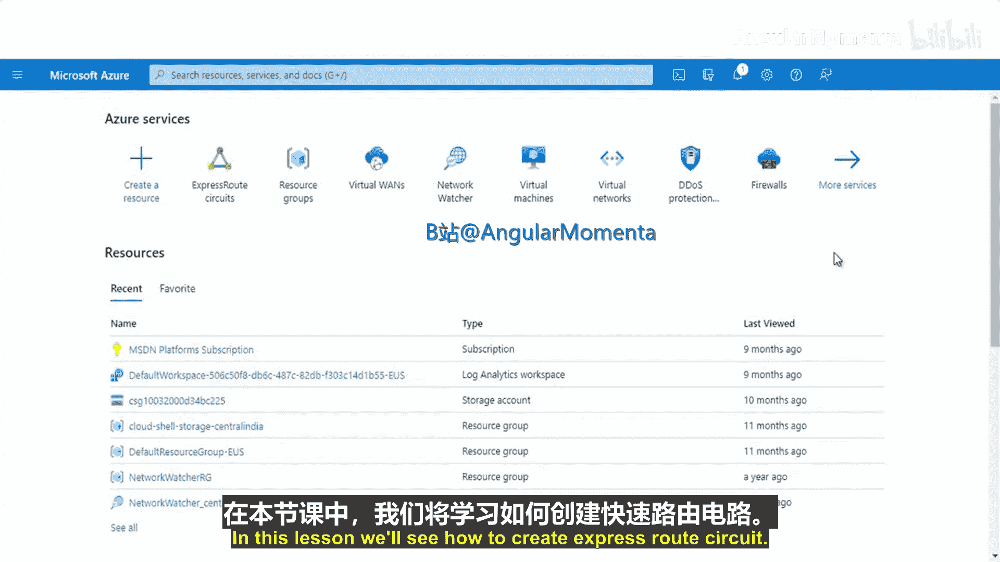

Directly， go to your portal and search for express route shortage。

Let's click on create Express route circuit。So here you need to select your subscription。

And to resource group。 So let's create a new resource group。And let's have the region。

 this region only。And， let's create。A name。 Give it a name。 Let's say test E R circuit。H。

Here go to configuration， So there are two types of port provider as well as direct。

 So I'll be using provider here。So if you check out its information。

 select provider if you are connecting to a service provider in order to access Microsoft's network and if you want to select direct if you have express route。

 direct resource。You can select based on that。 And here。

 if you want to create a new art import from the classics。

 you can create a new circuit or you can move an existing circuit from a classic deployment model that also you can do。

 So I'm creating new here。😊。

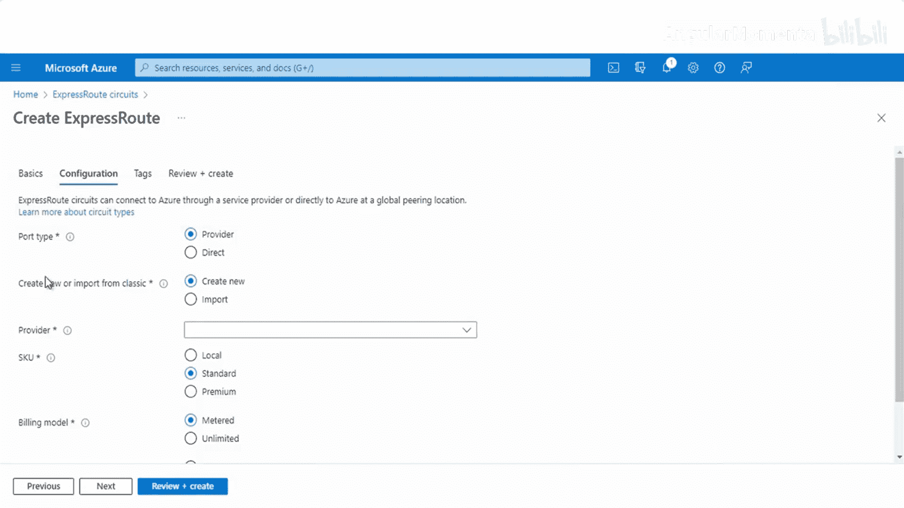

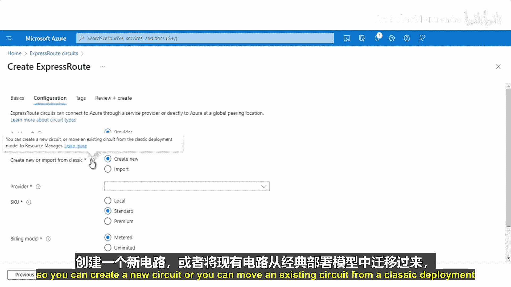

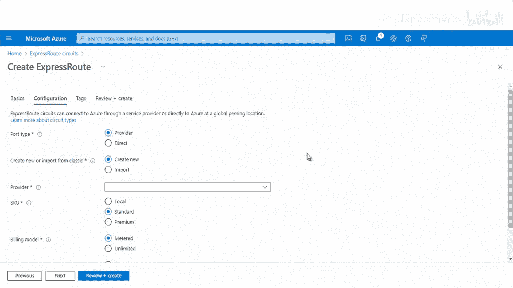

And from here， select the provider。There are so many providers available。So，80，80， Tokyo。

So you can select whatever you want。So I'm just selecting equiix。And from here。

 you need to select the location as well。So you can select because I've selected E to us from here。

 you can select whatever location you want。Seattle。From here you need to select the bandwidth。

 what bandwidth you want，50 MBP 100 MBP， so lets select 50 MBP only。

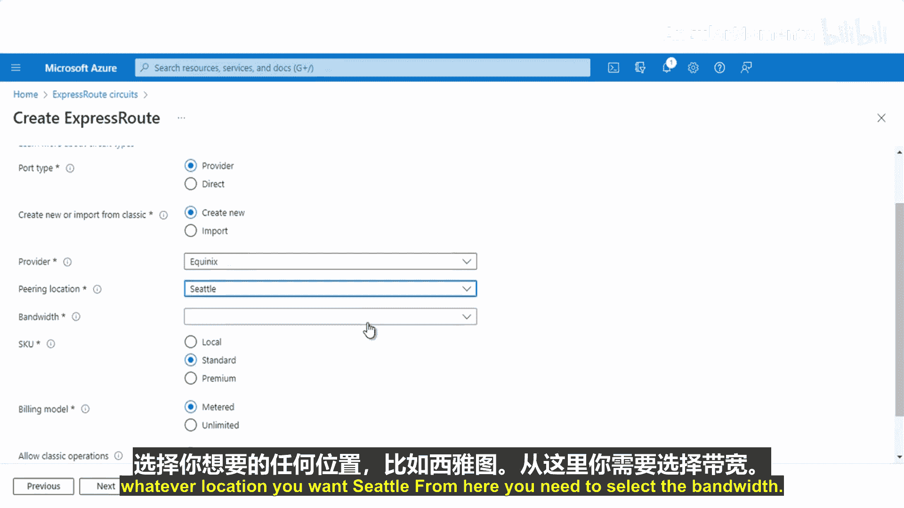

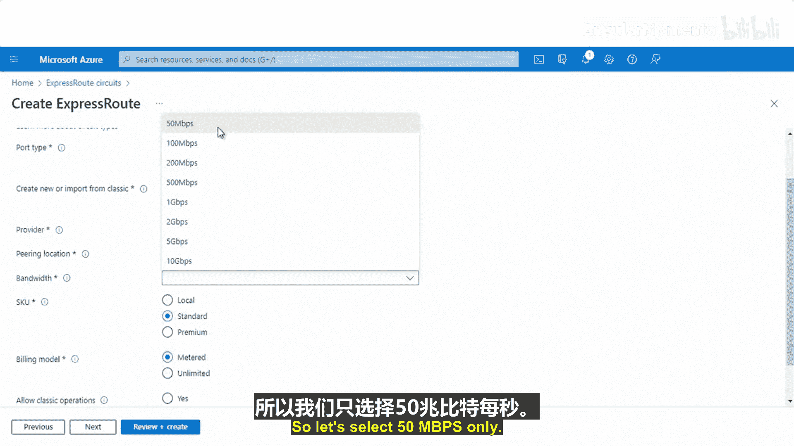

From here you select the SkuU。Standard or premium， whatever you want。 So let's select premium。

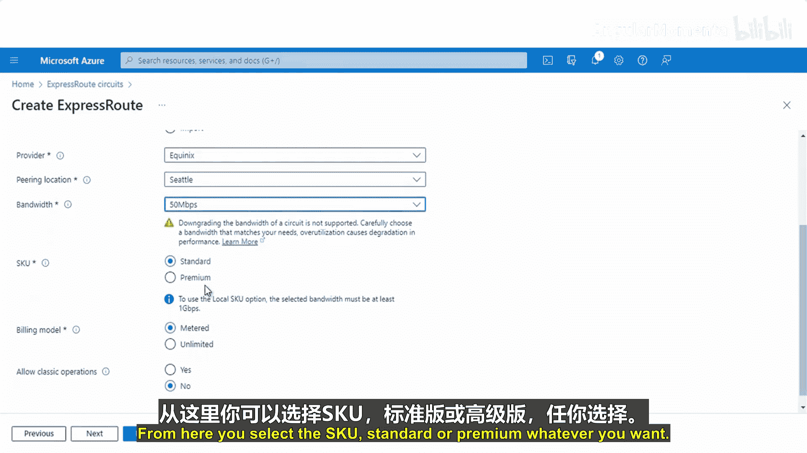

And from here， we have the billing models。 All inbound data transfer is free of charge。

 unlimitedlim provides outbound data transfer for a single fixed monthly piece。

 While meter provides outbound data transfer for appearing determine mines rate。

 Let's select unlimited here。And from here， allow classic operations。

 if you want to print that also you can use。

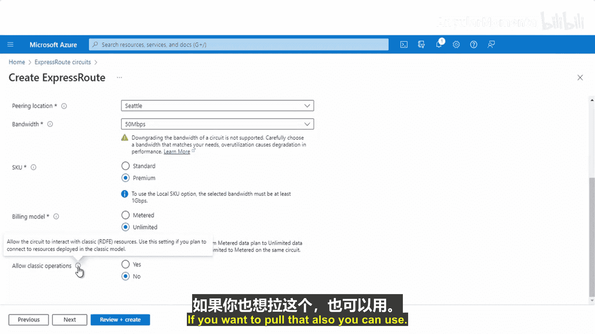

SoClick on next and let's click on review and create。 So first of all， as always。

 it will do the validation and then it will move to create option Now， simply create this。

 It will take a while to create this。 Let's meet in the next video。 Thank you very much。

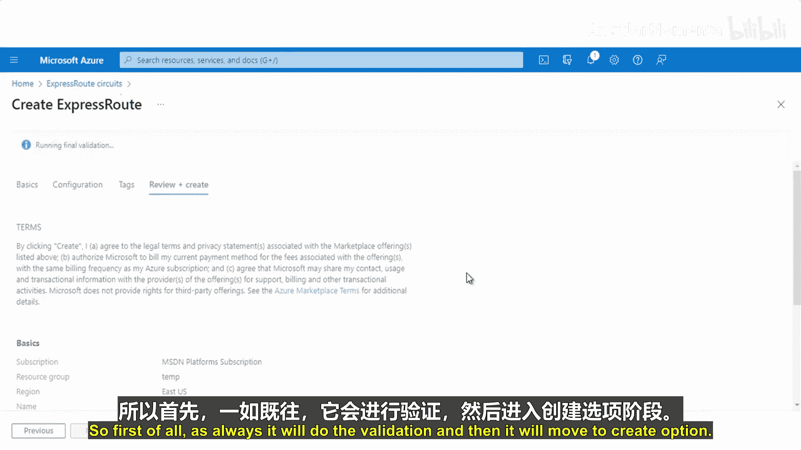

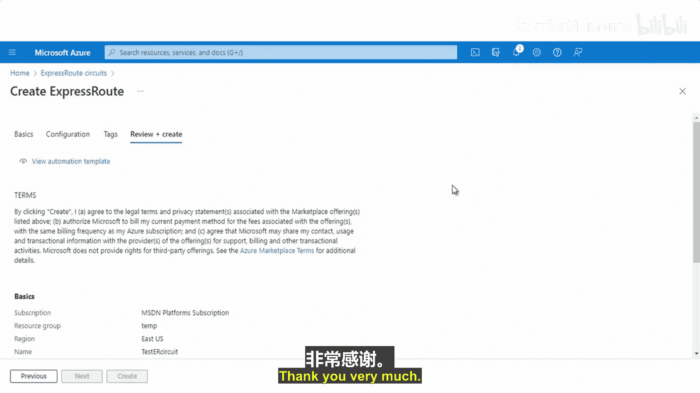

Hello， learners。Now， let's explore the next topic in our discussion。

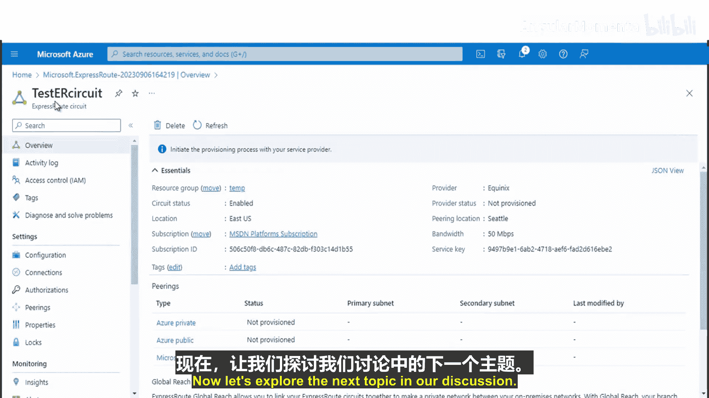

Now， as you can see， my testr circuit my express route circuit is ready。

 Now let's see some of the properties。 let's check it out。 So from here go to properties。

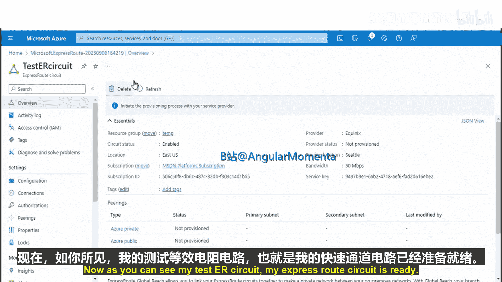

So from here as you can see， status is enabled and the location， the bandwidth you can see。

 this is your service key， you can check it out。😊。

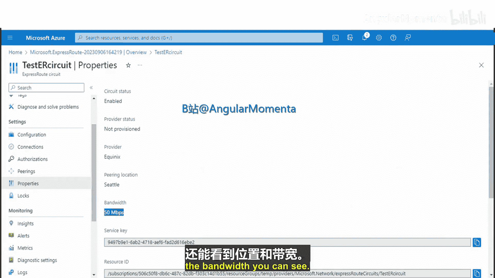

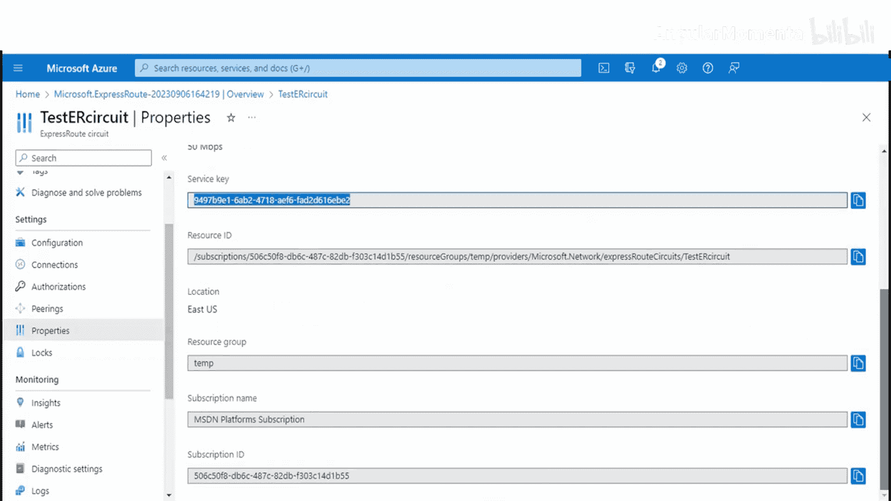

These are the different properties of your express route。 So from here。

 you can check the configurations as well。

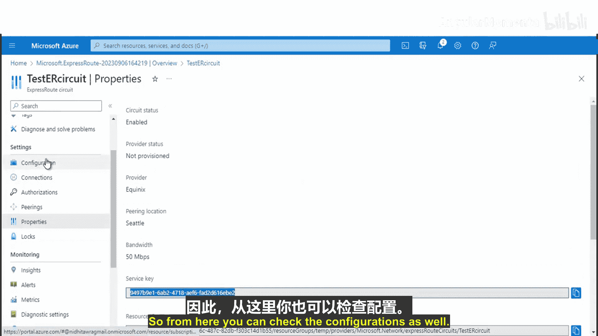

Whatever your configuration is。So if you want， you can change your SkuU as well later on as well。

 and you can see your connections。 right， all these things。 you can check it up。 Thank you very much。

😊。

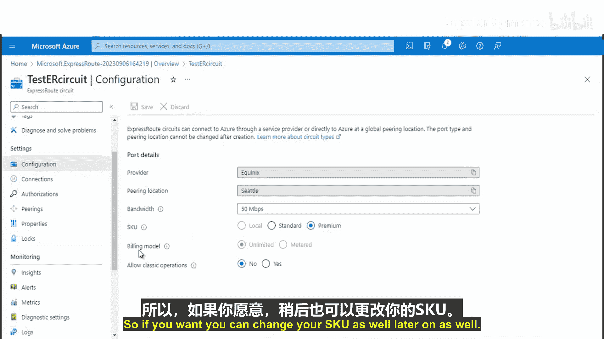

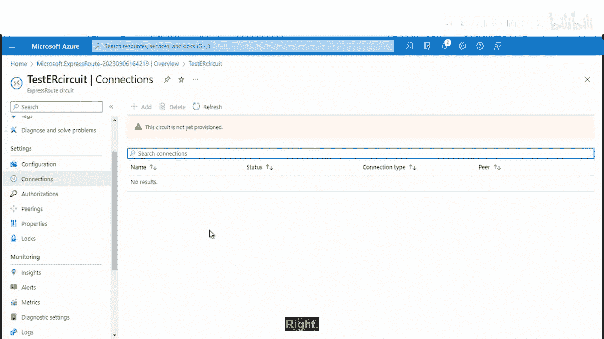