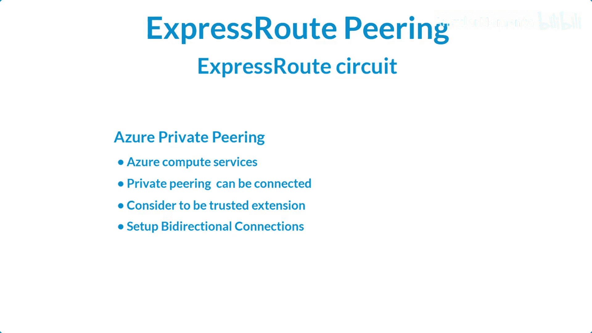
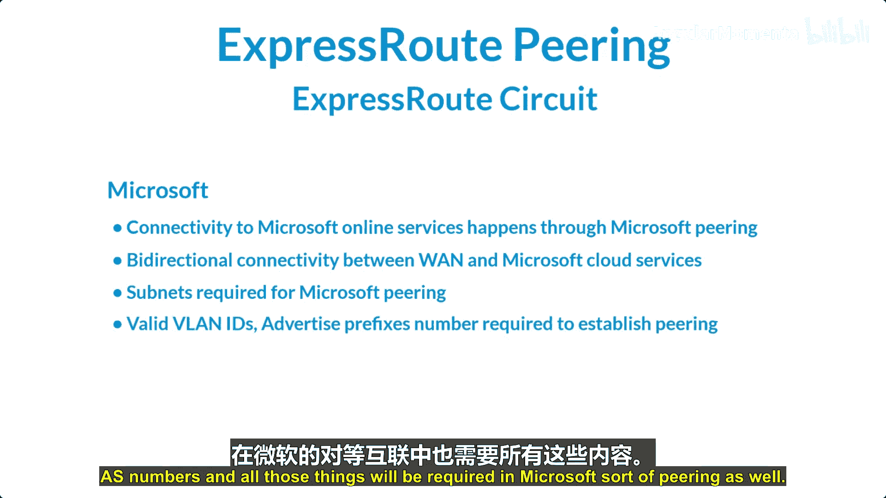
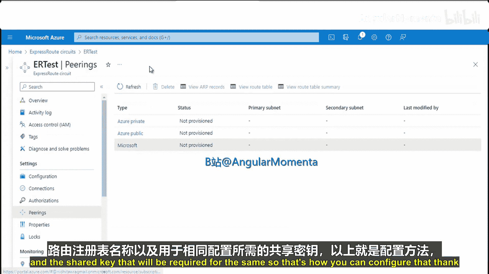

# 【EDUCBA】Azure网络服务 ｜ Azure Network Services p07 02_03_01_快速路由对等互联 第一部分 -BV1mwFSzNE2s_p7-

Hello， learners in this lesson， willll be discussing about express rope peering。

Express route circuit can have multiple peerings associated with it。

 There can be multiple peering connected to an express route circuit。

 Basically we have three types as your public as your private and Microsoft one So as your services are categorized as as your public and as your private to represent the IP addressing scheme and each of the pairing is configured identically on a pair of routers。

 basically one in active active or another one in load sharing configuration。

If I talk aboutzure private peering， generally we have azure compute services， for example。

 your virtual machines， your cloud services， maybe your platform as a service。

 aircraftO services that are deployed within the virtual network。

And the private pairing can be connected to this particular type of as your private sort of circuit。

😊，So private peering domain is considered to be the trusted extension of your core network into the Microsoft Azure。

 and you can also set up bidirectional connectivity between your core network and your Aure virtual networks。

And while you configure your aszure private， you need to check up few things as well。

Will continue remaining part of the topic in the next video。

Hello learners， welcome back like I was discussing with you while you create as your private out of peering at the time。

We may require a pair of subnets that are not part of any address space reserve for virtual network。

1 submit will be used for the primary link， while other will be used for the second re link。

 Each of these submit you will assign the first usable I address to your router as Microsoft uses the second usable I for its router。

 Other things you may require。Valid Vlan Id。And to establish peering， also。

 you may require a number for peering。 you must advertise the routes for your。

From your own premises edge router to Azure via PGP。Also， you have third title is Microsoft network。

So third one is Microsoft sort of pairing。 So generally Microsoft 365 was created to be access securely and reliably via the Internet because of this。

 the express route for specific scenarios is acquired is recommended， you can say。

So connectivity to Microsoft online services， maybe your Microsoft 365 as your past services and Microsoft PSTN services。

 this happens through Microsoft peering in that as well we have bidirectional connectivity between your van and the Microsoft Cloud services through Microsoft peering routing domain。

And few things also required when you go for this particular type of pairing。

 you may require a pair of submit which is on by you and that should be registered in RIR or IWA that should be registered one then one submit will be used as the primary link while other will be used as a secondary re link。

Also here also you may require a valid VN ID， advertise prefixes， yes numbers。

 and all those things will be required in Microsoft sort of earing as well。😊。

Thank you very much。Yeah。

Hello， learners。In this lesson well see how to do peering steps What are the peering steps in your aszure express route so first thing you need to do you need to create as your express route circuit so I have done that already although I have told you how to create that but let me show you the steps again so from here you need to select your resource group like for example temp I have selected and from here you need to give it a name like for example any name you can give。

And from here， you can select these options， the port type is provider or direct you want if you want to create new or not。

So from here you can select whatever the provider so I have selected equiix。

 so that's what I'm showing you equiix I have done and then you can select the location I have selected Seattle here。

 you can select any location for example， Seattle Benward you can select I have selected 50 MBps and from here I have selected the premium SkuU plan and you can select the v model I have selected unlimited here。

And then I click on next， and I have simply created it。So this is my express out， as you can see。

 So if you want to enable your。We are in first thing you should take here。

 The cicus status should be enabled and provided status should be provision right now， it's not。

 But in this video， I just want to show you the steps to do that。That should be there。

 The status should be provision as well。From here， you go to pairings。Basically， like I told you。

 we have three types of ears as you are private， as your are public and Microsoft one。

 So let me show you as you are private。 So once your machine will be your。This now will be in up。

Provision state， because as it is showing， it's not provision yet。There you will find your peer ASN。

 you can select the sublet， whether it is ITV4 or IPV6 like I was telling you from here you need to enter your primary sub as well as secondary sub for two links like in theory I was discussing the view。

Also， you need to add a wheel and ID and the share key and then you need to save it。

 That's how you can provision your。Private bearinging。 Similarlyly， we have the options。

For public and。Microsoft1 as well， for example， this is the public one。 So from a A N number， P S N。

 it will automatically take up when it will be one that will be provision。

 and primary secondary V and I D and sure key， similar things here as well will be there。

 Similarlyly for Microsoft A S N primary and secondary submitnet and public prefixes will be there。

A public prefixes is list of all prefixed advertised over the BGP session。

 only public IPV for address prefixes are accepted and the prefixes must be registered and that authority R I R and IR R maximum number of prefixes。

200 and I D S volume required custom A number routing registry name and the shared key。

That will be required for the same。 So that's how you can configure that。 Thank you very much。😊。

