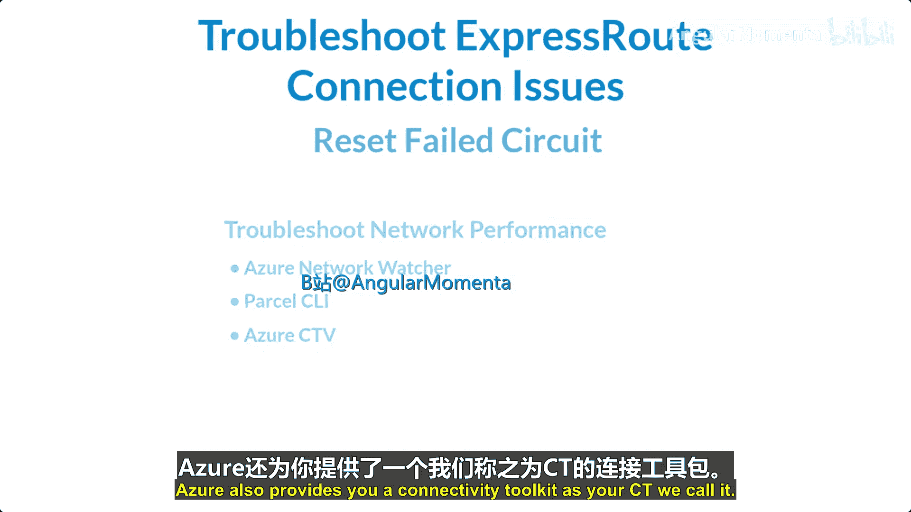
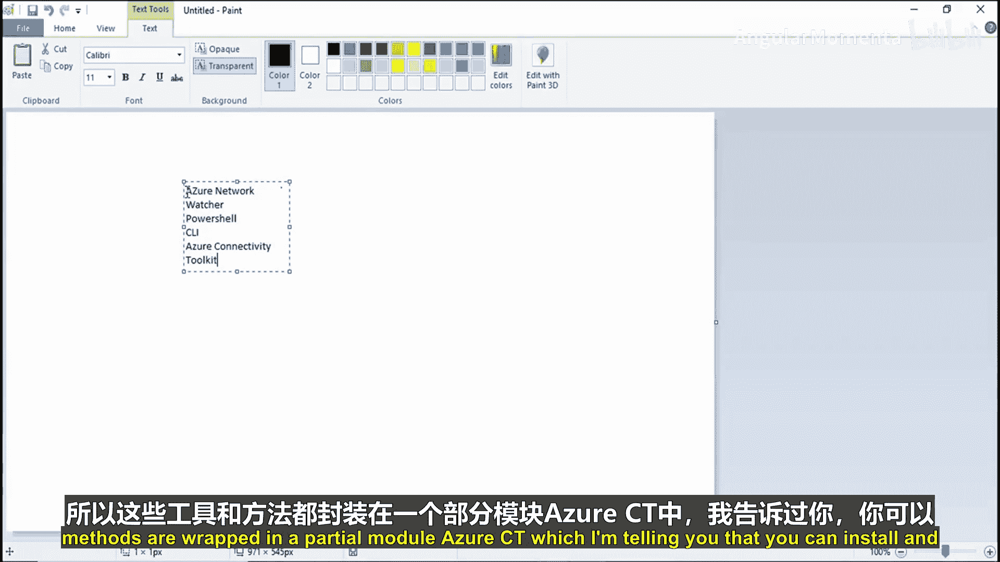
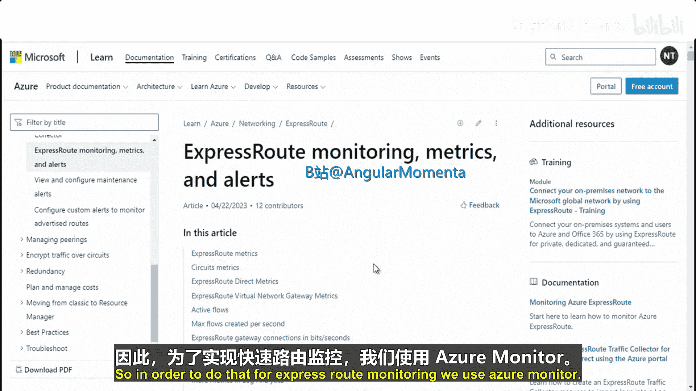
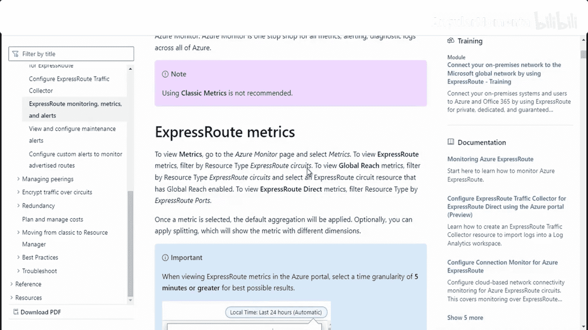
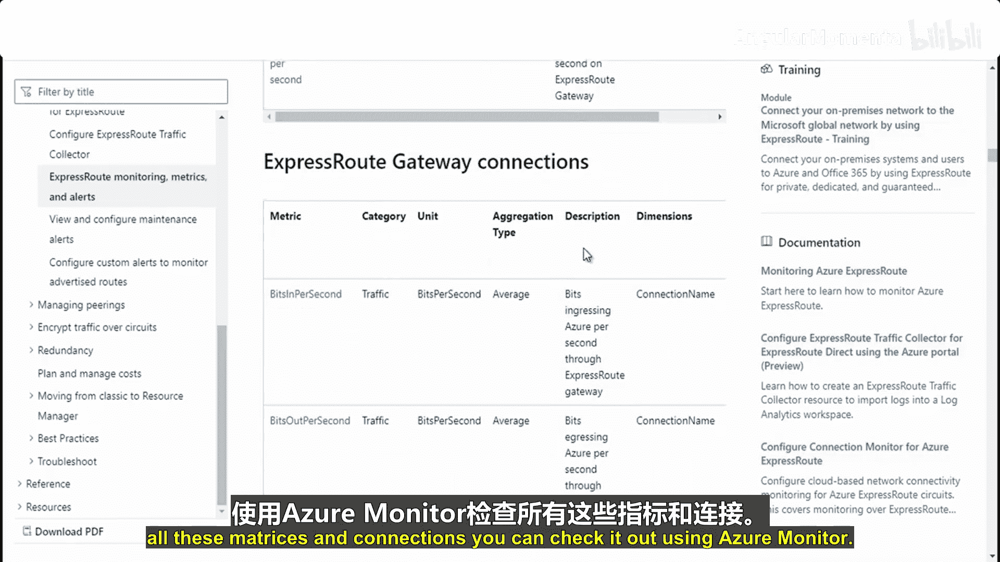

# 【EDUCBA】Azure网络服务 ｜ Azure Network Services p08 02_04_01_排查 ExpressRoute 连接问题 -BV1mwFSzNE2s_p8-

Hello， learners in this lesson， we'll be discussing about how we can troubleshoot express tro collection issues。

How can we troubleshoot connection issues， First of all。

 we need to verify the circuit provisioning state。It should be in provision state first thing you need to check this you can go to your as you expressed out and check in the overview as well like we discussed in the previous example as well while I was showing you the demo of clearing at that time Also I was telling you that it state should be provision or another thing you can do you can go ahead to your partial and can run this command get easy the express out circuit minus resource group name whatever will be your resource group name minus name name of your circuit with that it will show you the state。

Either it will be provisionent or nonpro， so it should be in provision state。

Then if you want to reset a failed circuit， how you can do that。

These are the commands you can run for that。 First of all。

 if you are connecting as your to your own premises。 First of all， you need to。Connect to that。

 Connect A account。 Then you run this command。 get A subscription。 After that， you run this command。

 select A subscription， Whatever will be your subscription name that you need to write after that。

 what I'm doing here， I'm creating a variable here， which is C Kt。 So here you can write the command。

 get A express route circuit， whatever is the name of your express route resource group name as well。

 And finally， to reset this command you need to run set A express route circuit。

 minus express route circuit dollar C Kt， the variable where you get your express route so that you need to run。

 then you can reset your failed circuit。 After that， you need to validate your peering configuration。

 whatever the three types of peering。 you have discussed private。😊，Microsoft or public。

 that should be in configuration。 That should be in period state。 That also， you need to check Also。

 you need to verify the ARP。 ARP is nothing but the address resolution protocol that is a layer to protocol defined in RF 826。

 and it is basically used to map the ethernet address， your Mac address with an IP address。

 the title of the ARP table error message will be there。

 so you can have on premise Mac address it may show incomplete Microsoft entry in the ARP table or you can have your mapping of on premises router interface IP address to the Mac address mapping of express route router interface IP address to the Mac address age of the mapping ARP tables can help validate your layer to configuration and troubleshooting the basic layer to connect issues。

 All these things you can do via this ARP Also you can troubleshoot your network performance。

 So in order to。Tubleshoot your network performance， you can use as your network watcher tool。

 as your network watcher， you can use， or you can use partial and CI as well。

 So to help with troubleshooting as you are also provides your connectivity to as your C， we call it。

For network thing， you can either use。As your。你work。Watcher。Or you can use fashion。

Or you can use C I。 Or like I was telling you， you can use as your connectivity tool as your。😊。

Connectivity。Tools sketch， you can use， right。 So these tools and methods are wrapped in a partial module as your C。

 which I'm telling you that you can install and use。 Thank you very much。😊。

Hello， Las， here we are about to discuss express route monitoring。

 So how you can monitor express route。 So in order to do that for express route monitoring。

 use as your monitor。 Like this is the official page。 Let me show you few mattresses。

 whatever you can use。😊。

To view mattresses， you need to go to your as your monitor page and you need to select the mattresses。

 So if you want to specifically view your express route mattresses。

 you can filter by resource type and select your express route circuit after that。

If you want to check it out， it is better if you check if you put this time granularity of5 minutes or greater。

Then you will be able to see the older things as well。 So we have these options for express route。

 You can check ARP availability So the category， the percentage dig it will show you aggregation type。

And VGP availability widths in per second， withs out dropped out bit per second。

 fast out path routes counted。For gateways as well， you can check out what is the CPU utilization。

 which received per second package per second， All these mattresses and connections。

 you can check it out using Azure monitor。 Thank you very much。😊。

Hello everyone， let us conclude whatever we have discussed as of now in this module we discussed about as your express route。

 which lets you extend your on premises network into the Microsoft Cloud over a private connection with the help of our connectivity provider so with express route you can establish connection to various Microsoft Cloud services such as your Microsoft as your Microsoft 365 you can have connectivity from any to any network。

A 。2。 inther lit network or a virtual cross connection through a connectivity provider。

Maybe at a core location facility。Since express route connections do not go over the public internet。

 this approach allows express route connection to offer more reliability， faster speeds。

 consistent latencies and higher。Security。We also saw how to create an express route circuit。

 how to do peering in express route。How to troubleshoot and do the monitoring in the express route。

 That's all we have discussed。 Thank you very much。

