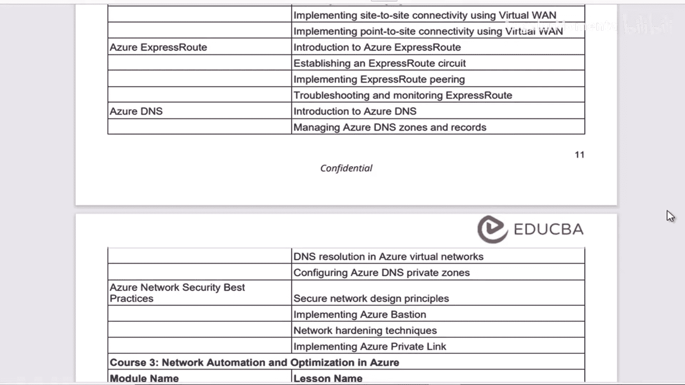
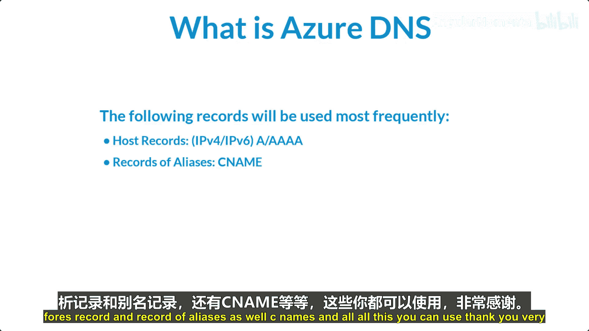

# 【EDUCBA】Azure网络服务 ｜ Azure Network Services p09 03_01_01_Azure DNS 简介 -BV1mwFSzNE2s_p9-

。

Hello， learners。In this module， we'll be discussing about us your DNS。Like we all are aware。

 the domain name system。DNS is responsible for translating a service name to an I address。

 your DNS is a posting service for domains and provides name resolution using the Microsoft as your infrastructure。

In this module， will be gaining knowledge of as your DNS。

Its purpose and how to efficiently manage DNS zones and records within Azure understand the integration of Azure DNS with virtual networks and also will learn how to configure Azure DNS private zones for enhanced security and control。

 As you can see these are the topics， which will be discussing introduction to Azure DNS managing Azure DNS zones and records DNS resolution in Azure virtual networks configuring DNS private zone。

Thank you very much。

Hello， learners in this lesson， we'll be discussing about AzR DNS。

Let's first understand what is azure DNS。Like normal DNS system does。

 it resolves IP addresses and as well as names， as your DNS as well is used to resolve name and IP addresses for resources and services that is accessible over the internet。

 maybe your web servers。And the name resolution is provided by AzR DNS using Microsoft AzR infrastructure in order to do that name resolution AzR uses Microsoft infrastructure。

😊，And in Azure DNS， you can create address records manually with relevant zones。😊。

And the records which are most frequently used， there will be host records， maybe IPV4， IPV 6。

 a4 a record and record of LSes as well sea names and all all this you can use。 Thank you very much。

😊。

