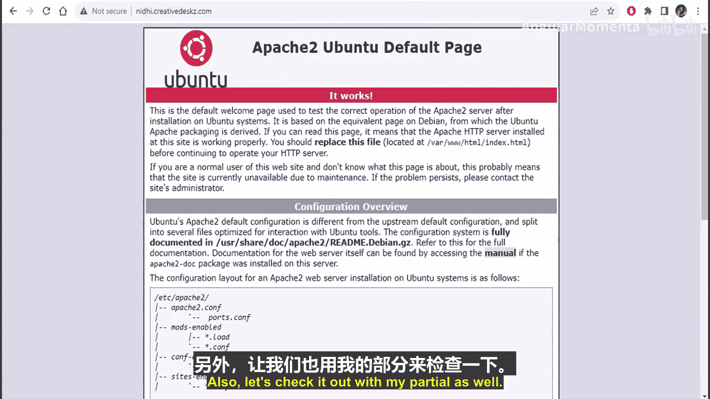
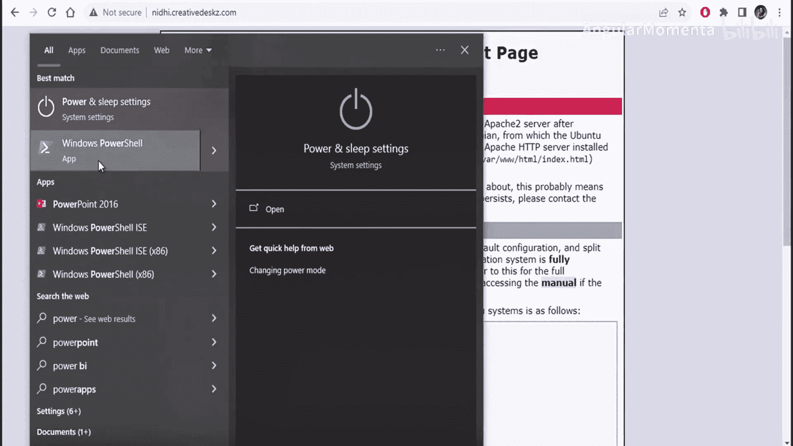
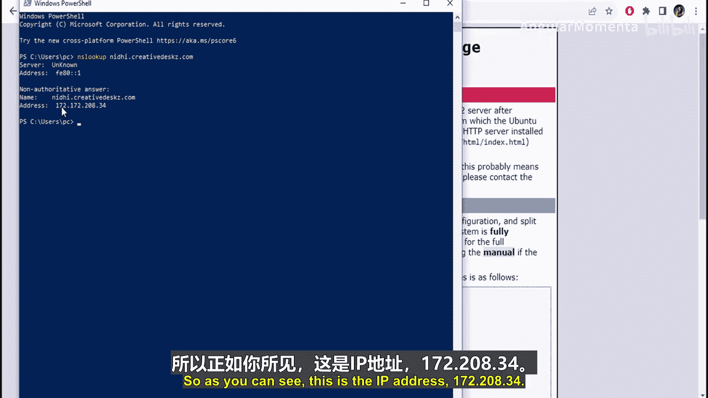
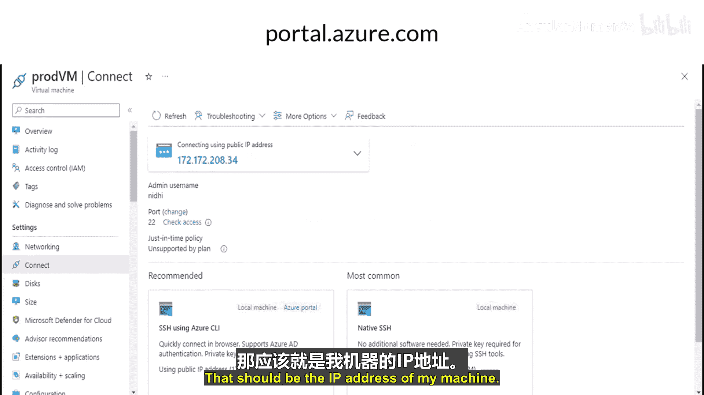
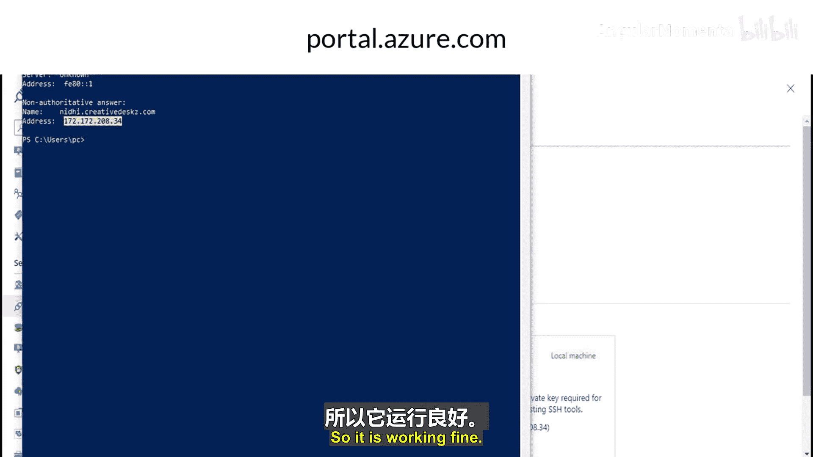
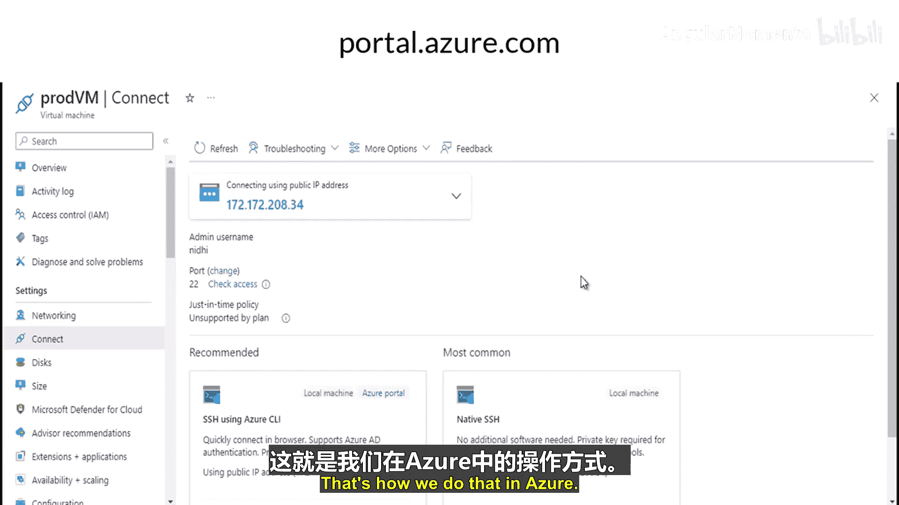

# 【EDUCBA】Azure网络服务 ｜ Azure Network Services p10 03_02_01_什么是DNS区域 -BV1mwFSzNE2s_p10-

Hello， Las in this lesson， we'll be discussing about DNS zone。

Lets first understand what is DNS Z DNS Z is used to force the DNS records for a domain。

In order to host DNS records， we use DNS zone。 First thing when you will be creating when you will be using DNS。

 you need to create a DNS zone。The same zone name can be re used in a different resource group or in a different subscription。

 It need not to be。 It should be unique within a resource group and within a subscription。

 but not necessarily in a different resource group in a different resource group or as your subscription。

 the same zone name can be used。Now the third point says whenever your route or parent domain is registered with the registrar and directed to the Azur name service。

 actually AzR is not a domain registrar so you can take domain either from Bo addy or whatever you want。

 you need to own that domain。And when you want as your to do the resolution and all。

 you need to update your pay registerstrar。 I'll show you the demo as well。 But yeah。

 that's what the requirement。To create a DNS zone in as your DNS using a domain name。

 you do not need to be the honor of that domain。 So if you are creating just a DNS zone。

 you do not need to be the owner of that domain。 However。

 you do need to on the domain to configure the domain。 If you want to configure the domain。

 then you need to have it。Thank you very much。Hello， Las， in this lesson。

 we'll be discussing about DNS delegation。What is DNS delegation DNS delegation means signing a domain to the name servers when you are delegating a domain to Azure DNS。

 you must use the all the four name servers provided by Azure DNS。😊。

AszR has four name servers you need to use all of the four asz DNS name servers also once your zone is created once your DNS zone is created you need to update the parent registrar one more thing I would like to add here like I told you before as well you can't use as your DNS to buy a domain name because Az doesn't have domain restrar So if you want to buy a domain name you can use app service domains or you can use thirdpart domain name registrar that's what you can do。

And those domains you can host in Azure DNS for record management。

 but as such as your do not provide you the domain。It's not a domain registrar。 Thank you very much。

Hello， learners in this lesson， willll be discussing about Guus records。 What is Guus records set。

 A record set is nothing but a collection of records in a zone that have same name at the same time。

 that is called this records。 And as you are suppose， all the types of。😊，In the court。

 including your A records4 A， C， A， A C name， M， X， N SP， T， R S， O， S， R E， T， H T。

 All these are supported by Azure。 These are the standard ones。 and asz you also supposed。

There cannot be two identical records in the same records set。 That is not possible。

 Record set cannot have。2 identical records， and any records set may have up to 20 additional records。

 not more than that maximum is20。 Thank you very much。Hello， learners， in this lesson。

 we'll see the demo of DNS， whatever we have discussed as of now。

 how to create a DNS zone and how to create a record on that and how the name resolution will happen。

 That's what I'm about to show you。 in order to do that。 First of all。

 I have created one virtual machines。 as you can see， this is my virtual machine。

 That's what I have already created。 If I hit that， I have installed Apache go to that。

 So you'll be able to see Apache to home page to that。 So I have done that。😊，Also。

 for a demo purpose， I have one domain， which I have taken from Godady。 Like I told you。

 Azure doesn't provide you the domains。 This is my domain creative De not co。

 That's what I have already。😊，This is my own。What I have done after that， first of all。

 what you need to do， you need to create a DNS zone。

 I'm showing you the stress because that's the part I have already done。

 So you need to click on create。 you need to enter the resource group。

 Also you need to enter the name of the DNS zone whatever you want to create。

 that's what you need to create because I already own a domain like I told you creative desks dot co。

 that's what I have taken the name and I have created one DNS zone。 This is my DNS zone。

 So if I open this like I told you asz gives you four name servers 1，2。

3 for these are the name servers。 So first thing what you need to do。

 you need to update your parent registrar。 in my case。

 my parent registrar is already there what I have done。

 So I went to DNS name servers and I click on change name servers and I have added the name server as your now。

😊，Now gooded is not managing it。 These are my as servers。 So what I need to do now。

 let's add a a record here。 the name resolution。 I need to enter a record set。What I need to do。

 let's call it niy dot creative desk dot com。 This is what I want to use。 And that is my a record。

 So you can have any other address record certificate Author name M X and all these are supported。

 But for now， I'm using a record。 you want to have it aas or not。

 So you see Eli Eli record sets are only supported record types As and C names。

 So I just don't want to use it。 I can use it if I want。 And there is time to live as well。

 This is why default1 if you want， you can change that second minutes or whatever you want。

 Now what I want to resolve it to Niy dot creative desk dot com should be resolved to I of this。😊。

Particular machine on which Apache is working。 Just want to show you this thing。 is this。

You can okay。Creating the reward set。Let's check it out， whether it's working or not。

 If I check it out。 Maybe he got creative。Yeah。Yes dot com。Sh it out。It is showing me that thing。

 Also， let's check it out with my partial as well。 Let's open partial。😊。

That's to N S look up as well。 That's what we should do。 That's how we check N S。Look up。

Ny got creative。This。😊，C， is。Is it at home。They chicken out。So as you can see。

 this is the IP address，1，72，208 dot34， that should be the IP address of my machine the same20。

8 dot34。😊。

So it is working fine。 That means Ram resolution is working fine。 That's how we do that in as well。

 Thank you very much。😊。

