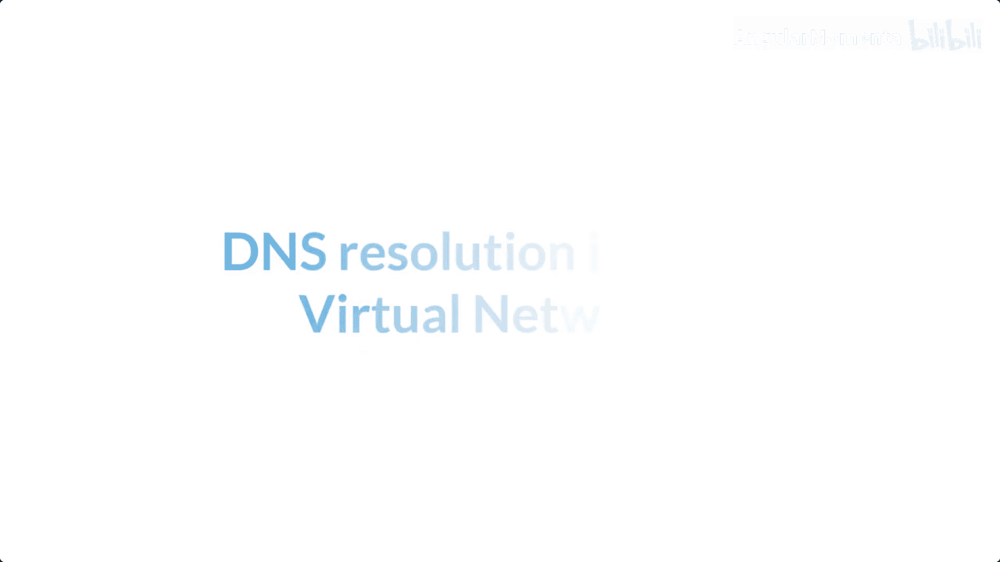
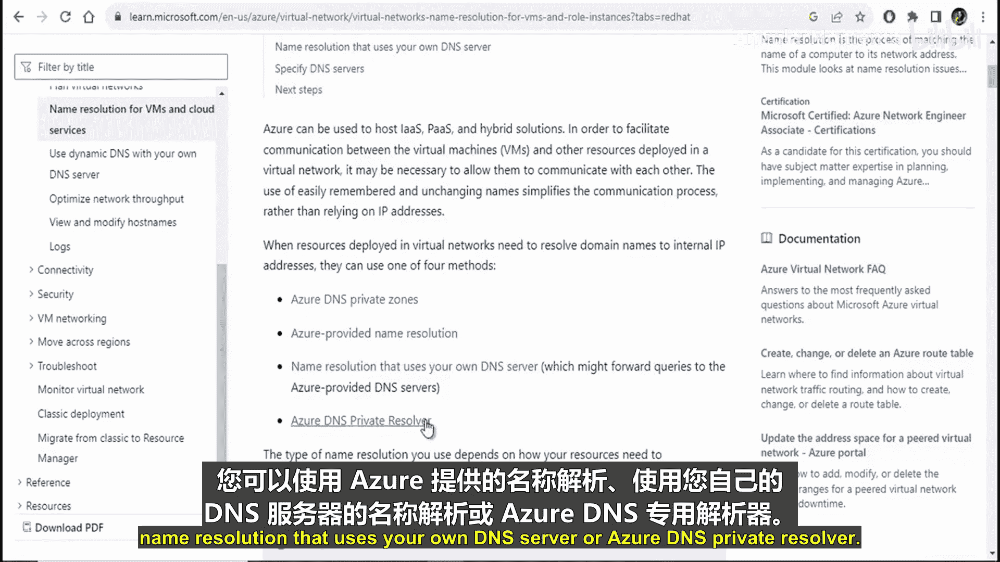
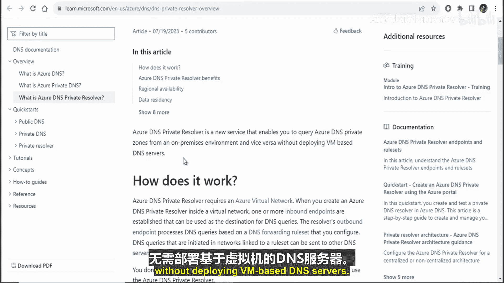
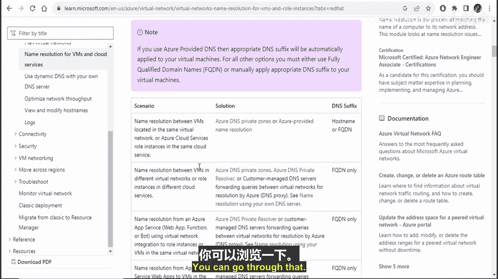

# 【EDUCBA】Azure网络服务 ｜ Azure Network Services p11 03_03_01_Azure 虚拟网络中的 DNS 解析 -BV1mwFSzNE2s_p11-

Hello， learns in this lesson， we'll see。 how do we do name resolution for our virtual。

 Basically within the virtual networks， if you want to do the name resolutions。

 if you want to resolve your domain names to your internal IP for that you do not need to do your DNS zones like what we for that。

 you can use any of those four methods as you can see word screen as your DNS private zones。

 that's what will be discuss it detail in upcoming video。

 Also you can have as your provided name resolution name resolution that uses your on DNS server or as your DNS private resolver。

 If I talk about this as your DNS private resolver， there is a new service。

 and it enables you to query as your DNS private zones from it on premises environment without deploying D based DNS server。

 Now let's see few more things according to the scenarios。 let's say if you want to do。😊。

Resolution between VNs located in the same virtual network or as your cloud services。

 role instances in the same cloud service， you can either use asz your DNS private zones or as you are provided name resolution。

 you want to do name resolution between DNs in different virtual network or role instances in different cloud services。

 then you can use Az your DNS private zones as your DNS private resolver or customer managed DNS server forward queries between virtual network for resolution by Azure。

Similarly， if you want to name the solution from Azure app service。

 have app function or what using a virtual network integration to roll instances or Vs in the same virtual network。

 so you can use aszure DNS private Re or customer managed DNS service robot inquiries。

For different different scenarios， we have different different options。

 So I'll share this link with you。 You can go through that。 Thank you very much。😊。

