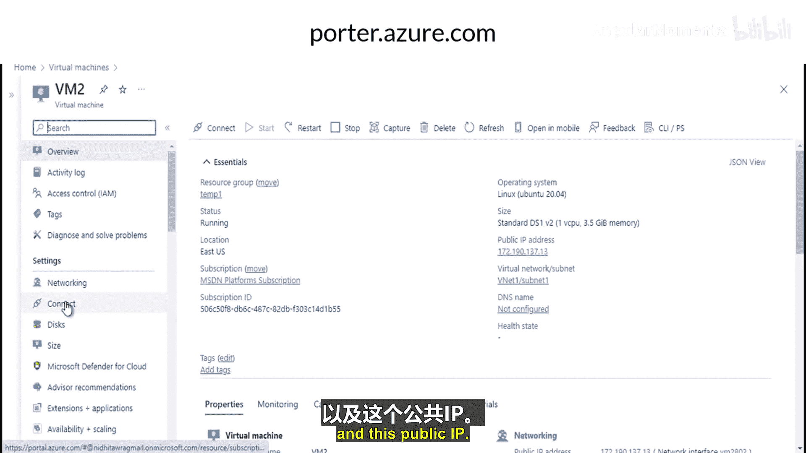
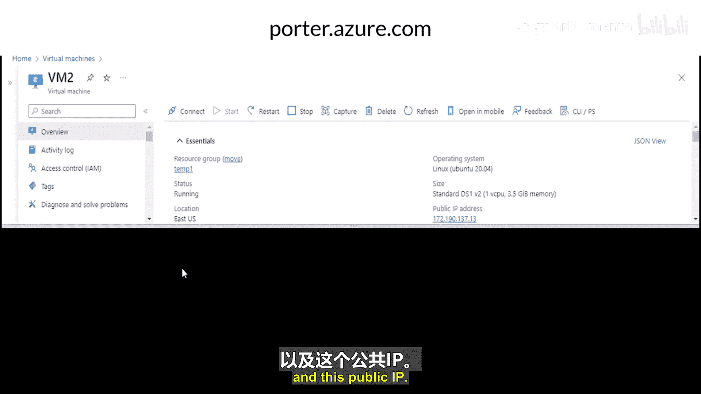
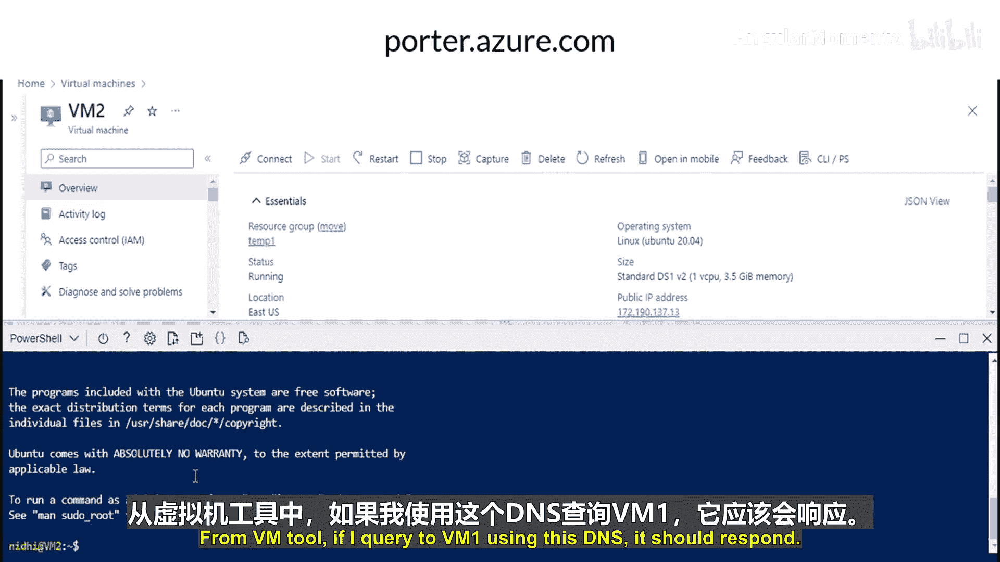
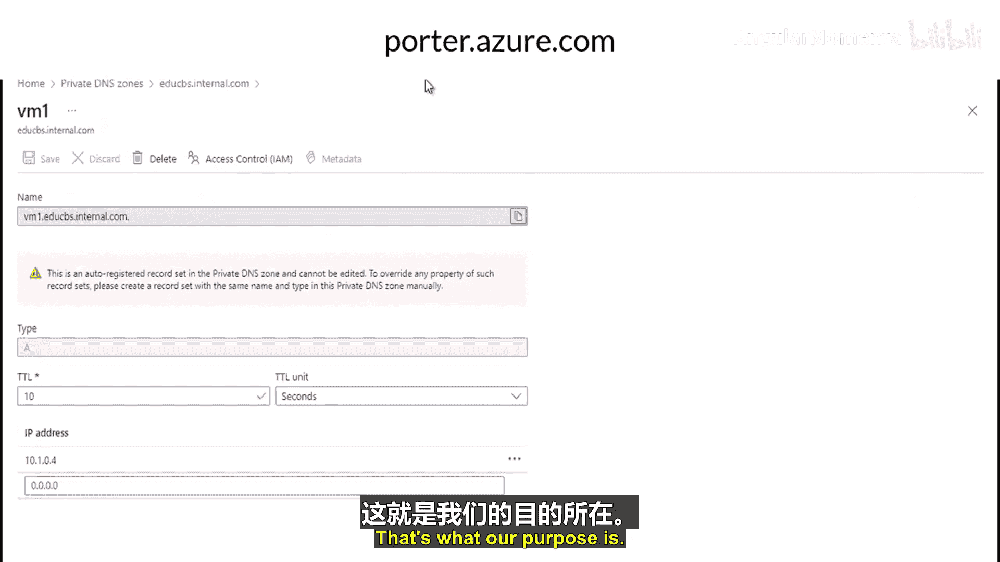
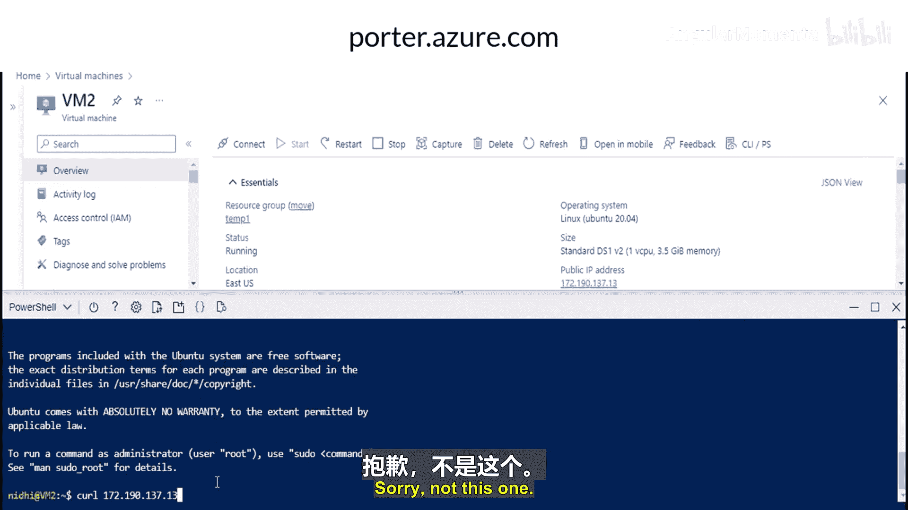
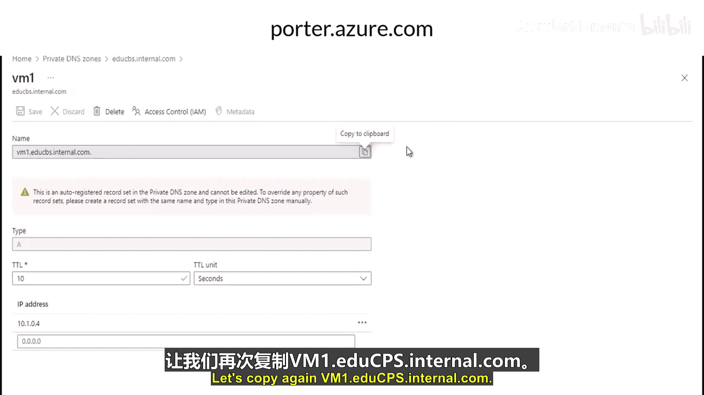
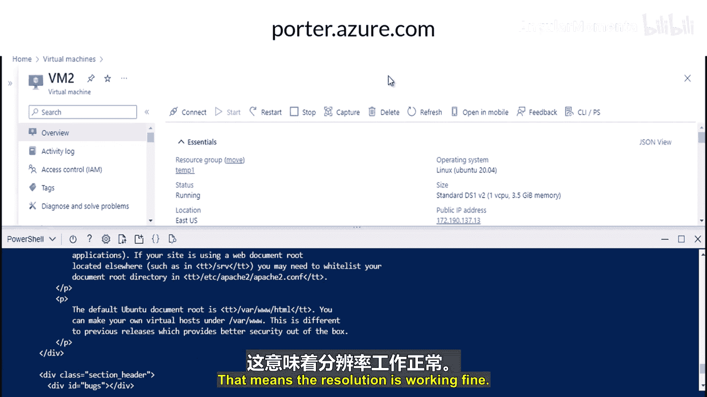
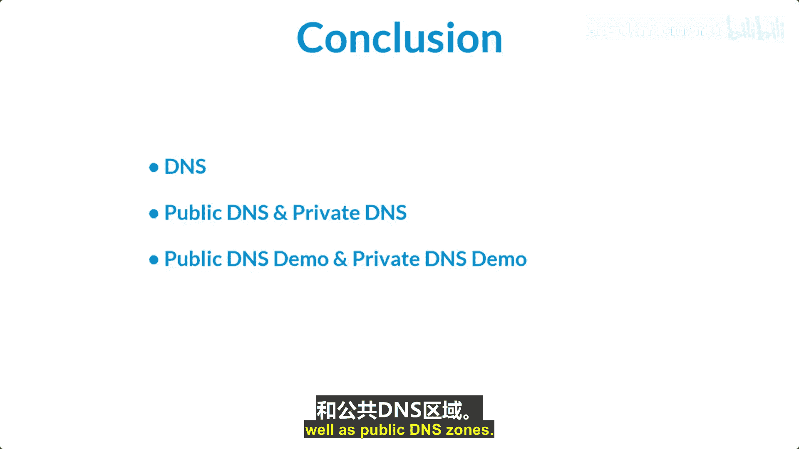

# 【EDUCBA】Azure网络服务 ｜ Azure Network Services p12 03_04_01_私有 DNS 区域 -BV1mwFSzNE2s_p12-

。Hello， learners in this lesson， we'll be discussing about private DNS zone。

 Let's see what is private DNS zone。As your private DNS zone is nothing but a service to manage and resolve your domain names within a virtual network without needing you to add a custom DNS solution。

 Like， for example， within a virtual network。 if there are two machines and they want to communicate with each other。

 They can do via private I within a virtual network。 you want to do DNS sort of things for that。

 you can use private DNS zones。By using private DNS zones。

 you can use your own custom domains rather than as you are provided names available only that's what you can do。

 Also， the records contained in private DNS zones aren't resolvable from the Internet。

DNS resolution against the private DNS zone works only from virtual networks that are linked to it。

You can also link a private DNS zone to one or more virtual networks by creating a virtual network links as well。

 You can also enable auto registration teacher to automatically manage the lifecycl of the DNS records for the virtual machines that get deployed in the virtual network。

 And you can use all common DNS record types。 Let me give you one example， as well。😊。

Let's say this is your water level。 Let's say this is your vegan。This is my。Me。And inside Vette。

 let's say I have two machines。Let's say this one and this one。 Let's say its I P is。1，9，2 dot1。

68 dot0 dot4， for example， and this one is， for example，1，9，2 dot1，6，8 dot0 dot5 for example。

Let's say if this machine wants to communicate with this machine and the machines wants to communicate with each other basically they can do using this private IP。

 let's say if you want that DNS sort of things here as well what you will do you will create a DNS zone。

 DN is private zone rather I should say let's create。😊，Are there。Eianus， ra。这种。And let's say。

 you have。Created error cards。A record here for this machine， as well as this machine。

 Let's give them a name as well。 Let's call it PM1。Let's call it B2。And let's say it's。

 it's where he is。Let's give it a name Let's say you have entered it like。C M1。Dot。ABC dot com。

 let's say this is for this one and for VM2， this is VM2 dot ABC。Da咁。If this machine， if V M2。

 is squaring with VM1， So it can do why this VM1 dot ABC dot com。

 then the resolution will happen with the help of this private zone。 Similarlyly。

 if VM2 wants to communicate with each other will do like VM2 dot ABC dot com and resolution will be handled by A your DN S。

 private source。 That's what you can do。 Thank you very much。😊。

Hello， learners。

In this lesson， we'll see demo of private virtual network。

 What I'm about to do here and some things I've already done。What I'll be doing。

 I have already created one virtual Le。 Let's call it。Pennet1。 and inside that V neck。

 I have two virtual machines， PM1 and PM2 call it。In one and。That's what I have already done。

 And on VM1， I have already installed Apache2 on BM2， I haven't installed everything。And also。

 what we are about to do， I'll be creating one A your DNS private social post。

 That's what I'm about to。😊，So if I show you here， like I told you， I have created。

2 virtual machines， BM1 and BM rules。 I show you on B M1。I hit I。If the showing I把 do。Now。

 I need to create private clean zones。 Let's do that private。In is soon。To is a new one。

And let's select the resource group， Select this step1。And give it a name。 General。

 private unitss only we create for our internal networks。Qu an internal network we that。

Cate this one， let's say a C。He got in the dot。And simply tags。 And let's just create this。

well adding， let's create this。I take a why to do that。But climate is in progress。Letigage comfy。

I take a while to do that。complete。have。Now， what I need to do。

 I need to create virtual network length here。Yeah。add a link yours。Give it a name。

 let's say if you CBA and journal， you can write any name， whatever you like。Select watch network。

If you enable this auto registration， what happens it will automatically create a records for all the virtual machines within this network that's what the benefit of auto registration。

 otherwise what you will have to do you will have to manually create the a records like we were doing in the DNAN。

😊，So as you can see here， this setting enables automatic creation of DNS records in this private TNS zones called the virtual machine connected to the virtual network。

 Let's click on。😊，And it will create the virtual link。 Since when it is creating。

 let's get up in the next video。 Thank you very much。😊，Hello， learners。Like in the previous video。

 we have created this internal。Do with D Z。 if you see the watch network link， now it's ready。

 as you can see here， And if I go to overview， you can see the error course。

 which is automatically created because I have enabled auto registration。 So Vm1 and PMm2 on Bm1。

 I have Apache to installed。 So if I check it。😊，Name， this is this one。 Let's copy this。

And let's connect to my virtual machine。Yes。Let's connect to my second virtual machine。And。

That's what they be。

Let's connect with that。So let's move S directly at。 That is the user name。

 And let's placee that public IP。Yeah。Deelequid password。嗯。I'm inside this VM from BM。

 If I query to VM 1 using this DN S， it should respond。 That' quite hard purpose。

 That means resolution is happening fine。 So let's do that girl。

And let's use this one。Sorry， not this one。

Let's copy it again。

VM1 dot H UC P dot internal dot com。 That's through the call government。As you can see here。

 this is a pa to save A to wish。 And we are to see that。That means the resolution is working fine。

 Thank you very much。

Hello， learners， let us conclude whatever we have discussed as of now。This module we saw about DNS。

 depending upon how you use Azure to host your infrastructure as a service。

 platform as a service and hybrid solutions， you might need to allow the virtual machines and other resources deployed in a virtual network to communicate with each other。

Although you can enable communication by using IP addresses。

 but it is much simpler with using the names which only DNS can provide you。😊。

We discussed about the public DN S as well as private DNS。 So we saw， we saw demo as well。

 how we can use public DNS。 We saw private DNS as well。

 We saw how we can do the settings inside the virtual network to make use of private DNS zones。

 as well as public DN S rooms。 So that's what we have discussed。 Thank you very much。😊。

