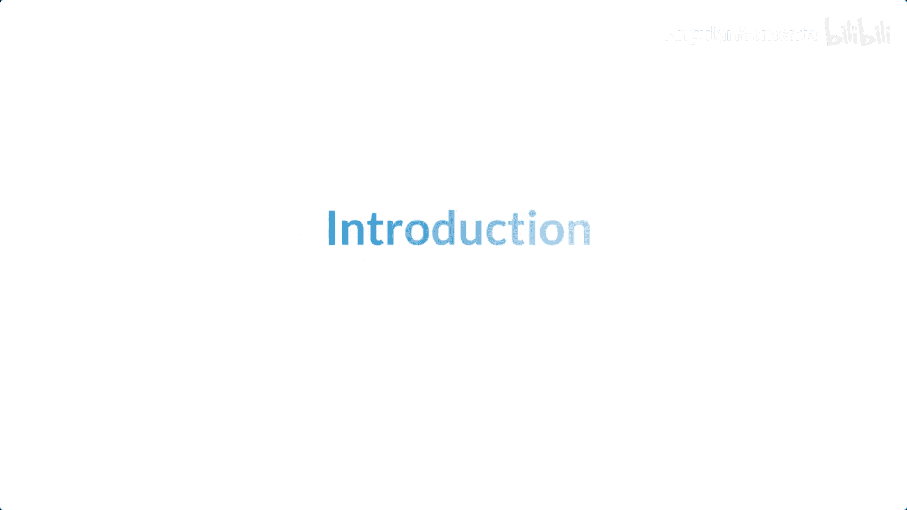
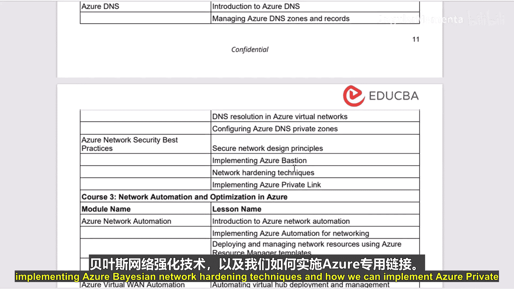
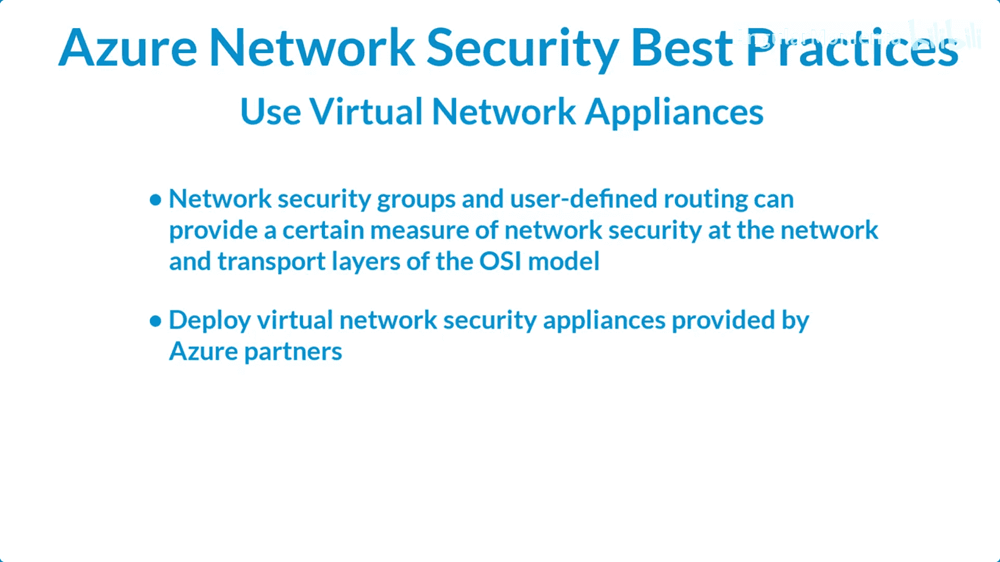
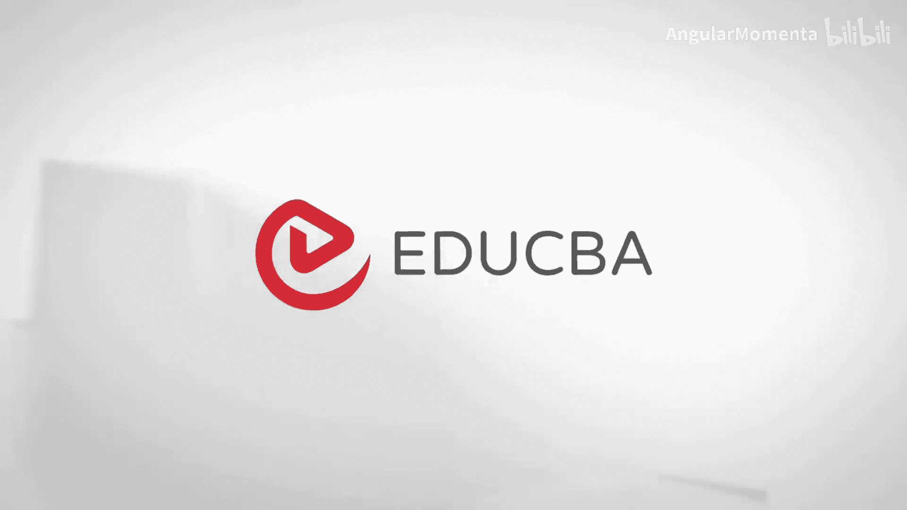
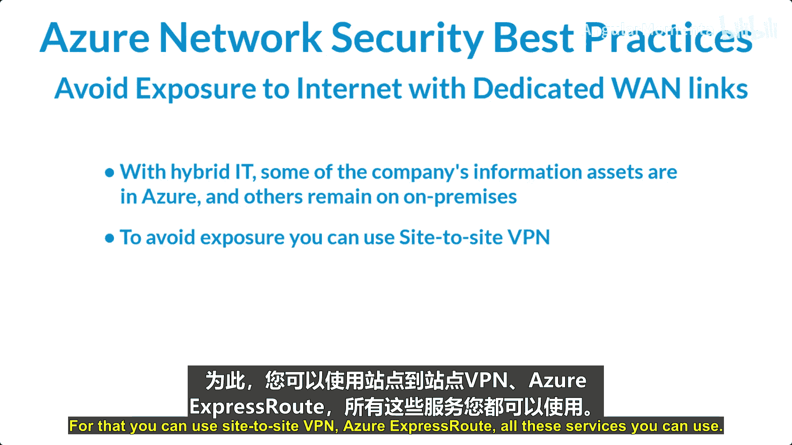
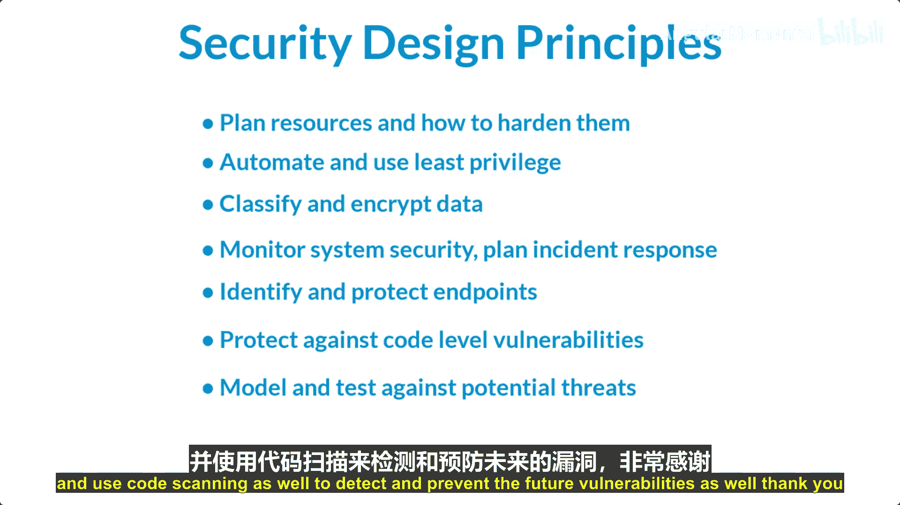

# 【EDUCBA】Azure网络服务 ｜ Azure Network Services p13 04_01_01_Azure 网络安全最佳实践导论 -BV1mwFSzNE2s_p13-

Hello， learners。In this module you we will be discussing about us your network security best practices。

😊，It'sVery necessary to protect our assets by placing controls on the network traffic。

 originating in Azure between on premises and Azure hosted resources。

 whether the traffic is coming to and coming from the Azure。If security measures are not in place。

 attackers can gain excess for instance by scanning across public I P ranges。

 That's why proper network security controls can provide defense and depth elements that help detect contain and stop attackers who gain entry into your cloud deployment。

 This particular module will be discussing about secure network design principles implementing azuration network hardening techniques and how we can implement azure private link。

 Thank you very much。😊。

Hello learners in this lesson we'll be discussing about network security best practices。

These are some of the best practices that we should follow。 So let's understand them one by one。

 First of all， we should use strong network。You can connect your your virtual machines and appliances to other network devices by placing them on a virtual network。

 connect your virtual network interface cards to your virtual network so that you can allow TCP IP based communications between network enabled devices only。

And your virtual machines can be connected to virtual network。

 can connect to the devices on the same virtual network， maybe to the different virtual network。

 the internet and maybe to your on premises network。

The recommendation is you should do the management of core network functions like for example。

 Express route we discuss virtual network subject provisioning and IP addressing。

 that's what you should do and also you should do the governance of network security elements such as for example。

 your virtual appliance functions for example， express route virtual network and sublet provisioning。

Second point is you should logically segment your subnets as your virtual networks are similar to your lands on your own premises network。

 the idea behind and as your network is that you create a network based on single private IP address space so that you can place all of your as your virtual machines together private IB addresses are available so as we are aware the class a8。

0。0。0/8 and 17216 point as the classes there 192。168。0。0 that range is there you can use any of this。

So it's better if I talk about the subnet specifically， the best practices do not assign。

 allow rules with broad ranges。 For example， all zeros or all 255 that you should not do。

 You should segment the larger address space into the subnet。

Create a network access control between the sub network and the routing between the sub networks happens automatically。

You should also adopt a zero trust approach， the third point。

 so basically the parameter based network operate on the assumption that all the systems within a network can be trusted。

 but today's employees exist their organization resources from anywhere maybe from any devices from work from home sort of things。

which makes the parameter security controls irrelevant。

 so its better you access control policies that focus only on who can access a resource are not enough so to master the balance between security and productivity。

 security advances also need to see the factor like how are resource is being accessed。

That's why we have a zero trust sort of things。 Do not trust anyone。 Allow only whatever is required。

Now the fourth point is we should control a routing behavior that is also important。

 So when you put a virtual machine on and as your virtual network。

 the VM can connect to any other VM on the same network。

 even if the other Vms are on different subnet。This is possible because a collection of system routes enabled by default allows this type of communication。

 so these are the default routes， so you can also control your routing behavior。

Wherever the routing is necessary， do only that part That is also important。

 Next point is use virtual network appliances。So network security groups like we discussed and user defined routing can provide a certain measure for network security at network and transport layer software O。

 but in some situation you want or need to enable security at high levels。 So for that。

 you can use virtual network appliances that will be better and these appliances are provided by as your partners as well。

😊。

Remoing points we'll see in next video。 Thank you very much。😊。

Hello， learners。Now let's explore the next topic in our discussion。

We should deploy perimeter network course security zones as well。

 so a perimeter network we also call it as DMC is a physical or logical network segment that provides an extra layer of security between your assets and the internet。

So perimeter networks are useful because you can focus your network access control management。

 monitoring， logging and reporting on the devices at the edge of your virtual network。

So it's better you deploy your perimeter network for security zones。

Next point is you should avoid exposure to the Internet with dedicated van links。

 So many organization have chosen hybrid I route。 So with hybrid I。

 some of the company's information assets are in Azure and others remain on on premises。

 So some component of the services are running in Azure， while other in on the on premises。

Especially for hybrid scenarios， there's usually some type of cross premises connectivity。

So cross premises connectivity allows the company to connect its on premises networks to Azure virtual network better you should avoid exposure to the internet for that you can use site to side VTN aszure express route all these services you can use。

Next point is you should optimize up time and performance if a services down information can't be accessed performance is so poor that the data is unusable you can consider the data to be inaccessible so from a security perspective you need to do whatever you can to make sure that your services have optimal up time and performance。

😊，In order to do that， you can use for improving your performance and optimize that。

 And you can use load balancing。 So we saw different load balancing methods in Azure as well。

 That's what you can do。 Also， you can disable RDP and SS access to your virtual machines。

So its possible to reach as your virtual machine by using RDP and SSH。😊。

So these protocols enable the management of Vs from remote location and are in standard data center computing。

So it's better you can disable direct RDP and necessary access to your virtual machines from the internet instead you can use a point to site VN or or a site to site VPN。

 all these things you can use。😊，And also， you should secure your critical as your services。

Resources only to your virtual network。 It's better。 You keep it within the virtual network。

 So for that， you can use your private link to access your。As your story。

 SQ data center SQ databases over a private endpoint within a virtual network。 Thank you very much。😊。

Hello， learners in this lesson， well see about some of the design principles for the security。

So let's see them。 So these are the security design principles。 So first of all。

 it says plan resources and how to harden them。 So you can consider security while planning the workload resources。

 You should understand how individual crowd services are。

Use a service enablement a framework to evaluate， also automate and use least privilege。

 implement least privilege throughout the application and control plane to protect against data exfiltration and malicious actor scenarios。

Also， you， you should do drive your automation through deficit cops to minimize the need for human interaction least privilege means。

Only give that much access， which is required。Also， we should classify and encrypt the data。

So classify according to the risk， apply industry standard encryption at risk and in transit which ensures that keys and certificates are stored securely and managed properly also you should monitor system security and plan incident response as well so correlate your security and audit events to the model application health correlate security and audit events to identify active threats as well also establish automated and manual procedures to respond to the incidents all those things you should do。

Security information and event management。Tool， whatever it comes that you should use。Also。

 you should identify and protect the endpoints。 Basically。

 you should monitor and protect the network integrity of internal and external endpoints。

We have S services， for example， firewalls， web application， firewalls。

And use standard approaches for your distributed denial of service attacks。

Or maybe your slow law is sort of attacks。 So different。

 different sort of attacks you should prevent。Also you need to protect against your code level vulnerabilities。

 identify and mitigate your code level vulnerabilities， for example， crite scripting， SQL injection。

 all these things you should protect and model and test against the potential threats as well establish procedures to identify and mitigate whatever the known threats are。

 also use penetration testing to verify threats mitigation static code analysis should be the。

And use code scanning as well to detect and prevent the future vulnerabilities as well。

 Thank you very much。😊。

