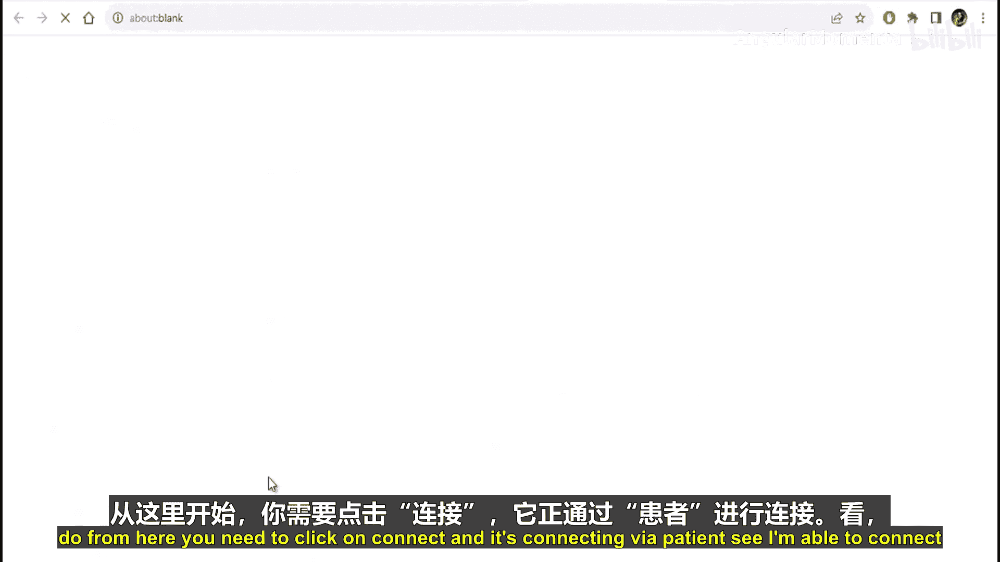
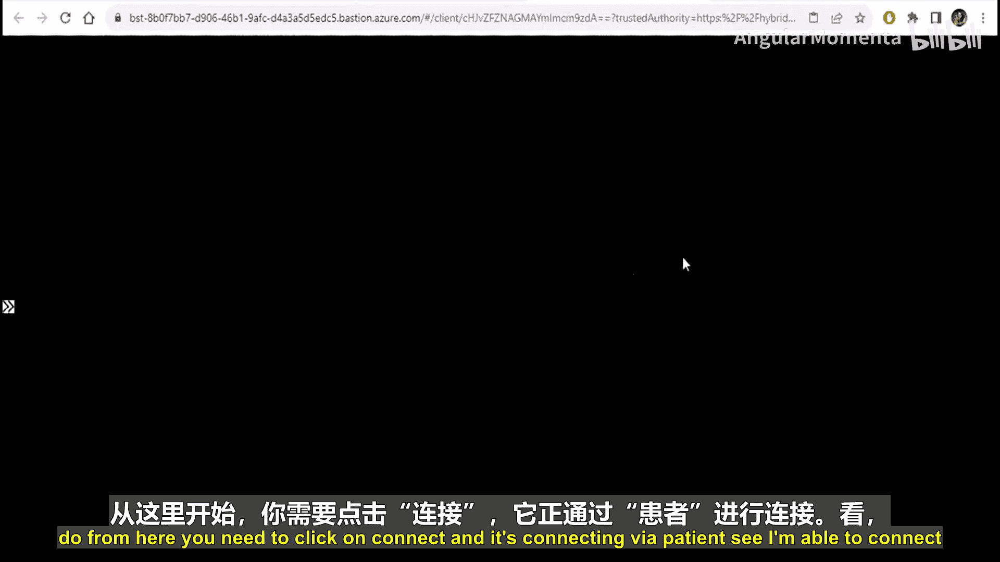
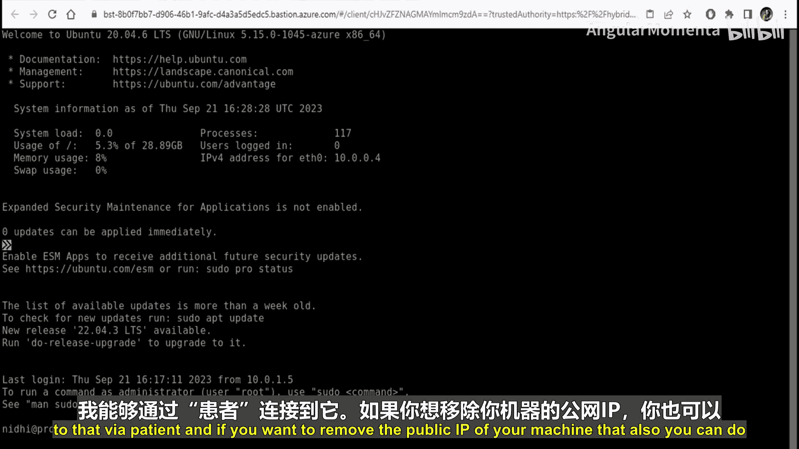
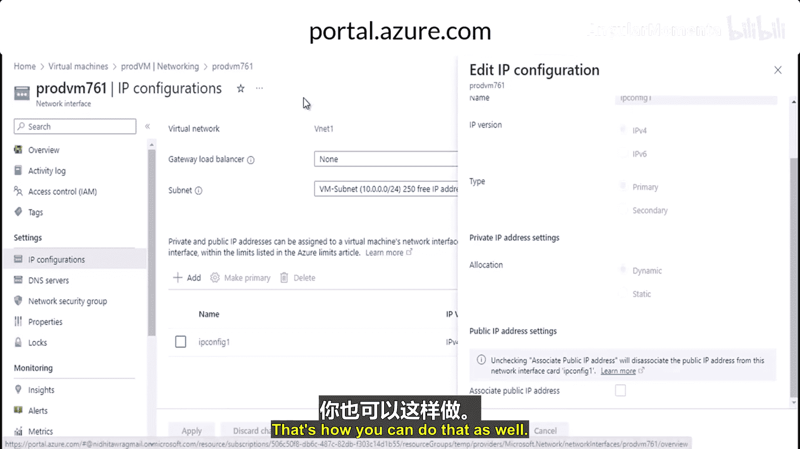

# 【EDUCBA】Azure网络服务 ｜ Azure Network Services p14 04_02_01_什么是 Azure Bastion -BV1mwFSzNE2s_p14-

Hello， learners。In this lesson， we'll be discussing about Auration。

Let's see what is Azure vision Asz vision is a service that you deploy it lets you connect your virtual machine using your browser and the Azure portal or maybe your native SSH or ITP client that is already installed on your local computer。

😊，It is a fully platform， as a service。And。It basically provides you a secure and seamless RP or SS such sort of connectivity to your virtual machines directly over TlS from your Azure portal or like your native flight。

😊，And when you connect using your reservation vision。

 your virtual machine do not need a public IP address， a agent or maybe a special client software。

 nothing is required in that。And patient provides you secure RDP and SSH connectivity to all the virtual machines within the virtual network in which it is provision。

 so you can protect your virtual machine from exposing RDP and SSH ports to the outside world。😊。

Also still providing secure access using RDP and SSH。

 let me show you with the help of a diagram to make the picture a bit clear， lets say。😊。

This is your virtual network。 Let me call it virtual network。Inside that。

 let's say I have three virtual machines。And like I told you， you can connect via as your portal。

 let's call it this is your Azure portal。😊，Ass your。古人。Or it can be your native client as well。

 Let's call it。Native client。And because this is your virtual machine。

 so it may be having any NSGs as well network security groups that may have。

 so let's call it NSG andsG。😊，And let's say this is V1， this is。VM。This is V M 3。

And let's say here you have deployed your Azure Ba because it will be inside your Port network。

 let's say this is Azure Ba。😊，Let's say on port 443 you are connecting lets let's call it where this or this a TlS communication is happening on port 443 for example here as well。

 443。So you will be able to connect。Using this okay so first it will go through this as your vision and to whatever virtual machine you want to connect you can do that without exposing your VMs public IP or anything whatever you have to the internet right that's how you can do that Thank you very much。

In this lesson， well see about SkuUs of Aurvation。If you see here， the comparison。

We have two types of a here basic and standard。 If you want to connect to target we in a peer virtual network。

 it is supported in both。Cargo CM audio output， shareable link。

To see what is not supported in basic but which is which is supported in standard。

 let's see that shareable link is not supported in basic If you want to connect to Vm using a native client that is also not supported via IP address as well it is not supported post scaling is not supported here you want to specify custom in port that is also not supported in here but。

All the features are supported in standard one， standard risk。

If you want to upload or download files， that is also not possible in the basic one。

 Thank you very much。Hello， learners in this lesson。

 we'll see how to create a and how to use as operation。 First of all， what I have done already。

 I have created one virtual network。 As you can see， this is V net 1。😊。

This is of hydrospace 10 dot0 dot0 do0 slash 16。So if I show you my subnets as well。

I have created two submitnets here， Vm submit10 do 0 do0 do0 slash241。

 which consists of my virtual machines。 Also， we have another submit here as your vision submit。

Its name， if you want to deploy a， its name should be same as your vision submit It' search for that and etc ceter。

 I have taken 10 dot0 do 1 dot0 slash 26。 That's what I have done already。 Also。

 one more thing I have done。 So you see here， I have created one virtual machine。

 How to create virtual machine that steps also give have。Seen already， let me show you。

 I have created a Linux virtual machine， which is having a public I address。

And this is Linux to 1220。04。 I have consideredc。With this， I want to connect via patient。

 That's what I want to do。If I go to my virtual networks again。

Because in vnet 1 I have already configured ratioian， but let me show you steps from vnet2。

 it is of same concentration from here， go inside your vnet and go to ratioian。

That's how you can configure。 I'll show you how to configure it manually。

 So if you click on configure manually， that's what I've done already。 So this is my resource group。

 give it a name， say for example， my nation any name you can do。Region you can select here。

 you can select standard have selected。Because， as we have seen that the standard gives you both features instant counts you can take。

 So I have taken to only the default one。 if you want， you can increase it。If I write minus-1。

So let it be only。 you can have it。From here you need to select your virtual networks let me show you one more thing if I select V net 1 automatically taking this as your patient submit 10。

0。1。0 slash26 regression if I select V net2。Because in this virtual network， I don't have any。

Subnet work with this name。 youll have to create one。

 So as your vision subnet and a prefix of at least 26 should be there。 You need to take care of that。

 That's what I have already done。 Like I have shown you as well。

 I have my as your vision subnet in 1，10 do0 do 1 dot0 slash 26。

From here the IP and static and standard public I required， that's what I have stated。😊。

And then I have created review and create， as you can see here。😊。

I'm not continuing to that in the V net 1， I already have this configuration。 if I show you here。

 ratio here。And it takes around 5 to 10 minutes to deploy that patient。 After that。

 you will see something like that if you want to from here as well you can do So select a VM to connect to because currently I have one Vm from here as well you can connect or you can go inside your virtual machine。

😊，And if you go here broad them。And from your click today。And from your。NC。

You want to connect using patient basic card standards from your go to patient。And from here。

 you need to give it a names if you do this because this is the standard plan here。

 you can select the protocol as well because minus Linux machine。

 so definitely I'll be using S code 20 from here， you need you can change this username and password as well。

 you can do that。 This is what the username I have entered an authentication type we have option。

 you can take password from asz your key all S is such private key from No and file or S such private key from as your。

He want us this。 as of now， I'm doing the password and just enter some password。

Whatever you have given the password while creating your given that password you need to do from here。

 you need to click on connect。

And it's connecting via patient C and the to connect to that via ratio。

And if you want to remove the public I of your machine， that also you can go。 So from here。

 you need to go to your virtual machine。And from me go to network。And from here。

 go to network interface。And from here， go to IP configurations。

So all the IP settings you will find go this one I Con1。So from here， you can change it。

 Public IP if you want to associate or dissociate， So speak on that， it will be disated。

 And if you can see。 That's how you can remove the public IP of your machine。Itel up be updated。

 and then the I P will be remove。That's how you can do that as well。

Thank you very much。😊。