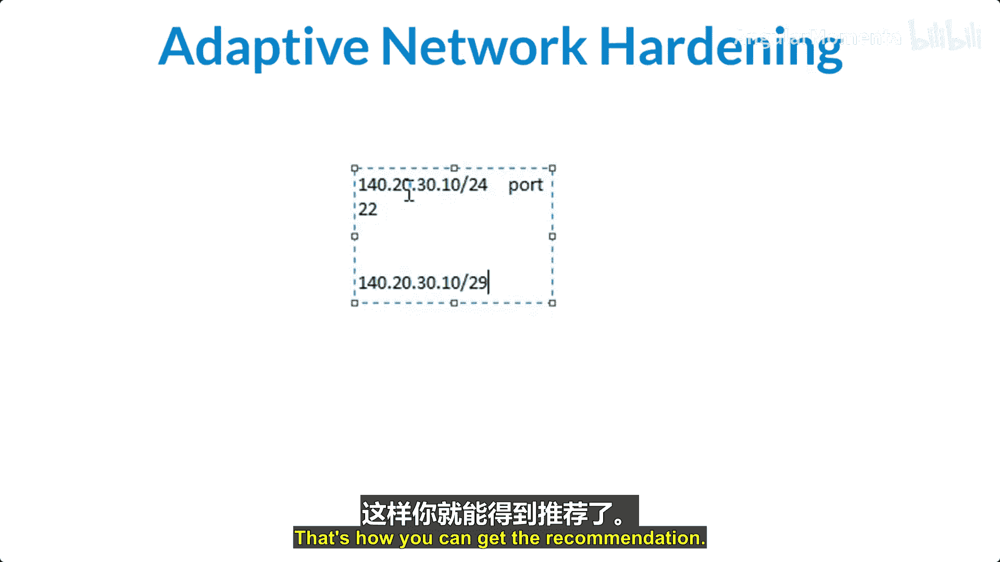
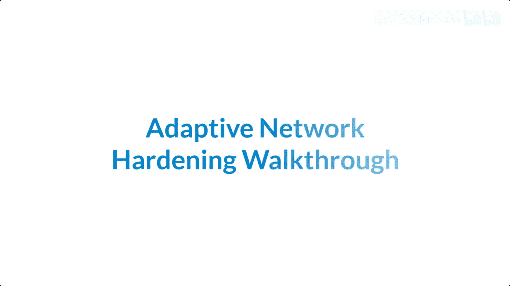
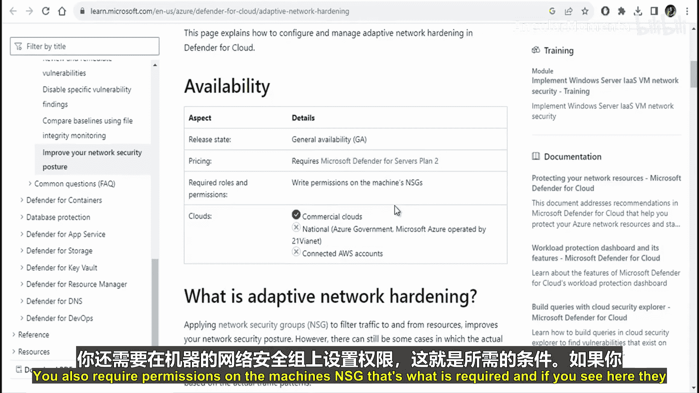
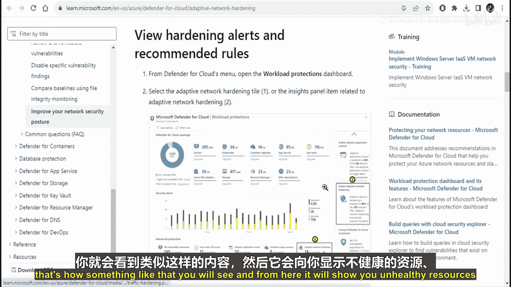
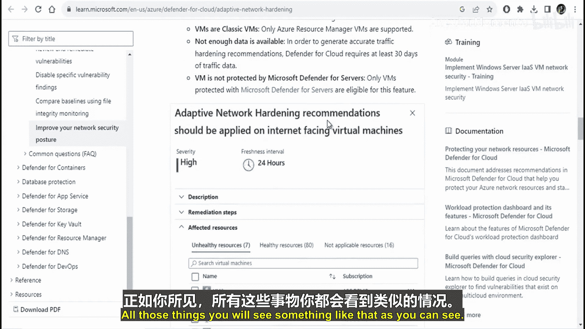
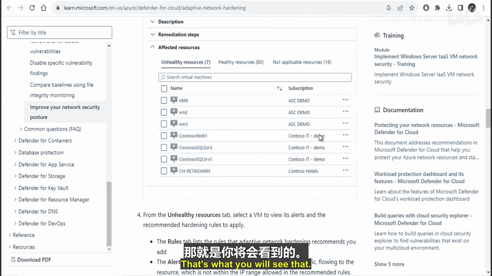
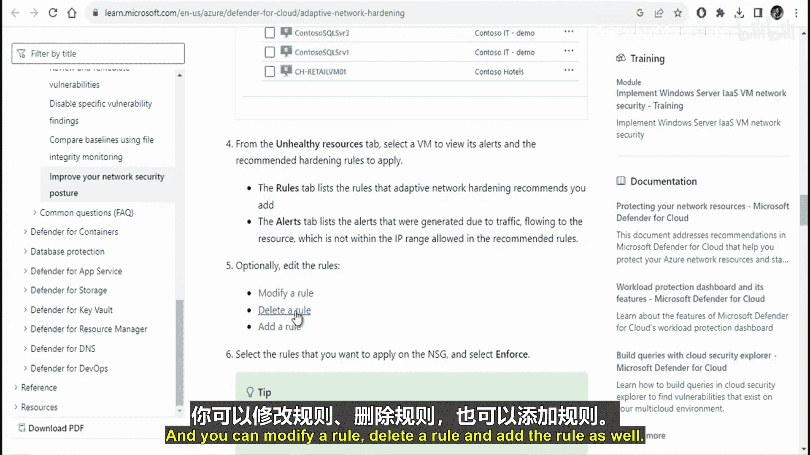
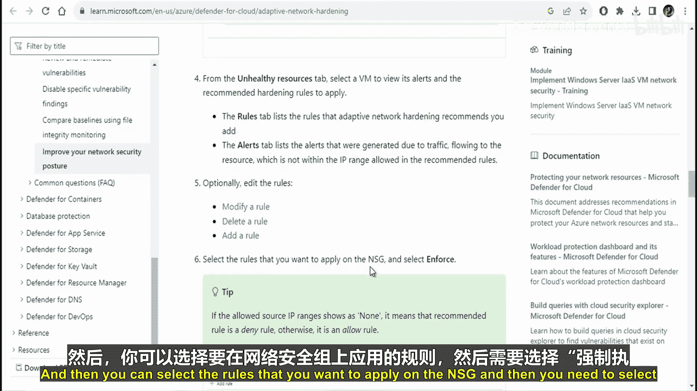
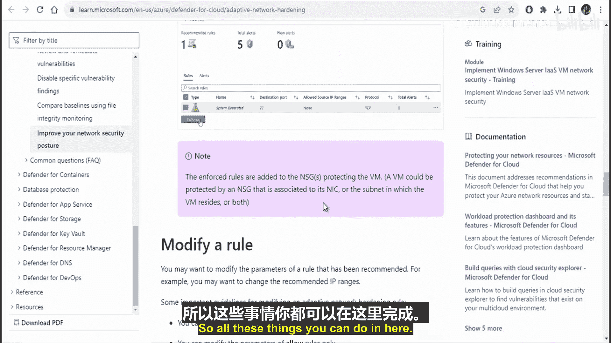

# 【EDUCBA】Azure网络服务 ｜ Azure Network Services p15 04_03_01_自适应网络加固 -BV1mwFSzNE2s_p15-

Hello， Las， in this lesson， we'll be discussing about adaptive network hardling。

So how you can improve your network security posture with using adaptive network hardening that what we are about to see here。

 First of all， let's understand what is adaptive network hardening。

When you apply network security groups we have already discussed NSG rules。

 so when we apply NSGs to filter traffic to inform from the resources it improves our network security posture however。

 there can still be some cases in which the actual traffic flowing through the NSG is a subset of NSG rules defined in these cases。

 further improving the security posture can be achieved by hardening the NSG rules based on the actual traffic patterns。

So adaptive network hardening provides recommendations to further harden the NSG rules。

 It uses a machine learning algorithm that factors in actual traffic。

Kown maybe known trusted configuration， maybe the threat intelligence and maybe the other indicators of compromise and then provides recommendations to allow traffic only from a specific I P or os。

 That's what you can do。Let's say you have an S route that allows traffic from。

 let's say from the I 1，4，0 dot 20。Dot 30。But one0 slash。24， let's say。And on port。Let's say。

 port 22。Let's say you have a existing NG rules that is allowing traffic from this range and on port 22。

 based on the traffic analysis， adaptive network hardening might recommend that you narrow the range to allow traffic from。

 let's say the same range on 4，0 dot。😊，20 dot。30 dot 1，0 slash29， maybe。

So that may be possible and you need to deny all other traffic to that port。Oh that's how you can do。

 That's how you can get the recommendation。 It will basically give you recommendations。

 Thank you very much。😊。

Hello learners in this lesson we'll see a walkthrough through network hardening tool bit of this well see This is a feature of Microsoft Defer for cloud and apart from that nothing needs to be installed on your machine。

 you want to benefit from network harding tool for that you require this Microsoft Defer for server plan tool that is what is required you also require permissions on the machines NS that's what is required。

And if you see here。They have shown us a bit of things。 If you go to your defender for cloud menu。

 you need to open workload protection and from here you need to select option adaptive network hardening type1 and that's how something like that you will see and from here it will show you unhealthy resources。

 healthy resources， unscanned resources， Vms that are the classic Vs， not enough data is available。

 Vm is not protected by Microsoft Defer for servers。

 all those things you will see something like that as you can see like for example。

 here you can see7 unhealthy resources， healthyy resources， not applicable resources。

 that's what you will see that。

And optionally we have rules tab as well that recommends you you want to set some rules at all。

 will be having alert tabs well that will be generated due to traffic flowing through the resource and you can modify a rule。

 delete a rule and add the rule as well and then you can select the rules that you want to apply on the NSG and then you need to select and force all these things you can do in here。

Thank you very much。