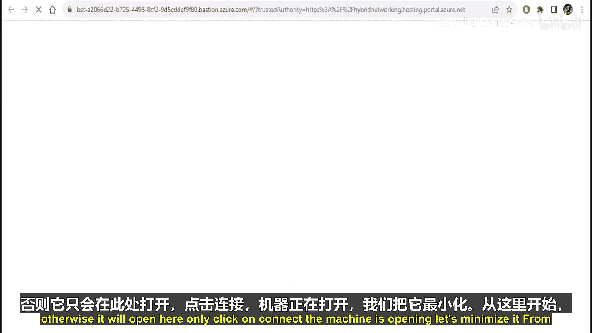
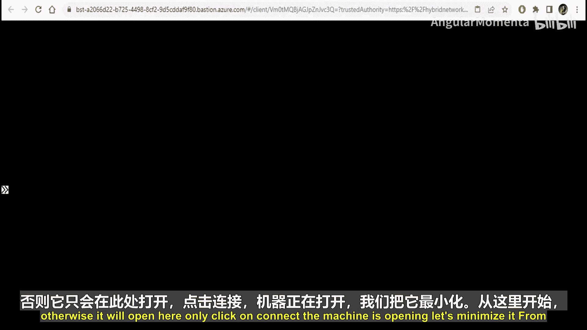
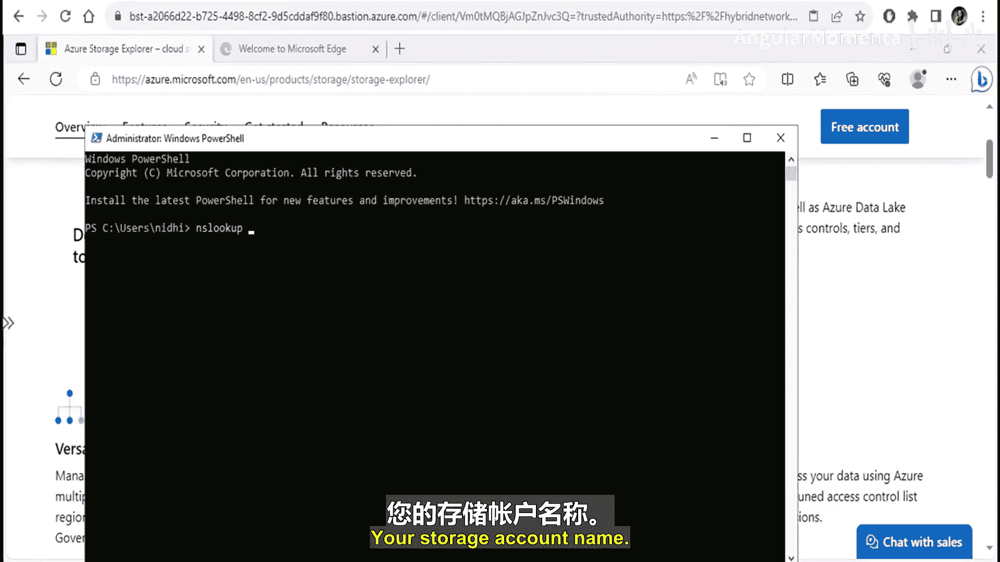
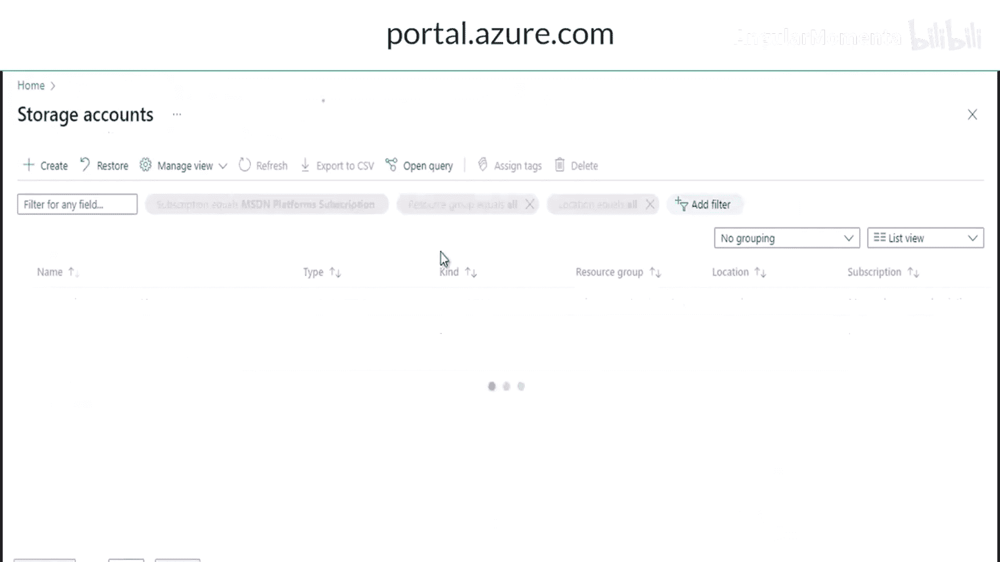
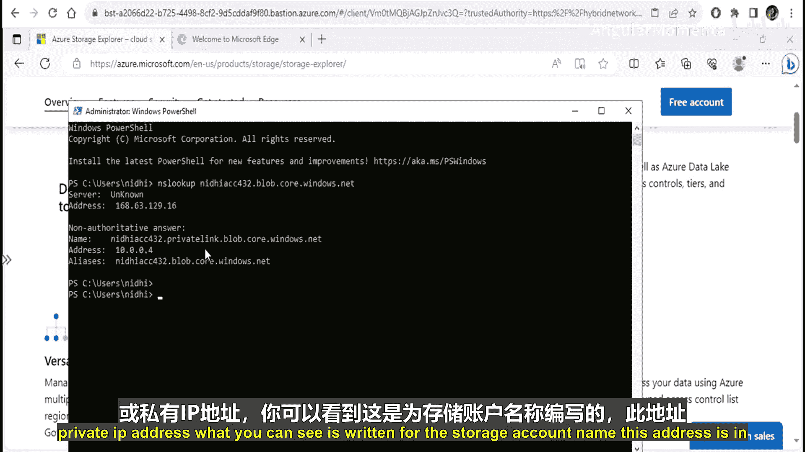
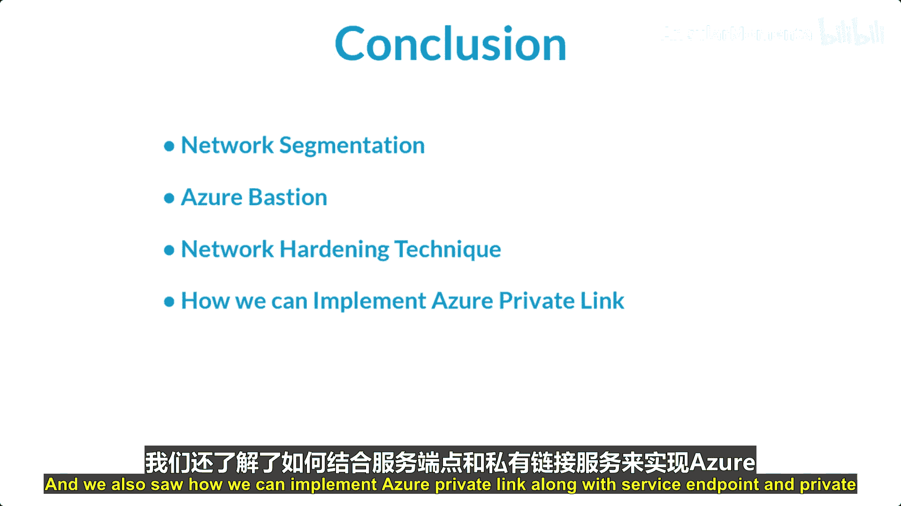

# 【EDUCBA】Azure网络服务 ｜ Azure Network Services p16 04_04_01_什么是 Azure 私有链接 -BV1mwFSzNE2s_p16-

Hello， Laers in this lesson we'll be discussing about Aure private link。😊。

So let's see what is as your private link first， as your private link enable you to access like for example。

 as your storage， SQL databases， all the past services and even customer on partner services over a private endpoint within your virtual network。

😊，So within your virtual network， if you want to access your past services。Using a private endpoint。

 then you can go for this particular service as your private link。

Let's first understand the benefits of Azure private link， let's take an example。

 let's say you have an aszure virtual network and you want to connect to a past resource。

 for example in SQL database while you create resources you normally specify a public endpoint as the connectivity method。

Having a public endpoint within your virtual network， you have your virtual machine。

 You have your database。 And let's say other past service as well。

 you have virtual machine is infrastructure as a service。

 Let's say you have a Web app or you have a database。In that case。

 if you want to connect with these resources， normally we use public endpoint。

So public endpoint means the resources assigned to a public IP address。

Even though both your virtual network and your Azure SQL database are located within the SzR cloud。

 the connection between them takes place over the Internet。

 over the Internet means public connection。The concern here is that is your SQL database is exposed to the internet via its public IP address。

This exposure can have multiple risks。If risks are present while using a public IP address。

Risk can be a pure your virtual network and on premisems network that connects to as you are using express route or maybe customer as your virtual network that connects as your services offered by your company。

Private link is designed to eliminate these security risks by removing the public part of the clinic。

So private link provides you a secure access to your services and that security is achieved by removing your public endpoint and we have only with the private network interface。

 Thank you very much。😊，Hello learners in this lesson well be discussing about private endpoint。

Let's see what is private endpoint。Private endpoint is a network interface that enables a private and secure connection between your virtual network。

And as your service。Private endpoint， this is the key technology behind the private link。

 the private link， which we discussed in the last module。

 this is the primary technology underlying private link is private endpoint。

Private link basically provides you a secure access to as your services and private link achieves that security by replacing a resource public end point with the private network interface。

😊，Also， private Endpoint uses a private I address from virtualual network to bring the services into the virtual network。

Now lets see the difference between private endpoint and service endpoint。😊。

Private endpoint grant network access to specific resource behind a given service。

 providing granular segmentation traffic can reach the service resource from on premises without using public endpoints。

 If I talk about the service endpoint service endpoint remains publicly routeable IP address。

 a private endpoint is a private IP in the address space of virtual network where the private endpoint is configured。

😊，Thank you very much。Hello， learners in this lesson， we'll be discussing about private link service。

😊，Like， we discuss。In our module about private link。

 private link gives you private access from your Azure virtual network to either the fast services and Microsoft power partner services in Azure。

 Now， let's say let's take one example。 Let's say if your company has created its own Azure service that are consumed by your company's customers only。

 Now you want to offer those customers。 a private connection to your company's service for that purpose。

 you can use private link service your private link service is the reference to your own service that is powered by as your private link So your service that is running behind the standard load balancer can be enabled for private link access so that consumers to your service can access it privately from their own virtual networks。

😊，So your customers can create a private endpoint inside the virtual network and map it to this particular service。

 like your private link service。😊，Okay， private link service receives connections from multiple private endpoints and a private endpoint connects to one private link service。

Thank you very much。Hello， learners， in this lesson。

 we'll see how we can connect to a storage account using Azure private and。

 What we are about to do here。 Firstt of all， I'll be creating。 let me show you。😊，Virtual network。

 Let's call it Vnet and ratio host。After that， I'll be creating a storage account。😊，And from that。

 I will disable public access。After that， I'll create a private endpoint。😊，After that。

 I'll create a virtual machine。 and finally， I'll show you how to do the connectivityactivity This is the connectivity。

😊，Start with that。First of all， I need to create virtual network。

Open your portal and go to your virtual network。This I have already done。

 but let me show you the steps。First of all， I have selected my subscription。Like for example。

 T and I' have given it a name let's say for example， VNe2 and I have selected as region。😊。

And then I went ahead and from here only I have enabled a your operation。😊。

And I have also created name you can take whatever you want and you need to also create a public copy of standard S that' is what I have done。

After that， I have went ahead to the IP addresses。 So as you can see here。

 one ratio submit has already been created with this IP address ring。😊，As from here， I went ahead。

I have changed its name。Like， for example， subject2。

I've saved and remaining all the settings I have kept default。

 and I have created the virtual network。 As you can see， this is my virtual network。😊。

And if I show you my subnet。I have two submits here。 Sub one with this range。

 That's what I have already done。And then， our next step is。To create a storage account。Let's。

 let me show you the steps for that as well。 So I have gone ahead。

And I have created a storage account。 So this is my account。 So if I click on create。😊，And from here。

 I have selected。My resource group。😮，And give it a name， whatever name you want like this。

 for example， my account，5，6，7。And from here， I have used locally redundant storage。

Remaining all the settings， I have kept default。And I have clicked on review and3。

So I have this storage account。After that， I went ahead and dis the public access of the storage account。

 So from here， I went ahead to the networking。😊，let it open and from here， as you can see。

 it is disabled by default， it is enabled from all the networks。

 but I have disabled it and saved it from here。😊，Remaining steps we'll see in the next video。

 Thank you。Hello， learners， welcome back。In a previous video， we have created the virtual network。

 We also have created storage account。 Now， I need to create a private link。😊，You can see here。

 the third step is to create a private endpoint。From here， I went ahead。

And search for private endpoint。As you can see， I've already there what steps I have taken have created I have selected my resource group and the subscription。

 Give it a name， Let's say any name。My link， for example。The region app selected this only。Now。

 I went ahead on the resource。And from here I have selected the default one connection method connect to an azure resource in my directory and from here I have selected the resource type because I have to connect via storage account So from here I have selected Microsoft dot storage。

Let me search。 This is this one。 Microsoft do storage slash storage account。And from here。

 the resource you need to select the storage account。Which just now。

 I have created this Navy account 432。And the target sub resource， I have taken as block。

From here I went ahead to my virtual network， this is my virtual network which I have created previously and the sumnet from here I have clicked on edit。

😊，And as you can see here from here， I have selected both the things by default。

 they were not selected。 You need to click on those those check box。

 then it will show you this thing， and then you need to click on save here it will show enable enables after that and I have selected dynamically allocate I address Then I went ahead to the DNS。

 All these settings I have kept default and then I have created my private endpoint。

 you can see this is my private endpoint。After that， what I did， I went to my school account。😊。

This is my storage account， as you can see， and I have created one bb container。

 This is my container。😊，How do you create a container， So you need to put a name， for example。

 my container， any name you can have。 And from here， I have kept it private only。

 So I have created it。That's what I have done。Now， what I need to do。

I need to test my virtual machine。 Firstt of all， I need to create a virtual machines when the he。

And I click on create virtual machine。From here， I have selected my resource group， for example， Tim。

 give it a name， any name you can give my fraud Vm。

 any name you can give whatever you like from here。

 select no infrra redundancy required security type I have put standard only and this is the virtual machine I have selected Windows server 2022 data center X 64 Z2。

 That's what I have selected from here size I have kept default。

 I have added some username and password name V， for example， and any password you can take。😊。

And from here， public in course I put none because I'm using G vision。

 I do not need any public copy of this virtual machine。

Then I went ahead to the tests I have kept De then I went ahead to the networking from here I have selected my network and from here in NIC Network security group I have selected Advd and have selected create new for example。

😊，My NS S G。And remaining all the things I have kept default。😊，I click on。And management。

 And then I have created this virtual machine。As you can see， this is my VM1。

Well continue remaining part of the topic in the next video。Thank you。Hello， learners。

Now let's explore the next topic in our discussion。After that。

 let's test the connectivity to this particular machine Premier you need to go to clinic。😊。

Pmier go to vision。From here， enter the username， what you have entered for creating the virtual machine。

 for example， N and the passwordword。And click on。Conect。😊，You want you can open it in a new browser。

 I have opened it in new browser。 Otherwise it will open here only。你关机咧。

The machine is opening。Let's minimize it。From here， let's open partial in this machine。

This is my Windows portion。But open。 I just sitting open already。From here。

 you need to do N S lookup。Your storage account name。 What is the name of my storage account。

 Let's check it out。

Ny ACC，4，3，2， Lets enter  need， ACC，4，3，2。And the dot lock dot。Toour dot windows， dot。And the。

So as you can see， this is the private link name。 It is getting the same name。

 and this is the address1 dot0 dot0 dot phone。😊，Or the private I P address。

 what you can see is written for the storage accounting。

 This address is in the subject of your virtual network that you created previously。 After that。

 what I have done， I have gone ahead， and I have。

Downloaded this Microsoft storage Explorer。 So locally。

 if you want to access your storage account at all， you can do that。

 This is the link from here I have done。 I'll share this link with you as your do Microsoft dot com。

Flash storage， slash storage exposure。 If you simply Google it as well。

 you will be able to go that it。 So from here， I have downloaded it。Now。

 you need to connect to your resource。 Click on connect to as your resources。 When you open it。

 this page will open and now I need to connect my storage， click on storage account。

 There are three options you can see key or Saas， URL Saas and account naming。Mus your on。

Let's take account name and key or you can click S as well。Click on next。From there。

 you can get account payment。 You need to go to your asz your account from here， go to your account。

From here， if you search， you will get excess key。Here you can see your connection ring。Can do that。

 as well。Com there， if you go。Give it go account key。The key。Oh is this。This。

Account name you need to enter。For example， N ACC。What do you do。As soon as your and need you get me。

Now， you are able to see the information of your account。Fromown here， if you see。

You need to click on connect。No， see。 I'm going to see here。And if you go to block containers。

 Im able to see my container。So if you want， you can。

And the blogs in the So the connection has been successfully， added。😊，Thank you very much。Hello。

 learners。Now， let's conclude whatever we have discussed in that module。Basically。

 we saw about network security best practices， as we are aware。

 that network security is the process of protecting resources from unauthorized access or attacked by applying controls to network traffic。

 Basically， the goal is to ensure that only legitimate traffic is allowed。

 J includes a robust networking infrastructure to support your application and service connectivity requirements。

 network connectivity is possible between resources located in Azure between on premises and Azure hosted resources and to and from Internet and Azure。

In this module， we saw some of the best practices of Azure。

We saw about network security best practices。The design principles we saw about as your patient。

 We saw network hardening techniques。 We also saw about how we can use private link to secure our network。

 So these are the things we discussed。 Thank you very much。😊，Hello learners。

 let us conclude whatever we have discussed in this particular course so we have successfully completed this course we saw about asz your virtual van we gained an understanding of as your virtual van and its benefits for connecting and managing large scale networks we also learned how to deploy and manage virtual hubs how to establish side to side connectivity also we saw how to implement point to side connectivity using asz your virtual van we also discussed about as your express route so from on premises to Azure if you want to connect using a private link basically you can do that privately if you want to connect。

Then you can use express route so we saw out as your express route its role in establishing private and dedicated connections between on premises networks and Azure we also learned how to plan configure and troubleshoot express route circuits as well as implement express route peering to optimize network performance we also saw about as your DNS we gained the knowledge of as your DNS its purpose and how to。

Effectively manage DNS zones and records within AzR so as your supports all the records A records PTR record all those things we discussed。

 we also saw how to integrate as your DNS with your virtual network。

 we also learned how to configure as your DNS private zones and enhanced security control。

We also saw about Azure network security best practices。

 we saw network security best practices and Azure we learned about secure network design principles also we saw network segmentation network security groups we saw about asure vision we also gained insight into network hardening techniques and we also saw how we can implement Azure private link along with service endpoint and private link service。

Thank you very much。