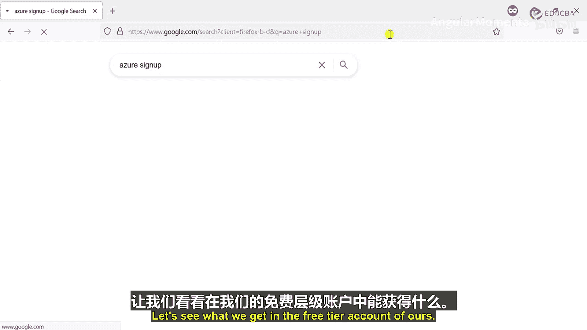
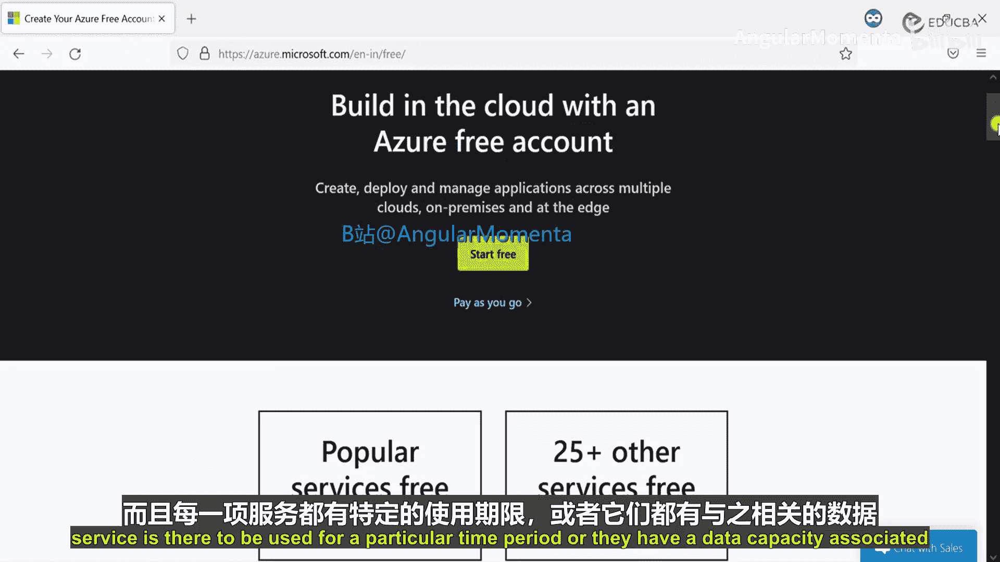
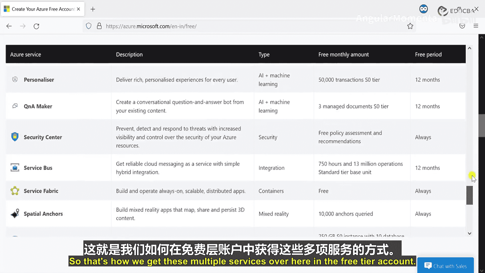
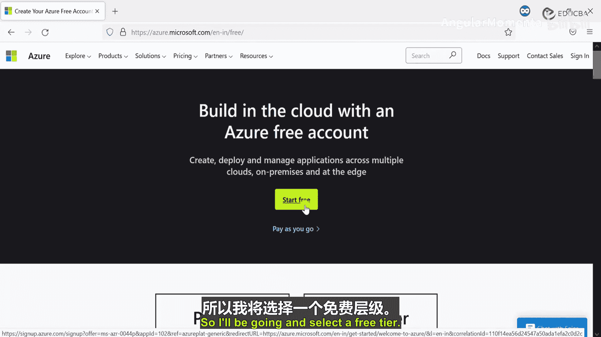
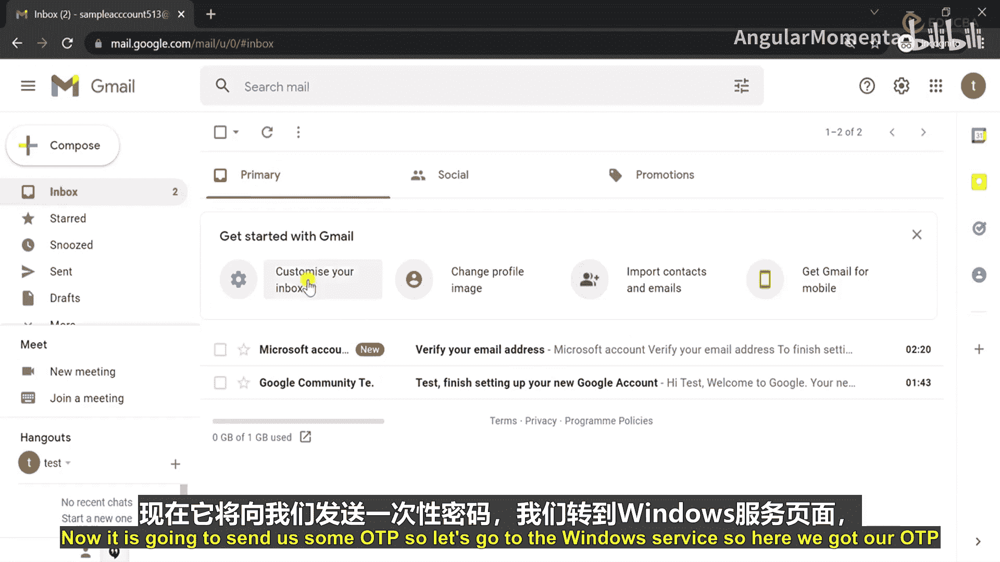
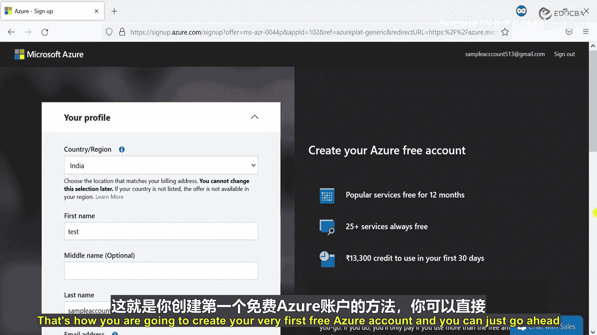

# 【EDUCBA】Azure实践——认知服务 ｜ Azure Practical - Cognitive Services p01 01_01_01_Azure认知服务入门 -BV1zXFozVEXL_p1-

🎼Hi， in this course of us， we are going to learn about Azure cognitivetive service。

🎼So there are a bunch of services which are being provided by Azure and we are going to pick one service at a time and explore。

 but before we go to these services individually， let's learn about what exactly is az your cognitive services aszure cognitive services is a bunch of services provided by Azure with the help of which we can create smart applications so it does help developers an architect to create these smart applications for daytoday usage making a smart application nowadays this is not new talk but in earlier days if you want to create these kind of application which are going to use machine learning or the AI based models at the back end。

 you should need to hire somebody who has a thorough knowledge about machine learning or AI but with the help of azure cognitive we can get these kind of things done easily enough we don't need any direct machine learning or AI or a data science knowledge to use these services now these services are easily provision and much。

🎼More easier to deploy then these services help a developer to build these intelligence applications。

 as I told already told you in the beginning of the course Now let's suppose we come across a situation on a day to day life where we get a couple of images and we just have to find what is the odd one out of it as you can see we are four images over here in the first image you can see there's a scenery over here where you can see mountains and clouds and in the second third and fourth image you can see there's a view of sea from a user in or a humans it's easier to identify anything which is out odd one out of it but if we want to get this these kind of activities done with the help of machine we need to create certain set of machine learning models and then we have to train our machine learning models and test them mouth thoroughly before we could bring them to the production environment of us。

🎼But with the help of uszR， we can create and deploy vision based services and they are going to help us out to find the odd images out of these kind of scenarios。

🎼Let's move to the next slide how does the machine learning process works into the industry the very first thing is we are going to collect certain training set。

🎼A training set would be roughly it would be thousands or hundreds of images of some different kind of data sets for example if we are going to create a machine learning model for processing logs so we need thousands and hundreds of log set so that we can train our machine learning model it real about that and if we want to create a image identification service or machine learning model as I've shown you in the previous slide so we need to get these hundreds and thousands of images and we are going to pass those images so that our machine learning model can learn out of it。

🎼After that， we have to clean up these collected training sets from a existing machine because they are going to。

🎼Occupy certain space over there。 so we don't want to keep a machine occupied with these。

🎼Waste data sets which won't be used by us in the future also because our machine learning model has already gone through it then after that。

 suppose we have been using multiple machine learning model so we get results out of these machine learning models some models might be giving you around 90% of accuracy some might be giving you 98% some would be giving you 95 so we are going to choose of course the model which was giving us the results with the help of 98% Okay so that's the correct model for us to be choose of after that we are going to train in that model with some more set of images in the future and verify the results so after these test and training things occur we just go and deploy these machine learning models to add deployment or a production in mind it does take a lot of time to get these kind of things done but as your cognitive service right these kind of models show us which we can just go ahead and deploy。

🎼And we don't have to look after how to train these kind of models bias us on a day to day basis because these have been already tried and tested out by the engineers。

🎼What are the process being followed by the Azures Cognitive Services？

🎼So the very first thing is we need to provision Azure cognitive service so I have told you that it easy to deploy these services and I would be showing you in when we are going to move through handson activity how to provision and deploy these Azure cognitive services after that we just have to go ahead and start using these services for our application so there are multiple ways through which we can access these services the very simplest ways with the help of console the other way around is to use the API calls so if you are going to get these things done with the help of our application we are going to use these API calls to get certain set of things done for us but if you want to just go ahead and start using these services without any application or middleware we can just go ahead to the console and start using。

🎼Now there are multiple services which are being provided by us here so the con services as you can see。

 there are five type of services over here I've already shared a glimpse of the vision earlier。

🎼Where I told you about if we want to find out the odd one out of those set of images。

 the very first one is a vision cognitive service then comes the speech。

 then we have searched then this language and the last one is the knowledge one So in the vision what happens is we can identify the object scenes and what kind of activity is being going on over there theres an activated detection which happens then we have a face recognition over here and with the help of face recognition we can even go for the identification supposeupp they train model with certain set of images and we want to compare an image with the existing type of image for that we can use this identification services then we can find out if image passed out is of celebrity or something for example I pass an image of Bill G over here so it is going to tell us O is Richard celebrity if I'm going to pass an image of some known landbus for example I pass an image of a tower。

🎼It is going to tell us yes it's a known landmark so that's why it is going to recognize the images out of it then when we pass it instead of images if we want to identify that as a person is happy。

 sad or something else，🎼To even help us in the emotion recognition then we have text handwriting recognition for example。

 if I go ahead and pass a computer printed form and I want particular set of data to be extracted out of that form can use OR vision services。

🎼But there are certain times person people write certain things down manually these OSA services also help in those things to us when we talk about videos we can get the met data out of these videos。

 audio keyframe extraction and analysis can be done from those set of videos which you are going to pass through even as you can see。

 you might have come across services being used by Facebook and multiple platform nowadays so that if you pass something explicit or an offensive content over there on Instagram。

 Facebook。🎼So these services what they do is they run in the background and they report these kind of services times people report them at times what happens is these services run at the background and they keep on cleaning and reporting these kind of things which are happening on these platforms these can be also be done with the help of vision cognitive services then we have a custom image recognition also when we talk about。

Speech cognitivetive services。🎼Yes， it's much more about what we do on a day to day basis with a speech for the very basic it is going to help us in speech transcriptions we do have seen certain set of YouTube videos nowadays and even on videos on the Facebook also where they do provide in brackets that okay these are auto transformations or auto transcription happening over the video when we ask further that then we have a speech synthesis when we pass certain text to these services it is going to respond in a speech format and we can even decide what kind of speech we need basically what voice modulation we need。

🎼Then we have a real time speech translation。🎼Okay which is going to help us out to translate speech for us then we have a speaker identification verificationification service We have a custom speech model for transcription and transcription and custom voice so I've already told you about the custom voice when we told you about these speech synthesis services Then we have search services So we do know about multiple search engines working nowadays and how we can try to make sure that a certain set of search results would be listed over there in a first page or a second page or a first result for that we have multiple search cognitive services which are there to help us out These are much mostly being used for the。

🎼in mainlyin。🎼You can see we have ad free web news image and video search results。

 we have trends for videos news， we have identification of similar images and products so that's how the search works for us even we can use the search cognitive service to find certain set of piece of things we want to。

🎼Get it done then the same way as the speech works， you have a language cognitive service。

🎼It is going to help us out with the language detection you might have used。

W will in recent where you might have passed on certain set of。

🎼written script which you don't know it's in English or some other languages and Google would have by default detected what kind of language has been passed over it to be transformed or converted so that's how the language cognitive services work so we have text sentiment analysis key phrase extraction for example I say that we are going to learn about cognitive services these keyphraes could we learn cognitive services out of it then we have spell checking you have seen these spell checkings working on day to we can see spell checkings happening over our cell phones by writing emails it even tells us the grammar messages of us so that's how the spell checking works then we have offensive text content or moderation text translations over here So that's how the language cognitive service help us out then we have a knowledge with the help of knowledge cognitive search we can it help us in decision making we can create a Q&。

🎼Findin of service to help us out。Different。🎼Use cases of each and every service being provided by the Azure cognitive service so we are going to cover these services one by one as we are going to move with a course。

Before we move out and do some hands on activity， we need to create a very first Azure account and we would be needing an Azure account。

And I would be creating that particular account in a free tier service base。

 Let's see what we get in the free tier account of ours So I'll be going to aszure signup page so we do get certain set of services from Azure for free to be used by us and each and every service is there to be used for a particular time period or they have a data capacity associated with that So let's go and see what we get in the free tier account of our So as you can see popular services which are free for 12 months and there are certain set of services which are free through So let's go and see certain set of services over here。

 So as you can see， we get 12 months of Azure virtual machines over here which we can use for 750 hours then we have azure virtual machines for Windows based machines also we get the Azure account for aszure re database where you can use a2 to 50 Gb of space or b storage could be created for 5 g the blo storage you can take it as a object storage also then we have a cosmos Db。

Then we have usz your app service。The main thing which we need to do is we would be。

Using services such as cognitive services， which are linked to them。

 you can say much more like an AI kind of services。So just let it go down。

So you can see we could get as your Devops also we have Kubernetes options over here。

Then if we just go down， okay， we find these anomaly detector over here。

 which is a part of cognitive service。Then we have a custom version over here。

Which is also part of cognitive services of us。 So you can see you get a。

Eill month subscription free and you can use around 5000 training images each for that So that's how we get these multiple services over here in the free tier account。

So let's go and create a very first aszure account of year， so I'll be going and select free tier。

Now we just have to go in add a email I over here， so before that I'll select create one。嗯。

So we just need to go and enter email ID over here。

 So even if you are using a Gmail based email ID or something。

 you can just enter your email Is over here。 It does not matter。

 It's a part of Microsoft community or not So I have created a sample account for this session。

Sample account 513 at redgmail dot。Thanks。We just have to go and give a password。Now。

 it is going to send us some。O TV B， So let's go to the Windows service。

So here we got a OTP over here， I'll copy this out。I'll paste it over here。

If you want to get more tips or offers related to your account。

 you can just go ahead and check this box over here， I'll select next。

So it is going to ask us to solve a puzzle。So that's it we have been able to cross verify that now we just have to go ahead and enter some basic details about us so that it is going to create an account for us。

 for example， you have to choose your region over here。

 you can add any region if you want to you just need to enter your first name Ill give a it PS test last name sample account。

You can enter provide your phone number here。 just make sure that you are not going to add some initial digits over here。

 for example， for us you don't have to go and add plus one over here。

 we don't need to pass the country codes over here once you pass your cell phone number it is going to ask you get it verified the way we got the email I verified for us that two options you can use the text option or a call me option After that you have to enter organization then it is going to ask you for a pan ID or something which is optional as well then we get to multiple options over here the very first thing is you agree with user a subscription agreement of Azure or not The second one is if you want to share your information with the selected partners of Azure then you can select this out it is not a compulsory option to get it done So once you fill these options over here。

You can just go and select this。 So I'll just go here see。Okay， still some values that you missing。😔。

When add cell over here， it is not going to get enabled until unless you are going to enter a cell number and get it verified Once you get it done we get a card verification option over here so you just have to go and add your credit card over there the reason behind adding your card is if somehow you owe you some any service of aszure so they can start billing you for that service usage so that's why for a safer side they ask you to add a credit card over here and then get it verified。

But if you are going to use your account in a much more proper manner by deleting the services after using them or else when you don't need to use them。

 the less and most chance is to get any build amount to your name。

 that's how you are going to create your very first free as your account and you can just go ahead and start using it。

