# 【EDUCBA】Azure实践——认知服务 ｜ Azure Practical - Cognitive Services p02 01_02_01_视觉API与计算机视觉概述 -BV1zXFozVEXL_p2-

Now let's learn about the very first cognitive service we get it's called vision API So what is the very basic thing comes to a mind when you heard here term vision So yes。

 if you're thinking something related to site or images or something like videos or something so yes the vision APIs mainly work on these images and videos of our only in the vision API we get more details about these particular set of images if you remember in the very few slides of us I've showed you to decide what is the oddwin images out of there these kind of things can be handled with the help of the vision APIs of files it gives us the analysis of the image we are going to pass through these services it help us you analyze and identify the content within the image or videos which we pass through it for example here we can see an image of a tree but we all know that it's a tree and if we would have wanted to create some。

Smart applications then we just have to create certain set of models over there and pass after that we have to train those set of models so that we are going to get a result that yes this is a tree but then we have to train our model to give some more detailed instructions about that but as your cognitive service we just have to deploy a service and start using it so if I just pass this image to that cognitive service we are going to get some result something like that here we get tags over here in tags it says it's named as a tree the score is 0。

96 in the descriptions we get it's a tag to be as a tree as we can all see that yes it's a tree only and with three it also passes a confidence level of the result we have passed over there so according to the service it's saying that it's about that by 96% over here that it is a tree and it could be a shell bar equally so that's how these kind of vision API works so the multiple services within the vision API which works。

Very first is computer vision， then we have a face custom visions video indexers in recognizer and form recognizer。

 So we are going to cover these set of services one by one and which comes under the vision APIs So how does these kind of services work over here I'll just give you overview of that here I have to just go to。

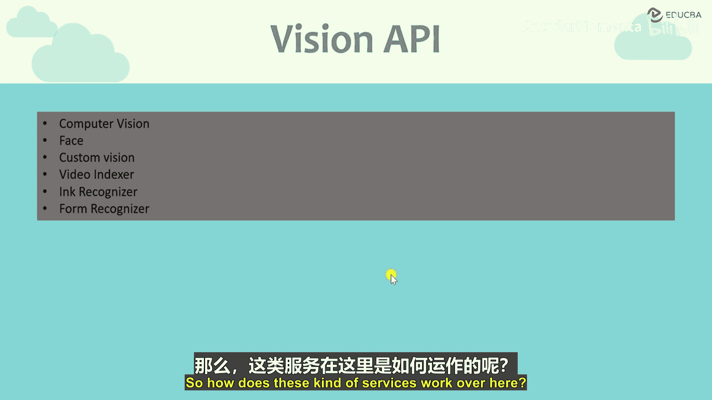

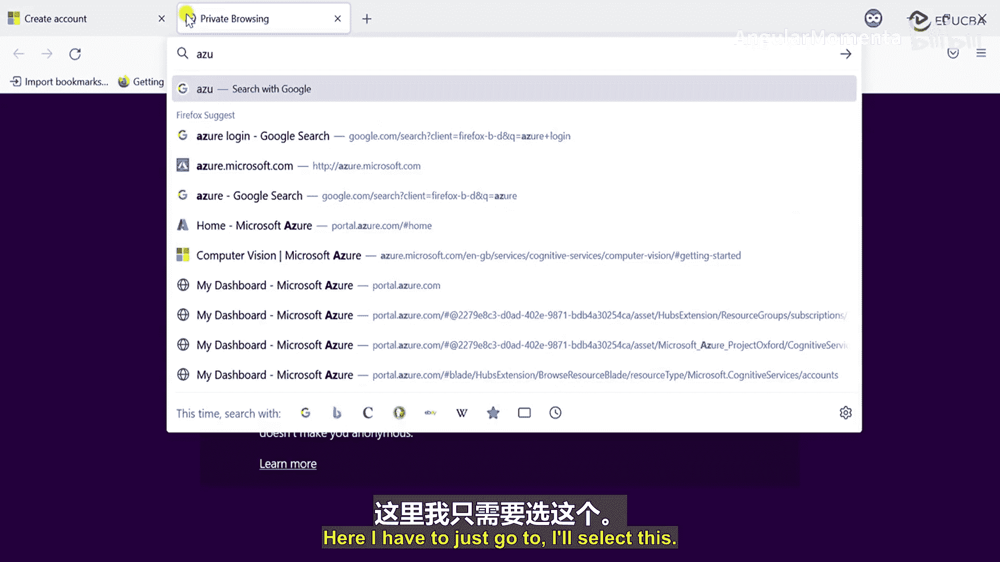

I'll select this。 You just have to look for products over here。

I'll select the tag in the product section I just have to go and search for cognitive。

 so here we get a Azure cognitivetive services， which is going to cover all the services in it。

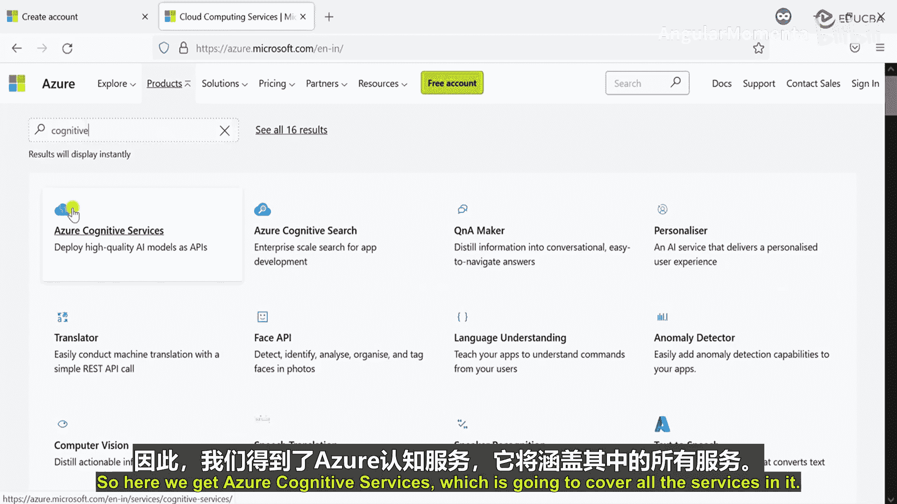

Now， if we just go down over here， there a some overview about what exactly these Azure cognitive services are in that。

 because we are considering the vision8 right now， I just select the vision and in the vision。

 for example， because we are going to learn about the computer vision only。

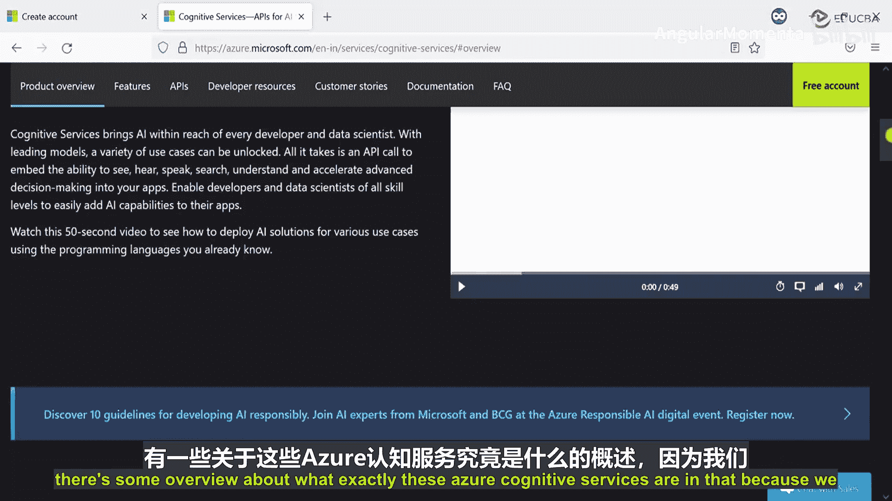

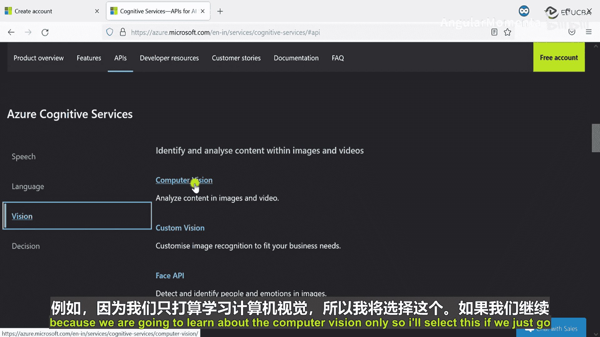

So I's select this if we just go down you can see there's an image which has been passed over here and according to the computer vision API we get a result over here that it's a subway in a train so if we just go and check these jas over here we get a description section there's a train there's a platform over here there's a station station at type of building only it's indoor subway because it's a train they would be tracks over there people are walking some people are waiting so we get certain description about the image which we have passed over here and then there's a value over here which you can see it's called us confidence level we get more detail about the image also the image type which was passed over here is a Jpg then we have certain set of dimensions which are working right now so that's all the vision API overall then we have these tags over here and objects which are there inside the image we have passed so with the help of these object do we get to know。

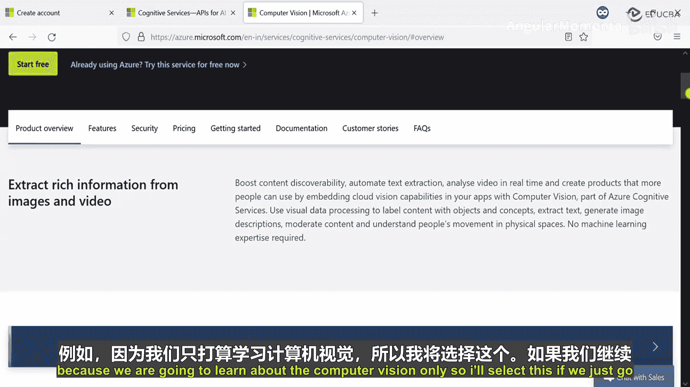

Location about things which are there So now let's go back to the because before we do that。

 I'll just show you some more images。 These are the sample images over there so you can just select keep and selecting them and it is going to show you some details about those images It says skating over here confidence is also defined right now then there's a equipment sports So that's all these kind of services work in the as your cognitive world we even get these dominant colors also So if we are going to select these kind of features that we want to get details about colors also at that time we get these details that what kind of colors are there which are dominant right now So that's all it works Yes the very first service which we are going to cover from the vision APA parties computer vision for example。

 this is a sample image of us and we want to get details about it So what is it a knownmark I it a place known to each and every person or what is a description about these images and all。

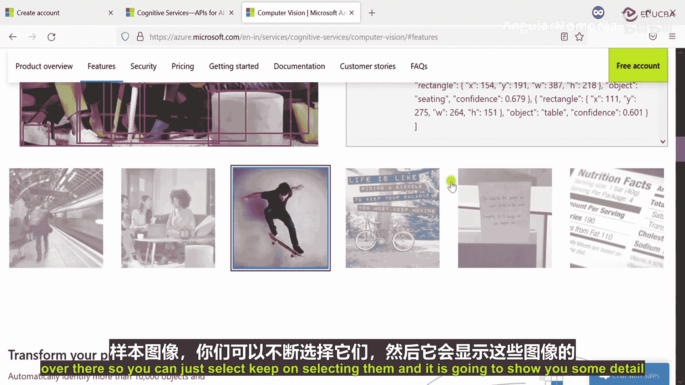

These are certain basic details we are going to get with the help of the computer vision So the computer vision do control certain set of rules over there。

 What are these I'll just show you them the very first is it is going to help us in the image classification and identification I it a known scenery or something or there some set of activities are going on there so as I've already shown you on the Azure main website that when a person was doing skateboarding it was showing that okay there activity going over there it's a sport it's a skateboarding so that's how the scene and activity recognition works now we I'm going to show you how the celebrity celebrity recognition works over the computer vision for example。

 if I just go in past certain known celebrity image over there with the help of computer vision we are going to get the results in which it is going to define as that what is the name of the celebrity I it a celebrity or not then we have a landmark recognition。

 for example， if I go and try to pass on some。Famous landmarks such as I'm going to pass over it So it is going to tell us that it is a famous landmark that how the landmark recognition works for us。

 then we have some special services which help us to get data from these images it could be a printed or a written data for example。

 you get a printed data from a bank and if you want to extract certain set of details from that statement of yours which you get from bank either you are going to just go and type those set of details of what files or the second way to do is you just pass that image or scan that image and pass it to the computer vision and it is going to give you details in a much more printed format you can just go and copy those details and you can use it as it is you don't have to write them now the second thing is the written Os What happens is at times you write down certain set of things by yourself and for those kind of services you might have in number of applications in the market。

which we can just scan and get these data printed out。

 but those services at times don't work on the written contents which we have written it on by our hand or something for that also we get services and we can extract data even if it's in a written format then we have a thumbnail generations also which happens with the help of computer vision。

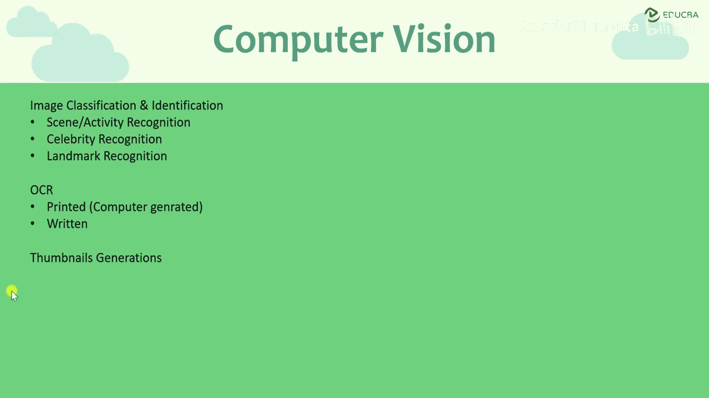

So in this particular session of us I would be showing you how to create your very first cognitive service After that I would be showing you how to create go through the Azure cognitive service documentation and how to start using these services and to use these services I would be using a postman so I think you should might be having a idea about how does the postman works and how these SCPs work in day to day life for us let's head back to the console so this is my Azure console we get a create resource option over here。

Here we have a cognitive service， but suppose you are not going to find these services written over here。

 so you can just go to the search part， search for cognitive。

 you can see that we get a cognitive search services， multiservice account。

 so I would be selecting cognitive services。Here， we have a。A cognitive service over here。 Now。

 we just have to go and make sure that we are going to create a very first service right now。

 So I'll just go to my all cognitive service says here we get an addd option。

 So I'll just go and select that。 I'll just select。

So you can see that we have something called as a computer vision selected over here after that。

We have get our subscription types over here so I would be using the free trial。

 then we have to select a resource group so you can consider resource group to be as a directories of yours。

For that， I just have to go and create a resource group。So I'm naming it as first resource group。

 okay。The region I'm going to use is East US。After that， I'm going to name my service over here。

First。Cognitive service。After that， we just have to go and select the pricing ti。

So we have a free one which we can select right now after that we just go down I'll just take mark this one。

 just make sure while creating your service or instance over here。

 make sure that you pass a name which is good as per you is going to be unique because the service name has to be unique through after that I'll just go and select next。

In the network section we don't have to change anything out then we have identities I won't be changing that too I don't need to add any tags so I just go and select a review right now and create it just make sure that the service you have created over here remember the reason of that so it would be taking a couple of seconds to get it done right now so yes we can now review it。

It has passed all the validations right， so just go and select create should would be taking a couple of seconds to create now because it has already validated all the values which we have passed over there So yes。

 you can see it says that our deployment is under process right now it is already deploying our very first cognitive service over year and that's it you can see that it says your deployment is complete right now so we can even go to our resource group directly now if you want to。

But before we do anything to this particular service of us， let's go and see that what can be。

Done use these services and all I'll just change a tab。

 So here we get some basic overview about the Azure cognitive computer vision service。

 So if we just go here， you can see that it says we can do text extractions image understanding facial analysis flexible deployments so multiple things which we can do there's a sample outputs you can see over here we just have to go down So here you can see that there are certain things over here。

 we get a sample app over here you can select that I'll open that in the next tab we have a documentation and we have even some certain more courses being provided if we just go to the sample app you can see that it gives us a Cb application over here and we can just overview if you want to but what exactly we need to do here is we just want to learn about that how to access these services with the help of the R Apa called the files So to do that I just go to the next tabs。

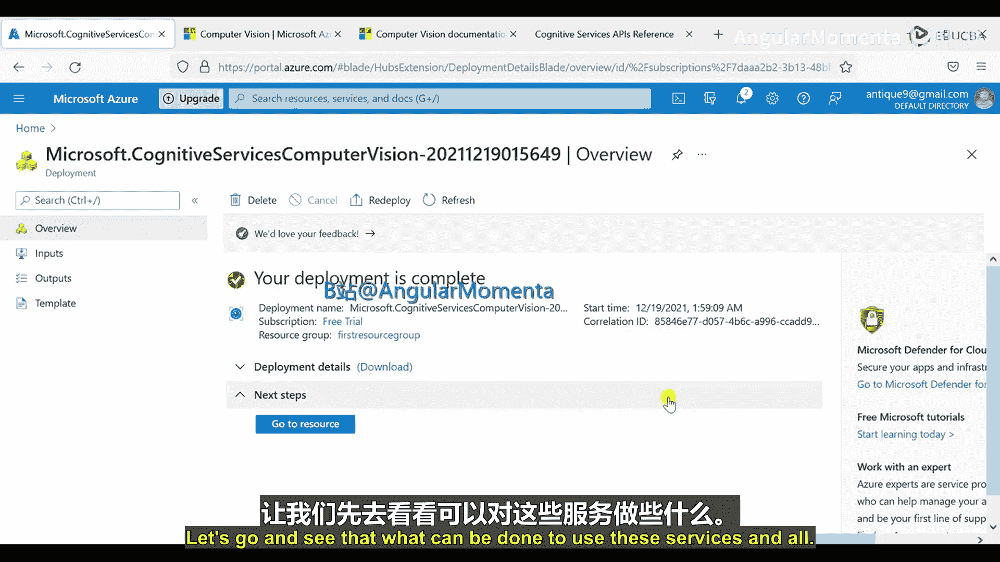

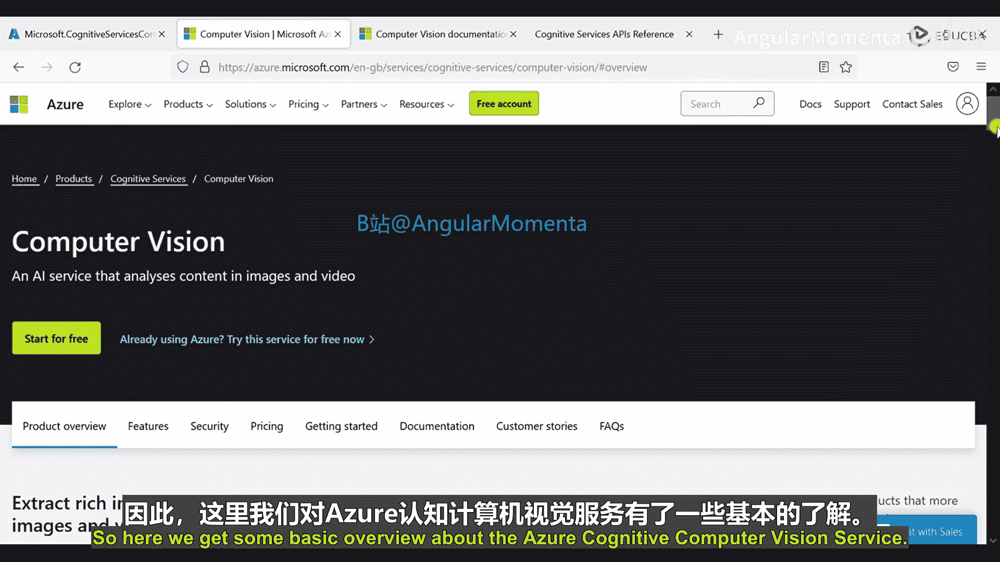

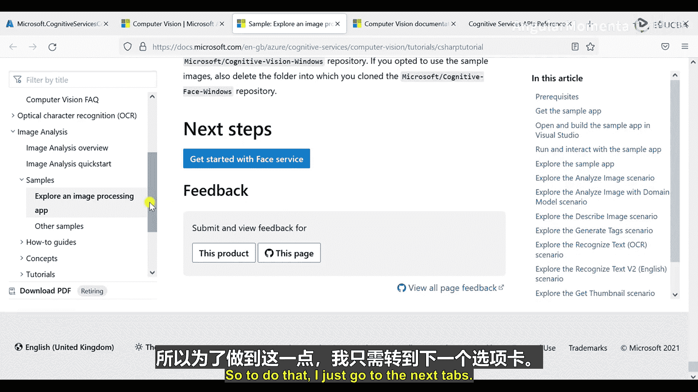

Here we have basic documentations over here。 you can access them from with the help of this documentation part and that we can see that as your providers multiple SDKs and we can use these SDks with multiple programming languages if you want to we have it for C has node J Python Java go and if we don't want to use SDKs directly because we all know that when we use these SDKs our application becomes a bit heavy so what we can do is we can use restJpa also get things done for us So these SJpa boxes I'll just take you so as you can see if we want to analyze some set of images we just have to use a post command after that we have a basic description about the services over here I'll just go down here it says how to analyze an image so we have an upload image options over here then we have to specify an image URL also if you want to use that After that we have these。

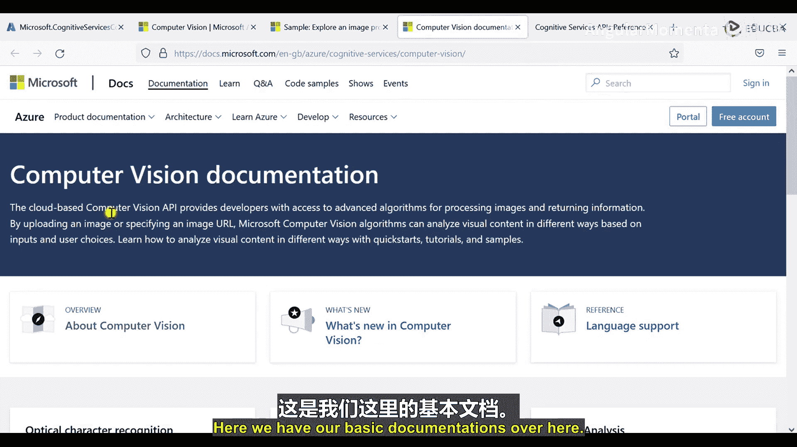

Regions over here， which we need to。Use， but how these Eps works actually for that。

 we can just go here and you can see we get a sample URL over here。

 So what I do I just go and copy this URL， a local or notpa file and paste it over here。 Now。

 in the end point part， we need to find past these。Endpoint over here。 So how to get our endpoint。

 let's go back to the top and you can see we get these end points over here。

 If you remember the region which we have used over years is。US each， so Ill just copy it。

 open my notad file， select this， remove it and paste the。End point over here after that。

 we have visions analyze。 after analyze， we have some more options， as you can see。

So I'll just press enterer right now。😔，In that we can see that we have visual features which are there then we have details in languages which we can use Okay。

 so I'll just remove this I have to remove these square brackets what are equal to what are the things which we need to find out over here okay so we get branch add is it adult categories colors description phase image types object tags I would be using the all of them right now categories comma color。

搞吗？Need description， I won't be using phase right now description， let's take objectss。

 Now what are the details we need over here， I just go select equals to let's go through the details We have is it a celebrity or landmark。

 So yes， we'll pass it。讲吗？I'll select landmarks， copy paste。

Now what are the languages we have So all these options are optional， So for example。

 we only wanted visual features over here so we can just go and remove other set of details from here。

 so I'll just go and remove these languages and model version control a copy So this is my postman。

I'll select。Pace， so as you can see， we have visual features and details over here。

I'll drop it down I just have to go and we need to request use some request items。

So I'll just go copy this content type select headers。After that。

 we need to pass some OCP subscription keys。I'll show you how to find the subscription key keys actually。

 So before I'll just go and paste them in this， I need to pass application。

Content type page is going to be updated stream forum us Now we need to find the subscription key for us Now for that we just have to go here I will go back to my main page I select my Azure cognitive service。

In that， we get a key end endpoint。Opttion。In that， we just go and copy these part。

 so you can see we get two keys over here。 you can use any key if you want to。

 and we can just show the keys also I just go back。And pass my keys over here， so that's done。

After that we just go back and see that do we need to do anything else， yes。

 we need to request body through which we are going to pass images and have multiple image formats which they support we have JPG PN G GIF or BM。

The image size should not be more than 4 N B as you can see。 So that check。

 and will go back to my postman。Go to my body right now。

Now we need to pass a GPPG or image type over here binary over here after that I select file。

 we have some sample images over here， so we'll be just selecting this image for now before we go and say select send over here you can see there's a get option right now I have to go and select post because if you go over here to use analyze of images we need to have a post。

vic。Now， I just go。Youing。While it is going to work on a request right now。

 just make sure that if more number of visual features you are going to select over here or more detail you are going to request from the Azure cognitive service。

 it is going to take more amount of time to get things done for you the lesser the things you are going to request it is going to take less amount of time to get things done for you so yes we got our request over here so you can see it's a status 200 okay which means it was a positive response from Azure cognitive service。

So the very first thing it says it category is it's an outdoor image as you have already seen that after that it says that it's an ocean beach then we get a scores for that it's not a known landmark as per the az your cognitive service After that we have some dominant color for grounds we can see we have whites over there most of the time then it's related to nature we have waves ridings over there and then we can just go to the captions so as you can see it has given a caption to it a wave crashing to a beach right now so that's how the as your cognitive service work for us now I would be passing a celebrity image over here I will go select。

So you all have。Familiar with him。But so let's go and select。

Sin only let wait for a response we get from here。 So as you can see right now it is sending requests。

 So once the request is sent the cognitive service， it responds back in adjacent format to us。

 So yes， we have got a response over here。You can see the status time it took was 17 seconds over here size is 1。

5 kb so category is people so as you can see it's a celebrity right now it is going to give a name to that it's Barack Obama confident level is 。

99 then we have a face rectangle created over here we have a dominant colors which are there foreground and background colors So we get the two dominant colors in the whole picture black and white then we got our description over here it's a person you have seen that he was a man。

Wearing a suit， theres a necktie clothing wearing so there are multiple tags that we get from the image right now and there's a caption also and if you want to see objects so it gives us the positioning for that so that was a Azure vision APIs works and for the mainly for the computer vision of files in the next session of us we are going to cover about how does these phase APIs work and before we do that just let me go and get one more sample image for us。

So I just go to here。I'll select a free image。 Now I just have to make sure that。😔。

I'll just select an a tower image。I you go and download it for free。除非公问期义的产业。😔，ok。

I just go back to my postman once again。Go to body。Remove the existing image。I go to my downloads。

I select the image and。So it would be taking a couple of seconds as we have already seen that it take time to analyze things out。

 but the results were fast it was done in around 7。33 seconds。

So we just say that okay we were able to pass and building over here so you can see that it just categorize the images we have passed earlier it was saying nature then it came to be as a person now it is a building in that we see that it's a Eiffel tower the confidence level is also very good over here not like we got with Barack Obama's image then we have a building pillars over there we can see it's a landmark so that's how the these cognitive APA work for us。

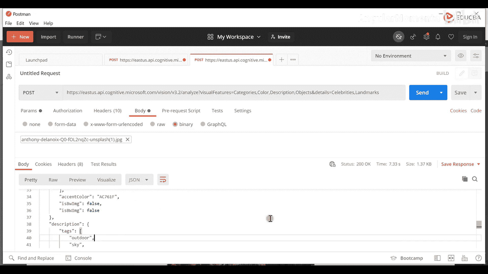

In the previous section of us， we have gone through the hands on activity in which we have used computer vision。

 and Ive already shown you how to use the postman to get the。

Access to these services of Azure and make how we can get the results out of it and the format of those set of images we even learned about how to deploy these services on the Azure club in this particular section of us we are going to learn about。

非起别意思。Has just seen in the previous section in computer vision， we were not。

Going deep into the images， we were just getting the basic details out of the images。

 what exactly is happening over here， their color schemes and is it a celebrity or a landmark just the basic details out of it。

 but in this very API we try to get more details of the。Image， we passed through it。

The very first thing which comes into the picture is face detection with the help of it we get to know about it are there one or more faces in the existing image or video which has been passed there after that it is going to give us some more detail about the image or a person in that for example age。

 gender expressions emotions and some more details about that particular person。

Then comes the phase verification。It tries to verify the existing set of images which it has and on the basis of that it result gives us the result out of it。

 the basic day to day example which we can consider is the Apple face ID which we use nowadays in that what they do is on the basis of the existing data it has and on the basis of the scanning it does on the fronttime it just unlocks your cell phone after that we go for the phase grouping so they might might be various needs to make sure that we need to how we need to start grouping things over there。

It might be a scenario that we try to search some set of images after that we come across that there is no particular match for that particular new set of image so we can just go ahead and create a new image and say that it these are unidentified images over there and on the basis of that we can just group it。

Then comes a face identification which works much more like a face verification part then we have a similarity finder what happen is there might be two images in which the persons might be looking similar to each other but are not the same set of person。

For that， the similarity finder comes into the picture。

The very first service comes here is face detection。

 so as I've already told you that in the phase detection service of us what happened is it is going to tell us that are there one or more faces in the picture past over here。

Then comes the details such as age， gender， emotions， landmarks， facial aid and post for example。

 we have a person over here standing。So what happened is if the APA is going to tell us that there is one person over here in the picture whose age is somewhere in the middle 30s。

 gender is male， emotion is hes happy， there are no facial is。

 so that's how the result it is going to give us out。

So we can use these kind of API for face detection， face verification， face Ids and grouping also。So。

That's how the phase detection work。Now， after that， we have a face verification service。

 so as I've already given you short idea about the face verification earlier。

What happens in the phase verification part is it tries to compare the image with the existing database and on the basis of that it just goes ahead and give your result out of it that is it a match or not。

 for example， there is a probability that two images have seen person over here。

With the using this particular API we can find the likelihood that two faces belong to the same person and there are many use cases for it。

 you can use these this particular API for the security purposes also for example if police is looking for some ex person over here and to make sure that they get a suspect matching with the existing record or not for that they can use this face related service then we have these Apple face ID also which are working in the day to day purpose of us then we have a face grouping as I've already told you earlier。

 what happened is when we have a certain set of images of get bulk of images and want to get them examined。

We just go through the existing service of files and try to match these new set of images。

 but after that we find out that there are no set of exact matches from the existing database of our so at that time what we can do is we can just create a new set of group over there and mark them to be as an unidentified images or else when we get these set of images and we have not gone through those images till now we can just put those set of images in a an examined group of files。

Then comes the phase search， what the thing comes into a mind when we talk about search。

It's all about searching and comparing the values so it helps us in searching and identify the images of our we can use this API to find out if a picture has a what happened is the very basic requirement for this particular services the images are to be stored in a 2D format it must be a two dimensional images after that we just pass on the existing image and a new set of images on the basis of that that is going to search the database and give us the detail about it and please note that the similar faces don't necessarily belong to the same person they might belong to people were simply similar looking you can use this API to develop interesting applications for example you can develop an application which accepts the user picture and find out if the user is similar to any celebrity and finally we have the first grouping API so you might have been seeing these trends going on to the Instagram nowadays。

They try to find out the celemity you looks like this way can de used you organize faces and pictures together into group based on the。

Visual similarity， for example， you can pass a single group of picture to this API and it can come back with different group placing similar faces in each group these API can has its own use cases as well in the next section of our I would be going taking you to the hands John activity and we are going to see how does the phase search of face API works in the real cognitive world of our。

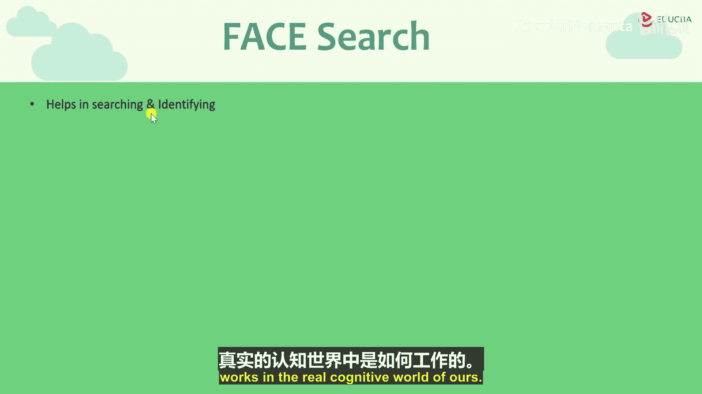

Now let's go to the handson activity and before we do that just see certain set of demos which are being given whether as here。

 so if we just scroll down you can see here there are two different images over here and in the first image there are two persons over here and on the basis of that it says that the person on the right and side matches with the person on the left and side over here and it even gives gives us the confidence number over here。

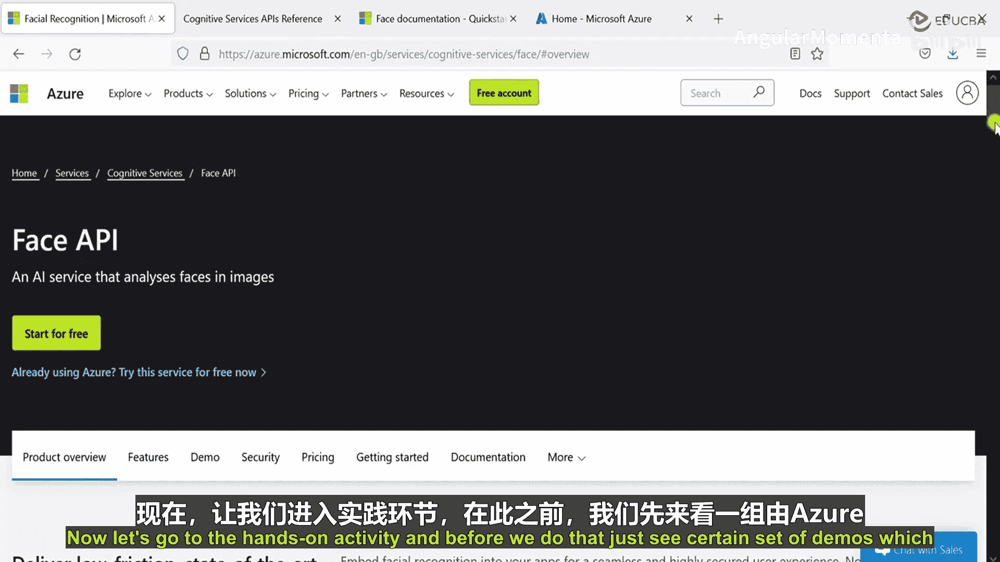

If we just go and select some different set of images so you can see it is being able to compare images on the basis of the driving license also on the left hand side the person has some specs over here and on the right hand side that two images of that person on the basis of that we got a number and in that the confidence is 083 that's all these verification services work on that now let's head back to the postman of us where we are going to trigger our own created API calls and on the basis of that we be learning that how to use this particular set of services by yourself so before we do that just let me show you that we have already created a service over here。

The reason behind creating a new service each and every time is because Ive created a demo after that I was not using the Azure anymore。

 so its recommended for us to make keep on deleting the resources when we are not using them。

SoThat's right saver costs。 Now， just I will go back to the documentation part。

 This is the documentation for the。Vision APIs so there are five services over here detect。

 find similar group identify and verify right now I've selected detect over here if we just go down you can see that there are certain set of rules and clarifications from the API engine you can find those things over for example they won't be storing your images after that we the image sizes given over that it has to be from 1 Kb to 6 m after that there are pixels details over here that saw these particular A work after that we will see that it is going to be a SDb method which we have already seen earlier also and we are going to use a post method。

Now I'll just go and copy the request URL， I'll copy this， paste it into my notad。

 I need to get my endpoint over here。 Ill just go copy my endpoint for the U E US。After that。

 we got a written phase IDd， so I'll be setting it to be as true。

Each and every time we pass a phase for that particular phase it generates a face ID and it is going to be same for that particular phase row After that it will be marking my phase landmark to as2 again。

with the help of these landmarks， we get to know that what are the areas where that face covers is okay coordinate basically now we just need to go and add some face attributes so if Ill just go down again so these are the multiple face attributes which this approach actually so I'll be copying couple of them copy I paste them over here。

Al just， let the。Extra spaces。So these are the attributes which we are going to look after。

Then just see what is there to be offered in the recognition model so you can see it's associated with the face ID supports recognition models and all。

 So there are multiple things it offers， but I won't be using it right now then we have a recognition model which is once again in a Boolean type。

 so I won't be。Using that to。Then we have a phase id。

 so on the basis of that we define that for how much time it is going to。Cash in the system of earth。

 So these are certain set of things which we are not going to use right now。

So I'll just go back to my API。Mark demo mode。And they them。So this is the API of mine。

 Now I just have to search for post。I'll copy this By the time my postman comes up。 just， okay。

 I think it's up。So that's it。 Here's my postman up and ready now， So I just paste my URL。

 which we have created over here。Okay， I will just select plus it is going to the type post。

 Ill pacee。Im updating right now， page。No， in the headers。

 we need to define a password general basically and what kind of。

Vals which we are going to pass with it， so I'll just copy my content type。

I'll select Doctor3 after that we need to find for the credentials for that we need to pass a key。

Subscription key， So there are two type2 keywords we get from our service。So before we do that。

 I just need to go back to my service， I'll select my service over here and the key is an endpoint we are going to get your key。

I'll be copying my。Key over here， you can use any one of them if you want to。Minimize it pace。

 so that's it。After that， we have to send it， but before we do that we need to add a body to it so it is going to have type binary I need to go and select an image over here。

So the very first thing I'm going to do is I'm going to pass an image。

 you can see multiple phases over here， so I'll just open。Sa。

 now we just have to wait for the response of this particular request of us。

I'll use a different image。😔，My is that。Just let me go through it。😔，你好。After that。

Just let me go and cross check once。So basically the I have been able to find out the issue with that does not accepting the mask to be as a field right now。

 but on the basis of image which we have passed over here so you can see we get a face ID。

After that we get a face rectangle， then we got a landmarks for each and everything such as pupil left。

 pupil right。No step， mouth left， mouth right。 Then for eyebrows， we have。

 So that's how these things works if we just。I should make it short now。

 I don't need a face landmarks because it is going to give a much more data set to go through。

Just wait for some time， so that's it we got a face I， face rectangle。Then we got a okay。

 these are the details over here then we have a head pose over here。

 we got a gender of a person age over year， then we got a facial head details that person had a mustache point one sideburns class details。

 emotions so you can see he's happy then blood levels are low。

So that's how these particular set of images work for us and you can use them in multiple use cases of yours as well。

So if we just pass now images have multiple people into that。

 so let's see how it is going to respond。So this is it。 I made。晴。

So you can see we got a phase idea here after that， we got some attributes。

There is one person whose age is 40， he is not having any glasses over there。😔。

Then the blood level exposures make up details， accessories。Hair details。

 if we just keep on going down with one thing which I want to。 So as you can see。

 there were multiple people into that particular photo， which we have passed right now。

 So for each and every phase。It has created a face ID and after that particular face I it has created all the data set for us。

 so for different phases it is going to have a different details so that's how it has managed things for us。

There was a lady in that， so it has already said targets it's a female defined the age also。Now。

 we keep on going down。They were， they were two kids， also。So you can see that。 Okay。

 this one no face I over here。So one kit is 11 years old， the other one is same。

 so that's how these detect APIs work to the day to day use cases of us and on the basis of that we can even decide that what exactly we need to do。

And what kind of use cases we want to create out。 That's how you can even explore the other set of。

Services which are being there such as find similar group identify and verify also。

 I've already show you how does the detect work and even a demo which was already given by the Azure that how does the find similar works。

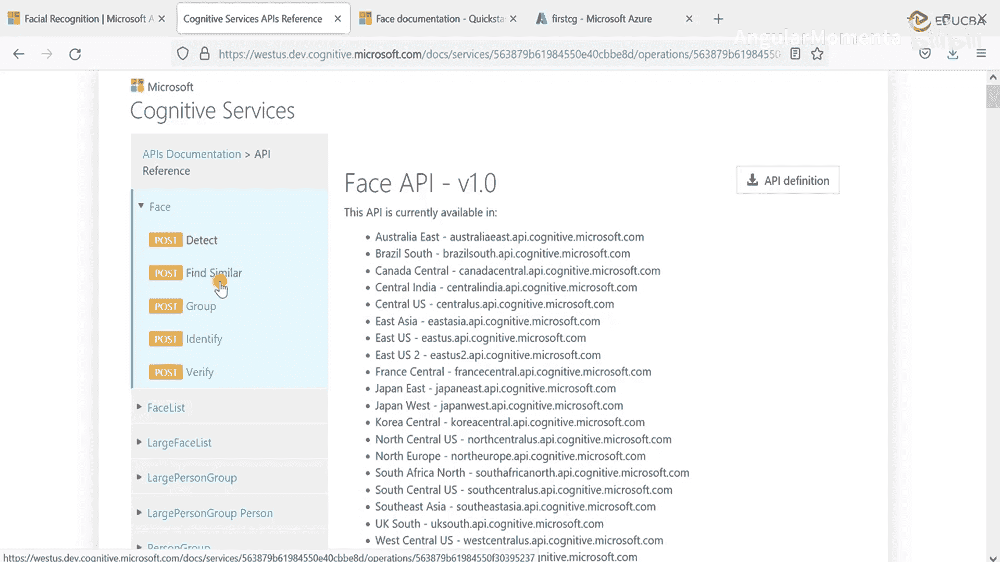