# 【EDUCBA】Azure实践——认知服务 ｜ Azure Practical - Cognitive Services p03 02_01_01_自定义视觉 -BV1zXFozVEXL_p3-

So the next category which comes under the vision API is custom vision as the name custom defines itself。

 it might be there for some specific reasons actually。

 and we would be doing some customization over that we can use the custom vision service to create a customized model to classify images for a unique use cases basically that two takeaway from this title first you only can use this model to classify images meaning accepting a new image until if this belongs to your specified group bias a group A might be a group B and the second takeaway is the fact that you need to use this custom vision service for your unique use cases only So we have already discussed about computer vision APIs and phase APIs earlier。

 we can use custom computer vision APIs to classify images of three E celebrities Mon more for those scenarios you。

Probably don't need to use a custom vision service。

 You need to use the custom vision service If you have a new scenario。 in that case。

 you can train in your custom vision models using pictures belonging to different categories you want to classify。

 for example。We can take a very basic example， We do sort things out on the basis of plastic in glasses see the picture also we are just trying to sort things out on the basis of that if it's a plastic we are going to put it in the basket on the right inside or else we'll just leave it now we can look into some more tangible examples over here。

 suppose we get different categories of different type of leaves of different trees basically。

And if you are going to pass these set of images of leaves on a basic model which we get from Azure。

 we are going to get to know that， okay， these are。Leavs from tree basically。

 and we won't be getting some much more detailed answer on the basis of that。 Okay。

 but if you are going to one that we are going to get much more detailed results out of it。

 for example， I have a。Name leaves or a mango tree leaf on the left hand side， suppose。

 and we want to get to know that when we pass these kind of images to our model that we get a proper answer on the base that that yes。

 this is a xyite leave， which have been passed over here。

 we just need to have a new customized model created by us。 So for that custom vision。

Comes into the picture and it helps us out to perfectly develop this scenario again。

 you can use the custom vision service to develop an application for these kind of scenarios。

How do you provision a new custom vision service， basically， the very basic thing would be。

 I need to make sure that we understand the fact that here we are not dealing with the low level machine learning to be able to train this custom vision model of our。

 You don't need to gather thousands of training pictures also。

You don't need to choose your own models or clean up the data all is taken here by the Microsoft Azure itself。

Microsoft Azure is already chosen the right model for these kind of scenarios and already have deployed it and are pre traineded as well All we need to do is use couple of images from different categories which we want to use。

Okay， for in my case， we would be considering leaves when we are going for a hand John activity。

 I would be choosing multiple different kind of。Leave from different trees on on the basis of that we are going to create a custom vision model over there Now let's see the steps which are needed basically。

These are the basic ships， as you can see。So first we need a few set of pictures ready。

 Microsoft requirements about 30 pictures per each category is good。

 the more pictures the better the result we are going to get。

Then I am going to upload those set of images over here After that。

 we are going to train a model with the set of images which have uploaded over there。

 Then after the model training has been done we have to test our model and check that the results which we are getting from these training model as per our need or not if they are not we need to train the model once again If the results are as per our own requirement or desired results are there。

 we just go and deploy these kind of services after the model is deployed。

 I can use it from my application or initiative declined by calling the rest API calls I am given with the help of Azure we have already seen how these APIPA calls are given out to us you can always make your own custom vision service better by uploading more set of images and retraining your model this way you can make sure the model is improving over time Now in the next session we are going to try to create our own set of custom vision API。

And to get it done， we would be using an example of these different kind of leaves which up there on different trees。

 and we are going to see how the result we are going to get out of it。

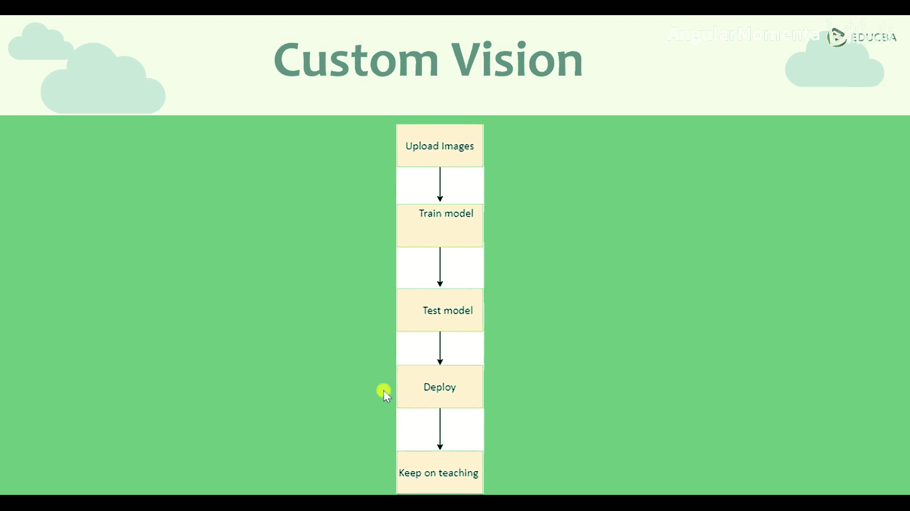

In this particular session， we are going to take at the overview and going towards the hands on activity where I would be creating a custom vision service through which I would be creating a leaf categorization service where I would be using two categories。

 a leaf， a nameme leaf and a mango leaf。On the basis of these two leaves we are going to test certain set of test cases of us and try to find out what kind of leads are there Now let's move over to the hand activity in the search option I just have to go and search for custom vision so I've selected the custom vision over here I'll go and select a create tab or the create option is going to be a prediction type but of course categorization comes into prediction the subscription is going to be a free trial the resource group we have to select so I would be selecting our first resource group which I have created in our very first session After that I am going to select the region East US which have been used by us from beginning then I just have to go and name my service。

Tterorization。That say is it's already taken， so I just enter a new breaks over there。😔，So， yes。

 it has been taken。Now just have to go and select a pricing tier so it is going to be free one。

 so I just go and select next now just in the network section I would be keeping it to a default one。

 which is the all networking including the internet and can access this resource next。

 I won't be adding any tags to it。Now I just go further review and create So as you can see it has partial your validation over here。

 we can just go down， scroll down and see that these are the settings we have entered create options this prediction。

It is a free trial is name of service and pricing deal After that we just go and select create。

Our deployment has been submitted over here， so as you can see。

It says that deployment is in progress it would be taking couple of minutes to get it done。

 You can see the operation details which are happening over here so we get an operation I over here operation names we have it says that providing status running right now timestamps duration even we have these tracking I service request Is over here。

 So as you can see our deployment has been completed over here so'll just close this tab then I'll just go to the resource。

In the resource， you can see。Find out certain set of。Details around here。

Now we can just get started with this。 So the first way to get it done is we can create our API key to authenticate and user application。

 and we would be using these web Ps to get it done in this case the second is to get it done with the help of a portal on those year only So it would be using a custom vision portal over here to get it done。

 The third way to get it done is with the help of web API calls using specific languages over here。

 So it's supposed。C hasash， Python， node j， Java and good language， as you can see。

So now just go to the custom vision portal of us now。

 and I'll just go and select our very first project。

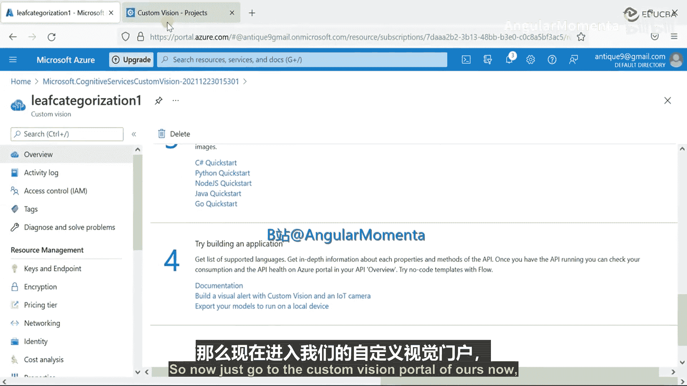

Name of the project is going to be saved leave。Category。Categoorize the type of res。

Then the project type is going to be classification in the classification。

 it is going to be a single tag per image。Then we get certain domains over here。Basically。

 there are four major domains over here。These are general food landmarks and retail foods food is related to all the food related items landmarks would be your landmark related then we have retails for this particular activities of us I would be using general and in general I would be selecting a general a2 you can select any of them if you want to so now just go to create project。

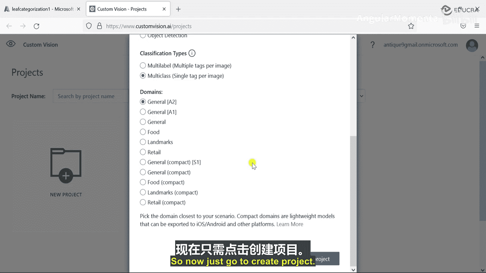

So as you can see， it's creating a project。So our project has been created over here。

Now we just have to go and select certain set of images to be used。I select the tab add images。

In that， I'll just go and select first of all， all the mango leaf related。

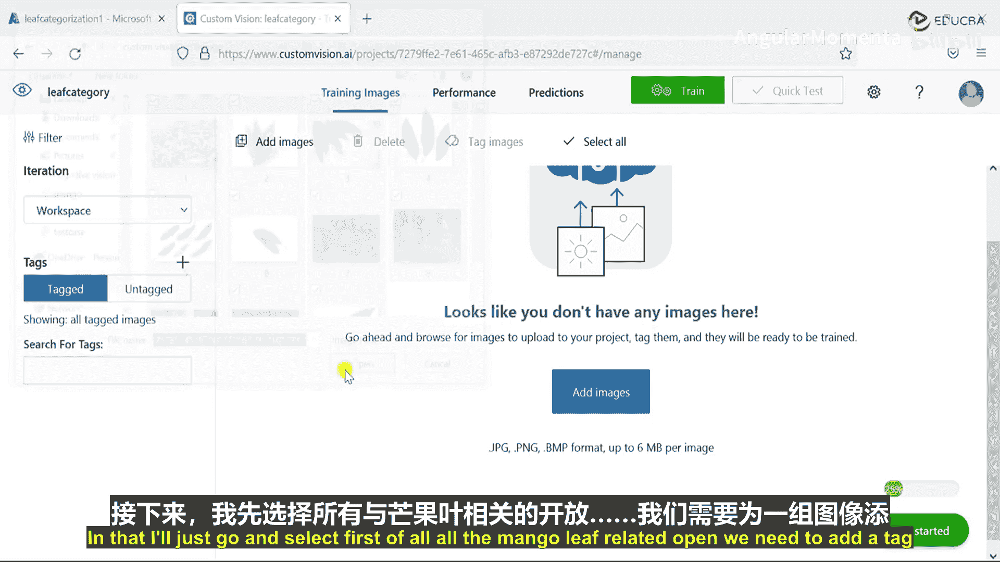

Open。We need to add tag to this set of images so I get to know that what kind of images are there so I name it as mango leaf。

Inlect clam， upload1 images。

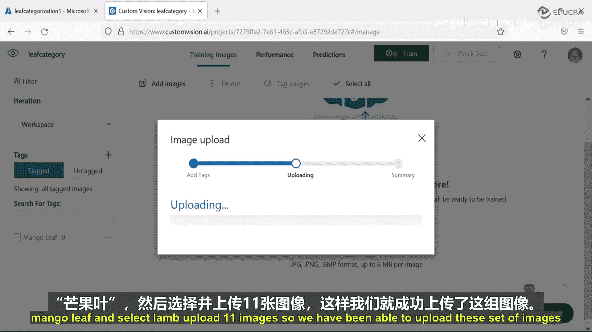

So we have been able to upload these set of images。Now I'll be adding more set of images over here。

I'll go to the other folder name。

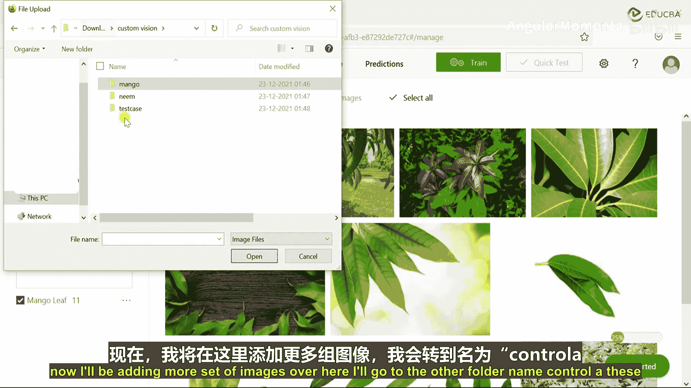

Controroller， these are name leaf。Upload it's good to upload if you can upload around minimum 30 to 40 images。

 which is the best desired from the as youn， but even if you upload 10 to 11 images also it' is good if you want to。

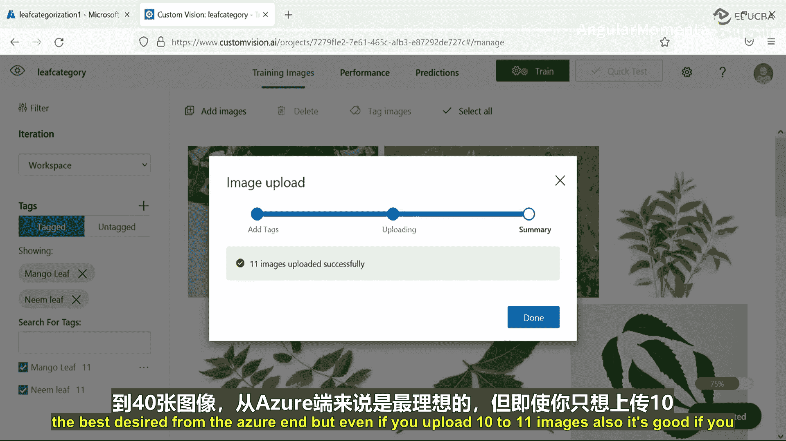

So， it's been done。Tll now what we have done is we have provided with certain set of images and have tile those set of images over here now it has been done but here comes the main part if you want to just go and train our model on the basis of these input data。

 we can just go and select train。

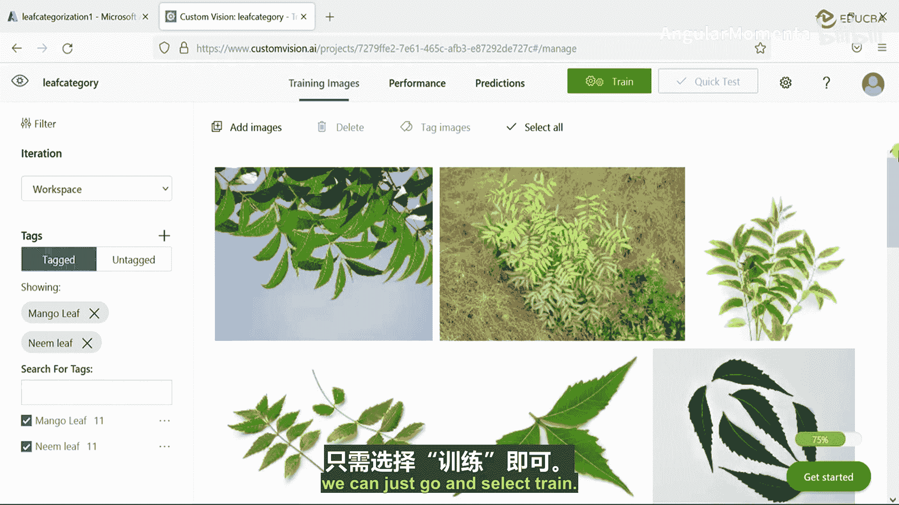

There are two types of training sets over here。 The first one is quick training。

 which we are going to use for this particular session of us。

 The other one is the advanced training basically in advanced training it。

Estimates and give you budget for the training required so you can select it for1 hour to or 10 hours96 hours the more the time your model is going to invest on training the better it become so that's how it works but the more time you are going to take it is use going to take more computations and that is going to cost your course and for example if it going select 10 or a 15 hours over here we won't be sitting here to wait for its completions what you can do is you can just select option over here。

 send me an email notification after the training complete so that's how the advanced training works but I would be just choosing a quick training I' select train。

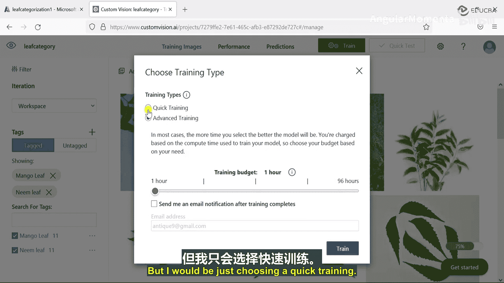

So as you can see it says that iteration1 training has been started right now now what is it is going to do is it is going to keep on checking with the model of us and on the basis of that it is keep on reporting us that the training is in crash or it has been completed so I'll just wait for it usually it takes a couple of minutes not more than a minute at times。

Because even training sit is small only。As you can see。

Time is changing with each and every seconds so you can keep on getting to know that something is happening over here as you can see a model has been trained over here so it says that right now on the basis of data sets we have given the precisions would go on 75% so now just go down so we can see the performance per tag so we can just if you want you can just add more set of images and train a model once again for that you just have to go to the training images part。

The second thing now we are going to do is we can just go and check the model so I just select a quick test tab。

 browse local files。These are test cases here you can see it's a manual leaf and the probability it says that it's 99。

7% Nowll just go and select another image。So it says it's a name leaf with a probability of 95 point。

One person， you can even recognize this one。 It's a mango only。 So it is going to be a mango leaf。

The probability is 99。2。This is also ning leaf。And to be on a much more sure part。

 if you see that these set of images are something which we have not passed over here。

 so these are totally a new set of images which we are sending over to our service and still it has been able to detect those things over here。

Now I'll just show you how you can access a service with the URL partner， so to do that。

 once you are sure about that we are getting a required or expected results out of here。

 you just have to go and select publish options。

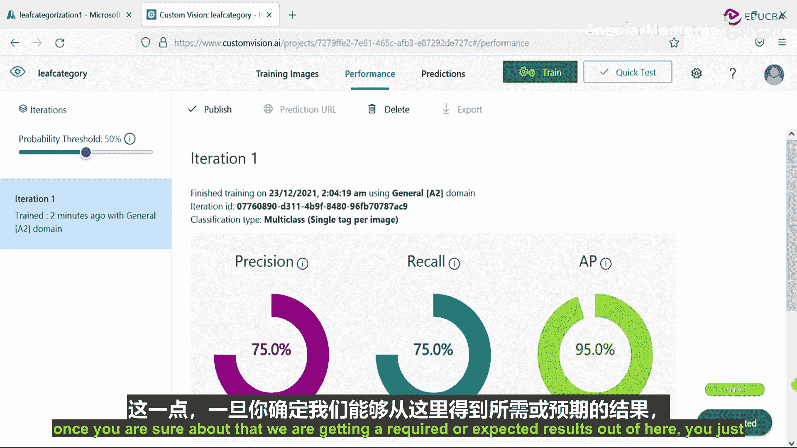

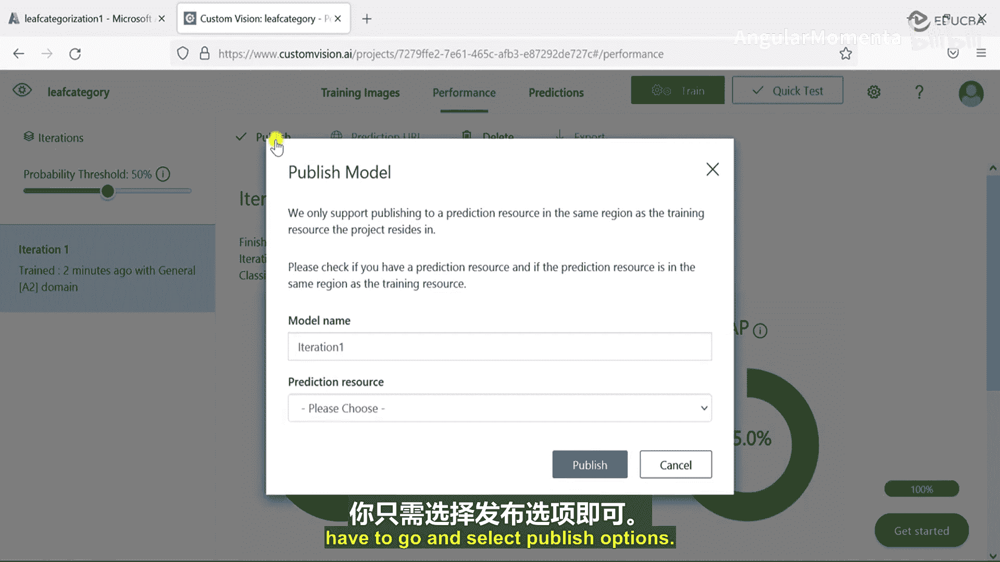

Our service is going to be published and we can access it with the help of our URLs also now。

So you can see if we go and select our prediction URL now， we get a URL over here， so for example。

 if you want to pass an image as a image URL， so these are the settings to be used out。

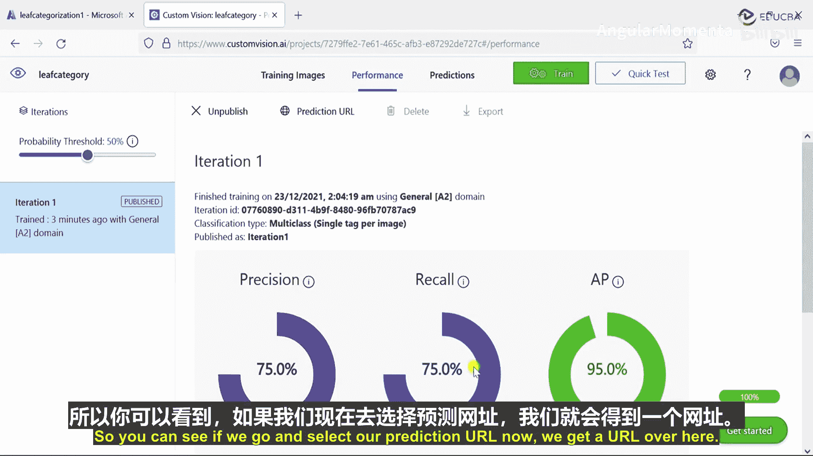

But if you want to send an image directly for that， we can just go ahead and copy this book。

You all shall go select this copy now。

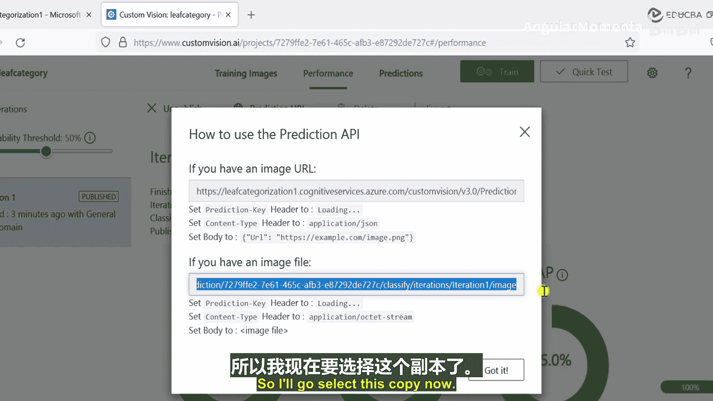

I open up Bush， man。I'll paste it over you。I'm going to select a post option。

I'll move to headers in headers， it asks us to put something as a prediction key。

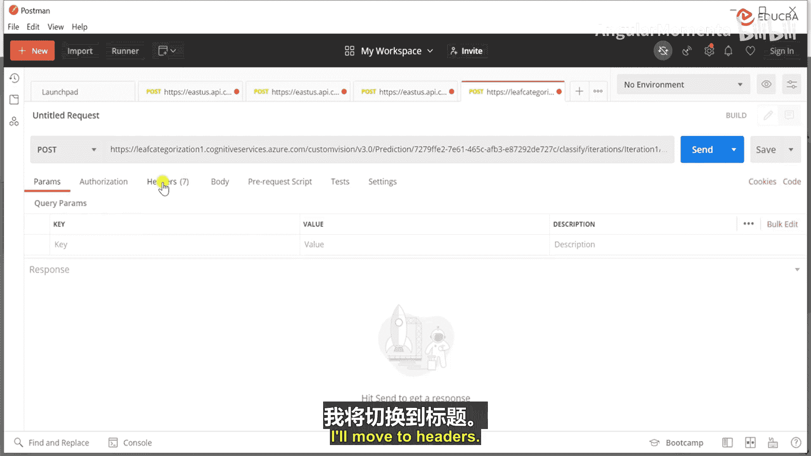

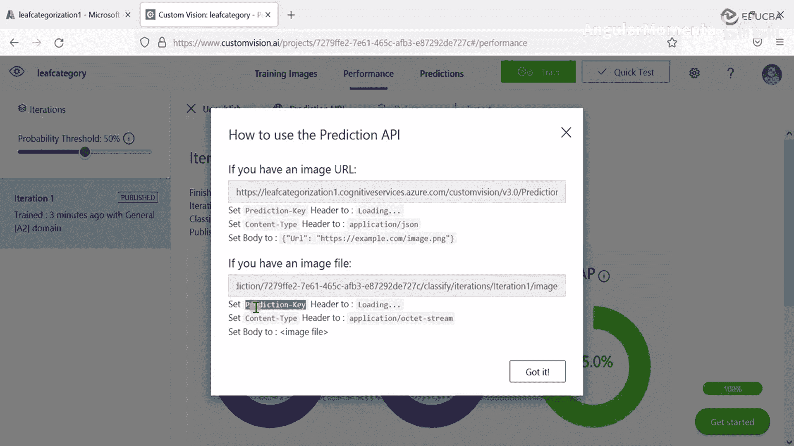

Ilar my prediction key。After that， I just have to select my content type。

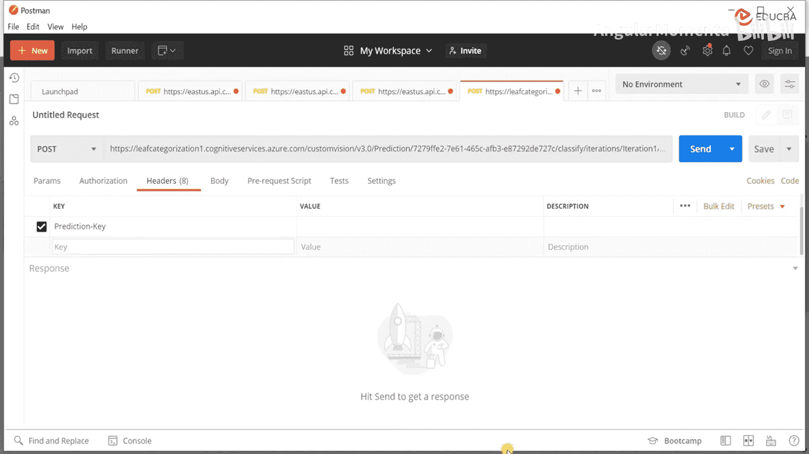

Could copy that， too。

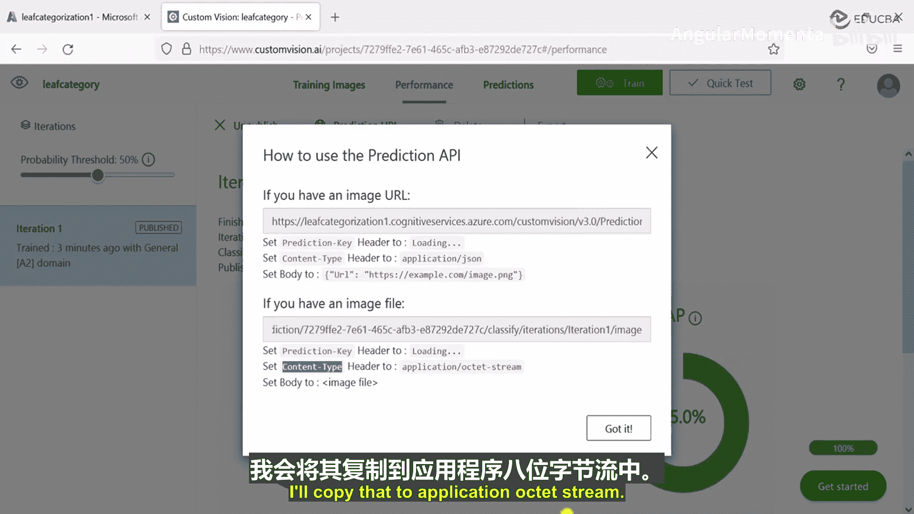

Application of3。 Now we just have to go and add a key over here to find a key。

 we just have to go to my tab in that I just have to go to keys and endpoint。I just go and copy。

 You can copy either of one of them。Mardy。It is going to be binary type。

I'll go in selection Now with the help of our UI patch。

 we are going to identify what kind of leaves these are。

 so you can see that we got our predictions over here in prediction it says that the probability is 0。

99。And the tag name is going to be me mangof it is also going to give us a other set of probabilities also。

 so as you can see it says that 0002 it could be a need。I'll just change。系没事。

If you see now the probability is 0。95 and it says it could be a name leaf and 0。

04% it could be a mango leaf， so that's how the custom Vi API work for us in the real scenarios so as per your requirements you can just go ahead and create services over here and test them out Now I just go and delete these set of resources to get it done we have to make sure that it is unpublished first。

Then I'll go and select delete。

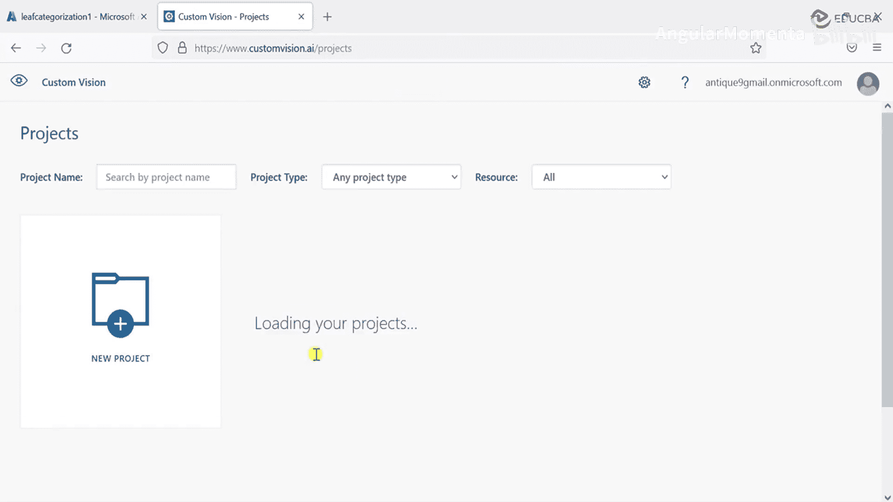

These are our projects。I'll just go and select delete。

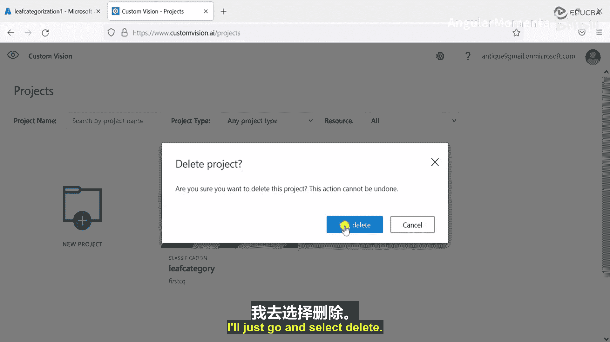

Now I just have to go to my home and delete this particular service。

So that's how the custom vision service works in our day to day life and you can use this。

I'll just go and delete it now。So just make sure once you are done with the service。

 you delete those set of resources so that you don't get bill for them。

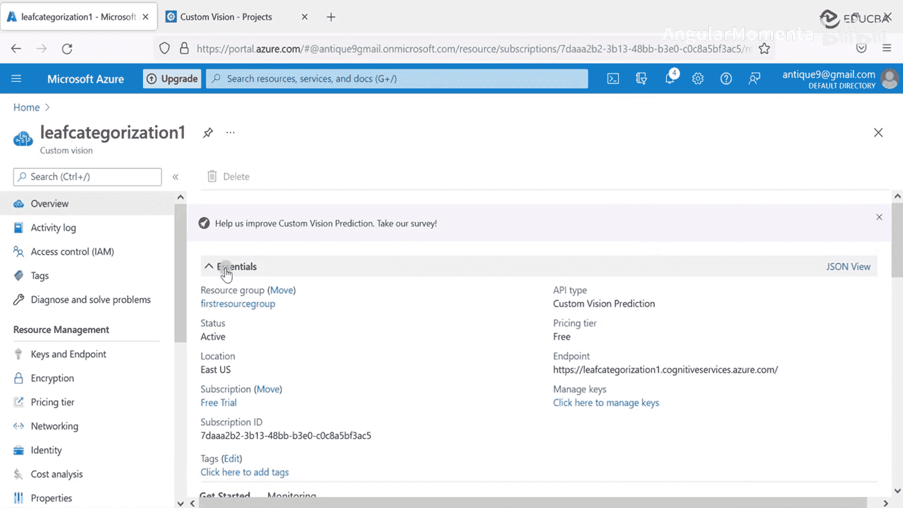