# 【EDUCBA】Azure实践——认知服务 ｜ Azure Practical - Cognitive Services p04 02_02_01_形态与墨水识别器概述 -BV1zXFozVEXL_p4-

Now we are going to learn about another vision service which are being provided by the Azure cognitive service。

 so this is the video indexing service， so the main purpose of this service is to index videos for us and to get it done it uses the metadata which it extracts from the audio and videos which we pass through this particular service of and this is the main purpose of this service also so。

Once the metada is extracted from the audio in video it in turn it can be used to tag the videos files later so what kind of metada which we are talking about here。

So the metadata includes spoken words， written text topics， branch， faces， speakers and emotions。

And as you can see， these are some of the valuable informations which we can extract from the video and audio files so this service also saves a lot of time and effort。

 so， for example we have a 10 minutes video and we want to extract children instead of metter data from it。

To get it done as a human， we have to go through the video completely and on the basis of that particular video we are going to note down these metadata and to get it done in much more simpler way is to do it we just have to float this particular service and pass on a video or audio through it and on the basis of that we get the metadata。

So getting all the metadata back is much more easier with the help of this particular service so we can use this service in multiple ways out so taking an example。

 suppose we have a video library and a person wants to come over there and want to search on specific video or something so if he' is going to provide us with certain set of metadata we can go and find those videos for him the second way to do it if we have a sample video we can just run through that sample video on the basis of sample video we are going to get a metadata and then we are going to go and cross check with the existing data of files so that's how it can be created out now after the video indexing service comes another service so this is a call as video form recognize the service。

So with the help of video form recognizer service， we try to extract data forms tables basically。

So what happens is you have these certain set of forms being provided by some banks school colleges which are to be filled with the help of computers and so suppose I have a PDF file which I got a from a school after going through the form editor are fill that particular form Now if they want to extract certain set of key value pay from those particular forms which I've filled either a person has to go and manually read through it the second way to do is they just pass these particular forms to the video form recognizer service and this service is going to extract data from that particular form of us in the key value pay format for example this is a form which we are going to get fill with help of a PDF editor or something so once it is pass through the video form recognize service it is going to extract the key value space from this particular form and that's how we can just index a data as per a requirement so it。

on't be required to get these things done manually so after the video form recognizer service comes the IG or we called as a inkrer so in the previous slide I told you that how exactly this data extraction works done from the forms which are filled from digitally but at certain set of time people fill certain details manually by writing it with the help of hand or by for example they just draw these things on the I just show you。

For example。I'm writing certain text over here。 So these kind of text are to be extracted。

 So these particular。Texture call us digital ink Okay so we have drawn these text with the help of a mouse on our text shop computers or we have a drawn a picture So this service is going to accept these rocks and come back with a recognition text and simple shapes and you can see an example on the screen also so Ive written a text over here。

 So my service is going to read through it and on the basis of that it is going to give us a result out of it So have handedwritten a text over here so my service is going to go through it and on the basis of that it is going to return certain set output So that's all the。

Videoing recognizer works so we can even try to pass on certain set of stand copies in which we have written something on a paper with the help of pen or something and then we can try to see how exactly works in the same way oR can extract text also。

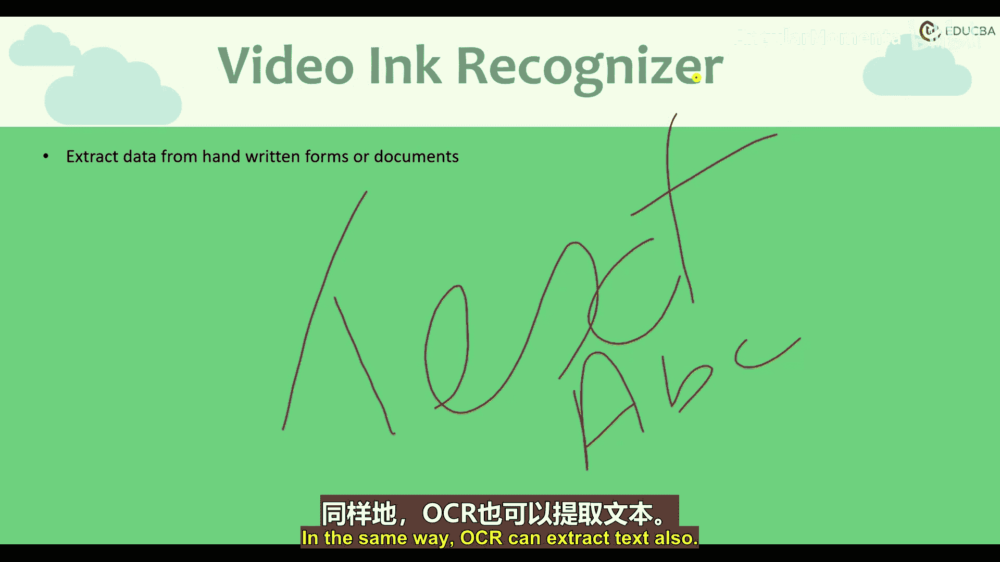

In this phase session of hours， we are going to have an hands on activity on the vision indexer service。

 which we have gone through in the previous session， so this is my Azure portal。

 but when I am going to search for the vision index over here。

It is not going to show us any service over here or even a video in。

So basically what exactly happens is this particular service is being provided by the Azure separately。

 so for that we just have to go to the media indexdexer dot AI So once you go to media in Dex Ai you have to create your account once again over there so I would be going ahead and creating my very first account over there so I select a Google。

I just have to go and enter my email I over here。Yeah。Yeah。So once I have passed on my email I。

 I have to pass my email ID。Yeah。So， she the。She。Okay。Okay。

 so I've been able to log into my account now。So as you can see here we can see what exactly the Azure video analyzer service providers。

 so we have media files over here， we have model customizations and account settings options over here so in my media files we have library project and sample so basically this is a sample service profile so I just go back to my library and select upload。

Now in the upload section we get a browser file and we have certain set of uploading guidelines。

 so let's go to the uploading guidelines， so it says that the video should not be more than 4Gb or up to the4 limit。

 then it also have some particular set of file formats as you can see。

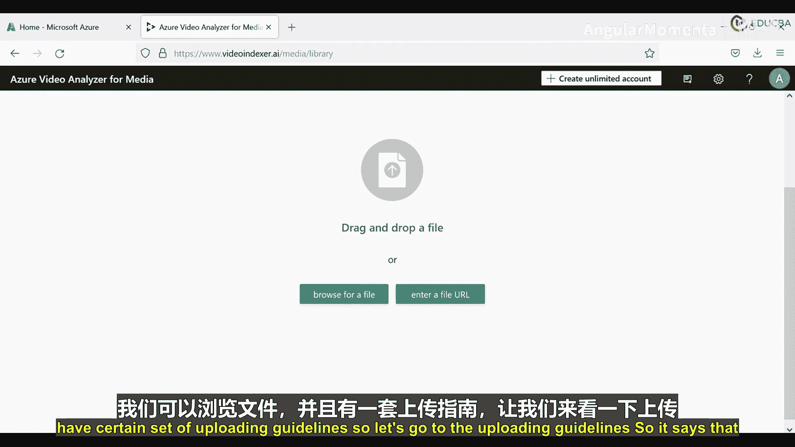

So now just close this and select B file。

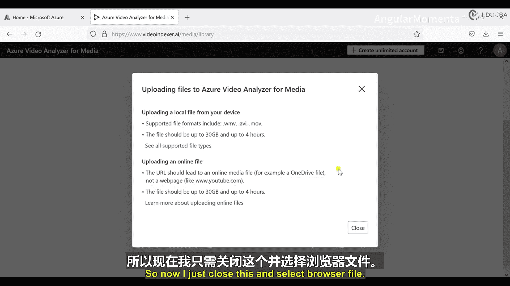

I will go to my downloads。So Ive already downloaded certain set of videos over here。

But just go into like this one。All of these videos are freely available。

So these videos don't have any audio in them right now。

 so just wait for some seconds to get my videos to be uploaded over here。Yeah。So as you can see。

 one of our video has been uploaded now now this particular video is getting indexed。

I go back to my browse file and I'll select another video Ill select upload so as you can see its the another video is also now getting uploaded over here。

So as you can see this particular video was uploaded in recent buyers Now it's getting index。

 and at the same time， this particular video index has been reached to 30%。

 So there are two ways to get it done。 for example。

 right now we have a smaller videos which we have uploaded over here So it won't be taking a lot of time to get indexed but in case you have a much larger video search so to get it done you have you just select your videos upload them over here after that。

 you can just get a reply by this particular service to a respective email idea that your particular video was indexed。

 So as you can see the indexing percentage has been changed over here one of the video is at 53% The other one has reached to a 30% though these videos are very small it should not take a lot of time to get completed。

 So what happens is once the video get indexed out you can go and check certain set of values over there and if you think as per your。

Ne something might have been missing over there so we can even go and select to get these particular set of videos rein if we want to。

 so I'll show you that once these videos get a index a proper way out So let's refresh it again。

 So yes， one of our videos has been index in a proper way out。Such as go and select a playover here。

 So this is our 12 second video， as you can see。So it will be playing that vertical video pass。

But at the same time we can just see what exactly is there in this particular video for us so because it was a sample video which available for free。

 we don't have to buy any rights for that so as per this particular video we got certain set of details over here that there are two videos over here and what is the appearance percentage in the video so you can see the second image is there for 23。

19 in the video。

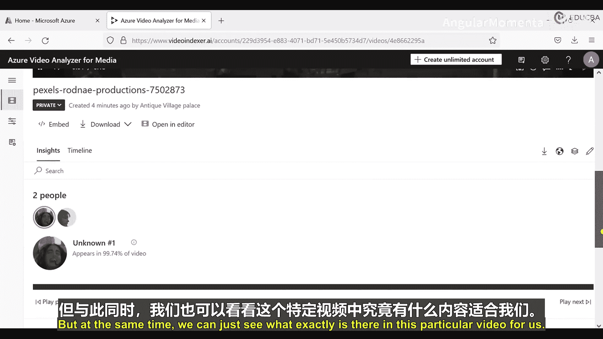

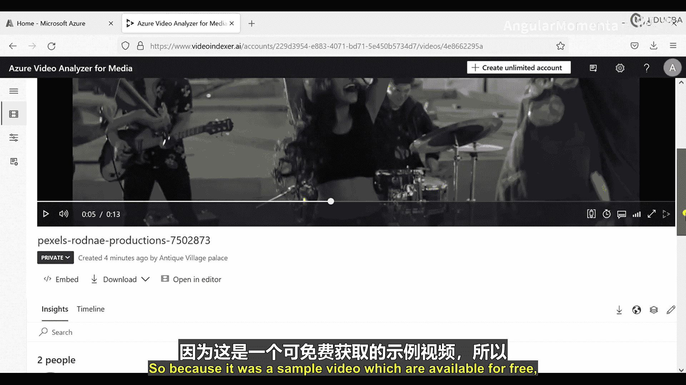

And I think it has not covered each and every person of a year。

 The first person has been covered for 199。74 person， which was the lead singer， as you can see。

 So the other thing which it has been able to capture for us there are 19 labels out here。

 I just expand it out， it's an out outdoor video， the person women's skyes， clothing， set。

 skyscrapers， human face。 So these are the certain set of labels that has been。

Creating on the basis of the video which have been passed through it。

 and there are certain set of scenes which have been looked after。

 So that's how it index those particular set of things for us Now if its a go。

We can select what exactly we need to look into here。

 so you can see we have these insights over here， we have captioning accessbilities because right now there was no video into that so there is no captioning which has happened for us。

You can even edit certain set of things， for example， if I want to delete this person over here。

 we can do that。Now， just let's go back。In the search box， for example， I。By bird right now。

 so as you can see it has ran a queryrry for us and on the basis of that it says that a bird was there in this particular video and what exactly at what time periods birds were detected in this particular video it has given us the insight so I just select this particular video now。

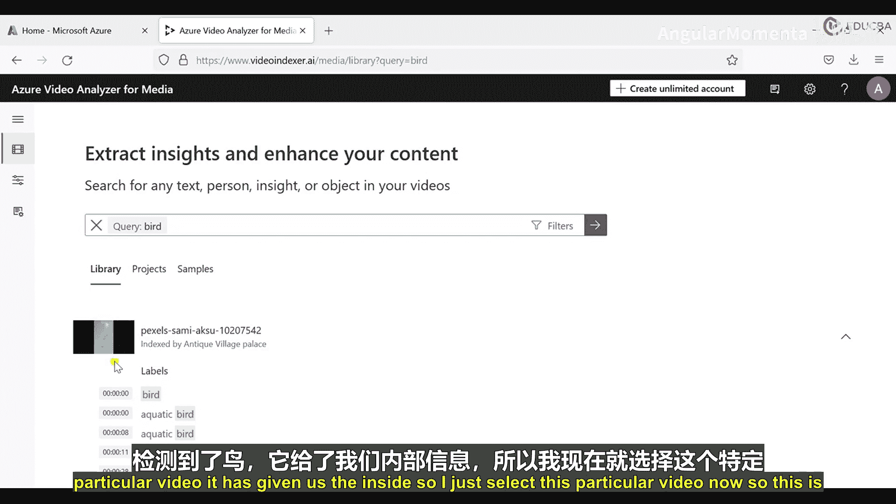

So this is a video where you can see birds are flying in the and if you see we get certain set of labels over here so the outdoor label you can see is present over here also then they have these birds and all and different kind of label which they have given so if I just go back and I try to search particular video for example my next query could be outdoor so as you can see we got these both of the videos over here but now if I just go and pass a curl over here you can see that this particular video has been recommended by the Azure video analyzer and it says that we can use this particular video if you were searching something related to a girl or something and if we just want to search something related to outdoor music。

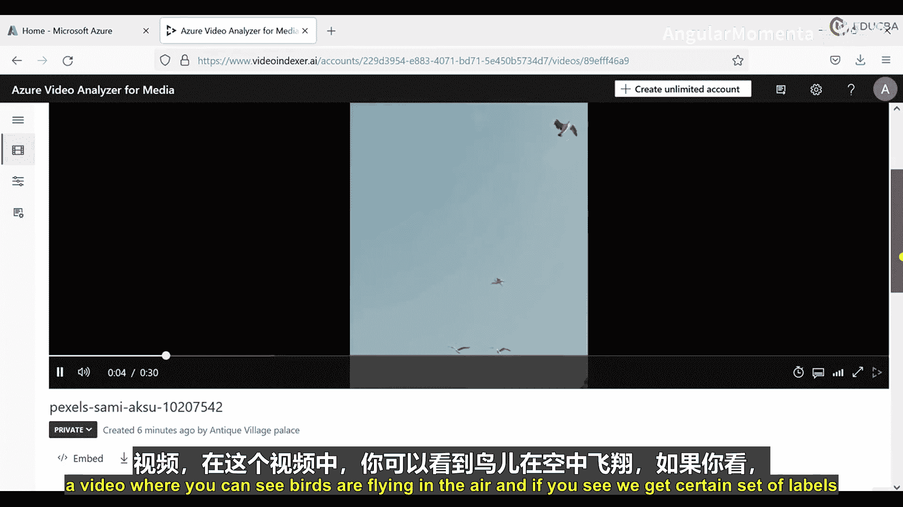

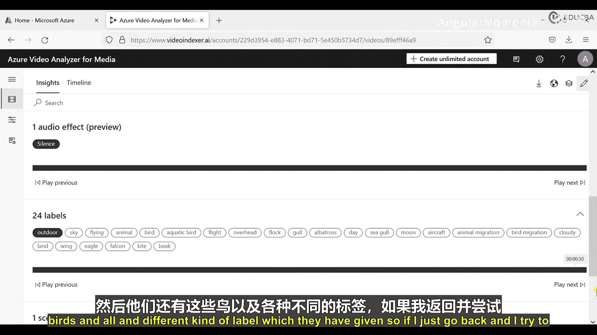

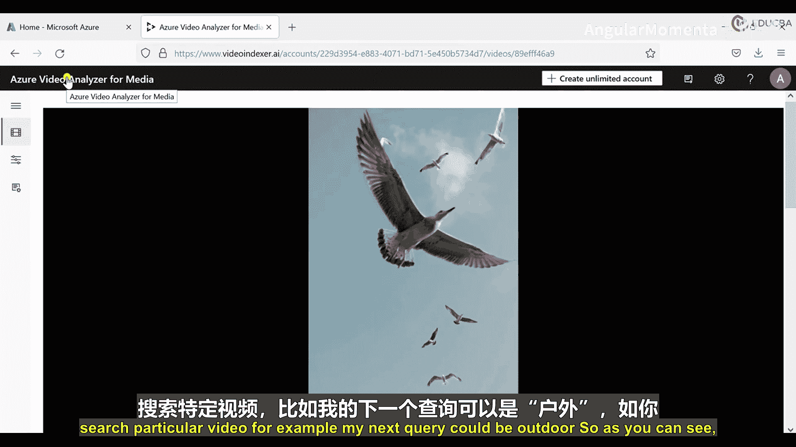

We can pass that Thank you So that's how the particular this particular service works on the Azure front。

 but this service has been provided by the Azure in a separate way out so this is the URL for that particular service so you can just go ahead and create your free account over there you just have to go and select the account you want to create on the basis of Google if you have a。

Microsoft ID or whatever on the basis of that you can just go and create your account after that you can just use this particular set of service as it is the way you want。

Now we are going towards the hands John activity on the form Rer。

 so this is my Microsoft Azure portal and I just have to go and look for the form Rer service over here。

Once I launched this particular service。To get it done， I have to go and select create。

So my subscription is going to be a free trial。After that， we need to go and past the resource group。

 so I would be using the very initial resource group which we have created in the starting of sessions。

The region is going to be issues。After that， I need to give a name in which I will give a demo face。

organizer。After that， we need to go and set the pricing tier。So would be selecting噶。

Free one after that I'll just go and select next， so I would be selecting all networks。

 I wouldn't be changing in anything to the identity。No tax be added。So I just now review。

 and after that we'll just go and select the C option。Well just review it once。 So yes。

 it's a free trial and the pricing ti is going to be a 500 pages per month option and it is going to integrate 20 calls per minute。

 So now I just have to go and create this particular service of first it would be taking some time to get it done So as you can see deployment is in progress now。

And if you want to see that what exactly is happening we can do that too and if you want to get these deployment details I can just download them as well if you want to just let wait for a couple of minutes to get it deployed so as you can see our service has been deployed so it says that your deployment is complete so as you can see this is my demo face recognizer service over here so I just go。

So here in the overview we get to know certain set of details of our service it includes the location service names and all so we have already been doing those set of things earlier also and these are our keys which we would be using as we are going to use our service as we move so now I have to go and select my form rec options over here so what basically after an over here I have been to the Azure page in which in the services I looked for the form recognize over here and with the help of that we can get the certain set of documentation so after that I have gone through the documentation part。

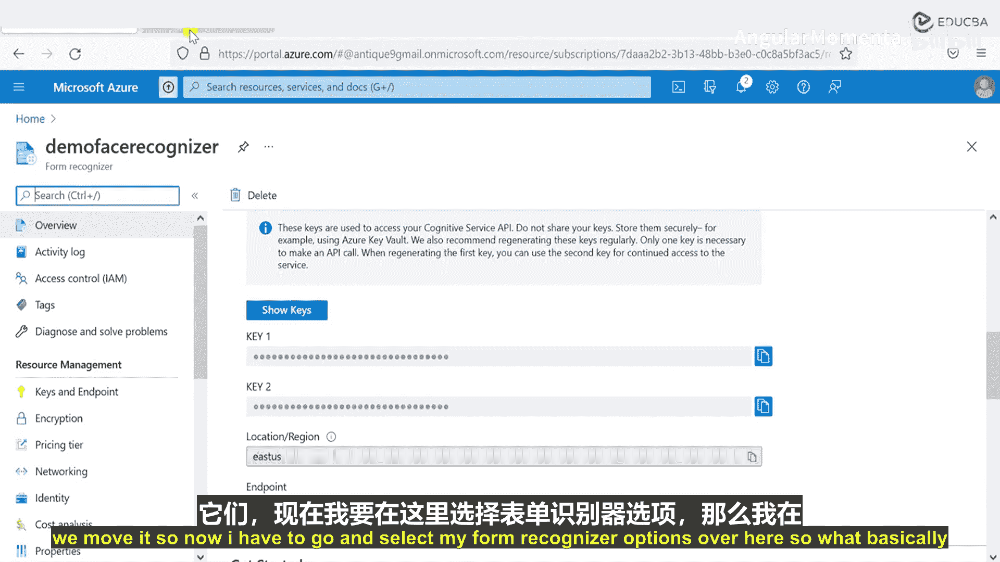

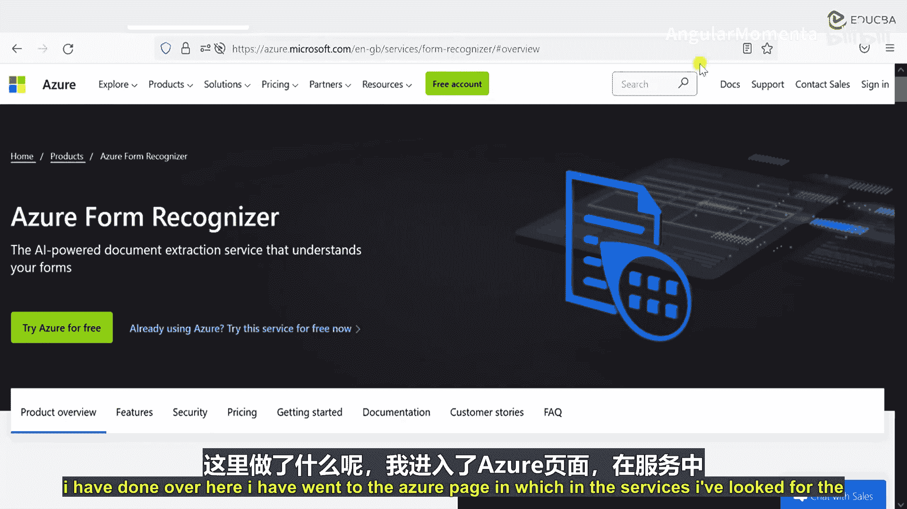

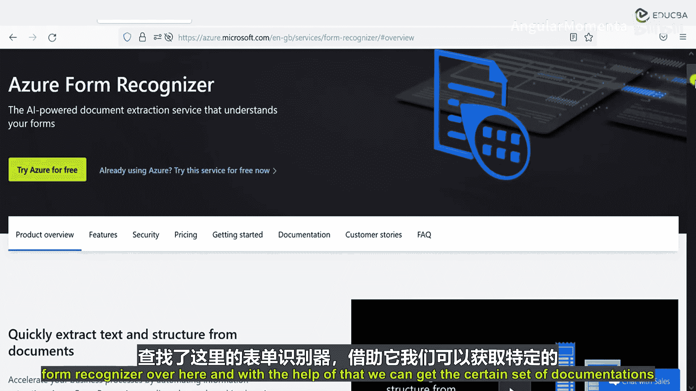

This is the bit tricky part， actually。In the farm recognizer， right， they support two types。

Theres a form recognizer API， which is a version 2。1， and there's a one API which is the recent one。

 which is in preview right now。you won't be looking into the preview one。

Right now we would be just looking into the 2。1 release and we would be trying to use that only we get our very first demo URLs over here so as you can see it says that we need to have our endpoints and all to get my endpoints we just have this particular documentation over here。

SoOn the basis of these particular documentation， if I just go and select because the location we are using is issue。

 we have selected that。I had actually opened it earlier。So this is a different document right。

This is my actual request， URL。Which we would be getting when we select。US over here。

 So I think service might not be working in a proper way。 So nowll just go back。

 I'll need to open a notepad， and I'll copy this over here。Still loading over here。

 We can wait for a couple of seconds or else for Tdo I do have it pre copied over here。

 What you no issues choose。 So I just copy this first control C。😔，Go to my notpa。Is this。谢谢。😊，那Yes。

I'll be copying this out。Letting we copy over here somehow。 Okay。

 there is some issue with the page right now。Okay issues。

 So what I'll do is I go to my postman and the postman I have already copied it out control C。

This is my A which we are going to use URL in was asking us to enter this eus。appicognitivemicrosoft。

com， then this is the API name which form recognizer version is over here。

 then we need to mention layout analyze。That check we've already done that After that we need to apply what kind of content is going to be passed over there and what is the subscription keys and all that what I do I'll just open my postman over here I'll paste the service it is going to be a post type I'll go to my headers and to fill these particular details over here I need to copy these things so I need to pass on my key first so we all know that from where we can get these keys actually paste so I'll just copy the key。

You can copy either one paste after that we need to select the content types。

 so I would be passing a basically a PDF over here though。So I just go and copy Okay。

 now I have to select my application。😔，It is going to be a Pdf。

I just have to go to my body over here in the body， I just have to go and select a binary。

 I have to go and select a file。So I would be selecting a this my demo form over here and I just go and send the request now。

 Now let's see what exactly it is going to do over here。 So as you can see， we got a 20，2。

Success right now， but there are no certain set of results which we can look over here。

 This is a application。 What happens is。We need to apply to the request in the first request。

 it provides us with a certain set of identification or unique identification number for our request。

If you want to do that， I go to my headers， which we have received back from my service and that I just have to go and see this particular response over here。

 as you can see， there's something called as an results。

 And with that we have been given out a certain set of unique identification number。

 So what I'll do I just copy this now open a new request pasted over here Now I just have to go to my headers I need to。

我 on ni key。So I pasted my key over here， what else we need so I'll just scroll it down so we have got a unique ID in response right now。

 so this is a get response samples。In that we just have to go and see what exactly they need。

 So we just need to pass on our header with the subscription be key over there。

 so as open back my postman and send a request So it says that I just send it back。Go to my headers。

So movingwing my head okay， so I just copy it again。 So， yes， as you can see now。

 we have got a response over here。 The status is 200。

We got certain instead of details such as status when it was created。The last updated times。

 then we have these analyzed results over year， the version which we are using is21 as I've already told you。

Then on the basis of each and every page， we got a certain set of details over here。

On the page number number one， so these are the some boundary details of the boxes which are there on the documents which we have passed I would be showing you the documents later on first let's get those set of documents converted for us so you can see there a certain set of details about where exactly these words are kept in all。

We'll just keep on going then we have a tech show here it says that builds to so that it was able to scan the complete set of details out of the document which we were able to pass through it。

Now， I just go in。Try to process a different set of file right now。 So this is a demo file one。

I pass the demo over here。So the reason behind this。

 I'll just show you that what exactly happens in these。

Unique IDs are different for each and every request we send。

 so as you can see we got a new URL over here it says that 4F95 something is the new ID I'll copy this but before we go and try it out just look at over here。

 this is a totally a different shade of ID which we were using earlier。

So that's how the API works for each and every request。

 we are going to get a unique Id and on the basis of that particular unique Id。

Our results are stored by the service。 I just pass on this control Z page。 Okay。

 lets say start invi subscription key。We were actually passing the set data of parents。Fish。

I will go here and delete my button。Now， I'll just sing once again。Hope so we would be。 So， yes。

 we have been able to get a response over here also。😔。

So that that's how this particular service works and you can see we get a these。

Things over here called us stick。 So I just try to。Ive been able to copy it out。Okay。

So as you can see in the text field， we would be able to find what exactly was data in the particular forms which we were passing out and all the data has been and what are the locations。

Boxes， which they are in actually， So these are the two kind of forms I using。So I just go here。

 Open my。Go back to download okay， let me check so as you can see。

 these are the files which we are passing through it。So this is a result out of it。

 So I just try to find something related to King John way coffee。So as you can see。

 we have found something called exchange on over here， if we just try to go down。

We got something as for $477 a year， such as taking coin。

 so that's how it works actually so that's it， that's how the farm recognizer service works over the as year。

 so we won't be needing this service anymore so I just go and delete this now。

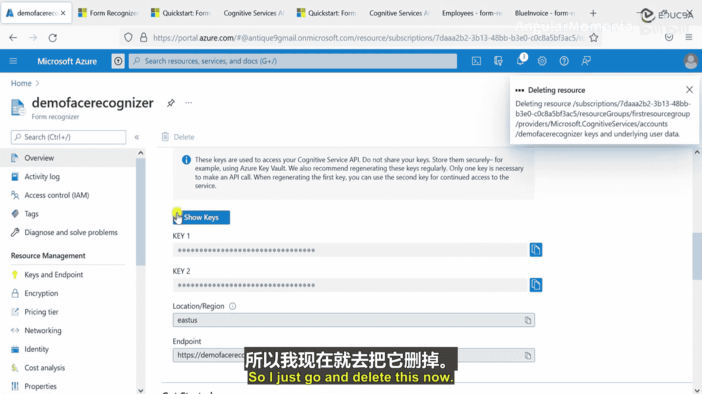