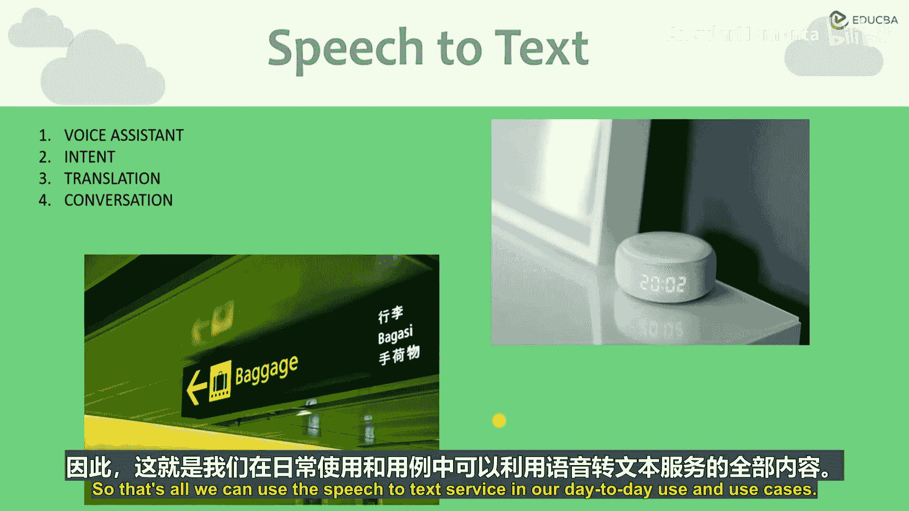
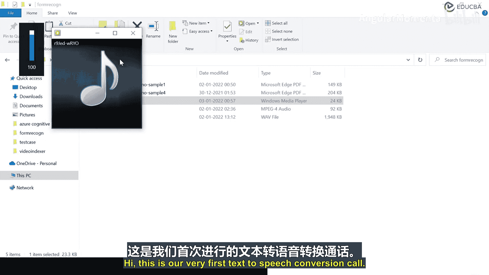
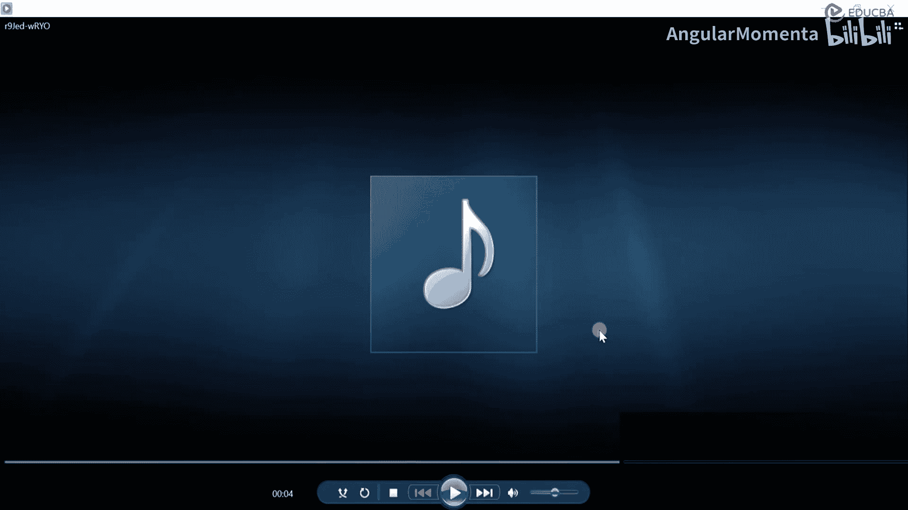

# 【EDUCBA】Azure实践——认知服务 ｜ Azure Practical - Cognitive Services p05 03_01_01_认知语音API -BV1zXFozVEXL_p5-

The next categories， which comes into to the picture is。Cognitive speed service。

 So what do you think about this particular service。

 What it could be all about when we talk about speech。

 there are certain set of things which can be done with the help of this particular cognitive service of us you can use。

them to convert the spoken language into text or vice versa。

 meaning you can produce a natural sounding speech from the tech。

 you can also use this service to translate the spoken text。And finally， for speaker verification。

 the services under this category are less diverse comparing to the vision category。Therefore。

 there are four major set of services that we are going to talk about So as discussed。

 the very first thing comes convert spoken language into this text。

 after which we can use this to produce speeches from the text we are going to pass through it。

 then comes the speech translations， which is going to help us to translate the speeches from one form of language to a different form of languages。

 then comes recognition This is the last service under this category。

 This services or ceiling preview。 It is not recommended to use it for production workloads basically。

 However， you can use the service to implement future risk functionality such as logging in our or authenticating with voice。

Let's start with the very first service under the speech category。

 which is speech2 text there is not much which I can tell you about this particular set of service because I am sure that you can exactly know what the service does。

For this service excepts a prerecorded text file as an input and as an output。

 it is going to provide us with the transcripts or text for the speech which we are going to pass through it you can go ahead and use the adjacent response in your application to higher quality voice file you have sent to this particular set of A you have a higher chance of a success。

 imagine you call the service and we receive back the text and now what exactly can be done out of that particular set of text we have received So there are several use cases for that as computers cannot work with the speech directly they can work with the help of text so getting a text back you can either restore it or pass it through some other set of cognitive services if you want to look into certain set of use cases such as voice assistant。

When the user speaks the speech will be translated to text and then pass through some different set of APIs with these other set of APIs we can get to know what the intent of the user will be calculated and then a voice assistant can be implemented this is exactly what your day to day voice assistant do such as Alexa we have a series quo as you can also find out the intent of the user also which or you can pass this text to translation service with the help of translation you can translate of voice of a person to find the actual meaning in your known languages from English we can get it translated to sub different set of languages from it might be frame Spanish or something else and we can even use this particular set of service for more traditional use cases such as it can script to conversions for example you can transfer script a college center call and show it for future investigation。

So that's how we can use the speech to text service in our day to day use。Un use cases。

In this section of course we are going to move towards the hands on activity in which we are going to try to pass on an speech and extract text data from that particular set of speech。

 so this is my a asure portal and I would be going to create some new set of resources。

I'll search for cognitive service。We go to3。And the cognitive service also。

 we can go and look for the speed service directly。 So just lets go to the cognitive service。

 Ill drag it down here。 we can see speed service over here。

So it would be just creating a new set of speed service。I have to go and select the resource groups。

 I would be selecting first resource group。The region which we are going to use over here is also going to be is。

So speech conversion， so we would be using this particular set of service for a conversion that's I named it to be a speech conversion service。

Now in the pricing tier we can just go and select free one now I go and select next in the network section we won't be changing anything same for the identity and tag so I just go to the review and create section now so just let it get validated so yes it has been validated over here now we can just review it once so we are going for a free trial one region is E name of the service and the pricing tier is free so now go and select so now service is getting created out over here。

So as you can see， it says our services in deployment and it has been able to deploy it completely。

So now we can see our service， the overview of our service over here now before we go and try to hit this particular set of service。

 let's go to the documentation part of this service so that we can try to reach out to this service using the postmanno files。

This is the overall documentation part of the Azure cognitive speed service， as you can see。

So if we just go down over here， well find the rest API calls details so I'll just open it into a new tab。

 this is the speech to text rest APIs because we are not going to use any specific language that's why we are going for a rest APIs now we just have to go and look for the basic authentication process over here we have toization process over here which we don't need right now。

If we just keep on going down。If we just go here， we see that okay。

 we got something called as a conversion service over here， I just copy this ones。

 I open a roadpa over here and paste my details here So as you can see we got our basic service URL over here。

 but we got a region identifier so we need to find a region identifier from here so our region is going to be E because we created our service in E only so I just copy this。

Open not。Select this out and replace control a controlr C。 now I'll go to my postman and the postman。

 I just go and paste this URL over here。 So that is the very first part of our。

 Now to get our service authenticated and all， we need to look into the header sections of ours。

 Let's go and look into the headers。 What are the fields require for the header over here。

 Let's go and look into that。So we have our languages over here。 Then we have this。

Subscriptions key section。 So I just copy this out。 Now I just paste my key。

So we need to find the key value for this just go back to my Azure service in my service if we go to keys and endpoints we would be able to find it out。

In the key section， I'll just copy this key and paste it over here as we all know that when we try to send any kind of data over the rest service。

 we need to describe that what kind of data is going to be send up from mind so as we know that we are working on a speech service so it is going to be a audio file but what is the kind of audio file which we are going to de into so just let's go and find out that what are the formats which are being supported by the。

As your speed service over here， if I just go and see that， okay。

 so we have these content types over here。So I just copy this， I'll paste it over here。

So as you can see the content type we see there was an audio wave。They are described over here。

 so I just copy this。So I'll just go and paste it over here。

We have been able to define that what kind of data which we are going to deal into so just let's see what are the different formats they support so I just select a wave。

So as you can see there are two mean audio formats being supported by this particular speech API。

 so one is wave format， the other one is the OGG format。

We would be referring to the wave formats only for this particular activity。 Now。

 I just go back to my postman。I'll go to the body part。I select raw data， sorry， binary。

Now I just have to go and select a file， So this is my sample data。

 which we are going to test upon and I just pass this。Okay。

 so it says that N while it's C ID or language。So we need to pass on the language over here。

It is going to be US English， so just let me go and find out the format。We got a language over here。

 I just have to go and select my parents。Language。It is going to be。English， US。

So I copyied this all。Open my postman again， please。

So let's try it once again what we get as you can see we have been able to send our data over here and right now say that status is 200 okay but I think we have not got any output over here so we were using a get method over here so I just go and select a post method now let's see what response we are going to get back so as you can see we got a recognition status which is a success from the service in and the displaypar text here says that in the audio file it was this is a sample audio file azure cognitive service in which we are trying to extract audio text from this particular file times so that was a recorded message which I had passed over here that saw the speech to stitch aszure service works。

So the very next API which comes under the speech category is called as text to speech and again I'm sure that you have a good understanding of what this service is going to do eventually so you can pass this service some sort of text and after that it is going to process that particular text and return as a generated voice file you can ressure the voice file almost most verbal played。

There are several use cases for this particular API of files Most important you can use this API to build the application and services That is to speak naturally the voice generated by this service is not just call or we can say a lifeless a one and it does not even sound like a robotic voice also so you can choose from dozens of voices they have either a male or a female voices with different extents also the voice is lifelike and not robotic you can't even go one step further and customize the voice through a special Xl syntex called Xl or speech synthesis markup languages This is a standardup markup languages which is used by many services providers as including Microsoft and you can even go one shift further and create your own custom voice all you need to do is record your own set of voice and then pass it to the speech studio and train a model on the basis of your。

Speech your have passion over to the speech studio after the model has been trained。

 you can use it to create a speech with your own set of voice。

Isn't it very powerful before jumping into demo， let's take a。

Brief overview how exactly the hands John activities goes so what exactly I would be doing is as we are already doing it early also I will show you the basic demo or we can see documentation go through and on the basis of that we are going for a hand John activity。

This is my Azure portal over here and this time we don't have to go ahead and create a new set of service or launch a new service over here。

 The reason behind that we had already launched a speed service in the previous session of our now what exactly need I need to go do is I'll open my speed service over here so that we would be able to access the key from that。

Let's go to the documentation part。 I have already shown you this particular documentation page earlier。

 So if we go down， we would be able to see the S formats over here。As you can see。

 we have a speech2 text， which we have already done， then comes the text2 speech。

So I would be just opening it to a new tab。As you can see this is my text shoe speech risk API documentation over here and now in this。

 if you want to access our service over here that there is a bit different way to get it done if we remember from the previous session of us what exactly we used to do is to access our service we used to provide these particular excess keys and on the basis of that we used to get output from our set of services but in case of text shoe speech APIs what exactly happened is we need to get these authentication opens from here just go down over here。

And I would be looking for authentication token service over here。

This is the service from which I can able to fit excess opens， so I'll just copy this over here。

I will open my notepad in the notad of my mine， I just have to replace this region I write Es。

 so that's it。Now I just copy this a face scroll down。

We see that we need to just pass on some excess key with the help of。

When I just opened my postman in the postman， I would be copying my URL。I'll use a post method。

Now I just need to have a subscription key option over here。 we'll copy this， I'll paste it。Now。

 I just I need to get my keys from here。 So for that， I'll go to my Azure portal。

 copy my keys from here。And paste it so I just send a request。Says that we were able to pass。Okay。

 I got that。Copy。I go to my headers paste。Go back to Pars。Cut going back to my headers。

 past and said。As you can see， we have been able to get our open from here。

 so I'll just keep this tab as it is over， I'll open a new request tab now。Now。

 once we have got a authentication tokens from here。

 we need to find out what are the different kind of languages which are being supported by the East U region。

 Basically there would be multiple voices and each and every voice would be having multiple accent accents with them so I just go back to my。

Pal。I'll try to take it down here we would be finding the how to get the list of voices which are being supported over here。

As you can see， we have something called as a get a list of voices over here because it as you know it says that it a get a list。

 so basically it is going to be a type of a get type。Okay， this request。 So I just go here。

 copy this easiest。I'll paste it over a year now， because we already have a token。

 So I just copy my token from here。I'll paste my token over here。Now I just go back。

 knowledge let see what they exactly call our token。So it's called as authorization。

 so I'll just copy this。Open postman。Bace。😊，Centtquiist。Now。

 as per the request we are going to get a list of response over here so as you can see we got a J request response over here and it says that what are the languages and name local name gender define the type of voice it is going to be and on the basis of that we can decide that what exactly we looking into so I just press control left and look for English so as you can see we found a language on the basis of English I just keep it as it is now I just open one more tab over here of a post method now just go here so we have been able to get two things done over here till now the first is we got a authentication tokens second on the basis of authentication we are able to get the list of voices which are being supported by。

Text choose speech rest J calls of us。 Now， if we just go down。

 we would be able to find how to convert our speech over here。

 So I just go to the E and copy this particular。URl， I'll paste it over here。

 I'll go to the header part。In the headest part， we need to define the。Authorization part。

Apart from authorization part we need to define what kind of request we are going to send over there。

 so I just take it down So if we just go down over here， we see that okay。

 there are multiple things which we can do over here。If we see that there is a request head。

 we have already been able to define the authorization。So I just copy my content type。

So if we just put my content type over here， so it is going to be Xl type。

 I'll let you know why we need to pass an Xl type over there because in the end of the day we would be sending a request with the help of Xl After that we have a Microsoft output format over here。

So this is something on the basis of which we are going to tell the service that what our desired output is going to be。

 of course it is going to be an audio file， but what type of audio file it is going to be we define that with the help of this output format so if we go down over here I'll be selecting audio 16 kilohertz。

This is my expected output。Bsteted over here。That' said。 So on the basis of the head of。

 we are good to go。 But now we need to define a body over here。

 So I would be passing a X file over here。 So what is the format of it， if we just go down。

 we'll find a demo。Take examined。But this is my demo example。 So I'll just copy this once。

Please door you。Now we are good to go， but we were looking for a different kind of voice over here。

 So if you remember， this is a voice we wanted。Just copy， I'll take it here。😔，And basic。

 it is going to be English of Australian and of female voice。 it is going to be。

 So I just have to go here and say。Hi， this is。美丽。But。Text to speed。Conversion。该。Thank you。

I just saying it right now。But， as you can see。We got our response over here， I just see it now。

We have been able to save our request over here。 just now open it。 So as you can see。

 this is our recording over years。 just let me check that if it is supporting my。System volume。

 So it is， I just let me play。This。六七。Hi， this is our very first text to speech conversion call。😊。

Thank you。That's how the audio works over here。Let me。

That's how you convert a texture speech over here。