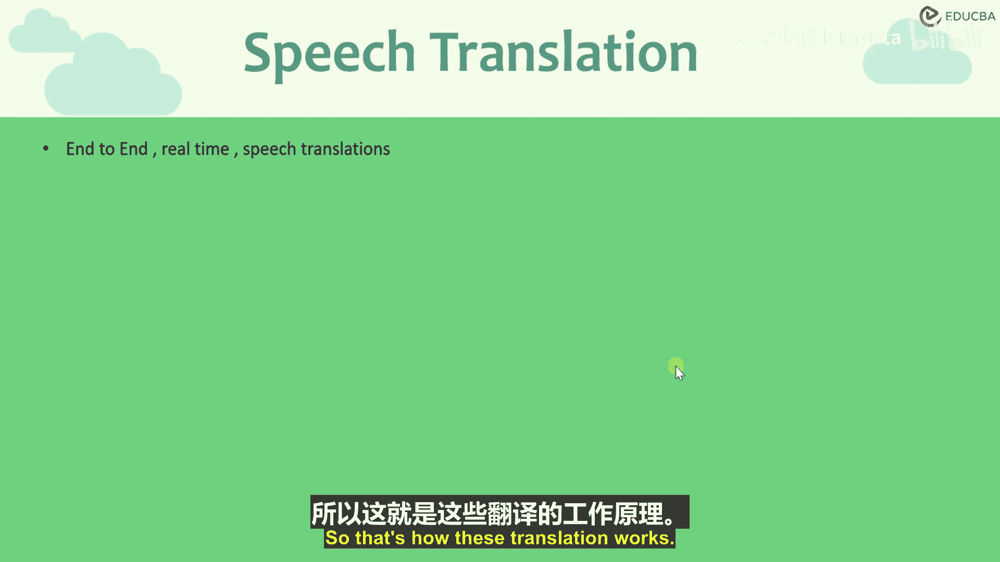
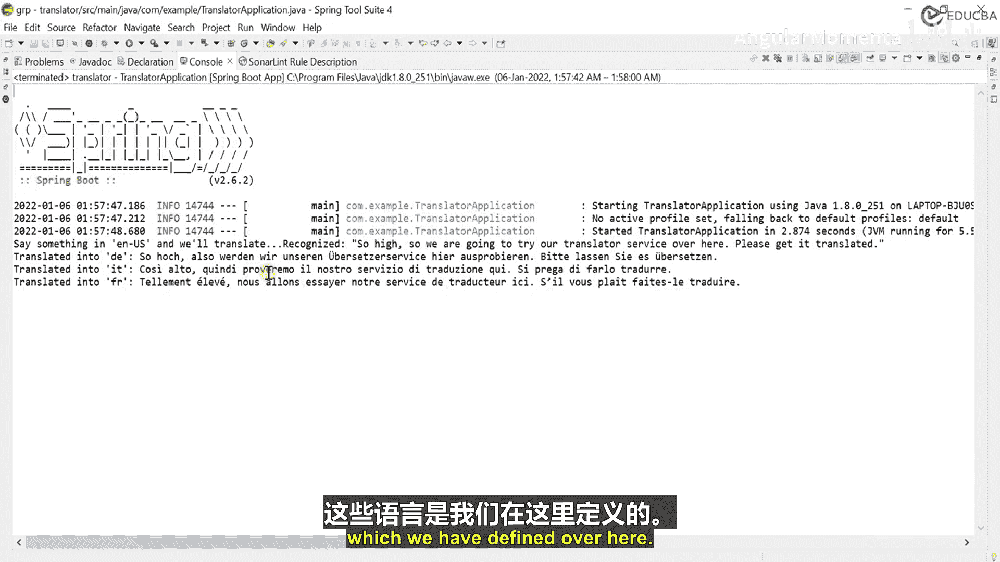
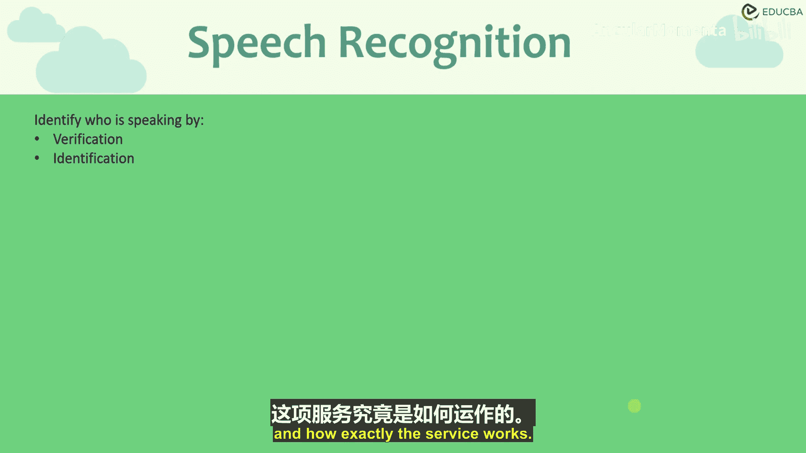
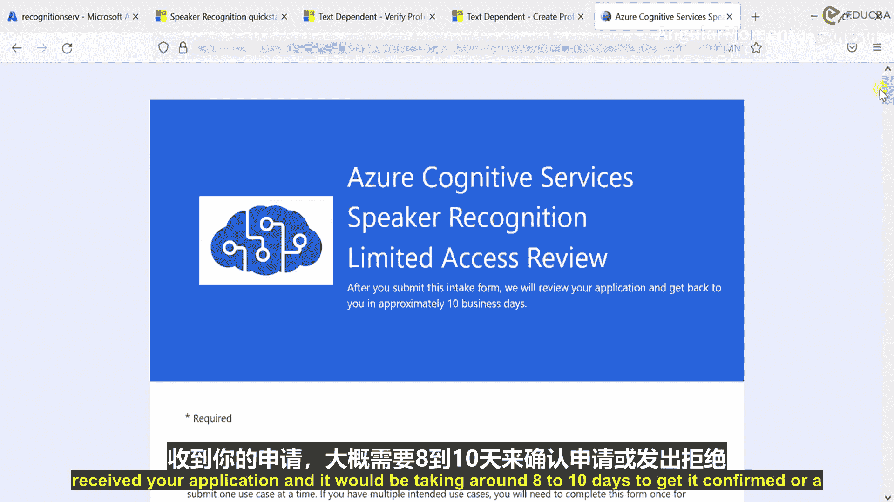
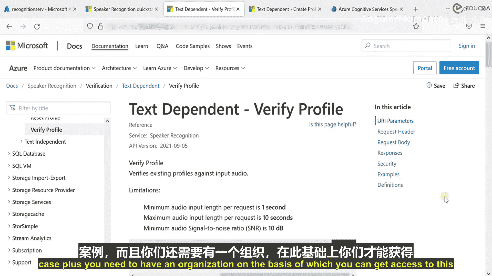

# 【EDUCBA】Azure实践——认知服务 ｜ Azure Practical - Cognitive Services p06 03_02_01_语音翻译服务概览 -BV1zXFozVEXL_p6-

In the previous session of our， we have learned about how does the text to speech service works and we have already done the h actism that。

Now the very third type of service which comes under the speech cognitive API is speech translation service。

 so we do have heard about translators in a day to day life， so for example。

 if a person is moving from one country to a different country For example。

 a person is moving from U to Russia So the moment he lines over there in Russia the most common language hes going to here over there is Russia So in the end of the day he won't be able to understand what exactly people are speaking or trying to convey to him to get it done in an easier way he would be needing a translator So in a daytoday activity。

 there could be a person who knows both Russian and English and on the basis of that he's going to get it transd for the person who has came from US right now second thing it could be we can use this translator service in day to day life。

 So how does these translator service works to the cognitive service of ours is So what happened is we have to pass on a speech。

So， for example， I would be transferring a speech which is there in English。

 So I have to specify that I'm passing a。Audio which is in English and even I have to define out what is my expected output from that。

 So， for example I am passing in English over there and I want to return output in Russian or some other language。

Could be German due， anything， so I just have to make sure that configuring my service on the basis of that and on the basis of that configuration I would be getting my outputs written back to me so we have two type of translators the general translator and the customer trans。

So we can use the generic translator for dayto- day transs， for example。

 if you need to convert your language from English to some daytoday languages。

 it can be done with the help of generic translators but if you want to use a translation which are domain or industry specific you can create a custom translationlator for that So that's how these translation works this is a very powerful features and we have been seen these translations in our day to day life So if we might have seen these un meet happening over there So you might have seen people wearing a certain set of devices over there there are certain set of people who use these set of devices over there so that featureses can be translated out for them and they could get to know that what exactly is being discussed over there So here we are going to learn about how these speech translation work and how exactly we can take an advantage of this particular service and create a very own use case So the first use case I have already told you that for example。

Person is traveling from one country to a different country and they have a different set of native languages so they can use these translators so that they can get to know what exactly the person in front of them want to convey so this could be basic use case which we could consider so in the next session of us we are going to see how to implement the speech translation service and。

There is one difference over here。Before the speech translation。

 all the services which we have been using till now。

 we used to take advantage of these rest APIs so that we don't have to quote a lot for that。

 but in speech translations till now there are no rest APIs being provided from the asure so we have to take help of the SDdKs being provided by them and on the basis of those SDKs we are going to design our service and create a sample program through which we are going to perform these translation。

In this section of us， we are going to for a handja activity where we are going to try for speech translation。

So this is my Azure dashboard， so this is the service which we have created。

 so I just access this out so that we would be able to get the keys if we need it out。

 so I just select keys in endpoint。After that， we just have to look into that how exactly we can access this particular service So for that。

 if we go down to the documentation part， as you can see here you won't be finding anything called as。

Speech translation service for the rest A， so we have speech to text， we have batch transcriptions。

 text to speech conversion transcriptions， so there is nothing regarding to the speech translation those over here。

 the reason behind is if you want to access this particular set of service we need to use only the SDKs which are being provided by theure。

Now， if we just move to the speech translation documentation part， so if you want to see。

 for example。You can see that these are some of the basic details you can access through and here only other set of services you would be finding out the speech translation also。

 so in the speech translation I would be going for the important dependency part。

So if I just go to the top part of it， so for example。

 if I want to access my translation service over here so it can be done in multiple ways so first phase with the help of CS。

Then we have C++ Java， Javas， Python Cs， so with the help of these we can try to access this particular service so I would be using a Java over here so that we can get to know how exactly we can access it and you can use any other languages also it won't be affecting anything on that basis because we do get a sample codes over here。

So before we just go ahead and start working on the code part。

 so just let me go and look into the main dependencies。

 so if you are known to the Java or exactly Java works。

 we would be needing to have these Azure dependencies for that。So， I this。

I go and look for Aomi Inencies。I'll open this up。So as you can see。

 we have multiple dependencies over here described by them and we can use any one of them as per a requirement。

So here we have a yours ticket。So the latest version is 1。441。2 as you can see。

 you can use any one of them as per your needs。So because they have not discontinued any one of them till now。

 so now I would be just moving to my STs through which we are going to try to create a project over here。

 so I just go to file select new I would be selecting Sp startup project。Okay。

In the spring Starter project， I just have to go and define of my service name。So， for example。

 my service name is going to be translator。It is our example service over I just。Put at my。Yeah。

Groed to be as Comm dot example， I just named the package also to be as Com dot example over here。

I just go next， I won't be needing to add any web services or something over here。

I can just try to find if thing supporting does here right now， so as you can see there no。

Checkpoints over here， so we just have to add dependencies manually only， so I just go select next。

Finish。So on the basis of that， we would be getting sample duming project being created over here。

So as you can see， this is my translator。We got a basic structure over here。

 I just opened my Pdot example。And in the palm dot example。

 I just have to go over here and add my depend。So I just started a client SDK over here。

 the version I'm using is 1。19， you can use any one of them as per your requirement。

I just close this particular set of service a year now。Now， this is my main application over here。

Okay， so it's responding now， so I'll just move back to the documentation part of us。

So if we go over here。We just have to import these particular dependencies over here。

 so I just copy it from here。And paste it。So these are the dependencies which we would be using over here。

So I just have to move。 We just need to get started set of。

Sensitive data and environment variables over here， I just copy these two lines。Yeah。お。

So what exactly these means is we need to provide a subscription key and then we have to define this a region where our service has been hosted over so you all know that from where we can get these set of keys。

 so if I just go over to our。As here， Ill copy these keys， open us again。T。

Reagion is going to be E US。We can get it confirmed， also。He serious。

If you want to check to know how exactly these regions are defined so we can get to know from here。

 it says E only we don't have to add any other set of characters over here。

So that set our service variables are being created。

 we just have to go and define a different set of。Requirements。

 so I just copy this particular set of code， so basically it is not doing anything different over here。

 Basically， they have just defined a。Method， and we are just going to call that method after that。

 we are going to close that particular method of us。One sets being used。I just go to my。

Main define my method。It is going to say it's not there， we will just the method at the bottom of it。

Now check in， I will just declare my method。😔，So we have been able to declare the method now。

So in this， basically， we are just trying to configure。

Service as you can see it's calling the subscription keys and the Reg and we have already passed those set of values above。

 then we would be needing the source of languages。So as I told you in the previous section that we need to define that what kind of languages we are going to use。

M save。Ill take it down now we need to define the languages through which it has to translate them out so they're using two set of languages over here。

You copy is them over here。 it is going to consider two different set of languages over here。Okay。So。

 okay， I'll just copy this。えこの？Okay。O。If we just go down。

 we need to find the initialization part of it， so it's much more a cleaner version of that。

He copy this。And replace the functionality of us。 So basically it has not made any some major changes over here。

 It has just tried to make it much more cleaner for us。 So， for example。

We have created a string over here where it says that language is going to be English US and it is going to be converted to these three different languages over here。

 and then we are going to pick one language from。This particular string one by one and on the basis of that we are going to configurefiator so we don't have to。

Call Trans a dot type target language 1 by1 again and again。

 so to get it done in much more easier way， they have just created a loop further。

So I just copy this part。😔，So this is for audio configuration part basically。

In this particular section， what exactly is going to happen is。Tell here。There is no major changes。

 but from here they just define that。Whatever the audio is going to be passed through it it is going to be passed with the help of a microphone。

 so whatever I am going to speak frommic it is going to take that text and it is going to get it translated for us。

That's it。Now， we just have to go down over here and see that。The second way to get it done is。

 for example， if you have。Audio required a system so you can pass that particular set of audio over here in that we just have to define from where exactly that particular set of file is going to be read out and on the basis of that it is going to get it translated for you。

 So right now we are going to consider the pass only audio from a microphone which I would be doing over here and that's it。

 So now we are good to go and we have been able to。confi了。Speed translate over here。

So and then what they have done over here， they have just tried to make it much more cleaner and on the basis of that。

Definine things over here。So， I just go here。So right now， I think。

It is not going to print a lot of things over here。

Just let me check it once I'll go through it so I know have made some more set of changes over here。

 so we are going to get to know that what exactly we were speaking over here and on the basis of that it is going to print that what exactly has been transformed or translated on the basis of that so now just go to my service translator service I'll click right。

Corones。Springwood up。So， now you。Would be able to。Prow an application over here。

So we are going to translate a service over here， please get it translated。So as you can see。

It was able to recognize certain set of things we were。Trying to convey。

So high it has taken high to be as high， so we are going to try our translator service over here。

 please get it translated and on the basis of that it has been able to convert a set of applications。

Basically， our our text over here using our application to different set of。

Languages which we have defined over here。

In this particular section of our， we are going to learn about the last service which comes under the speech category and it is called as speech recognitiontion service。

So。The main use cases of this API is very simple。 It identifies who is speaking and in other words。

 we can use this API to determine the identity of an unknown speaker。

 there could be several use cases for such APIs for example nowadays we use a fingerprints to access our cell phones or face I to unlock our cell phones in the same way if with the help of these kind of services。

 what we can do is we can feed our voices to our cell phones and at the background with the help of such a APIs we can try to get our phones unlock because we would be speaking something and once the phone verifies that the speaker is the same as fitted in the system it is going to get it unlock for us So they could be many more such use cases if you want to create So the voice is treated to be a key to unlock our systems or cell phones you can also use this particular set of API for speaker ID and acade you can。

Go ahead and train these set of A with custom voices also as I've already told you so you can identify custom voices as well So what exactly we are going to do in speech recognition service in the upcoming session is I would be giving you an brief overview where I would be showing you how does the rest API works with the speech recognition service the reason behind the overview is in speech recognition service if we want to get access to it we have to go ahead and fill certain set of forms which are being provided by the Azure and even we have to provide them with the use cases which we are going to work on and on the basis of that they are going to get certain set of approvals done for us once things get approved then only we can use this particular set of service for us as it's an educational purpose thing out till now we have not got any confirmation from therein so we won't be able to go and perform an actual hands on but I would be able to show you how to。

Fill these certain set of requests with your team， how to feed certain set of your speech I over these as your services and。

How exactly the service were。

In this section of our we are going through the documentation part of the speech recognition service。

 so you would be getting a brief overview how these service works actually so as you can see I've already selected the rest options over here。

And if we go downstairs， we get to know that if you want to use this particular service in Azure。

 we have to make sure that our service is going to be created in West US region only so I do have created a West US region service already。

 so I will be using that particular set of service to。

Get our application processed out and ask Aure2 grant to use this particular set of service so already created a SS region service and if we just go down now。

So we see that we have got something called text dependent verification and then we have a text independent verification so these verifications can be done in two ways so first would be a text dependent the second one would be text independent verification so the major differences in the text dependent service we have get a certain set of text on the basis of that we have to record a voice and pass it through in the text independent we can speak anything if we want to but theres a difference between sending out the samples so for the text dependent verification service so it requires three sample voices whereas for the text independent verification it requires to send us 20 different voice samples so it's much more like when we go and insert of fingerprints to our cell phones we have to make sure that we are going to give it a multiple fingerprints so that it can process it out in a。

So as you can see， the very first thing is creating a voice profile over here So to create a voice profile what we can do is its these services are mostly in post base so it is going to be a post service we are going to provide a URL over here so I would be showing you the URL also so this is my URL over here。

 so I've already created this particular sample API over here。

 So as you can see this is going to be my endpoint URL。

It is West US the reason behind is I already told you that these services can be run in West US region only right now。

 so this is my URL which I am using over there then we have our API versions Ive already defined my API versions over here。

Then on the basis of a content type in that we have these application。Type to give of Jason。

 then we need to pass a subscription key after the subscription key we need to pass a body in which we have to define that what other the language which we are going to pass sub use EUS。

And on the basis of that， we just send the request to them。 So if I just run this command over here。

 I would be getting an exception over here for time being。

 so it says that it's in unauthorized the reason behind that is。

The aEC is provided is not authorized yet and we need to make sure that it has been approved That's what I've already told you so we have to send in a request over to this particular URL I'll open this over here。

So this is a form which we need to fill over here， as you can see。It's a limited access review。

So you just have to enter your company name， first name， last name， you just have to make sure that。

You have to enter your work email addresses over here。

 it is not going to accept the personal email addresses。

Then we have to define out what are the use cases we have to enter our subscription keys over here。

After that， we need to provide the complete detail of your organization you are working with。

 After that， we even need to。Provide that the region where that organization work。

You have to provide the phone numbers of your organization， the company websites are needed。

 and even there are certain small set of things which we need to provide to the A your team and on the basis of that they are going to get。

Application approve， so that is something we have already done and we are still waiting for the response。

So once you get it done， you would be getting a email from there end stating that they have received your application and it would be taking around eight to 10 days to get it。

Confound or a rejection from therein So once you have created a text dependent service in the J response。

 you get something like this。

Just let me show you。If you go to scroll down so you are going to get something responses like this so as I've already told you if it is our text dependent service you need to pass on at least three voice samples over here so this is the meaning of that remaining enment count After that we have to send voice samples using this particular set of API so after that with each and every response of yours you would be getting a new Json response in which it would be reducing the remaining enment count numbers so that's how it is going to work so the pass phrase could be something like this my voice is my passport verify me so that's how it is going to verify your voice so you have to send three voice samples。

In the same way if you want to use a text independent verification service。

 we have a certain set of URLs working over here in which we just make sure that it is a text independent service So as you can see in URL we have defined find that its a text independent profile So after that it is going to ask you for to send at least 20 voice samples as you can see it says 20 over here so that's how you are going to get your voice control at the as you are in and that's all it is this particular set of service is going to create。

Profile for your voice at the bottom。Then we have a speaker identification which comes into the picture。

 so it is the second thing which we can do with the help of this particular service。

 so identification and verifications are somewhat same。

 if you know so what we need to do is we just need to use this particular set of service and on the basis of that we need to provide 20 voice samples and it is going to create a voice samples over there so what happens is in if you want to create a voice verification service you can consider is as a service which is going to help you out if you are going to use only one set of voice over there but if you are talking about a group of people and we want to identify one single voice from that group of people so for that we have speaker identification service which comes into the picture。

So once that is done， we have these independent services which help us to center a request and get things done for us。

So just let me take。Overview， so this is my recognition service over here。

So the first thing comes identification。So in the identification， what we need to do is。

If we go to the identifier because the profiles has been already created at the zero end。

 we just make sure that the audio input length is minimum of one second and maximum it could be of two minutes。

So at that particular audience as I've already told you that it would be one speaker only in that audio for yours。

 okay？So if you use this particular set of service。

 so what exactly I do is it is going to take a voice sample and it is going to get it compared from the voice samples which were being passed onto the previous service of uss the profile creation services and on the basis of that it is going to get those things compared out and give us the results so as you can see we need endpoints so there is only one endpoint which is being supported over here which is WestUS I've already told you the reason for that then we have API versions so there is only one API version which is being supported by them right now so the version is 20210905。

After that， we have profile IDs and Ignominum links。

After that we just have to pass on our subscription keys。

 so just make sure once you create your subscription keys and it has been approved from the Azure end don't delete your existing service or don't change those set of keys because if you change them then once again you have to go ahead and send them a new set of requests to get those subscription keys accepted by them after that we just have to send our audio data and it is going to get rest of the things stuff。

In the same way， the verification service comes。So even the we have text independent and text independent。

 I would be just。Showing you one of those server。So we have these endpoints over here at the endpoint it would be West US API。

 then we have these text dependent services， then the API version is。2021。

0905 already told you we just have to make sure that we would be able to send a certain set of profile ids which we have created over there these profile ids are unique throughout and on the basis of that it is going to help us out to get voice identified among different set of people if they would be so that's how the speech recognition service works on the as your serviceing so I hope you would be able to understand how exactly it is going to work but just make sure that if you want to use this particular set of service it's in preview right now so that's why Microsoft don't allow lot of people to access it you just have to have a very good set of use case plus you need to have an organization on the basis of which you can get access to this particular set of service to experiment around Thank you。

