# 【EDUCBA】Azure实践——认知服务 ｜ Azure Practical - Cognitive Services p07 04_01_01_语言服务 -BV1zXFozVEXL_p7-

Hi， after the speech recognition service， now comes the cognitive language service。

 So what happens is we do come across scenarios where people pass some set of reviews or comments。

 And at that particular set of time， it is not easy to understand it's in a positive way or a negative。

 Therefore， wouldn't we it nice if we could just pass these set of user convention review through some sort of services and get the sentiment out of it。

 So we do have certain set of services with U being provided by the Azure。

 Even if we want to create certain set of services which would be helping us to create something like Alexixa or seriesri。

 which we can use to create a service as an electronic assistant。

So to get a solution for these kind of needs of our。

 we do have a Azure cognitive service and that is called as language service So let's get it started as your cognitive service language Aps can help your application to understand the meaning of unstructured text and basically there are five type of services which are being provided by the Azure so the very first service here is sentimental analysis it automatically detects sentiments and opinion from the text which are we going to pass through it after the sentiment analysis comes the translator so we do have gone through a translator in the previous session of all where we were passing text through it and on the basis of those text we could translate it if needed so a translator detects and translates more than 1 hundred0 supported languages and dialects for us after the translator service comes the language understanding service。

It helps us to build natural language understanding into application bos and IoT devices after the language understanding comes entity recognition so what exactly the entity recognition service do is it helps us to identify commonly use and domain specific terms from the text which we are going to pass through it and the last one is the question and answer makers basically so distill information into easy to navigate question and answer so basically with the help of Q and A makers it is going to help us to distill those set of info and making it much more easier to navigate out so very first service which comes under the language category is called as sentiment analysis so you can use this particular set of service to extract information from your text you can use the sentiment analytics service to find out sentiment analysis of the text which we are going to pass through。

Imagine you are an ecommerce website owner and you sell a product and it is extremely important for your business to get the sentiment on a customer coming。

This way you can find out if the customer is happy or unhappy and act immediately。

 you can also extract key phrases from your text。 These key phrases include the name of C or events the sentiment analytics A can also give you the language of your text this is extremely important because knowing the language of your text which you are passing through it and later on you pass it through the translator service and get this translation back and finally you can extract the name entities from your text which you are passing these includes the name of CC C organization celebrities famous places around and handson activity of the sentimental analytics how exactly it works on the Azure platforms。

 So for that we won't be needing to keep on hitting the A with the help of postman because for the sentimental analytics basically the complete language service of Azure they have totally a different kind of。

Platform through which you can access these services and in the end it also provides you how you can access those set of services using URL so we don't have to go through the immense documentation and all we just have to go there create a service and start using it So this is my Azure page where I have selected a product of mind to be cognitive service So if we scroll down over here。

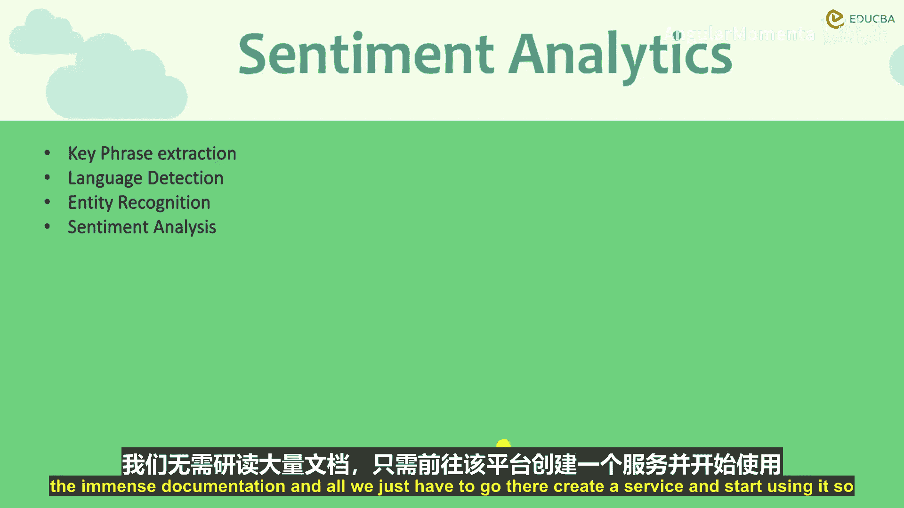

We find language service on the left hand side so this is a language service and these are the services which are there inside the language service of so I would be selecting my sentiment analysis service over here。

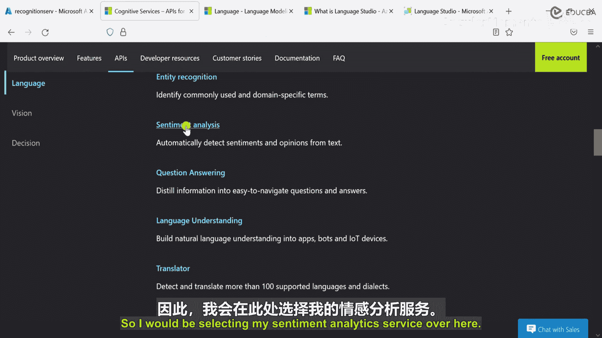

So this is my ana service， if we just go down we see something called as demo over here。

 but in demo we just find certain set of videos over there so what I'll do I'll just go to the documentation part。

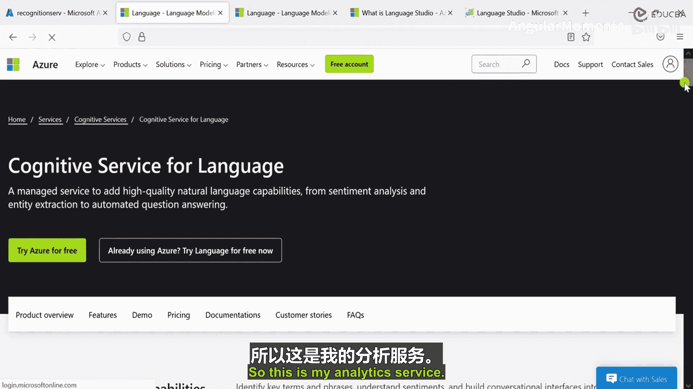

So once we go to the documentation part， just let me。Yeah。See， yes， here it is。

 so I just go and select documentations。In the documentation we have a quick start guide over here so basically theres a language studio being provided by the Azure so we would be experimenting out with this particular set of service in the language studio only so that make things a bit more easier for us to get things done because it does provides much more easier interface as per the Azure we were using earlier so I just open it on a new tab so the first time if you are going to access the language studio we just have to go and create certain set of credentials over there you have to log in your Azure account over there after that you have to select that it is going to be a free pricing tier or a paid one so you have to just create those set of things after that it is going to ask you to create certain set of resources also。

We won't be going to create a new one。 We just go here。 if we just go down。

 we'll find something called as。Okay， we have PIA exc name。Analytics on Earth， there it is。

 we have our analyze sentiment service over here， I just go in select try out。In the tryout section。

 it is telling us that we just have to go and select a language which we are going to prefer。

 but be selecting English over here。So this is my Azure resource。

 which I created over here when I logged into my language studio for the first time。

 so it's similar to the。Resource creation we have done on this year it work in the same way Now we just have to go and enter a certain set of languages over here。

So there are two things which we can do is， okay， so the very first thing I'll enter is。Tice。

I went I like the food， I just have to go and select to run the service over here。

So it is going to provide us results in two ways the first one is a much more user readable or you can say user friendly one。

 a normal set of results， the second one is the JN one which we get when we are going to pass on the actual request through the URL of us basically the post I'll show you that too so in the result I say that it is a 94% positive sentence which we have passed through it。

 the 5% is neutral and 1% is negative。So it even points out that what exactly we are。

Talking about so it says that it's an assessment of our food。

 so it says that assessment is for like transfer assessment。

 then we have a target over here to be us food。So that's how this particular set of service work for us。

Now， if you just want to go and try out some more text of。Oh， yeah。 so I just。Try sample。

T Chaveer have selected that。 So as you can see， it says that we went to Contosso food place located at downtown Seattlettle last week for a dinner party。

 and we ordered the spot。 They provide marvelous school and they have a great menu。

 The chief cook happens to be the owner。 and he super nice coming out of the kitchen and greeted us all。

 We enjoyed very much dining in the place。 The pasta I ordered was tender and juicy。

 and the place was impeccably clean。 You can even preorder from the online menu at Ww dot Contosso food place dot com。

 then they have given their numbers and The only complaint they had was I have is the food didn't come fast enough。

 Overall I highly recommend that。 So as you can see that this particular sentence is something negative here。

 but overall the sentence， the paragraph is much more positive。

 So I just go run my assessment over this。So it says that its 86% positive and 14% negative over here。

 then if you want to look into that okay what are the target and assessments over here so I just select this thing and you can see that。

The first assessment of fire is the targeted spot。Then we have these multiple sentences over here。

 So on the basis of each and every sentence they have give us the sentiment of the person。

 so I just go to the last one now。So this is the negative one。

 So the only complaint I have is the food income fast enough。 So that's how the assessment。

Basically sentiment analyticstic service works over here。

 So if I just want to go and look into the how does the J works over here。

 so what I'll do is to keep it short， I'll copy this。I'll come over， please。I just run this。

I'll go to the J。So here it is， so we get that okay。

 it's a mixed sentiment sentence which we have passed over here。

 then we have confidence goes over here， the ones first one is negative。

For that it says that the complaint is the food is didn't come first the second one is a positive sentence over here which says that overall I highly recommended so that's how this particular set of service works but what if you want to take access to these services with the help of R APIs so as you can see over here you see we have a curl post commands defined over here so as the services has been running in the E US region So the endpoint is like this E API。

So what I'll do if needed， I will just open a postman also。So it is going to a post command。Yes。Yeah。

Copy。So it is going to have some patterns。If I move to head apart。The content type is。Application。

 Jason， so I just go to my key。 pasted over here。Oh。Now， we need key。Controex space。Yeah。

So what we can do is I' just pass up。😔，Jason We will copy this。😔，I remove the extra tabs。我还。Thank。

Yes。Yes。Yeah。H。Oh。Good以。Okay。Most of it is done。 Now。

 I just have to remove certain more set of things。😔，Slash。Okay。Yes。Okay， I think now it's done。😔。

So okay， it says that it's an invalid request。😔，Iqui body must be present。

 so we have been able to get data out of it。 So what exactly I have done is。😔。

So I'll just show it once again。 Don't save， open new request， import。😔，So if I just go back to my。

Pal copy the URL over here。 I'll go to the rock steps。I will place the request over here。

 and just imported directly。Yes， that's it。 So now it has been imported in much more better way out and we don't have to try to put each and everything by ourselves。

 There might be some issues which can hook over there and to make it more readable。

 I just select beauify over here。Then I'll just send the request。So that said， as you can see。

 we got a 200 okay request over here and we have been able to get some set of a response as per the request we have。

Paure， so that's how the service works sentiment analyticss basically the very next service。

 which comes under the language service category， is called as translator service so and therefore。

 we all have a good idea what the service is going to do in the end first of all。

 you can use the service to detect language of your text detecting the language is very important。

After detecting the language you can go ahead and pass the text to another API under the service which is called as text translation。

 this API will take a text in and translate it to destination languages the text service allows you to pronounce the phrases from other languages we are going to take a look at it example shortly。

The translator takes API is perfect for everyday scenarios， however。

 you can create a custom translator service also so this trans service tailored to your specific domain or industry because some translation model can be easily created or trained using unstructured documents such as manuals or website we are going to take a look at that too let's take a look at an example of text in the next session of files where I would be showing you how exactly this particular set of services works and how to deploy a translator service and how we can actually use it So even I would taking you around how does the documentation of the translator service works in this phase session of files we are going to learn about the handson part on the translator services being offered by the Azure so this is my Azure page over here in which I have opened the Azure cognitive services。

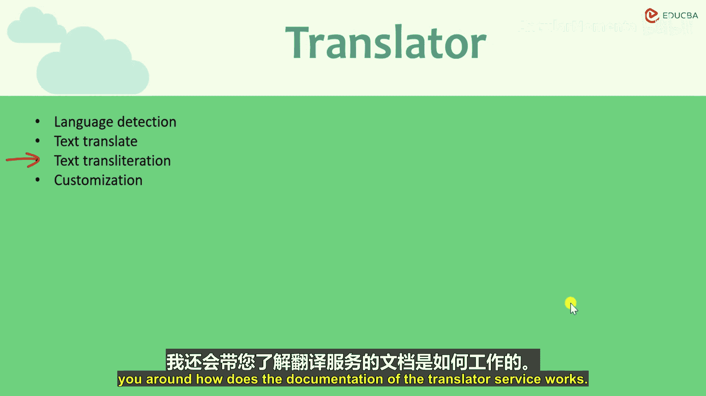

So if we just scroll down to the bottom of it we will find different services being offered by the cognitives part。

 so in that I just have to go and select language in the language part I have to go and look for the translator so I would be selecting the translator over here。

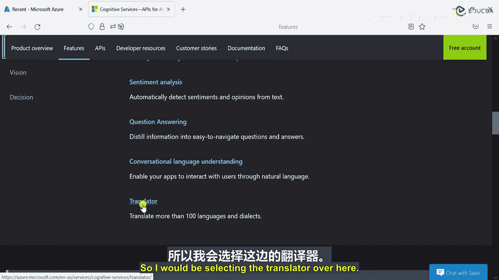

And we can see this is the overview of the translator service of ours now we just have to go and look for the documentation of it。

 so I have selected our documentation over here， so I'll just open the documentation。

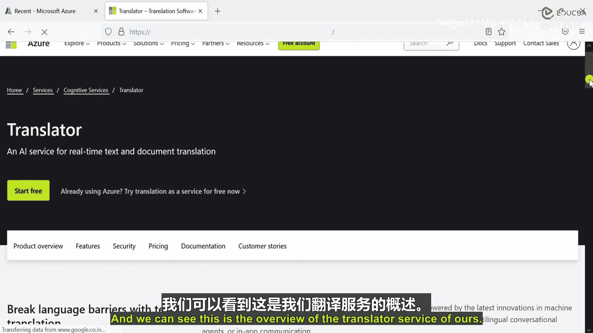

So this is the overall documentation of the Azure translator service over here and you can see there are different kind of documentations being provided by them so now I just have to go and deploy a service and start using it。

So for that， what Ill do is Ill just go on the left hand right in the text translation。

 I just select the reference part。Then we are going to use the APIs。

 so for that I would be using the text trans text APIpis， rest Shapis。Yeah。开始。

So this is my overall text translation API over here。

And here we can see Az your portal getting opened up。

 so there is a translator service already created my me over here。

 so what we can do is we can just also create a new set of status。So I'll just look for translators。

は。In the translator， I would be creating a new set of translator over year。

After go and select our resource group， so it is going to be the first resource group After that。

 after select my region， Im going to use E name of the service is going to be sample。Dranslator。

Then we just have to go and select the pricing clear it is going to be。

Since it's not offering the free one over here summer。 just let me see。😔，Yes。

Vi just go select freeient。Okay， so it says it's already being used earlier。

 so I'll just go back to my services over here。I'll select it out and delete the existing service。

So I just have to go into select yes。Deelete。So I would be just deleting existing service over here。

 so it's in pro right now， so I just okay， now it's deleted， I'll go back to create。

So I have to select my resource group once again， after that after select region， it is easier。

The name of the service is going to be。First。Sample translator and the pricing tier is going to be free。

 so I just go select identity we don't have to make any changes to them so I'll be just going to the review and create set so is right now validating my values which a pause over here we can go for the review of them so yes its a free trial and the region is US and pricing tier is also free so I just go and select create。

So by the time it is going to create the service， we just go back to the documentation part。

 so as you can see this is the text translation recipe， so we have a get options over here。

 we have translate options over here， so we would be working on the translation part only。So。

 if they just go。Down over。 so we can just say that， okay。

Just go to the quick chart and I would be selecting Trans over here So this is my main translate URL which we are going to look into so I just copy this one and because we are going to use it So what I'll do I'll just open my post one I'll save it over there so I'll just paste it over here so I have my API version to be asked 3。

Now we have certain set of request parameter over here。

 one of the is API versions which we have already added。

So we just have to define that what is my target language is going to be， so I just select two。

After that， I will go back to。So， I just had to。So， I just take D。So you can say D stand for German。

 then we have I for Italian， so we can use D for now。

 I would be using that only now we just have other options also I won't be using these forms。

 text types categories。And there are a more set of optional parameters which we can use over here。

 so we won't be using them right now。 Then we just go back to the header part。

 So this is something a bit tricky to be here。 So I just open it a new tab。

So I'll just copy the content type of here。So Ill just go and paste it into my headers。

I will copy this application last ja part。That it。Now we just have to look into the authentication part where it has。

Transfer us so if we go to that we have these headers to be OCM APM subscription keys。

 we have authorization keys， then we have region keys over here so I won't be using anything else I just copy my subscription key over here well paste it。

So we do have been copying the subscription keys earlier also。

 so we all know that how to access it now， so we just have to go to Azure select a service and then go to the keys and endpoints。

He justco。Open postman， pay。So that said now we just have to look into the documentation what else is needed。

 we need to define the subscription region over here so it。

East US because we were working in the US region only， so I just opened back my documentation。

 That's it。 we don't need something as a authorization over here because we don't have any bur tokens at the moment so it is going to work without that too Now we are just need to have some text document for us so we can take a sample document from here。

Will you copy this。Go to the body parts。Select raw， it is going to a type Jason。

 that's it Ill find it。Okay， it' is not going to work the reason behind us we have to go and select post。

I'll just send the request once again。So， as you can see。

What it has done over here if you can see is very first thing is it has done detection of the language as I told you earlier and it it is saying that it a language of English score is one after that it has done a translation for us so that's all this particular set of service work but if you want to make sure that it is working in a proper way out what I'll do is i'll just copy this。

Iput I。Yeah。I'll go back to my body。Okay。Repeer。Ill send the request。

So as you can see now its say it's in German and we have got a output from here now I would be converting it back to English。

Yeah。So， I just copy my。Yeah。Yes。The question over here。对。Fish， Sir。

So if you can see it says the detective language is Italian after that it says it has been translated to some different languages so this time we had choose to get it converted to English so as you can see it is the same text which we had transfer qua with this particular set of service in the initial part so that's how the service works translateator service works over here after the language translator service comes very another extremely useful service under the language category and it is called as understanding service and even this particular set of service is also called as Lewis。

So this service can help us to extract content from the textual input of our and in turn it can be used for many other useful scenario such as creating a voice access for us so with the help of Lewis we can try to extract phrases out from the actual context which are being passed through it so for example we have a user here and who is going to issue a command such as turn on the lights or turn off the lights so without the machine learning or。

Assistance so pass we just have to go ahead and we just have to create a hard codeed logic for our application。

 but even after that， if there would be any slight change in the input of us for example。

 if a person is saying that or turn off the lights then an application would be able to handle it out But if a person goes and says that turn down the lights at that time we just have to make sure that we have hard coded in such ways that our application is going to。

Understand all kind of logic which could be used by people。

 So it won't be easier for us because in different ways we can convey that how exactly the lights are to be turned off。

 instead of doing that， we have Lewis over here to help us out。

 So what exactly is done is in Lewis we create a set of models which are highly customizable And after the models are created we train them and just go ahead and deploy those models for us and to make it much more easier for us。

We have these Lewis portals， so it is much more easier to get things done with E of Lewis portals and in Lewis portal we just have to pass on our set of JN through which these models can be created out。

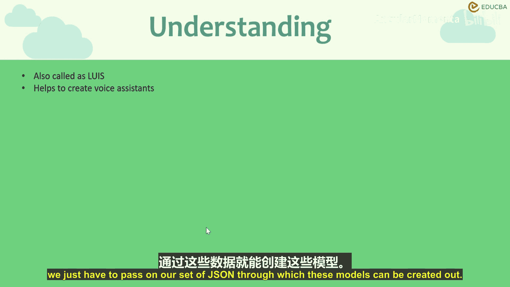

In this section of us we are going for enhance on activities where I would be creating a Pythonb application through which we are going to create a model then we are going to get that model train and published over the Lewis service of our and then we are going to pass a text through that and trying to extract certain set of context through it so for that I would be creating a Pythonb application so in this particular section we are just going to create our application in the next section I would be going to the Lewis portal from there I would be getting the credentials and passing through our application and I would be showing you how the application works over there so right now I would be using a visual studio over here so just let us go and create a directory over here。

So I would be na my directory to be a quick shot。So this is my directory and right now Im in my directory over here。

 I would be creating a Python base file over here。Yeah。てなって。So I would be just creating our file。

So we have been able to create a Python based file now I just have to install certain set of libraries over here。

So， would be。Getting some。As your base libraries。Okay。Yes。Yeah。So， I'm just。

Getting some installed libraries for Azure cognitive service so I think I was missing some i over here so that's why I was not able to find the suitable version so let's install it now so as you can see we have been able to install the respective libraries over here using the VIP command so now we are good to go and we can just go ahead and start using this particular directory of us I just go to my files or select open folder。

So in that， I would be just going to look for quick。😔，St。

And I would be selecting this particular of folder here。

So as you can see here we can see a set of files over here。

 so this is my authoring underscore Red do pwifi which we are going to use now I just have to go and add certain set of dependencies over here。

不搞。Do。Soervices。Dot language， I would be called dot Lewis dot authoring。

 I would be importing it in both。L U I。哦。So right now we have just。

Imported the authoring models over here。 I copy this paste。In the authoring models。

 now I would be getting models from here。And I would be calling it as。Aplicationation。Create object。

After that， I would be just calling my。Run time over here。I would be calling here。 it as blue。

Run time client After that we just have to call some most two or three some more set of imports MS rest。

Not authentication。Yeah。So here we can call this oh year。After that。

 we just have to call our function tunes now。From。3 years。

So right now we have been able to set our respective needed dependencies over here。

 so after the dependency we just need to go and import more set of needed things so I would be importing Jason over here time and UI。

So that's how we have been able to make sure that we have imported all the required dependencies over here and we just have to go and start building a code so for that I would be defining my quick start function so that's it once your quick chart functions has been declared we just have to go and create certain set of variable here which we are going to use it so I would be just creating a variable called as authoring key。

Yeah。So we are going to keep authoring keys to be as empty right now。

 I would be getting these set of values from our Lewis portal basically。

 so I just have to give my endpoint。We do know about the endpoint we have been using endpoints earlier also in different examples which we have seen previously。

 now we just need to get our prediction keys and endpoint so basically mostly the endpoint of authoring endpoint and the prediction endpoints are same。

Yeah。Yeah。Yeah。Yeah。So that set， these are certain set of。

Variables which we are going to use at in application night right now now we just have to go and start using creating our application。

 so now I would be using my Uu ID to make sure that we are going to avoid name collisions over here so for that I would be creating my app name over here so my app name would be so let's say it as。

Psa app right now， and I'm just going to add a string to that in which I would be passing my UuI。Yes。

So that's it。So we have defined a app name over here now just have to use the version ID so mostly the version ID is going to be dot01 because we are getting it done for the first time。

After the version I D comes the intent name。So on the basis of intent name。

 we are going to just train our application， so I'm going to call it as。Or the P intent That it。 Now。

 I just have to go and make sure that how exactly we are going to authorize a client basically。

 So for that， I would be calling my client。Yeah。So I would be calling my Lewis authoring client over here。

Yeah。I would be needing my authoring endpoint and I would be needing a cognitive service credentials over year。

Cognitive service credentials。We just have to pass my authoring key now。

 so that's how we are going to authorize it After that we just have to go and create app for that I would be calling my app underscore ID。

Create underscore。U I just need to use my client which we have created above after the client we need to pass the app name。

 after the app name we just have to pass on the version IDs。

Now we just have to go and add our intent over here。I will call climb door。Md dot add after that。

 I would be getting my intent over here so I just have to go and see underscore screen I just have to pass my app I D。

😔，With that， I need my version IDd again。Yeah。Yes。Yes。An intent name。

 which we have defined over here。duct check。对。After the client model。

 we need to make sure that we are going to add a certain set of entities over year。

So I will be going for addent now after the。Yeah。Yeah。Yeah。Yeah。

Forionally if we have being able to create identities over here， after that。

 we just have to go and add certain set of labeled examples。Yeah。We it climbed once again。

After the client， we would be need。Bdy。Yeah。Yeah。Yeah。So that's it。

 We have been able to add a labeled examples right now。

 Now we just have to go and train app versions over here。 So for that I would be calling my client。这。

Pen。嗯。给我 just。Yeah。Yeah。I will be sitting my waiting。呢个笑对。Yeah。It's going to be capital。 That it。

Now we just have to go and create a while loop over here。Yeah。Yeah。On the basis of that。

 I would be adding info。Yeah。好的。We are going to get the status of that。Train right now。

For getting that when would be needing to pass on the app I and version ID D further。Yeah。That it。谢。

Now on the basis of that， we are going to get multiple list of training status of here。

 which is going to be one for each and every model of ours。

And it is going to make sure that each and every model is trained through it， so to get it done。

 we are going to create these set of loops now。は。Yeah。Yeah。Yeah。Yeah。Yeah。Yeah。Yeah。Yes。6。Yeah。Yes。

Yeah。Yeah。She does all。Yeah。Yeah。So that's it。NowWe are going to for a certain set of if conditions。

Okay。Yeah。Not visiting waiting。10 seconds。For training to。Get complete。

Then I would be just going for a sleep over here。So because we are sitting a 10 second bar。

 so I would be adding 10。Yeah。Or else I would be going and printing that。 Okay。

 my model has been trained， so I would be just printing that。你。More人顶。

And I would be setting my weight to be equals to falls now。So that's our loop is going to get。Ened。

 and we would be coming out of the loop with the help of that。Yes。

So the moment the waitinging is going to be marked as falls over here。

 we would be coming out of this particular set of while loop now， So once that is done。

 we just have to go and publish a version now So for that we just have to go and create。Cleline do。

Us。Yeah。Dot update settings。And I would be marking it to be as a underscore score public to be asked true。

Yeah。So， now， Ive made response。And point in4。Response and point4 equals2。C door apps。Dot publish。

I need I underscore underscore scroll I over here。So these are certain set of things we would be needing again and again。

 the app I， version ideas。Msigating。Now we are going to create a prediction creation。

 create client over here now， so for that I just have to go and I call run time credentials is there。

Yeah。楚。Yes。Andtime credentiality goes through。Cogniator service credentials now。

We need to point prediction keys。 So once the prediction keys are done， we need。Yeah。

This run time point。So， we need。Yeah。And credentials and credentials we need。Current time credit now。

Lty。So a prediction creation client is also good to go now。对。Yeah。Yeah。

Now we just have to go and create our query query prediction endpoints over here for that we are going for。

Prediction。So we with the help of this， we are going to pass a query over here or you can say a text through which we are going to find out what is the exact intent of the user over here so for that it is going to be of tagation。

So Ill type my query。I think you would be able to understand what exactly user want to say also we are just。

Trying to create a simple set of queries only。Yeah。Okay。Yeah。So as you can see。

 the user wants to place an order over year where he' is trying to order two small we visas over here with more salsa。

So on the basis of that， we are going to get a prediction response now。Yeah。Yeah。Yeah。Yes。Oh。

As usual party。Yeah。It is in production， so。Yeah。Production。And prediction request。Yeah。Yeah。

Now we just have to go and print certain set of things over here。Yes。Yes。Tent of user。Yeah。Okay。Yes。

Now we just have to go and format it out for us。Prediction response。Yes。Yeah。T on the school。

Now we just need a set of things over here。😔，We are trying to call sentiment over。

 So I have just copied it out sent。😔，Meant now instead of a top intent， I will be calling sentiment。

Okay。Dive。So what are the exact intents now？Yeah。That's it Now we just have to go and create a loop over here to find out what could be the basic multiple intents it could find out on the basis of request。

I。Sure。St to。No， we just have to call a printer。With of tabs。

 I would be just trying to call more set of。Yeah。嗯。你这身。Now， we would be passing it and getting it。

Foratted for us。So once our loop gets over， we'll just go and print that， okay。Yeah。嗯滴滴。Yeah。嗯。Yeah。

Right。Yeah。so now we are able to print all the entities as well， which we are going to get。

Now we just have to go and make sure that we clean up our resources also。好。你呢？Yeah。Yeah。Yeah。

We just need app I to direct it。Oh。Yeah。Now we are just going to create some mode functionalities over here。

 so the very first which is going to take place right now is going to be a creator。

Now we do have created our clients。Yeah。H。Yeah。Yeah。Yeah。这。Okay。这个。Yeah。Yeah。In。

So it is going to give the version Id。 After that， we just need culture。So， it is going to be。严镜。

The she， if you are going for a different set of language。

 use use a culture to be asked per that language only。Yeah。Yeah。So that's it。

 we just have to go and print that okay。Our app is being created with particular set of IDs。Okay。

Yeah。Yeah。Former。Yeah。Yeah。Okay， now we just need to return the app writing。嗯。Yeah。Yeah。So that said。

 one of the functions has been created now， we just have to go and create a function for add entities now。

不己。嗯对。Yeah。啊本的。Now we just have to go and create client model， client dot model。Yeah。I just need Is。

Vion Id。Rebuil underscore extract。Nco names。For that， I just need to pass the numbers。😔。

That's it Now we just have to create our N T T definitions。

Now what exactly I' have done is I do have created my fixed set of entity right now。

 so it is in a adjacent formats， I would be just copying that over here because it is going to save time also and we are just going to make sure that we won't be making any mistakes right now so here we have entered our ML entity definitions over here I just need a model I now。

Model I is going to be。在这个。Yeah。And did滴。Pto score ID。Pion ID。😔，Name is going to be。

Something related to pizza order。Now we just have to go and make sure that we have children。Okay。

Okay。Yes。Now， we just need to pass identity of here。

That's it now we just have to go and create a phrase list， so I have already copied that out。

 pasteed it over here and that's it now we just have to use a phrase。Yes I。嗯。Tra do features。

And let's go phrase， underscore list。😔，Okay。Inversionion I D， once again。Yeah。Yeah。And phrase list。

 That's it。Now we just need to go and get entities and the sub entitiesities for us。

So for that I just need to create certain set of model objects and topping quantities IDs and all。

 so I do have created it out and I'll just go and paste them now。Just a second。

 so we do have passed on some phase ID and model objects related that we have added topping quantity IDs over here。

 so that's how it is going to work now just we have to go and create some more set of depths over here so for that I'll be going and creating a depth。

Ard。Labeled example。As usual， we will be using client。By this。我 are you内。And intent name this time。

So on the basis of these things， we are going to pass certain set of。Learning data。

 So it is a defined labeled example for us。 so I'll just go here。So Ive already created it out。

 so I would be just pasting it as it is， so the reason behind is because it aation。

So we don't want to make any issues with that so as as you can see we have added an example ML entity over here。

 so it has intent name to find out here then we have some more details like it is related to P order then we have certain set of。

Details about quantity size and types and even topics so that's it that's how we are going to get a example labeled example created over here So when that is done we just go and print。

Yeah。Yeah。Yeah。Yeah。Yeah。Yes。Yes。Then not。Exle。Dot add。 now I would be adding my party version I。

So just copying this thing， I'll paste it over here。😔，Yeah。Okay。The不知好。Yeah。

So we have been able to add our example labels over here now the very last thing is just to get these grandchildren IDs。

 we just create a large function of us get underscore。Yeah。Yes。Yeah。Mo you would be needing model。

在雨天。嗯。那这。Now， on the basis of that， we are going for。I would be using filters over here。Yes。Okay。你。

Yeah。H。Yeah。Yeah。Yeah。Right。This。Yeah。I'll just copy this。😔，Yeah。Okay。Yeah。Yes。Yeah。Yeah。I just you。

Yes。That it。 I'll call my grandchild I here。😔，Yeah。No， that。Now I just return my IDdi。😔，嗯。Yeah。

So a function is good to go Now I' just call my parent function， which is quick start。

That's it so that's how the basic application has created。

 So what exactly we have done over here we have created a function multiple functions。

 The first one is going to create our application over here after the creation of application we are going for model creation on the basis of that model creation we are going to train a model and after the model creation we are going to publish that and to test it out I would be just passing a test phrase through it this is my prediction request or a test phrase through which we are going to get a predictions to be done out So this is my Lewis portal over here as you can see So I've already logged into my Lewis portal and I have already create a P app over here so you can create a application by clicking a new app and you just have to go and create a app name over here and select the regions over here So I've used West US region right now。

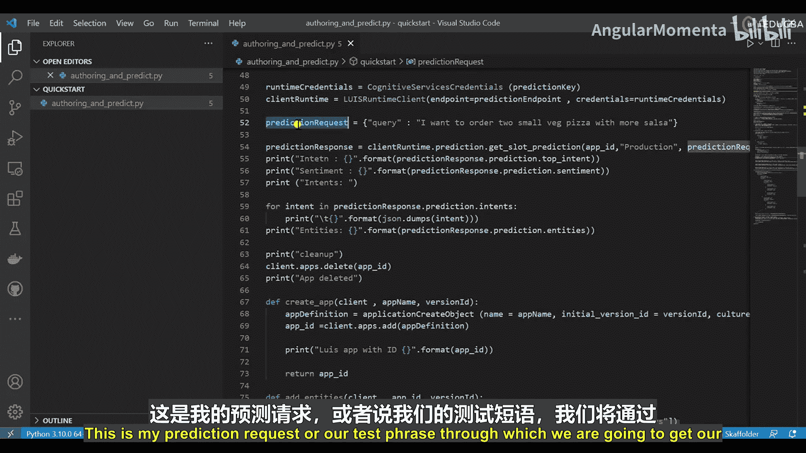

So I'll just go to my P application。Now my P application。

 as you can see there are no certain set of intents created over here。

 but there's something called as Man section So if we go to a manage section we can get the required set of keys and endpoints over here so as you can see this is a primary key for prediction resources and for authoring resources we have a set of keys over here and endpoint URL because we are using a S region so the authoring prediction resources endpoint URL are going to be same only so I've already gone through my application and made the required changes over here as you can see I've already added the keys over here Now what exactly I'm going to do is I just have to go here and run my application so I'll just go select my run tap and select run without debugging。

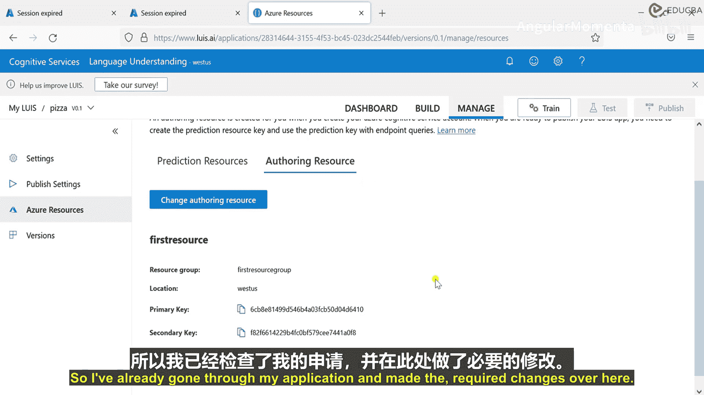

Now we can see our terminal getting opened over here。

So right now it is going to help us out to run an application so you can see it has passed certain set of commands over here to run a Python application。

 so now it says that it is creating Lewis application with certain set of ID oier。

And then on the basis of a labeled example utter which we have created。

 it has been creating and training a model for us。So it says that waiting for 10 seconds to train a model。

So as you can see after that， it stated that model has been trained。

 then it says that the intent of our or the P intent。

So on the basis of our request over here which we passed that okay we wanted a P of size small。

 so on the basis of that particular set of query it says that the user sentiment was none but the intents were to order Pa only eventually and once that was done it was able to clean up our application and got our application deleted as well so that how the Lewis application can be created using basic Python application and if needed we can use the and add a certain set of。

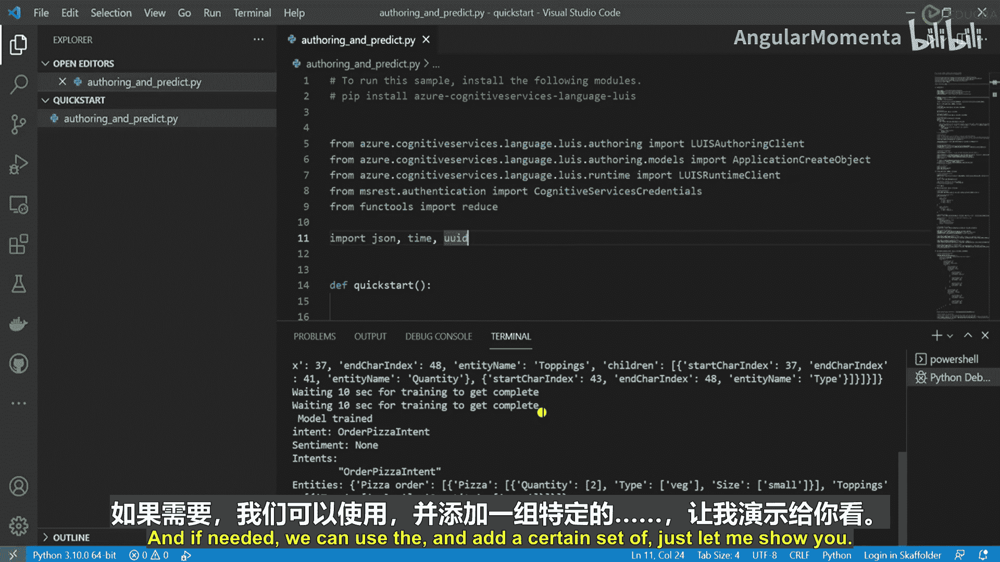

Just let me show you so in the dashboard if you go you can create a sort particular set of models over here and after creating those models we can just train them also through the dashboard also so we can just select create intent trainer model on the basis of that particular set of intent then we can publish that and start using it with the help of rest shape is also so that's how the Lewis application works。

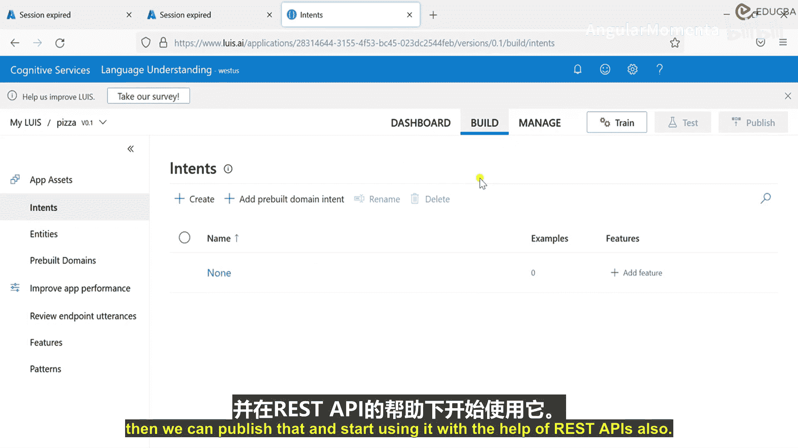