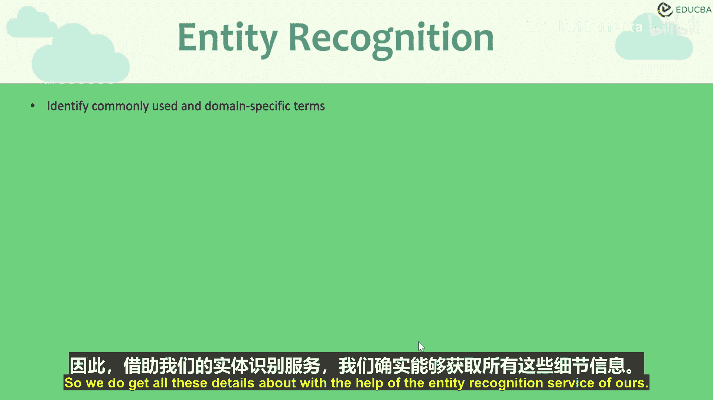
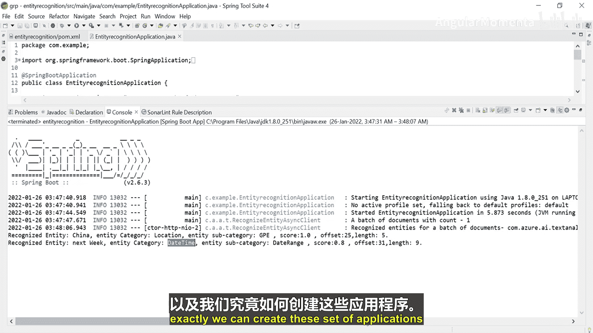

# 【EDUCBA】Azure实践——认知服务 ｜ Azure Practical - Cognitive Services p08 04_02_01_实体识别 -BV1zXFozVEXL_p8-

Now in this session of our we are going to go through the entity recognitiontion service so entity recognitiontion service is one of the features offered by Azure cognitive service which are part of language service only it is a collection of machine learning and algorithms in the cloud for developing intelligent applications of follows that involves written language so the entity recognition feature can identify and categorize entity in unstructured text so for example it is going to tell us about people places being talked about organizations quantities and。

Daate ranges and events which are to be occurred， So we do get all these details about with the help of the entity recognition service of our。

In this way section of us， we are going to create a Java based application through which we are going to reach out to cognitive service of us and we are going to try to pass certain set of sentences and out of those sentences we are going to find out the entities so I would be going to my files after that I would be selecting you and that I would be selecting spring chartter project。

I would be naming my project to be asked。Andt recognition。Next。

Finish so I would be just creating a spring boot application over here。

 so it is going to help us out to maintaining the dependencies of us in much more easier way so as we can see our application is getting created over here。

And the basic structure of an application has already been created over here。

 So what I'll do I'll just go to the Po dot Xl file of first。

In this particular set of Form dot X file， I would creating certain set of dependencies which。

We would be using。So， just go。Okay， so it's still building our application。

 We can just wait for a couple of seconds for that。So that， I will go select， okay。特色。

We can add our dependencies over here。 I would be needing to declare our group I。Yeah。

So my group is going to be calm do as here。After the group I。

 we need to declare the artifact id over here artifact。So my artifact I is going to be just。

 so I would be using Azure dot Ai。So I would be calling azure AI text analytics over here。

After that we just need to define the version which we are going to use so the version which we are going to use over here is going to be 5。

1。0 that it I' will just save my pump over here， so it is just building our application for us that check。

I just go and I would be expanding my project over here。

 so this is the basic application which I would be using over here。

 so in the main do I would be just declaring certain set of things over here。

 but before we do that we just need to make sure that we would be using certain set of keys and the URLs so for that I would be creating some static variables。

So this is going to be my key after my key I would be needing endpoint。

 so I would be creating a variable for that too。So that's it。

So we would be getting these set of values from the。As your portal only。

So now I would be moving back to her。Main method and the main method I would be calling text analytics clients over here。

We would been needing to call authenticate flightde over here。Okay。Yeah。Yeah。

In which we would be passing a key。And endpoint。Okay。After that。

 I would be calling a recognized entities example over year。

In which I would be passing my inclined object。Yeah。So that's it。

 Now we just have to go and create a more set of method for these things which we have declared。

 I would be calling Shate。Sing over here。Yes。So it is going to be the key then when you think。

So I just have to go in。Return something over here， or declare return you。Yeah。

So I would be calling my builder functions over here in which I would be。Pasing my credentials。不懂。

So we have Pazakio here after the key， I would be needing to call。Endpoint。So in the endpoints。

 I need to just pass my endpoint URL。That's done。 Now， I just have to build my life。So， that。

So so called text analytics client is good to go now after that we just need to go and create a so called recognized entities example service over here。

So I just copy this name。I'll call static。Yeah。I will pass my method name。

 So this particular set of method is not going to return anything。

 So I would be declaring it to be as wide。After that， I just pass on mine。And I would be using clay。

답7。Most of the parts have been done。 We just have to need to declare our strings over here。

String text to be analyzed。I would be traveling。Do zina。Next week， So this is going to be my。

Message which I need to get analyzed。 Now I just have to go and call my category service over here。

Yes。对。Yeah。And I would be just passing my text over here on the basis of that I would be getting certain set of details。

 so I would be using C out over here。Good nice。Is dirty。对不定。放心。Okay。After that。

 we just need to define。Category of that。To be。Category percentage。

 So because we are printing a string over here。 That's why I'm using that now after that。

 we just have to。Call entity subcatego， if it could be。

And we can even call certain set of more things such as score。 So the score tell us the sure part。

 How sure the。Services about it。Ofet。After the offsets， we are going to look after the n。Okay。Okay。

Now， we have already described what exactly we are looking over here。 Now， I would be just。

Pointing that， okay， I would be printing things that we have。 So entity。Okay。

So the first thing is going to be entity it takes after that， I would be calling my entity。

The category。Get subcategory we can get from here after the subcategory we were using these confidence course。

schoolchool。After the confidence curve， we need entity that get offset。

And finally I would be calling my Li So that's it， So our service is good to go so most of the things are done。

 I think it's not working so I just use print。So yes we are good to go so we have been able to create a application through which we are going to get certain entity recognition of on the basis of the text we are going to pass through it so sample text is going to be I would be traveling to China next week now we would be just creating a language service over here on the basis of that language service we would be getting the respective endpoint and keys and I would be using those set of endpoint and key to access a service over here。

So this is my create service over here， so I would be just going and selecting my subscription。

 so I would be selecting subscription one resource group I would be using the first resource group which we have created long back I would be naming my service over here as entity recognition。

T rising ti is going to be S。 Now if you just go， I just have to come these set of rules over here legal terms are there。

That's it， I'll go and select next。So from the network identity and tax perspective we won't be changing anything over here let's go and get a reviewed and create a service over here right now it's running the final validation service so as we can see it says that a validation has passed so just shall go and create a service over here so as we can see the initialization of deployment it's charted over here So it would be able to deploy a service over here so we can just if we are using a free tier and that we can deploy only one kind of service at a time of a free tier type or else we are going to get certain set of message from the as year only that we are already using that free tier service somewhere else so we just have to go and kill that particular service then we can create a new set of services over here。

So as we can see our entity recognition test is being created over here and the deployment is in progress。

 so once the deployment would be completed what we can do is we can just get our redirect to that service directly and we can get the keys and endpoint URLs from there so yes。

 as we can see our deployment is complete over here now we can just go and select go to resource。

Here 아래 was 우 you。We can see the name of the service MTD recognition test and if we go downwards we can see the keys and endpoint so if selected key and endpoint I would be copying my key if you want to see these keys you can just select show keys。

Now I would be going back to my SCs。ペーストキ。After that， I'll be going down。

 we can see the we got a end pointss over here， I'll copy my endpoint and just go and paste it over here。

So that's it。 Service is good to go。 So now I'll be just going back to my。

Project right click over there。Slect runs。Spring boot up。

So now it' is going to build an application and after which it is going to run it over。

So so that it's visible， I'll just expand my。Console， as you can see。

 our application is getting started over here。So we can see our application has been started over here。

😔，A batch of documented count。Has been declared to be as one。

 We just have to wait a couple of seconds so that agent just reach out to。

Cloud and give us the results out of it， so as you can see。It says that the very first entity。

 which it has。Recognizes China over here the category type is location。

 the subtype is GP and score is1， so that means it's 100% success。

 it's 100% sure about it that we are talking about certain locations over here after that it shows the length of that。

Word also so China is have length of5 now comes another thing over here next week。

 so it says that the category is of datetime， the range is so it's called calling it as subcate and score is 80% over here and length is9 so that how the entity recognition service comes and becomes handy for us if you want to find out more about the entities into any text being passed on a service and it is a very important service which is part of the language service as your cognitive service I hope you would have been able to understand how exactly the application works with the cloud and how exactly we can create these set of applications。

