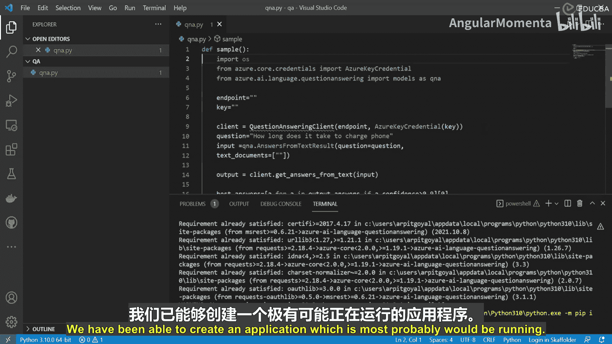
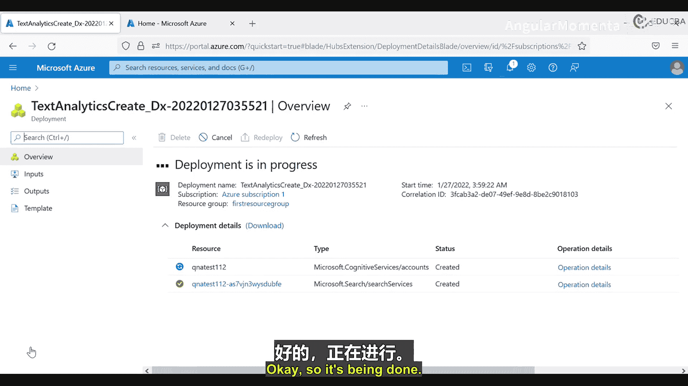
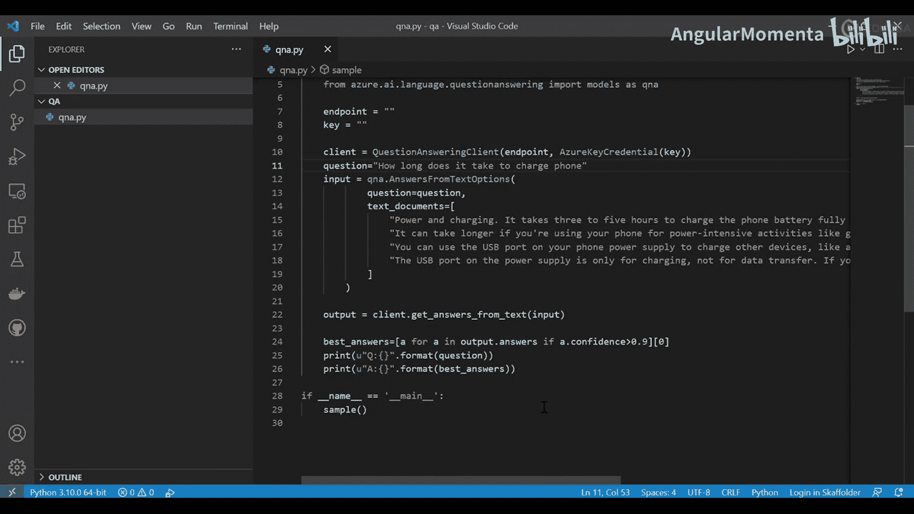
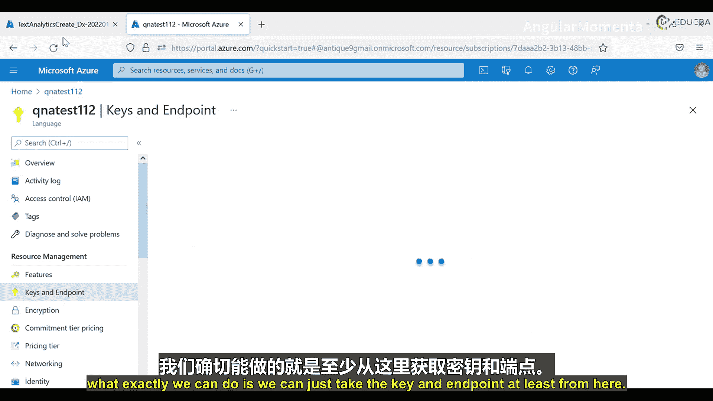
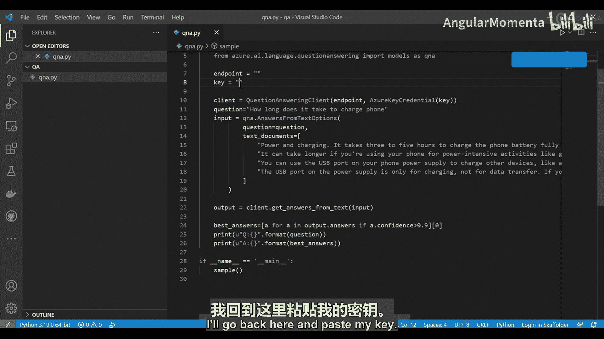
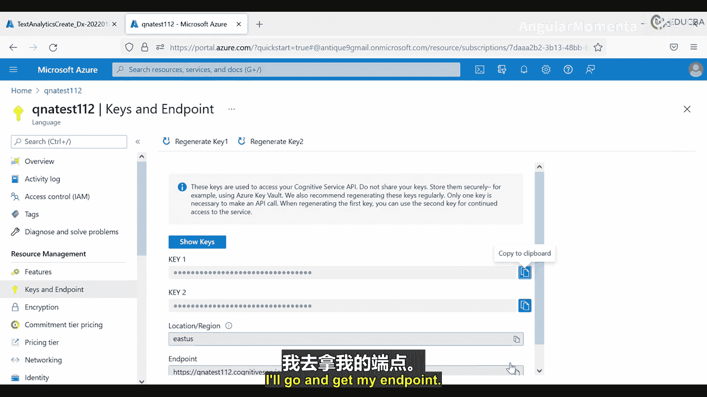
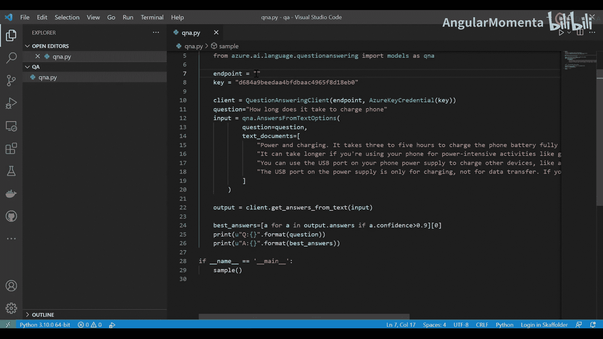
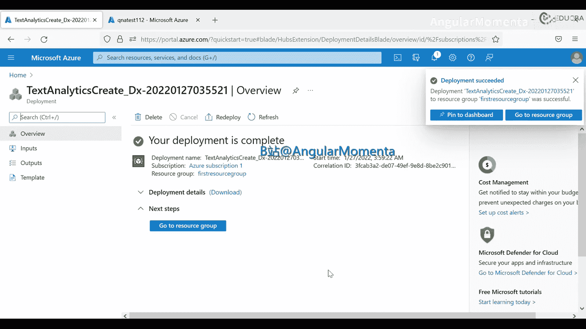
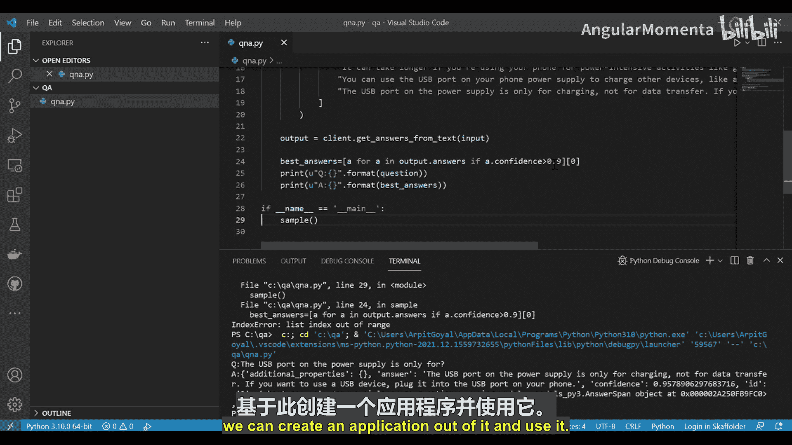

# 【EDUCBA】Azure实践——认知服务 ｜ Azure Practical - Cognitive Services p09 05_01_01_问答生成器概述 -BV1zXFozVEXL_p9-

We do have spent a lot of time browsing through Q and a pages on website。

 but still find it very difficult to finding the answer to our questions Finally in the series of the language cognitive service we would be covering Q and a Ba So this is the last service provided by the language cognitive service where Qs Cha for question and。

Aian for answers。This service can be used to create a question and answer over our data。

These data could be unstructureed， as well。So we can get the unstructured data set from different set of websites。

PDf files， work documents， Excel CS file and text files on the basis of that data set。

Service creates own set of question and answers knowledge base we can also create our own set of specific questions and answer to that those set of questions and on the basis of that a knowledge base is going to be created so what exactly we can do with these bunch of knowledge base which have been created the Q andA maker all these questions and answer through a full API so your user or yourself can go ahead and post your question and if the question is found within the knowledge base the answer will be back to the user。

The beauty of this service is the machine learning logic running behind it as a user。

 your question should not exactly match the question in the knowledge base。

 the question with the same meaning will also lead to the same set of answers。

In this section of first， I will be creating a Q& A maker application using Python language and before we do that I just have to install certain set of dependencies over here。

 so I'll just pass our command PIP install。Ass your AI。Language， portion。Answering。

 so it is going to help us how to install certain set of dependencies over here。

Now in the QA section， I would be creating my file over here， so I've created a project。

QA in which I have my Python file named as Q and A just creating a function。

Now we just have to import certain set of things over here。

 I would be importing go after that I would be calling some more things。

 so I would be calling from Azure。Dot course。Tought credentials from that。 I would be。

Importing as your credentials。After that， I just have to say from。A dot AI dot language。

 dot question answering。Inmport。So that's it。 We have been able to import whatever we would be using over here。

 After that， I just have to create mine。Local variable。

I name it as endpoint in the end point I would be defining what exactly we would be needing so from Azure portal we would be getting the respective endpoint and secondly we would be needing keys so that's it once that is done we just have to go and look into how to create client and all so I'll just go and create a client。

Okay。Oh。Yeah。Yeah。In that client， I would be passing my endpoints。

And what your your key credential in which we need to pass a key。😔，Yeah。So。With the help of that。

 I would be creating my client over here。Yeah。Now， we just have to。

Create a one more variable in which I keep passing a question。So my question would be。

 how long does it take。布。Dt。款。So that is going to be my basic question over you。

Now we just have to go and create input over here。Yeah。然后给邮件。Okay。

We need answers from text So these sections we would be just considering to put certain information using the basic text shortly Now I just have to go question。

一度。不。回心。Yes。高吗？Pix underscore the school。Document。Yeah。

Now I just have to define my sample texture over here。

So I would be doing that later on once let us complete rest of the things over here。After that。

 we just have to go and call a new variable。 I would be calling it as output。Okay。

I'll be calling my client。好。Yeah。好。And I would be using my input。

So I would be getting sort set of outputs of so further that I would be calling some more things。Yes。

ok。It best all the way。是。Yeah。Yeah。Yeah。Okay。So I would be printing answers on the basis of the confidence level。

对。Thank。So we do have been discussing about this confidence in all for long time。Now。

 I just have to go and pray。Okay。Sund pe using some format mattersters over here。

Then I would be just printing my answers。So we have already created something called as best answers above。

 so I would be just printing on the basis of that。Yeah。Yeah。Okay。嗯。I。Okay。the things are done。

I just have to make sure that the application are。So that's it。

 You have been able to create an application， which is most probably would be running。

This is my Azure portal。 where I would be creating my language service over here。

 So I just have to go and。Select a custom question answering After that I just go and select continue to create a resource。

So I just have to make sure that my subscription has been selected right over here then I have to go to my resource group so this is the resource group which I would be using this is the same resource group which we had been using from Charing now I just have to go and name my service。

Yeah。So I call it Q and it is。I have to go and select pricing here。

So just have some numbers with you。Yes。Okay， so。Now it's good to go。 Now。

 we just have to go down and select certain set of。

Tos and conditions being provided by Zure Now we just go and select next。

We don't make any changes to the network and identity tags。

 which we have been looking after from long time， so just go and select next to the view and create。

So it is getting it validated for us， so the name of the service is Q& H 112。

 so as you can see the validation has passed now I'll copy the service name。Un selectlectrate。

So mostly service deployment don't take a lot of time for us。

 we have been seeing that since starting， so it would be done in next couple of seconds， I think。

Okay， so it's being done。

So by that time what I'll do is I'll show you the text which we have added over year。

 so as you can see I've added a text regarding power in charging。

 so it takes three to five hours to charge the phone battery fully from the empty state。

It can take longer if you're using your phone for power intensive activities such as gaming。

 video streaming while you are charging it。You can use the USB port on your phone power supply to charge other devices like a phone while your phone mischan so this is the sample text which we have added over here on the basis of this sample text I would be answering users questions over here so now just go back to the service of files and let's see if it's created。

So the deployment is a process。So it's attaching some more set of services over here。

And think it would be done in a couple of seconds or just refresh it once。😔，Okay。Yeah。

So the deployment is in still progress。 It should be done。😔，So by that time。

 what exactly we can do is we can just take the key and endpoint at least from here。

So I'll copy my key。I'll go back here and paste my key， save it。

I'll go and get my endpoint。

Copy this please show here so our service is good to go now。

 we just have to make sure that a service has been deployed in a proper way so yes。

 our service is done。

Now go back to my system， select run， and I would be saying run with without de workinggging over here。

 So let's see what exactly is going to happen over here。

 Most probably we would be getting certain set of answers by the time。

We can just fade so as we can see the question we ask for how long does it take to charge a phone over here。

 The answer is the power in charging it takes three to five hours to charge the phone battery fully from the emptyt and it it can even take more time for power intensive activity such as gaming so as you can see the confidence level is also giving over here Now just let me ask some different question out of the blue what is the color of phone。

It is something which is not defined in our text show here， still I'll just save it。

And close my terminal and right。So right now the application was able to create a knowledge base out of the text document which we have provided it。

Now， on the basis of that text document， we were getting some answers over here。

 but now we are asking something which is not described into our。Okay，'s saved。H number。Okay。

 so as you can see， it was not able to track something regarding to our。Question。

 so that's why you were getting some aerozooir。 What is power supply。Ran。

So on the basis of what is power supply， we should be getting something out of it。

Kates still not printing anything。So what I do at just copy。Pace hunt the up。Oh。好。

Okay so as you can see we got something over here， so the question is the USB port on the power supply is only for so it says that the USB port on the power supply is only for transit not for data run for so that's how the Q&A service works over here if I would have added confidence level to be much more less than greater than 0。

9 at that time we would have got some more set of answers over here for the different questions which we were passing over here so that's Azio Q&A service works over here and we just have to make sure that we create some set of services at the AG portal and after that we can create application out of it and use it。

