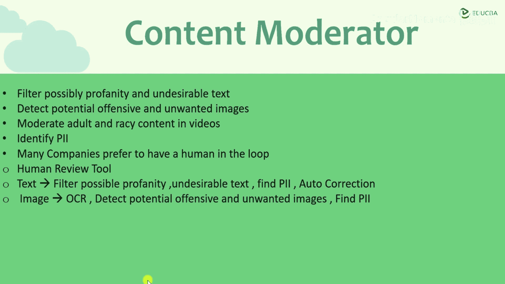
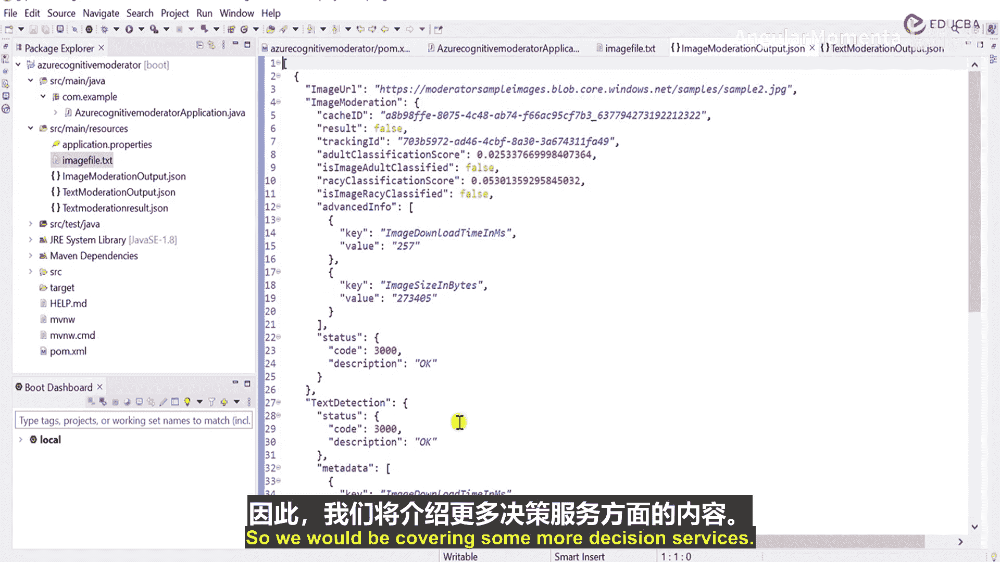

# 【EDUCBA】Azure实践——认知服务 ｜ Azure Practical - Cognitive Services p10 05_02_01_认知决策服务 -BV1zXFozVEXL_p10-

Hi， in this session of us， we are going to learn about cognitive decision service。

 so what exactly you think about these set of services？

So the services under the decision help your application to quickly make decision。

So the word decision might look weak right now to you。

We lets go and to take a look at the services which are being offered by the Dec cognitivetive service。

I'll assure you that you'll have a better understanding about these services as we go through multiple services under this service there are three services under this category the very first is contain modeator then comes the anomaly detector and finally comes personalizer so these are the mainly three services which are being offered by the decision of cognitive service in the next few of our we are going to cover these services one by one。

Hi， so the very first service which we are going to take over here is content moderator service。

 so you can use the content or service to filter possible profanity and undesciable text it can also be used to detect potential offensive and unwanted images。

And finally you can use the content moderator to moderate adult and tray content in videos。

 so I'm sure you are already thinking about several use cases which can be used with the help of this particular service if you are developing a chat application you can easily integrate with content moderator to make sure no undesirable text communicated between the members and the same thing goes for images and videos if you are developing an online photo or video library you can use integrated with the service so the images and videos are inspected to make sure no offensive unwanted or adult content is communicated。

Their users can do more。It can identify eyes personally identifiable information as well as you remember we had the service under the language category earlier with the same thing for text here you can identify pictures for text images and videos。

This is great， same as many other services under cognitive service， which we have already seen。

So there is some level of customization possible over here。

Many companies prefer to have human in the loop， meaning if a text image or video is tag or flagged as undesirable。

 a human being is going to go ahead and approve or reject that particular set of decision for us so this can be achieved through human review tool as well。

SoNow let's go ahead and take a look at this particular set of service in more details。

Let's talk about text first so you can use content moderator to filter possible profanity and undesirable text it can also be used to find personally identifiable information or in your textual content if you are for example。

Our names， emails， phone number， Social Security numbers， bank card， other card。

 or many more things are there。Theres a cool feature in the service also Im sure we have seen that people misspelld bad wordss also。

 for example， replace the eye with exclamation mark or use herer a star and other characters here so the content moderator is smart enough to perform an auto correction as well on that particular textual content which we are going to fast through it the correction is not 1 hundred0 percent accurate though。

 but it is promising in terms of images。You can detect potential offenses and unwanted images and flag them for us There is also a cool feature here。

 What about the text inside images so this service has。Be also covered。

 So it does perform OR on the image and extract the tag text for us。

 And after that it goes ahead and perform contain moderation on that particular set of text inside the image as well。

 So this is a very powerful tool as you can see and we are going to。

What we are going to do is I would be going to create application using Java from where I would be passing out some text and images and on the basis of that it is going to filter out certain set of stuff for us over there we won be implementing a human review tool over there for us we will be just covering two major parts how text is processed through content moderator after the text we are going to look into how exactly these images are worked upon。

Hi， in this section of us， I would be creating my first moderation app。

 I would be going ahead and go and select a new project over here I'll be selecting a spring spring starter project。

I'll be naming my。Protective as as your。Cognitive moderator。

 I won't be selecting any of the predefined jars or dependencies。

 I'll just go for next and finish it off。 So once project is going to be created over here。

 I would be adding certain set of declarations into our dot X5。

So what exactly we are going to add into our poem is。Okay so for example。

 we would be needing certain set of dependencies on the SG front after that I would be needing some dependencies such as I would be needing Gson J over here and then we need some faster example for Jacksons of course so I'll just go and add those set of dependencies of I'll just go at dependencies。

So what I'll do for these set of。Depenenceencies Ill go to my chromroe。 Ill go and select for。

Moerator is on the basis of that I would be getting a repository details from here so these are the versions which are being there so what I'll do I'll just go and select this particular set of version。

 so I'm using 1。02 beta so I'll go back to my form。I'll past it over here。 After that。

 we would be needing。Dependencies such as Zda over here。 So for that， I'll go back to the browser。

 Look for。 So the version I'm going to take is to。We can take any of it。

 but I'll be using a 2 or 9 do4。Based my dependencies over here。

Once the we have user time dependencies as over here， I will be using a gson， so for the gson。

 I'll just type it over here。Depenent and C in the dependencies path， I would be adding micro Id。

So it is going to be calm。In the artifact I I just have to go pass Gson， Ill save this two。

So that's it。 So we have been able to add most of。Independencies over here。

 I would be just needing a couple of more。 So， for example， I would be needing。

Faoster examiner Jackson code over here。So what I'll do， I'll just go。Sos okay。

 so I'll just copy this once。Now， in the group idea， I just have to go in fast calm dot。

Fas your examine。Ld。A dot co。So my artifact id is going to be for。Jackson cool。Now you copy this。

I would be calling my annotations of you。Yes。Now， I just have to go and pass my。Data bank。

 Jackson data。So I'll add my versions over here later on so we can just look into the versions which would be required for this。

😔，By that time what exactly we are going to do is I'll just go to my source me。

And create a dummy applications over this so that at the time of run time。

 we can just add rest of the dependencies or the versions which would we would be needing over here。

 So what exactly we are going to do is we have to just define certain set of things we required So in this particular session I would be much more looking into the moderator application for the image in the next section I would be going for the text file one So right now I'll add the code set for moderator moderating our images after that in the next session into the same set of code only well go for a moderation of the text file。

So I would be using a needing or review URL over here， I'll pass that URL later on。

I pass my review URL later after that we would be needing subscription key。Okay。

So we do know that what is the main use of subscription keys？

So we would be getting a subscription keys from our portal only after the subscription key。

 we would be using a endpoint。So once we we would be having our subscription key in point over here。

 I just have to go and create a class so that particular class is going to be called as evaluation data so just let me go and create my class public static evaluation class over here So what exactly my class is going to need over here it would be it would be required image URL moderation and OCs and they would be if there's any set of image over there and if image consists of some phases so we would be using found face detection also so I just call some more public so I would need a image URL over here after the image URL we would be needing evaluation。

Yeah。Thank。After that， we need to call our so we do know the user of o here with therefore OSA。

 we try to extract data from our images so text detection。After the oia。

 we would be calling our found faces。Functionality。

So the uses of that is to detect our faces so that's it so that's how our evaluation data class has been created over here we can just go and start implementing the client connections and all So what I'll do is Ill go and create current。

Moderator client Ill name it to be asked client Now I just have to authenticate it out。

So I would be needing a URL。 So for that， I just have to pass it with the help of。

Endpoint which we have declared above once we have our endpoint。

 we need to pass on our passwords or the subscription keys。

So that's how we would be able to create a client over here。

I think we might need to call a manager class。So once we have a client created over here。

 we just have to go and create a list in which we have to show the image moderation results actually。

 so I'll create a list over here。On the basis of data we have created above。

 I'll define it evaluation。You just have to import。So what I'll do is I'll add a jar over here。

So that if we would be importing some more set of less arrays or something。

So we are able to create a list now now we just have to go and create our own set of functions over here。

 so I'll go and create a functional called as moderate image。

In which we would be passing a client because it is something with through which we get ourselves authenticated over here。

And evaluation data。Now we just have to go and create our own first function function over here。

 So it is going to be a public static void because we won't be returning anything over here we just。

Going to print each and everything as it is。So， we have a client。Yeah。Evalation data。So。

 it is of type place。So we have created our very first functional function over here。

 So with the help of that， I'll just have to go and define that。 Okay。

 we would be printing something over here。Yeah。Yeah。So。In it more。ation。Perts。

So after that we just have to go and create a triad block so that if something goes wrong we would be able to handle exceptions over here。

 Ill create a tri blog。In which we need would be using certain set of URLs。

So I would be needing a URL string。Theこ。So Ill add my URLs over year later on。Yeah。

I would be using a body model。Yeah。So I name it via as model。Or we can。 okay。

 we can add to B us URL over here。After that， we just have to use a URL to get certain things of matration。

 So with。So now I have to save my evaluation class for later， so far that。Valuation。你的。

Now we need to get image already。Now， we would be using this particular set of。

Data to get it moderated on the basis of different things out。

 So I would be getting it evaluated for adult or Ra content first。

 So what I'll do is I'll call image data。Dot image moderation。Now with the help of client。

 I would be using the。Functionalities， human modes。Dot evaluate。URL input。Yeah。That is going to be。

Application。Last season， it is going to be。Data type。Here， we need to pass new。violationition。

Opten parameter in the parameter。 I need to。Mark mytasha to be S2。

So we have already able to make sure that image matration on the basis of racing content has been done。

In the same way， we will be getting it done for the text detection， phase detections at all。

 So before we do that， we can just make sure that。Put a thread on sleeve， so that。

We would be triggering functions， one by one。No， I would be going for help。Fse detection over here。

 So in the same way。I'll call my face prediction over here。系 your screen。Not。Youit matations dot。

Fine。Face URL input。dson。With cash。Iage， and it is going to be true to。

Ill call my thread tot sleep once again。SoWhat I'll do， I'll copy this。Coffee。

 paste my thread do sleeve。 Now， I would be going for a。After a phase detection。

 we would be going for a text detection now。我的。URL input。So， mostly， my。

Text type is going to be of English only。 so I'll pass English over here。As usual， my。Yeah。

is going to be application slash Jason。It is going to be O C URL。 Okay， it's not。Okay。

 we have been able to get it over year。Optional parameter dot enable caing width to bes。对。都。

Once again， well go for a thread dot sleep over here。

 So that's how we have been able to detect multiple things out。

Now we just have to go and make sure that we is going to have our results over here。

 as we have defined that there is something called list over here to be as result less。Dard。I save。

We just have to make sure that we are going to get some status over here。So， image。Modration status。

 I put it over here。So that we would be getting our status。But it was a success or not。Now。

 what we are going to do is we are going to make sure that these particular set of results are going to be stored somewhere。

 so I would be using a buffer writer。So I'll call my right over here。Yeah。Okay。

So I need my file to be asked。Yeah。So that we would be able to find it out。Resources。Iit。Moeration。

result。 So we are already getting it to be as adjacent soil create a file of adjacent type only。

Now I'll use my Gson， which we have already imported into a formm file。D on buildder。Okay。Okay。So。

 okay， so the sun is not imported yet。 so just let me。Andmport this on。

Now we just have to call a writer over here。With the help of writer。

 I would be just writing data to my files now， so that would be the most probably the last step。Yeah。

Yeah。So we have our result list over here。 We just have to。Blue string。Yeah。Yeah。Yeah。Okay。Thank。

Okay。After the data has been written over here， we just have to go and close right now。

And that's how most of the work for the image moderation has been done now because we use a tri catch blocks over here。

 we just have to catch if something goes wrong。Yeah。真的。I would be writing a lot of things over here。

We just write down the not。Oh something went wrong。Okay。some。Thank you。哦困 now。Or we can even use。

To print a stack over here。Yeah。After that， we just go in and he thought。S please。So that's it。

 that's how the image moderation is going to work。So we are going to have a string line over here。

 Then we have to create a screen。On the base of screen， I will be calling my text results。

I'll appreciate it once。Now， once that is done， I would be calling my gson once again and creating an object of of gson your。

So I'll be using a while over here， So in that I would be finding that okay。

 once make sure that attacks don't get empty so we would be reading till it's not empty。

So we have a working over here。 So I checking my length。 It has to be greater than 0。

I'll call my text results。I'll be using my client。And that I'll call my text modes。

So because we have a normal text file， it is going to be a type text plane。

And we would be reading each and everything as much。So that's how it is。

 So we have a value bow here now once that isn't， we would be I'll be printing。Moration。

Sttraator over here。 So for that， I'll be using the same way we have done earlier。

So I'll use my text results over here。I'll call status and description。 Now。

 we do have a results over here。 Now we can do two things over here。

 Either I can print my results over here。 The second thing would be。

 I'll just make sure that these results are showed somewhere， right。

So I'll be using my buffer writer， writer， as usual。So now with the help of that， I'll be passing。

My data to some。New place。 So I have to just now define my new file。Now。

 we just have to mention the destination for that。So it would be in the resources folder only。

Name of the file would be。对。Moeration。Reult，Now， you just have to call my writer once again。

W a right。Now， with the help of Gson， we would be generating a。

Now we just have to pass our results over year。To swing。That checked。

 Now we can just go and say that， okay。S not out。That it呃。I written in。Ex。Yeah。Modereration。

Result that Jason 5。That check， so most of the things are done。

 we just have to make sure that I'll close my writer。

 so I'll call writer dot close that check Now in exception sections， I'll call my system dot out。

Theal。Exception。Detect。Okay。Plus， that。So that's how we use it to。Get certain set of。

Exceptions handle to get the moderation child。 But now we do have created a moderation text function over here。

 Therefore， we just have to go up and call it once。We have a moderation of text。

 I'll pass my client in that now on that check。So we are good to go in the next session。

 I'll show you how to add your review URL subscription keys in end points over here and on the basis of that we would be going ahead and。

Of finding out how exactly it works， but we can just see that too。

 this is my create content moderator functionality， as you can see。

 I've already created a function over here。 we just have to select a resource group region give the name of for instance and select the pricing to After that we get these kind of keys over here。

 So we have already known that how these keys and endpoint works。

 So I'll just go and paste my keys over here。After that， I just have to go and copy my endpoints。

So though most of the things are already done earlier year， we can use our application as it is。

 if needed。But before we do that， we just have to go and find the exact versions required for this。

 I'll get it done in the next session and I'll show you how this particular set of application works and how does the moderation works over there。

Hi， so we have already added all the required details over here we have a subscription key。

 we have our endpoints defined over here。 So what I will doing is I just go here and trigger my。

Command and turn this particular set of application， I'll trigger it once。So， as you can see。

It is application has already started， it took around 1。1。7，5 seconds over year。

And as you can see it says image moderation， the status is okay and it says that output has been stored over here and then we have text moderation the output stored in adjacents so these results are already stored over there so what I'll do is I'll just go and try to refresh it once。

So as you can see we have certain set of results over here。

 the bottom of the result is this second one is going to be here so what exactly we have passed in our file was it's a test for text moderation with user email ID for numbers and some random address was added over here if we go and check into the text moderation it says that okay this is the original text which we have passed through it After that it has a normalized it。

So it says test text moderation， user email and all we have a。

So we have something called as Niagara falls over here。

 so just let me see so as you can see we have our status codes over here。

 then we have our email IDs described out of here， then we have our countries。Cellphone number。

 so that's how this particular set of API was able to extract certain set of information from the text file we have passed away it and it has even tried to normalize it actually。

So now if we just go ahead and check the image moderation part so it says that we have something called as image URL。

 so just let me go through this， I'll pass my I'll check the image so you can see we have certain set of sets text is written over here if we go back to our application if we just go down we can see that okay Oia was working fine on that and whatever was written on that particular set of image it prints that all and the backslash in Sha for the next slide okay。

We were able to detect the。Take out of it， it was even trying to phase detect from that。

 so these are the multiple things which were happening over the image which we have passed out。

Because I pass my phase detection after that， it has already put my face detection after the。是。

Facity， which we were using over there。 So that's how image moderation and the text moderation works in the as your cognitive service。

 So we would be covering some more decisions services。

