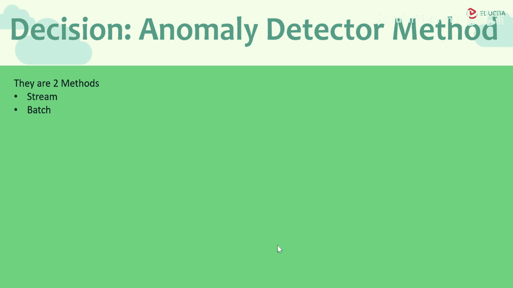
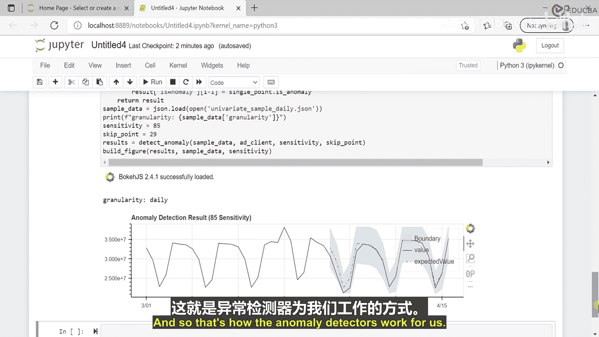

# 【EDUCBA】Azure实践——认知服务 ｜ Azure Practical - Cognitive Services p11 06_01_01_异常检测概述 -BV1zXFozVEXL_p11-

Hi， so the next service， which comes into the decision A。

 is called as anomaly detector and it is a one of the known。

Services also so what does the your anomaly detector means。

 So this is a service which enables you to monitor and detect abnormalities in your time series data using machine learning。

Here we need to clarify that time series data is a series of data points。

Point indexes in time order and you are most probably receiving these time series as a stream of data。

 A few examples of time series data is data collected from heat sensor it could be in thermal power plant nuclear power plants as well and data being collected from the formula1 engine cars and other details also so on the basis of that team gives instruction to the formula1 drivers and even your data are being collected from different connected iot devices as well So what anomaly detected does it is going to learn from the normal pattern of your data and it is going to come up with and so calledled a normal data range once it comes with a normal data range on the basis of existing data ranges after that if new series comes it tries to find some anomalies into that new set of streams on the basis of the previous stream through which it plotted some normal data range So even anomaly detect。

SinI critical in certain set of scenarios。 And on for that， we get。

Seconds of microseconds to respond on the basis of those set of data。 For example。

 we are receiving these formula one details， so we are getting these。

Car engines RPpM details right now。 And if the rest of the team member sitting in the pit。

 they finds theres some set of abnormalities going on there。

 And if the driver keep on pushing his car So it might result in some major engine issues or it might cause some transmission issues as well at that time they notify the driver immediately and act on it。

 What if you are receiving data from a heat sensor or planted in a nuclear power plant。

 What if the power plant temperature exceeds the allowed limit within the matter of secondss and alert should be issued in technicians should be notified so they can act on it。

 even a few seconds of delay could be catastrophic example would be data you are receiving about stock market pricing What if the price drops below the expected limit you want to go ahead and by a stock and finally。

 what if you are hosting an agency called database instance in the your database always accept traffic from specific IP addresses suddenly you are receiving。

request from unknown IP all of a sudden so this is， in fact， an anomaly and should be dealt with。

 it could be security threat as well。 In fact， as you call database offers an advanced data protection plan as well which does anomaly detection under the hook to detect these kind of security abnormalities and deal with them。

 Let's talk about how exactly these anomaly detection modes works So the anomaly detection services can perform two major modes we have different end point for these modes as well So the first one is a stream mode which this service is going to learn the previous data to decide if the last data points is abnormality this is a mode you should be using for live data and it is more performance and accurate the other mode is the match mode which acts on all data points in data imagine you have one year worth of data and you want to pass it to the service and get all the abnormalities in that particular set of data you should be using the bat。

For these kind of scenarios and it is important to note that the batch service should not be used for live set of data for live data。

 so you should be always be using these different mode as per your requirement。

In this session of us， I would be creating my very first anomaly detector application using Python So before we go ahead and start our code So what I will be doing over here I would be using a Jupyter notebook so that if you are going to plot certain set of graph it is going to help us out with that and secondly it's make much more easier to code in Jupyter notebook if you are getting to start something new So what Ill do before I start coding Ill just add some dependencies over here。

So I would be adding dependencies so as we can see dependencies are already over here after that I would be importing the required libraries。

不可。Now， from other libraries， I would be calling。Yeah。Now， from Azure。

 I would be calling Azure dot Ai do。Dctor。Andport。Yeah。So I have got my client over here after that。

 I will be getting as your do here daughter。Anomaly， director taught models。In that。

 I will be getting。Dector request。Yeah。After that， I would be getting time series points。

 so I have already told you about that we would be getting some data in time series format。Yeah。Yeah。

Yeah。Then I would be getting some anomaly detectors error。That's too。After that。

 I will be getting your credential handlers。 So for that， we need a core。你不。Okay。After that。

 I would be using a Pada libraries。Yeah。Okay。Yeah。Now we would be using nuy over here now for graph plottting。

 I would be using Boque。So these are some of the libraries which we have already installed over here and at times we don't even need to install them at Jupyter notebooks so far。

Okay。Yes。Yeah。Now from Boque， only I would be getting after these plotting functionalities。

 we would be calling pilots。Yes。Now， we would be needing these boque model as well。Yeah。Yeah。Yes。

Okay after the boque we would be needing a date times。

 then I would be used calling my date till as well。

 so with the help of that I would be passing certain set of things。

So this is my date tu from which we would be calling a parcel。

 then I think we need to have one more boque I handlers。Yeah。Yeah。Yeah。Then finally。

 I would be getting。Yes。Okay。Yeah。IP widgets over here enter widgets。And thanks。

So these are a certain set of imports which we would be needing over here now what exactly I would be doing is I would be creating my notebook functionalities over here then I would be setting my subscription keys and only detection endpoints for that So what I'll do is add line over here。

Define our underscore score。Yeah。In Northfo。Subscription underscore key in which we would be passing a subscription keys。

 as we have done earlier as well After that， I would be creating an a URL endpoint handler I just name it to be as anomaly。

Yeah。And point for now。In which I would be passing up endpoint later on So that's it。

 So these are some of the basic things which we would be needing to get it done in the next session of us。

 I would be creating a figure build functionalityities through which we would be plotting a graph after which I would be showing you how these client connections are going to handle over there and after that I would be showing how exactly these anomaly detection services work over here So these are the certain set of things we would be covering into our next session of our Thank you in this session of us I would be creating my client connection in the initials after which I would be creating a functionality through which we are going to plot our graph for the anomaly detection so just letting me go and create my client。

So I would be calling anomaly detector client over here。

 so as we have seen earlier also if we are going to create a client we need certain set of things。

 So one of it we need to call as your key credentials。

After which I would be passing my subscription keys over here so what I'll do I'll just copy my subscription key let me paste it over here after the subscription keys have passed we need to call our endpoint so Ill copy my endpoint2。

Over here and pass it over here。 So that's how a click mainly client would be created。 Now。

 once we have a client， we need to make sure that whenever we are going to hit a anomaly detector and we get certain set of values over there we would be needing to build a graphs right now。

 So to build a graph I would be creating a function called as。밀gra。

In which I will be passing my result on the basis of anomaly detection， sample data。Okay。

And sensitivity。For this particular application， I would be passing my sensitivity to be around between 90 to 95 okay so even if needed we can pass it to be as f。

So I would be using my columns over here。So force would be expected values。

So we have already passed a result。So here， so from result， we will be getting expected value。

 So I'll just copy this。Pas it over here， once we have our expected we all， I will be calling。Is。

I normally。So it is going to be fetch from result only after that we get this negative anomaity。

Negative or not。Okay。Yeah。After the negative anomaly detections。

 what we need to do is we need to go for a positive anomaly detection now， so I'll press into here。

Is。Okay。Positive anomaly。So it has to be kit from result。So what I do。

 I'll just keep on adding things over here after that， we can just。必事。Of marginin。Yeah。Reerard。

After the upper margins， I will be calling my lower margins now。Yeah。Yeah。Then we need value。Yeah。

We need to pass from result only， so we have result of a year through which I would be getting multiple things out then we need timest。

Yeah。Thank。TimeSo these are certain set of things we would be needing over here。

 So basically for values and time stamps， we need to pass certain set of things over here。

 So what I'll do is I'll just remove result from here control it go back to。

Value well to move term result over here。I have。I will be calling my values。B eggs。Oh。Oh。Yeah。Series。

 same thing we need to do for timest I would be calling a pass over here。Good。Yeah。

On the basis of times stampmp， I need to get values。So on the basis of x。

 I would be getting in values， sample underscore data。Need to pass series。So that's it。

 so these are certain set of values we would be needing over here and once we get we need to go and build a response on the basis of that。

Yeah。Data free。Yeah。Okay。Yeah。To have values now。Yes。

We need to find label that should be on the basis of。We need anomalies。For now。

 it is going to be just a basic set。 So after that， we need to create some anomaly levels also。Yeah。

We need to our index over here， so index values can be equal initiated as 0。

Now we need phenomenaly indexes。Okay。Yeah。After that we need to just go and plot things out for that we would be calling more functionality so I called figures now because we are talking about plotting the graph over here so we would be needing xxs and y axiss。

 so for that we need to define the xxs over here first of all。

So it is going to be of type date and time， of course， Now we need to define the title of that。

Anomaly。InDection。Sity now after that， we need to just add some more things。

 so I need to format it once。So I'll be calling my format。Okay。Yes。Yeah。

We to define the width and height so I'll define my height to 200 for now。

 so that's it so we have been able to define x axis for now after the x axis is what we would be doing over here I would be calling fall loop over here so on the basis of that we would be trying to fetch more set of values。

Start recall calling my response and response we need to pass anomaly is。Yeah。On the basis of that。

 we would be getting multiple values one by one， get a if over here， if condition， if anum is true。

Now we have to use our index， which we have declared over here to be as0 earlier。this spas。Yeah。

be falling on the basis of expected， expected values。NowAfter this expected values。

 we need to use upper margins。Or else we would be having。Yeah。And this is。On start I log in index。😔。

Expected values。Yes。Minus。responsesponse that I love。Al next。Lower margins。Yeah。Okay。

So after in that particular set of a functionality。

 we need to go for app pending functionality right now， anomalies or the pen will be app pending。

Next values。Yeah。Yeah。Yes。Okay。Good。These are certain set of things which we had declared about。

 so Im just calling those things out and now sending those set of valuess into that。Yeah。这个。Normally。

 underscore underscore score。Minixes。Yeah。Go it open。Okay。So that's how the if condition comes。

 Now we have to just increase the value of our index。Yes。Now we just need to look after。U婆。Yeah。Yeah。

Yeah。Yes。What are you doing， I just name。Expected values。U margins for lower band。

Response size usual minus。Response。老吗亲亲你。Thank。Now， we just have to use bands for x over here。

you would be offend。Yeah。Yeah。No， it by way。We need lower band over here。嗯。Okay。Yeah。

Now we need to have some boundaries over here， so I'll just define。Yeah。B and corrects。

We are planned in the school Y now we need to define certain set of colors over here， so I give。Yeah。

If for alpha0。6， you can have need to define the where the frame in turn will define it to be as1。

嗯你 do所的牛逼。Yeah。So I called it to be as boundary only。 So a boundary is done。

 Now we need to a mo set of things。いっぱ言。We need to define certain set of colors over here。

 So what I'll do is I select the colors later on。😔，So colors are to be defined in hash code。

 it's good to define it in hashboard if you want to， so I would be defining colors in hash code only。

Yeah。So basically these anomaalities are on the basis of the expected values and exactly there is a deviation from the expected values in all and so we would be just using basic time series diagram also you I do have created a J based file already for that so I'll be using that。

Yeah。Iで。Yes。Yeah。Yeah。Once again， we need to have our colors I'll define it later on。

 so if needed we can give these colors in hashboards or proper names as well if it depend on us so once it's done we need to go and provide ourselves source。

Yeah。So that we would be needing a dictionary anomaly。Thank。Yeah。Yeah。He。Yes。Thank。Yeah。Yeah。

And you go to find colors once again over here， I'll do that。Oh， this so。

So we had the describing tower。So with the help of this particular set of functionalities or bars。

 I would be just what exactly we are going to do is we would be having a graph loted out as per requirement。

Thank you。Yeah。Per。Yeah。Okay。6。Yeah。Now just have a force show functionality。Yes。Yeah。1块钱。

So that's how we have been able to create a functionality to plot a graph now in the next session of us I would be showing you how exactly these detect anomaly E functionalities are created and we would be creating one simple functionality and then we would be passing our sensitivity and after that we would be trying to plot the graph graphs on the basis of that so till then thank you。

So in this session of us， I would be just creating my function through which we would be。Trying to。

Detect anomalies， or create a function。Or detect。Anomaly over here now in which I would be needing my sample data。

We would be calling a game。我知看。We would be need a sensitivity。

And then we would be needing some think our last skip point。

So I'll just define my skip points to be as static for now。

Sample underscore data is going to be series After that we need to define gran granularity。

So I would be defining my granularity over here So on the basis of the sample data which you are getting。

So that's it Now we need to have our results created。So we have something called。不要。Expected values。

 so my expected values is going to be。Yeah。9 for。Then points。After that。

 once we have our expected values over here， I would be using。Okay。Upper margins。

 that is going to be seen as above。 Once we have the upper margins。

 we need to define the lower margins。So what I'll do I just copy these things now so once we have upper margins low margins and expected values we need to go for negative anomalies positive anomalies and as anomalies things out So for that what I'll do is。

Yeah。Yeah。So for that， we need to have something else false to pass my then。W of the位置。Yeah。

Was there death anomaly。And is anoma。So architect， now we need to go and for。

So most of the things are done， now we just have to call loops over here。Yeah。

So we need to define our range now， so it is going to be on the basis of skip points。Yeah。

So it is going to be series。So it is going to be a dying series base。Yeah。Im some mini values。Yes。也是。

Yes。So these items are on the basis of values。Okay。Now looking for a do on the basis of point。

 So you were maintaining a minus-29 because。😔，LetSo the series is done。

 we need to go for request now。你们懂我不。A series in incrnularity now。We need to have sensitivity。

And then my score。ratio， whichch is going to be 0。259。Then， singles by。好。Yeah。

So on the basis of our client， we need to go and call our detect。Yeah。past the requested。

 So with the help of that， we would be getting a single point now now， if my single。可。

The is underscore underscore score anomaly。Eals2。 So and A minusda score count plus one。

 So because now we just need to have our results。 So we would be having expected values。😔，Yeah。1345。

6。 So youd be getting six results now。Yeah。So on the basis that I just have to go。

 So it is going to be upper margins。有 my钱。This negative anomaly is positive and is anomaly。

 that I' call single do。Okay。Yeah。Yeah。Yes。Thank。Yes。Uper underscore margin。

 Do lower underscore margin。I underscore negative underscore anomaly。

 his underscore positive underscore anomaly is underscore anomaly。 Now。

 we just have to go and return our results。😔，That's it so most of the things are done now we just have to pass our basic request over here and on the basis of that basic request we would be getting results over here。

 So what exactly I would be doing in the next session I would be adding my user in pointss over here and after the user inpoints I would be adding my socalled。

Key values pay also what Ive done I've already created my service over here and I have already assigned keys to it so now what in the next session Ill be just going ahead and passing those set of things over here and then Ill just set my values and on the basis of those set of values I would be trying to plottograph。

So till then， thank you。So what exactly I haveve done I do have pass on my keys over here。

 I do have defined out my anomalyline points also now we just have to go and trigger application over here and these are certain set of things on the basis of which I would be plotting my graphs over here so what we just have to go here and now make sure that I'll trigger my application and on the basis of these certain set of things we would be getting our graph plotted out for us so I'll just go and select on。

So as you can see right now it's on the basis of our data。

 it says that there was some granularity and in which it says daily。

Now these are the graph it has plotted for us。So as you can see these are some basic expected values over here and these were the expectations values which were to be there now on the basis of which it has defined out that they had found certain set of anomalies in this particular set of series data which we had provided over here so that's all the anomaly detection work so what they have done is we have skipped some initial set of values so we need to define the skip points if we don't have some insufficient data or not enough data so we need to decide that how many things to be skipped out at the very first point So what I have done Ive used a skip point to be 29 which we have even。

Hard codeed at upper levels of far and on the basis of that we were able to detect anomalies and I have used my sensitivity level to as 95 and if we can just reduce it to 85 for example and I'll run this application once again。

So we can just keep on changing our sensitivity as per our own needs， so as we can see。

It's a bit different graph as per the previous times and so that's how the anomaity detectors work for us Thank you。

