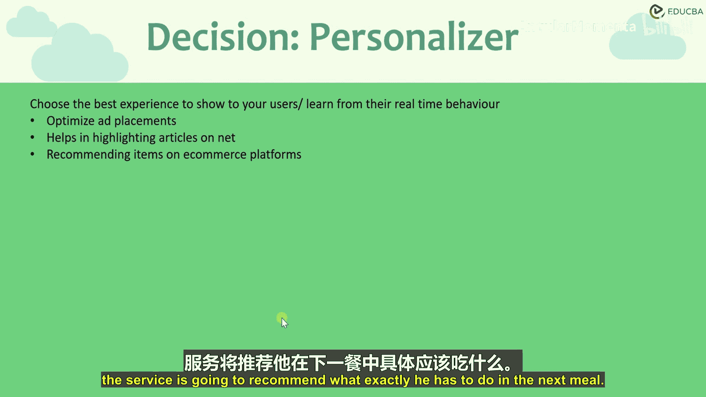
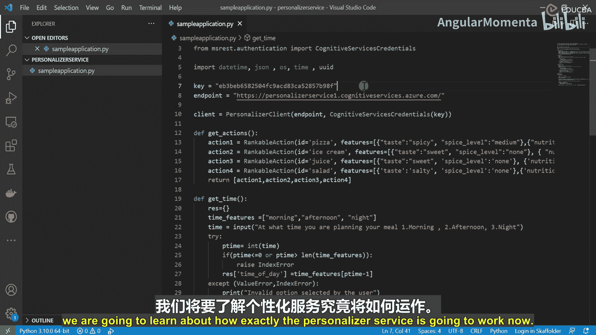
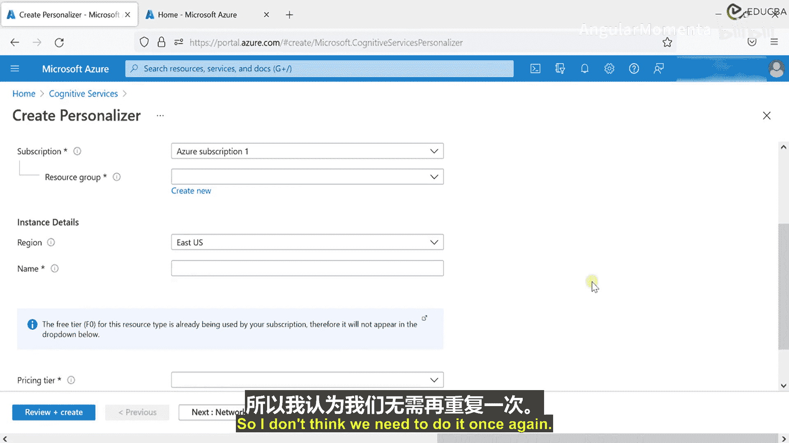
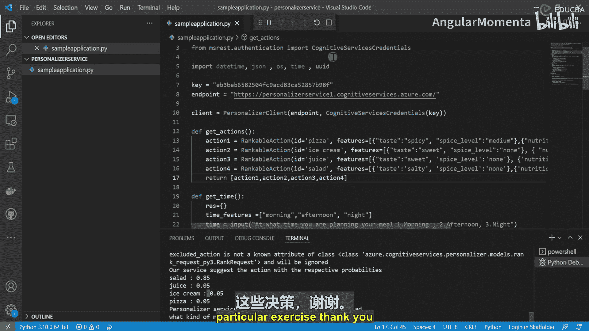
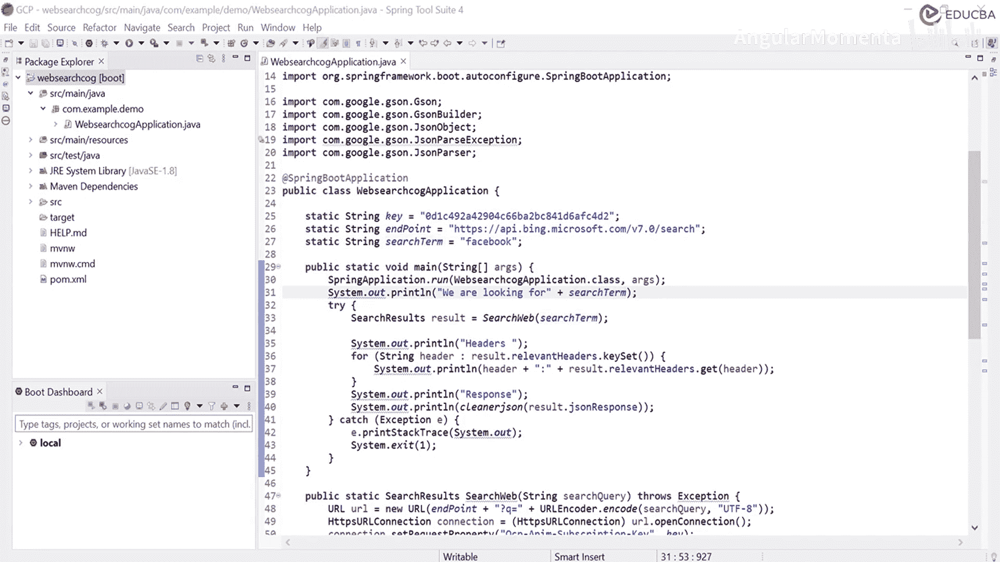

# 【EDUCBA】Azure实践——认知服务 ｜ Azure Practical - Cognitive Services p12 06_02_01_决策个性化器概览 -BV1zXFozVEXL_p12-

In this particular session of hours， we are going to cover the last service。

 which comes under the decision group of us。 and it is called as personalizer service。

 So this particular service help us to choose between multiple things on the basis of the user experience So it calculates the user experience on real-time behavior and on the basis of that it recommends us what exactly has to be done。

 imagine we have an website and we want to show certain set of advertisements over that。

 So where should you place those set of advertisement top left corner or top right corner or may be at the bottom or maybe some user prefer decides that there is no silver bullet solution for these outplaces So it depends on each individual preference。

 So how can you go ahead and based on the individual behavior place these advertisement in the right place of your website So this is the time the personal service comes in handy。

 So this service is going to monitor and learn from user real-time behavior and then use it for。

Future references。 So let's take a look at few more use cases， which we can consider。

 So as you already talked about， you can optimize your ad placement on website with the help of this particular service and you can also show recommended items for users to buy in an ecommerce-commerce website So for example in Amazon in ebay you might have seen that on the basis of your previous purchases it keeps on recommending you some new sort of products So that's how these things are handled out on an ecommerce-commerce website Now it even helps you to highlight and place articles on news website based on the articles and topics which the user was interested in previously So that's how the personalizer service can help you out in multiple use cases So in the next session of hours。

 we would be creating a pythonbased application through which I would be helping a user to decide what exactly they are going to have in their next So on the basis of the previous meals he had taken or for example。

 if he likes to eat something things sweet on daily basis you prefer。

some sort of specific ice cream so we have those set of data collected with us then service is going to recommend the user if he is interested in eating something sweet then what kind of ice cream he could have if he wants to eat something salty what he can go and heard and eat so that is something on the basis of his previous experiences a service is going to create a model and then on the basis of that particular set of model the service is going to recommend what exactly has to do in the next meal Thank you。

In this set of section I would be showing you how to create an personalizer service application in which I would be creating a Python based application through which we would be suggesting people that what they can have in the next set of meals so for that before we go ahead and start coding just let me open the terminal over here and in that I would be installing certain set of dependencies over here which I would be needing for my Python application thatll be using PIP install。

As your cognitive services personalizer。So， this is。Personal laser。

So with the help of that we would be getting a set of dependencies installed in this particular directory which I would be using over here so as you can see it's already installing by that time I can just go and create my application of here so Ill just write my sample application。

Dot Py。 So this is going to be a Python Ra application。 So I do have installed that Now。

 before we go for the coding part， I'll be adding certain set of dependencies of a year。

 So I will write that as your door cognitive， so。This is dot personalizer。Yeah。From。

Personalizer claim。After that， I would be getting some more set of services called as youror will just copy this。

Cognitive services， dot。Personalizer dot models。And I would be importing。Yeah。Okay。Then。

 rewards request。After which， I would be calling rank。Okay。Request， now， after that。

 I would be just calling for more service away here。Mirs。NotNot authentication。Inport。Stet。

 and just let me check that as we ordered cognitive。

That's right so we have been able to import all of the required entityt over here okay thats right now we have imported everything which we were needing from the Azure perspective now I just import certain basic things such as date time Jason always time man sorry。

U you I。 So that's it。 Now we have been able to completely get all the required inputs。 Now。

 I have to find a field over here of called key， and I would be creating one for endpoint。

 So with the help of these。Variables mainly we connect with Azure cloud as we have already seen the previous sessions of files。

 so I would be filling these particular set of values as we move with the cross So now we have a key and endpoint so we would be creating our very first client over here so to create a client I'll be calling my personalizer client So in that we would be needing a endpoint and after the endpoint I would be just decing my。

Cognitive service credentials in that we need to pass the key So that check So with the help of this particular thing we would be able to connect to us as your cloud so now we do have a client created for us so now before we go ahead and start getting things done we need to create a basic data for a service to go through and on the basis of that particular sample data we would be going ahead and suggesting a users to that what can they can have in the next set of meals so I'll just go in。

Cl。Yeah。Okay， so I'll be creating my actions over here， okay。

 so the very first action I would be creating over here is going to be called as action number one。

Now， on the basis of that， I would be。Defining it to be as a rankable actions as you can see we have already voted above。

 so what I'll do I'll just copy this once。So in that I just need to have an idea over here。

 so for example， I will call it as a。Pizza。Now my P is going to have certain set of features。Yeah。

So I'll be just defining those set of features。 So basically。

 these set of features are much more like a adjacent type of object。 So it is going to。

How exactly a pizza is going to。Tage basically， so I'll define it to be as so just let me create my parent。

So I'll just call it to be a a bit salty。Just let complete a spy the strength that I would be defining that what is a spice level it is going to have。

Spice underscore the score level so I'll just say hi that is going to be a spicy piece of example now I'll be creating one more Jason and that in which we can just mention out the nutrition facts about P so how what are the new nutrition values over here so we would be entering those set of things so for example nutrition。

I。So we can provide it at round four and what type of cuisine we can call it。

 I will define it to be as。Yeah。Italian so we have been able to define the very first action item of our Now。

 in the same way， I would be creating some small set of actions， So I add a pasta this time。

 it is going to be salty。Spice level could be medium nutrition values we can say six and it's Italian。

 Okay， so I just have to create a new I for that actually too now I'll be adding one more。

而且 numberumb three。Suppose we need to add an ice cream this time so we can have an ice cream。

 so of course it is going to be sweet。Pice level are going to be none for this particular thing nutrition levels we can define it to be neutral。

 so well say okay， it can be5 and we might not be needed to define a cuisine。So that's it。 Now。

 we can have a much more healthy。Full salad。So my salad would be having spice flavor do we has none。

Nutrition level could be taken as8。And after that， the cuisine we can just remove。So， that's it。

 We have。4 different actions right now。 So with the help of that， I'll just go and return it。

So we have four multiple actions over here I'll copy this and we'll return them。Yeah。

So we have been able to create our action items with the help of that now what we can do is we can just go and create a getting the users time of the day。

 so we would be asking users that at what particular time of the day is planning to get a meal so for that we would be creating a function called as a get user timings or something so just Ill go and say de。

Get time。 sorry， now on the basis of that， I'll just create a new methods over here。

 So my response is going to be a empty。Now， I just call。Sorry， I am on this school。Okay。

So I'll be defining my library area， so for example， we have meals in three times a day for example。

 so I'll define morning afternoon。Yeah。案例。You can add more set of time features over here even if you want。

 you can add evening also， I'll take a time。And put。So Ill call it at what time you are planning。

Yeah。Your。Yeah。So for that， we can define it to be as。完。Good morningor。Do。Afternoon， three night。

C check So on the basis of this we will be getting users input。Yeah。Now， I'll be creating a tri law。

Okay。So I would be getting my first time over here。Ask per the user's input。If my。Past time。

If's an questions。P time is more than the length of the array， which we have created。😔，Yeah。Yeah。

So on the basis of that， we would be telling our。User that there is something wrong with it。

 so Ill call index error。Yeah。Now we'll be just returning some results of a year。Yeah。

Equ to time feature。P time，1。Exception。Okay。Value underscore square error。 Here we have value error。

😔，Next it。So on the basis of this particular set of exceptions， I'll be printing some details。Yeah。

Inalive。Option selected。By the you。Yeah。Yeah。Time minutes does go of the。一个烧。T time feature。

0 now I'll be just returning my set of results on the basis of this。Yeah。Return。Yes。

So we have created a result variable。So we have been able to handle user time now in the next session I will be showing you how to handle user requests for the preferences they are looking into so we would be asking user that they want a sweeter meal or a salty meal so we would be creating a function for that then we have we are going to create a functionality through which we are going to return multiple results on the basis of the actions item we have created Thank you。

In this session， I will be creating certain more set of functions over year。

 so this particular set of function is going to get user preference on what kind of meal he wants I it going to be a sweet or a salty。

 so just get。This is underscore pre So on the basis of that I'll be creating a method as a result。So。

We would be creating a test feature in the same way we have created our time feature earlier。

Salty so that's it。 Now I'll be taking users input over here so。Because it's related to reference。

 So reference it equals to。Andport。Yeah。What kind。Love me。You1，1，3。To salty。

So we would be getting users preference from here， so after that I'll create a tribe block。

F equals to。If。Brefast less than 0。Oh。Pf is greater than to the。

Lth of set something the same way which we have done earlier to make sure that user are going to put proper values in X error else。

We operated a result。Yeah。Yeah。Quation the scope of features。 we would be just passing the index now。

Yeah。So after that， we just have to go and handle our exceptions。

So if it is going to be a value error or index error， I'll print。Invol。joce。ok。

After which you need to go in just make sure that the z block。Ts preference。一会 too。

Please underscore features。That is going to be zero return R yes。

 that's it now we would have been able to handle users preferences also after which we just have to go and start working on the actual job。

Keep going。 I'll market us through。 So this is going to be a flag for us through which I would be running a loop。

So we would be generating our event ID now， that's why we had import a UUI earlier。This year。

I will call you U1， touch it now on the basis of that I' will be calling context。一個수。

Userss preference。 Now we would be getting users time。So I this cool。Yeah。So these are functions。Now。

 I have to go for actions。You get underscore actions。

Now we would be calling some more functionalities which are being provided。

 so I'll call rank and underscore score request right now。

 So for that I'll just have to call rank request so we have already handle it earlier so for that I'll be needing actions equal2。

Actions now we need context show here。 So for that context features。

Equal to context After setting context， we need to find for excluded underscore score action。

 so we have some excluded actions。So for example， I add a salad this time。Now we go for event。

 underscore IDd， which we had。二零哪年。Now， we need a response。一个手。I do rank。

 We have a rank question above the rank。Sll pass that ankle question here。Yeah。Now。

 I'll just print a message over here。 This simple message is going to be printed over。😔，No service。

So this。The action with the respective。Probabilities。

So we would be just listing out all the probabilities as per each and every action we are requesting for。

 soll just create a list。So I'll just call my for loop round。对对。Yeah。Inrant list。

I'll be calling my print function now so my ranked dot。😔，Id and on the base of that。

 I'll be calling my probabilities。Yeah。Yeah。I。Okay。Just， let me take。Okay。这个。Okay。

 now after the follow loop， I would be just printing out the maximum probability。nalaysia。Okay。

So these things you would like to have。No。Response。Yeah。啊。Okay。Action and that what I。Yes。Now。

 you just go and call my answer。😔，We can miss this thing out So that's the main thing of what we are going to do is we just ask the client that if it's the actual request he was looking for or not so on the basis of that we just go ahead and print it out Okay now after that what we can do is we can just go。

Yeah。Yeah。So for example， if a person ask for some more set of things。

 if you want to just continue it out we can what we can do is we can just recall a function functional over here and on the basis of that we can just try to find out more other things out so for example if you' are not happy with this particular set of response of us so we just have to go back and call all the functions so for that we can just create each and everything from the starting or instead of that we just recall this particular set of functions over here in that we would be just decides action which has to be excluded out so in the next session of us I would be showing you how exactly we can go ahead and figure this particular application of us and just let me check why exactly these things are showing this error over here so I'll just go through it also once again and we continue in the next session Thank you in this session of hours we are going to learn。

AboutHow exactly the personalizer service is going to work now So as you can see I've already populated my keys and endpoints over year。

 So for that I have already created a personalizer service on my AzR account and from that account I was able to get these keys and endpoints so we have all know that how exactly to create these services on the Azure account so we have already done it a couple of times earlier you just have to go and look for personalizer service。

Yeah。Yeah。In that we just have to go and create a service over here。

 So once we go and select to create a service， we just have to name our service name over there and select the resources where exactly we want to deploy it。

 So we have already done it multiple types earlier So I don't think we need to do it once again So if we just go back to our application I'll just go and select to run this application without debugging now So this is our application。

 which is up and running。 if I go and select my meal to be salty and if I decided to take it in after So on the basis of the nutrition facts on the requirement of our it is going to suggest salad So as you can see the percentage of salad is 0。

85% which is much more than the other three components which we have added over here juice sayss of 0。

05 ice cream is 0。05 and pizza is also 0。05 so that's how the personalizer service works on the basis of the data which we are going to pass through this particular service it is going to suggest us the suggestions So that's how we can just。

Take users input and if you just club together all those user inputs and experiences。

 we can just go ahead and make decisions on the basis of mass users and where we can want to place the advertisement。

 what are the articles which we need to suggest to them we can all take this kind of decision with the help of this particular exercise Thank you。

So we are going to talk about the very last service。

 which comes under the cognitive services and it is called as web search cognitive services。

 so I'm sure that most of us do have a good understanding of these services so far the services which comes under the web search cognitive services enables our applications and services to leverage the power of。

Web search engine using Bing in simple words， using the services。

 you can bring the power of the search engine into your application by a simple restful APA call and basically it uses Bing at the backend So before going any further let's make sure that we don't confuse the web search services under cognitive services with the agile search services because these tools are completely different So far there are nine services which comes under the cognitive web search service and these services are Bing web search。

 then we have visual search then we have entity search emitid search video search and B new searches also there and so we would be going through each and every services one by one in the next session of our out of which on the basis of web search we would be creating an demo application also through which I would be showing you how exactly the web search services works and each of these services even have their own set of home。

sAlso so you can go ahead and if you want， you can explore those set of home pages if you want from the Microsoft as your website if you want to So in the next session。

 I would be going through the services which I have told you one by one bit detail and after which I would be creating a Java based application which is going to take a help of freshful services to reach out to cognitive web search and we will be passing a test phraserase also on the basis of those test phrases。

 it is going to give us results in a form of Jason and we are going to get to know that what are the matching results which we can get from the Bing website from it Thank you As discussing the previous session of us I would be covering the services which comes under the cognitive So the very first service which comes under this categories called as web search and I'm sure about that we all use search engine into our data day life such as Google Binghoo these are some of the examples which we can consider So you specify。

You can control the market or the region which you want to get results from and you can turn on of the save search also and you can control the freshness of the data if you want the data to be max one day old or a or a month old we can get results on the basis of that so we would be looking into this particular set of service in much more detail in the next session of we would be creating a demo application for us through which I would be passing a test phrase and getting results from the web search service for us after the web search service comes another important service called us P not only you can use the service to correct the misp words。

 you can also use it to correct the words according to the context after this comes auto service So I'm sure that we also have seen these suggestion comings on our screens while using the search engines when we are searching something on Google or you can use the data suggest service to implement the very same feature in our application also。

So as you might have seen when you start passing phrases over these search engines。

 we start getting certain set of suggestions over there to complete those phrases so these things are done with De of the autos service after the auto suggestion service comes news image video search so in the image search service what happens is it is a very selfexplanatory service so would be passing a phrase over here such as galaxy solar systems or just a fruit name Apple over there so I would be getting the pictures on the basis of that so but I won't be able to control that which regions I want to get data back from but I can control that is it going to be a safe search on orof and even I can control the freshness of the data in the same way the image search service works we have video search service also and it is much more similar but you can specify the phrase you control the region also and save search and。

Even the freshness of the data can be controlled by us and being the web search。

 it is going to written back with some morals of the videos and you can go ahead and watch these set of videos also after that we have NtT search over here So what happens in the ND search service So what we can do is you can use this service to search for specific locations of people you have control over the market and also the location So and service is going to come back with the data and you can use it in your application So after the NtD search we have something called a visual search over here So what happens is if you want to search certain set of images on the basis of images for example I want to go and buy a certain set of searchs or t-hirts and I do have a reference point of that So what I can do is Ill just go ahead and upload those set of images as the input to the service and bring search engine is going to go back and find the similar picture for you and return back。

Those set of results from where we can go and find that particular set of product for us So at that part the visual search service comes in in handy now in the next session I would be creating a application where I would be creating a Azure service and on the basis of that Azure service I would be creating an application through which we are going to trigger the test phrases and get the result back from the service of us Thank you。

In this section of first， I would be creating an application through which we would be accessing the web search application。

So I just have to go and write my name of application over here。Wehib search， cognitive。

It is going to each Java8， next finish。So now we will be getting a sample application created over year for us。

So it's getting created， so just let me expand it once。So I would be using the pound or Xl。Okay。

 in the palm dot examiner， I would be just adding my， okay， it is still building right now。

So in the Po dot X file of us we just have to go and add some GsonN Js over there。

 so with the help of GsonN JS we would be trying to use and create some JSN passes and all asparra because this particular service of AzU recipe to interact with the Azure services of us。

 I don't have to go and add some dependencies from the Azure service。So yes。

 a po do examine is good to go and even a base application has been created over here now in that session。

 we just have to go and add some fields over here， so I'll just define my static string。K。

 so this is going to be a subscription keys， so we do have seen that how exactly we were using these subscription keys earlier after that we just have to go and define the endpoint。

So this is going to be a URL in 0。0 here After that we just have to go and create one more string over here on the basis of which we are going to pass the test phrases of us static。

Yeah。Third。So that's it now we have application initials created over here after that we just have to go and make sure that how exactly we are going to create our connections in all So to do that I would be just defining it out something that。

Okay， I just have to go and。Priinnt that， okay。So I just have to print that。た。

Looking for and on the basis of that， we just have to。Print our thoughts S over here。That's it。

After that decision， we just have to make sure that we would be creating a application。Yeah。So。

 I would。Yeah。Yeah。Now， I think we won't be needing to import that thing over here。😔。

So I just remove this。Okay， so I would be creating result search。喂。

And then we just have to pass the search terms over here。 So that's it。

So on the basis of the search results we would be creating some functionalities for us。

 so I'll do that too。Okay。Now， we just have to system do。It。

So now we just have to make so that are going to have our relevant headers。Yeah。

So I'll be printing my headers over here。Yeah。Print Elen。

 So now we just have to go and create a follow。Yeah。So as the。Yeah。Yes。I believe。Yeah。Okay。

 I think it's better to just go and create a functionality first now。So， what I'll do is。And go back。

I think。We just have to go out the main function。 I will create a blank。😔，Startday。Whi would B。Okay。

String。Quy。Yeah。So。We have been able to create a very first function over year as per our requirement。

 so if you want to use it， we would be needed to create our URLs over here。

 so I'll be calling my URL。Yeah。Yes。So we had our endpoints over here， I'll be calling my endpoint。

Then just to make sure that we would be able to create the exact URL out of it。

 I'll be creating Q equals2 plus。URl encoder。Check。辛苦的。😔，Enco。Yeah。

Now we just have a quarry over here。U D F 8。So we have been able to create a URL now。

 now we just have to call STps URL connection。Newer connection。😔，So I just have to go and create a。

Object out of it。And not， beneath need。Gett fastest this。After that， we have a URL created。

Now with the help of that I'll be opening a connection so we have a connection open now with the help of that and that's it now I'll be calling my connection over here with the help of that I would be setting my request。

Properties over。So what other the things we would be needing this， so I do have my keys。

 so I'll just go。And it pass O E A V IM。Subscript， subscription。😔，几。

And we have a key already created above， so I'll just pass that key over here。

So that's it now with the help of that we would be able to reach out and connect now now if you want to receive some JS bodies so I would be needing to open the streamings over here。

Now we have our streams created。Yeah。Get input stream。Now， once we have our input stream。

 I will be using my scanner。😔，Yeah。scanner is to be created。😔，Im we past a stream over here。Now。

 we just have to create one more response。Yeah。We have the scanner created scanner。

We would be using the delimits over here。Yeah。That's it。

 Now we just have to go and create a constructor result object for return from here。Yeah。Yeah。Yeah。

Yeah。Thank。ok。Now， we just have to go and create new。Yeah。

And that is going to be a type list so we can use a。Key value pay。 So for that。

 I would be using a hash map for now。Yeah。So it is going to be string， strength dry。Yeah。

Then we just have to pass the response。So now we would be going and extracting the STtb headers out of here from the B。

 So what I'll do is I'll call map。In map， I would be passing a string。

 and then we would be defining a list over here。So just okay。

 so we would be having a list of strings over here on the base。With I the school。对。Yeah。

So that's it Now we would be having our loop over here。

 which is working over the headers which we have created over here。Yeah。Sing。系的国人。Dot。

We weightating the key sets over here， that's it now if my header is going to be nulled then。

What exactly I need to do is I just have to go and continue。

If my header is going to start with certain set of。Values， so had a。If I'm going to start with。

 send the starts with I'll be saying that。明嘅 b a。So if it is going to start with this particular thing。

 then we just have to put it into the results of us so or we can even say that they might be。

Sharge with。Yes。I miss it。Thank you。Yes。Yeah。So on the base of that。

 I'll just have to go and create my results。Dot。Yeah。A event。Yeah。

Headers or foot in which I need to pass my header。😔，He does your。G。

 I'll be passing my headers so I would be getting the object out of it。😔，Yeah。Yeah。Yes。

So my follow loop is here， once my follow loop ends。

 what exactly we need to do is I'll be closing my streams and all just to make sure that it is not going to impact us。

 close my stream， I'll go close my scanners over here。And then return my results。这个。

Now we just have to go and make sure that we are going to create one more static class over here。

 so I'll be having。Cls colorss。So to results。Now it' going to have a data type of hash map over here。

 which is going to be having two strings。So we can just going to name it as relevant headers only。

Now we are going to have a string over here， I'll name it to beaz。Sorry， Jason response。After that。

 I'll be just going to say。Yeah。Thank。Yeah。Yeah。AndThisen3。So， what I lose。😔。

I'll assign my values over here。 equal to headers。Jason response is going to be equal2 Jason now。Yes。

So our class is good to go now now we just have to make sure that if you want to clean certain set of things over here。

 so I'll create one。Okay， I'll do that too。 So I'll create a cleaner quote。Yes。For cleaner code。

 I'll call it cleaner Jason。So it is going to get a adjacent text over here。On the basis of that。

 we are going to clean our cord。So before that， I'll call my Jason object。Yeah。

J object I call it Now， I call this in password。Yeah。而这个。Okay。I us see the。It is of type string now。

 So well this past string in which I have passed my text over here。😔，唔大。

So we have created our object， I'll call Gson， which we have imported over here。

Gson buildder we would be needing， so I'll call Gson buildder。Dot set pretty printing。

 and in which I'll pass create。So now we would be just returning。 and for that， Ill return Gson。Go。

 it has to be converted to Gson。We have created a object called the J object。yes， you have a。

Things created over here now just to make sure that to remove these so called exceptions over here。

 Ill put them into a。😔，We can protect alcohol， So exception。Okay。So with that said。

 now we we are not getting any exceptions over here。Yes。So we have an exception to year。😔。

The new so results is over okay。😔，Responses of type。

String only okay we have okay what I'll do I'll just go through it later on once again now well get just go back to the main method of us to look into things that what are the remaining parts over here。

So in the main functionality， we had called a search term and we were working on the headers part。

So I'll just go create my。For a look会啊。I you call He。On the basis of result， which you are getting。

Now， we just have to go and look for the key sets。Oh。And that。System， do of dot。Print vin。Yeah。Yeah。

Thank you。Okay。Plus。On the base of result。😔，I would be getting relevant lot。Get an I pass over here。

So after that， we just have to go in。See what are the responses which you are getting。Cant。Okay。

Response。So we have our responses to be printed out over here now。Yeah。

Now we have created a functionality at the downside。Cleina Jason I copy this。

So in the printele functionality， I would be calling that and passing my result and in the result I will just pass this response。

So。That's it。 So it says that we would be needing some。

Throw statements over a year what I do all this。Ped triage lock and。And in that， we can just say。

system。Got exit and status would be1 before that I'll just print the state。E dot print tax trace。

 which we need。System dot out。So that said our application is good to go there might be some minute issues over here so what I do I'll just work upon it and in the next session I would be just populating it with the relevant endpoint URLs and the keys and on the basis of that we would be running it over here Thank you。

So as you can see I do have already populated my keys in endpoint over year as per the values which we were getting from this particular service which we have deployed over here。

 so we all know that how to deploy the service over year so in the search bar we just have to go and look for B search and then create our resource over there and after which we can just go and get the keys end point over year so I've already populated those set of things and in the endpoint of first just make sure to add v7。

0 and slash search over year after that I would be looking for0 over year and then I'll just go and trigger my application。

So I'll just expand the console over here。So as you can see。

 it was searching for these results over here and as you can see there are numerous results which it was able to get from the Azure web search。

So on the base of Web search you can see we have multiple things over year。

 we have cloud computing service， free account， pricing， overuse， training， remote workshop shops。

 the multiple things as you can see and we have web pages one web pages two after that search results if we just go down we have entities also covered over year after entities we can see that there is something called as videos。

 so it is covering each and every element out of the Azure cognitive web search。

So as you can see something called related to YouTube also you can see over here so it has been able to get details from each and every available things。

 And even as you can see， we have a ranking response also maintained over here。

 So that's how the searching。APA works over year。 and if you want。

 we can just look that how exactly it was working。 So if we can just。

Go and pass some new string over here。 For example， if I just go and book for Facebook。

The run as run service， Ill expand the console。So now we are going to get results on the base of Facebook search which we have passed over here。

 So as you can see it shows the estimated match count over here also and web search URL which it was using over here has printed。

 So we got login pages over here find friends message in boxes So that's all the web search cognitive service work and if you don't want to access the。

Search engines directly， you can create our application and you can even help your application to go and look into these services and get results out of it as per the requirement So that's it for course Thank you。

