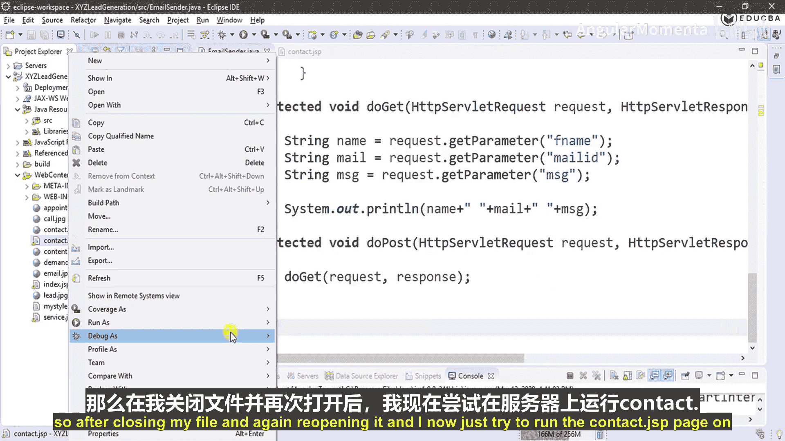
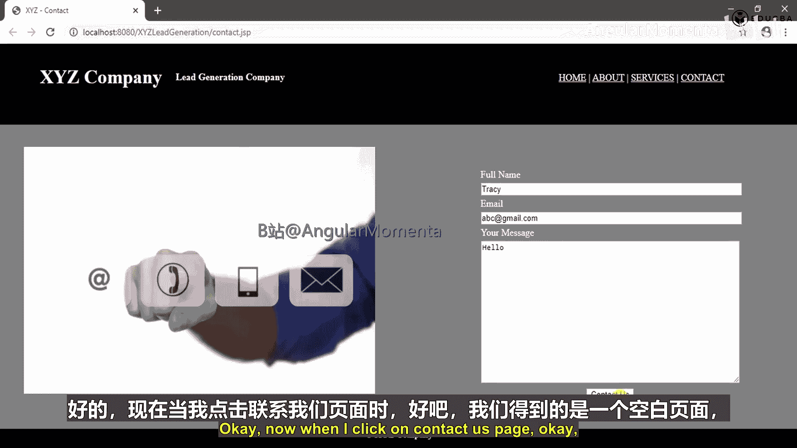
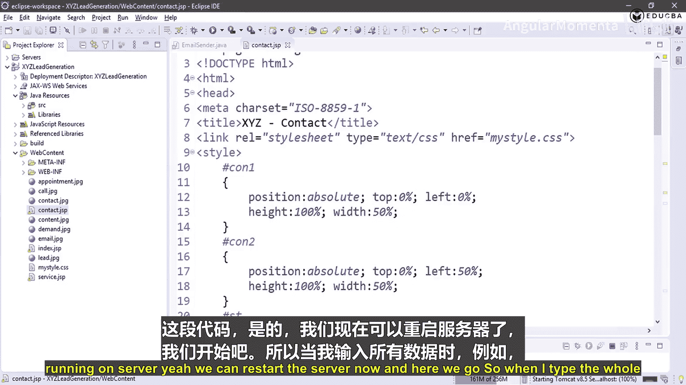
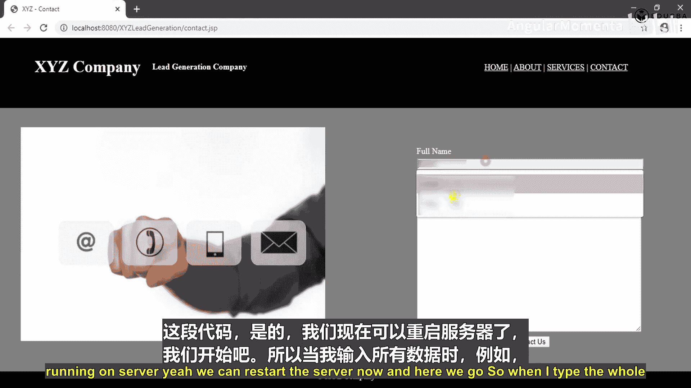
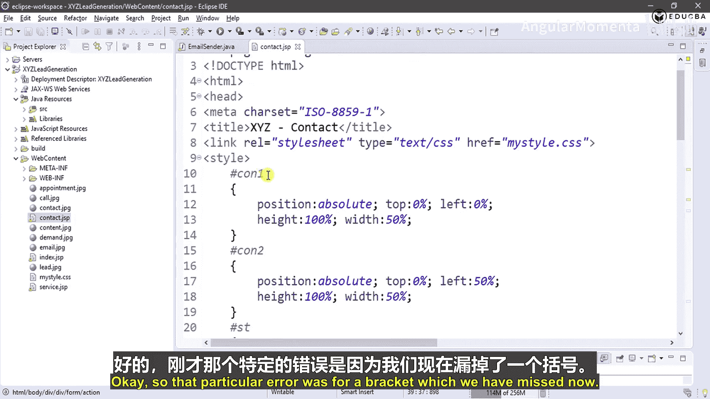
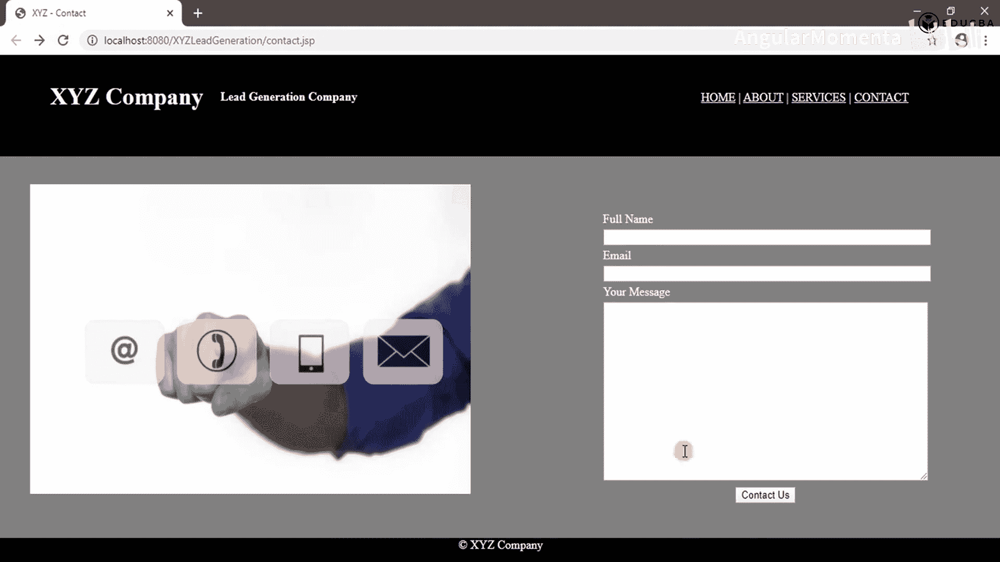
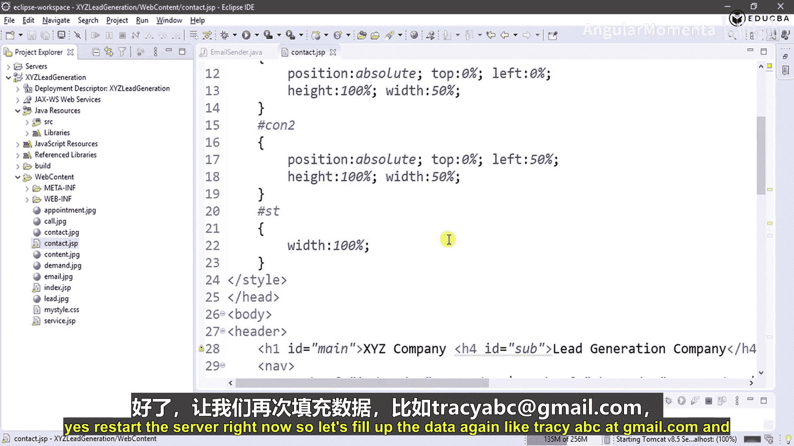
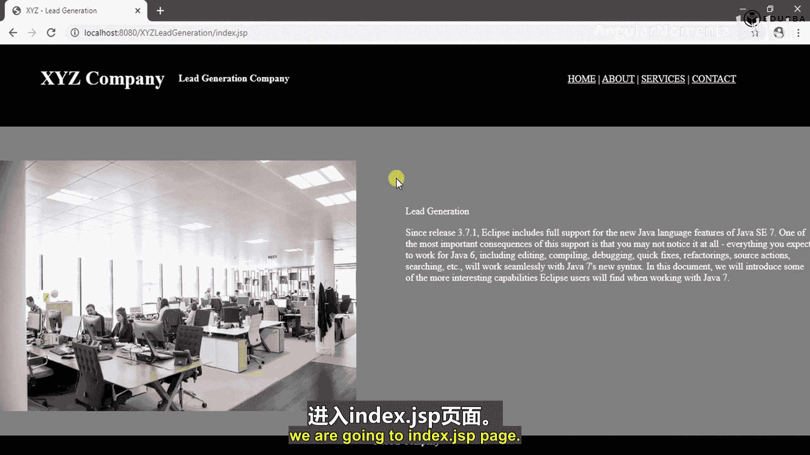
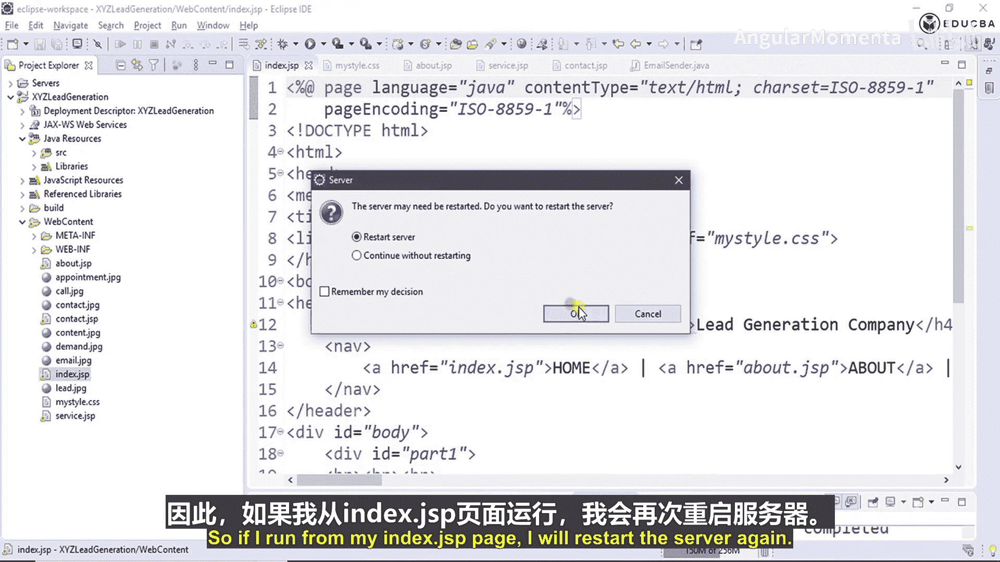
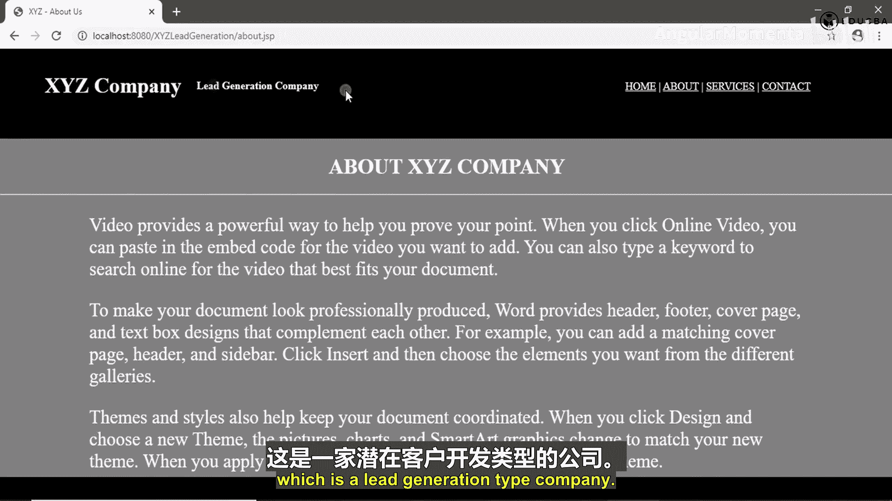

# 【EDUCBA】构建与部署Tomcat网站：设计、开发、交付 ｜ Build & Deploy a Tomcat Website： Design, Develo p04 02_02_01_发送电子邮件 第3部分 -BV1kmFoz2EzF_p4-

Okay， so after closing my file and again reopening it and I now just try to run the contact dot gSP page on the server。

Okay， I am getting my output over here and lets say suppose if I type some data over here。

 So for example， if I take the name of Tracy。Email I D S ABC at。

Gmail dot com and message is something like hello okay now when I click on Contact us page。

 Okay here we are getting a blank page that is email sender page and when you come to our eclipse we can see that we are getting Tracy the email I ABC Gmail do com and message send this and hello message right that means this is working successfully So now what we have to do after this is that we are getting this data right so this is working successfully we have to send this data to the user and how will we send this data to user is we will use a concept for email sending So we have created this method for sending the mail right So what are we going to do is we will call this method and how we we call this method after getting all this data What you just have to do is you just need to say email sender dot we have the methods send。

From which email ID do we want to send， that's Jason T Smith28 double01 Add Gmail。 co。

This is the main I D from which we need to send a message and the password for this email address so we can just save the password for it So they say like password is。

Then to， to whom are you sending this email。 So let's say if I'm sending this email to。Okay。Landance。

Out。Or maybe any， any， any email I D， whichever you are Com Very good。 So just let's say。

To sending at。Dumb me。Or maybe just like。Trac C at Gmail dot co。

 you can take any email ID the subject。Now when we get the subject is the subject we will type over here is like a lead and the message we want is first name。

 the email ID and the last name so we can just make string data is equal to we want the name。

Dot conca， and we want to concate it with mail。Okay。

 and inside the mail we will again con with message。

 So these are all the data which we want to concate in it and store it in the data or elses you can say like name。

Plus an space。Then the mail ID， which we have。Plus in a space and we can just see the message so this all data will be stored in the form of data。

And that data will be passed as a lead to us okay， so like this we are sending the email。

So now after this， the once the email is send， we will just say response dot。Send。

Redirect and sending it to。Index dot jSP page Okay， so once the email is been sent。

 you can directly go to this particular page Okay， so now let's execute this code from contact dot jSP page so let's run this code。

Running on server。😔，Yeah we can these start this server now。

And here we go， So when I type the whole data for example， Tra see this and the message is hello。

 contact okay now it is giving you answer server exception。

Going to the internal server， then。sing you an internal server exception Okay we can just this is for initializing the subject class internal and then insert this at the method line number 22 Okay。

 let's see this why we are getting this error first Okay so that particular error was for a bracket which we have missed now now let's retry it So Im just save refreshing the data。

Okay， so I have just missed one particular。😔，File over here， okay。

 I have just commentended this also， just to check。

So we can just remove the comment out from here Okay。

 so one particular bracket which was missing over here through which we got an error Okay。

 now let's run this code again， so let's run this again and I am just trying to run it on the server。

Yes， restart restart the server right now。

你看了。So let's fill up the data again like Tracy， abCgmail。com and just the messages hello。

Okay now when we click on the contacts okay we are going to index or GSP page and when we come to the es okay we are getting the output so we have removed that system or printline so it is just we are getting this particular exception nothing else so directly the mail has been sent to the user on its particular email ID okay so this is how we can send emails in Java by using Java mail AP。

Okay， so just for an overview what we have done so far is we have created the server at the start。

 then we have created a home page thats the index or HTML page and then later on I have created a styling page that is my styled dot css where I have applied the stylings to my。

Content then we have created about Java page we have created service page and the contact page right in the contact page I have just set in an action that the action will go to email sender okay and we have created a serverlet which email sender in this serverlet we have tell that we have a send message where I have given the properties that this are my different different properties。

 the socket factory， the SSL factory， authentication and the port number。

Then we have authentic and checked our password is correct or not for the given email ID。

After that we have used the my message to send the message so we have just said my message sending this message to this data。

 this is the subject and this is the text and then we have said the message should be sent。

And over here in this do get method we have called all the different datas which we have the first name emailadian message。

Mge them all then we have used that method send and we have given our email ID the password to whom we are sending the subject as lead and the data as the response and then after the data is send we have said response or send it direct to index dot JSP that is again the main page so once they fill up the form they fill they click on it we will get the response to again going back to the home page so when I execute this code now let's execute this code from the index dot GSP page to get the actual output so if I run from my index dot JSP page。

will they start the server？

And we got the output something like this， So this is the home page about page。

Services page and the contact page and whenever we fill up the details in the contact page。

And when we click on the contact well again go to the index dot gSP page after the mail is send it to the user Okay so this is a simple application of simple website which is created for an XY Z company which is a lead generation type company I hope you like this project Thank you for watching。

