# 【EDUCBA】巴塞尔协议、压力测试与抗风险能力 ｜ Analyze Capital, Basel, Stress Testing, and Resilien p02 06_03_01_输出楼层 -BV1tLcTzJEeb_p2-

Next focus was on operational risk and there was a more standardized or more quantitative approach towards looking at standardizing the operational risk and calculating the operational risk capital in a broad level the operational risk capital capital could be calculated by this approach Bic into ILM and I'm sure a lot of us would not have heard of these two terms before so let's spend a bit of a time on understanding this Bic is。

😊。

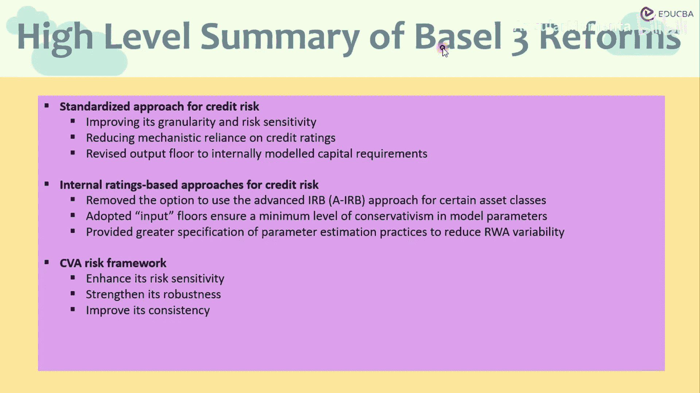

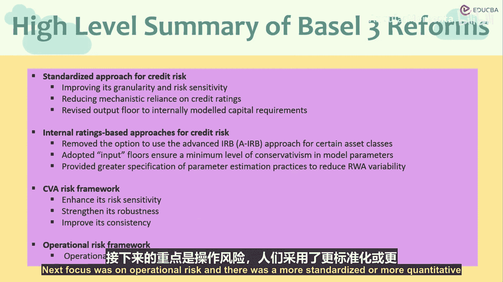

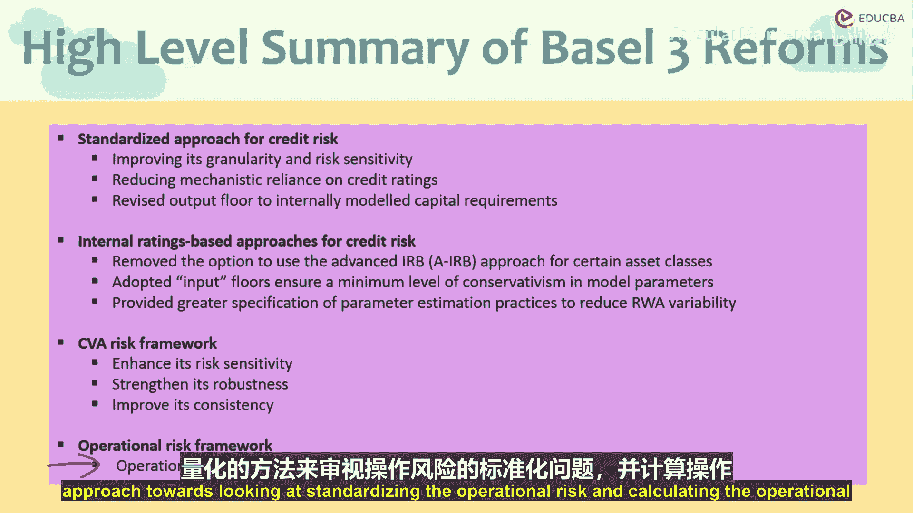

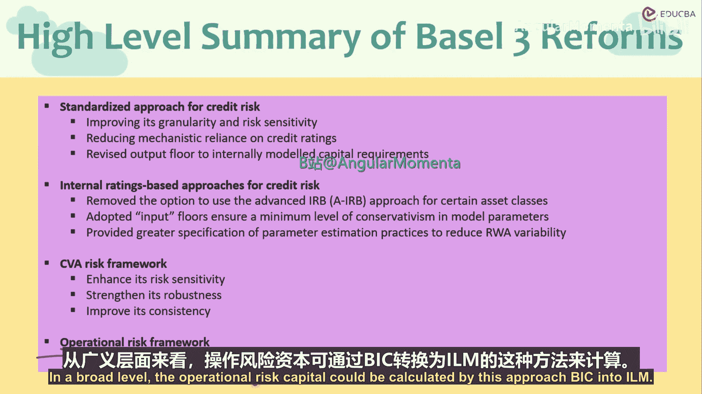

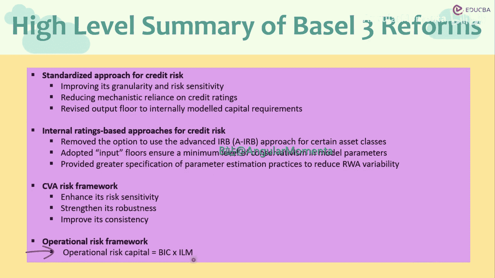

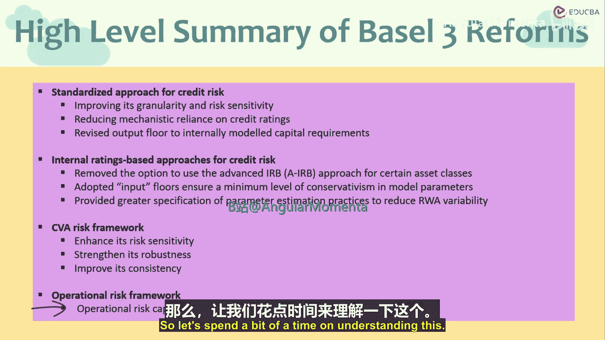

Business indicator approach so business indicator is the sum of three components。

 the interest the lease anti dividend component， the service that's one component right that's the income which business line it is related to so interest lease and dividend component that's one component second component is the services component there is third component is financial component and there is also a factor to be multiplied by these three component which is alpha now alpha。

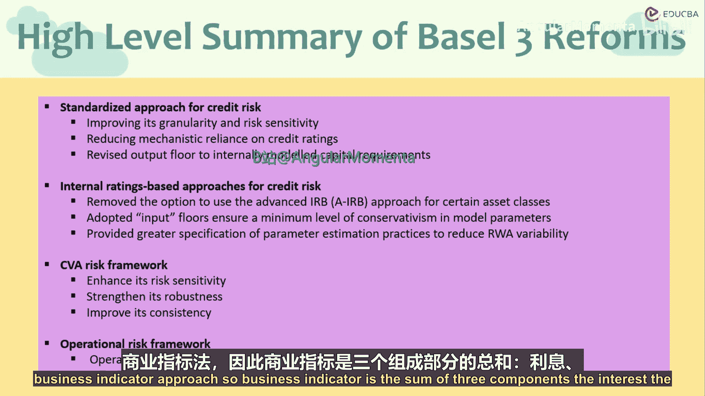

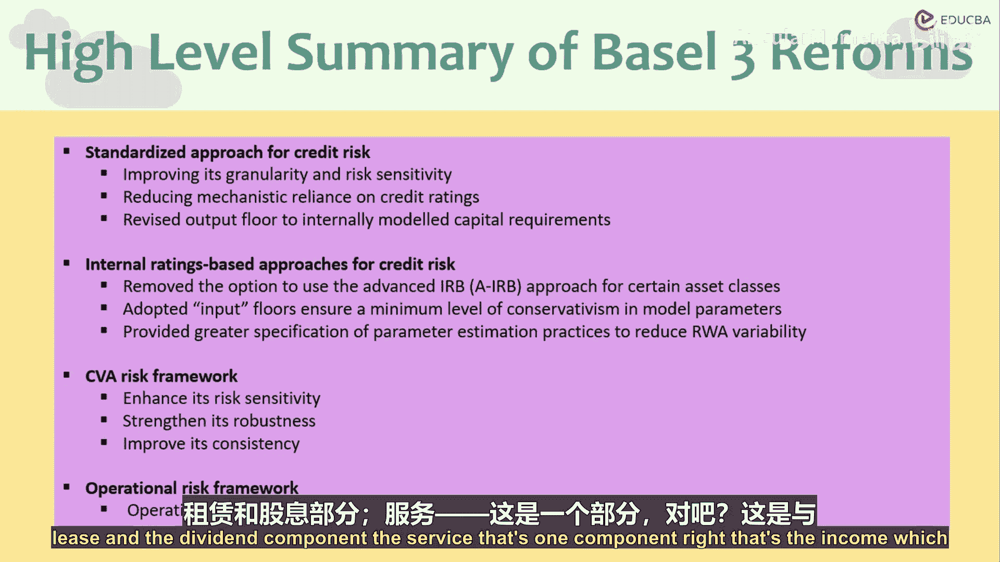

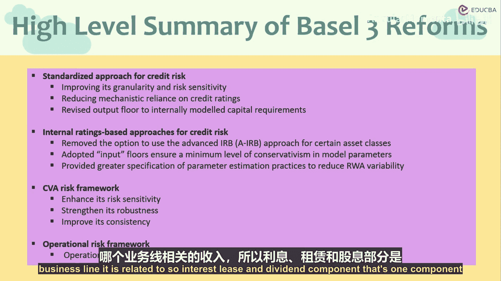

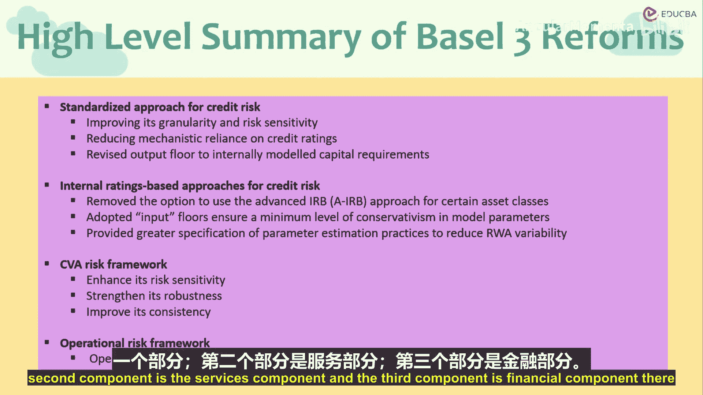

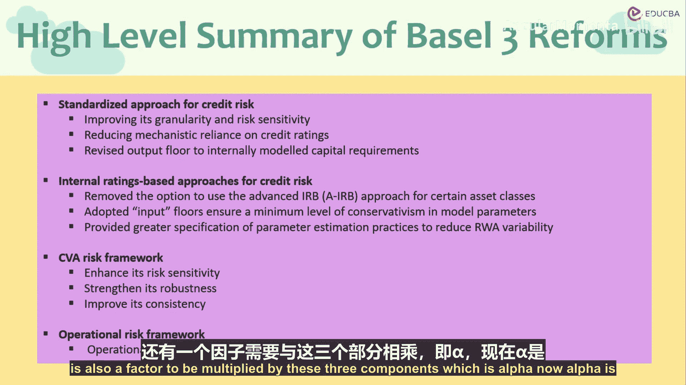