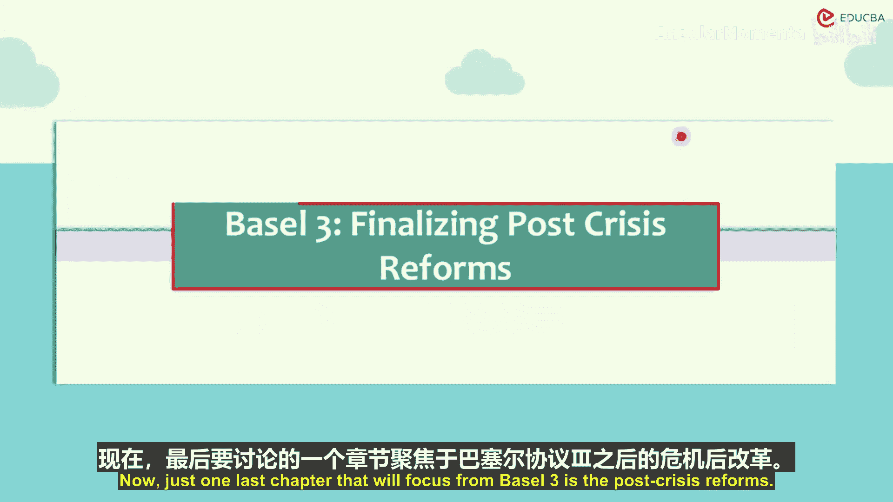
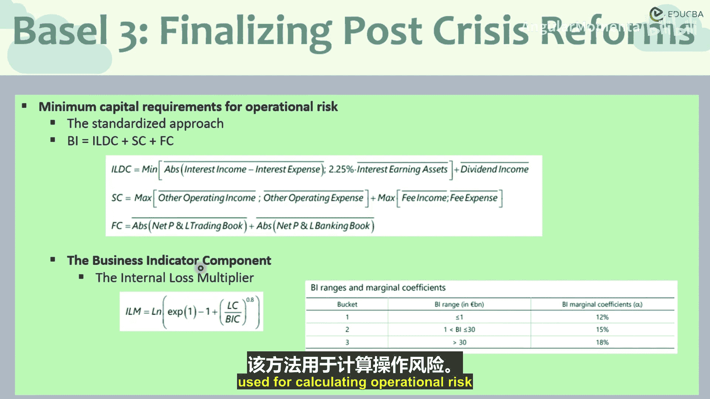

# 【EDUCBA】巴塞尔协议、压力测试与抗风险能力 ｜ Analyze Capital, Basel, Stress Testing, and Resilien p04 06_03_03_危机后改革定案 -BV1tLcTzJEeb_p4-

Now just one last chapter that will focus from Basal 3 is the post crisis reforms and what we're going to do in this chapter is focused primarily on the operational risk aspect and we would have noticed in the earlier part we came up with this formula BicC into ILM business indicator component into ILM internal loss multiplier so well talk about these two components how to calculate the business or operational risk capital this is as you can see。

 standardized approach depends on what line of business we are using and what breakage what is the source of income for these three lines of businesses so first term Bic that is dependent of business indicator right so B business indicator component was a multiplication of two factors B business indicator and alpha which is a coefficient multiplier now B is again broken down into three。

Component income from interest leases and dividend income。 So ID component。

 interest lease dividend component， second component was SC or service component third part is the financial component So business indicator or B is defined as some of these three components and again these values are calculated as the average over last three years So let's say if we say ILDC first component interest lease and dividend component it is the minimum of net interest income so interest income as interest loss over last three years plus dividend income similarly net dividend income or the dividend income is not net it is the absolute dividend income and third part is interest component。

 So again， it's net of interest income and net of lease component Next part is ILM。

AndSo this is the calculation， the minimum of interest income minus interest expense when we are saying bar of this bar includes average over last three years。

 either absolute value of net interest income or 2。25% of interest earning assets。

 assuming that the net interest income is。😊，At least 2。

 to5% from all interest earn assets so that is the interest component then there is dividend income which is dividend component and least component obviously thats straight away for service component S third component is the other operating income or other operating expense maximum of those plus maximum fee income and fee expense。

FC financial component is net PNL from trading book plus net PNL from banking book PNL trading book is proprietary trading banking book is the services and the charges the fees received from the banking side when you are saying again these are absolute values and we are taking bar which is average over last three years and that's how the B component or business indicator component is calculated Al as you had seen earlier。

 the multiplier depends on the value of B it depends on what is the income range one example rate。

 this is the coefficient marginal coefficient value of alpha for income less than 1 billion the alpha is 12% or 。

12 for 1 billion to 30 billion it is 15% and 30 billion plus。It is 18%。

 so the some of these three components and what is the appropriate alpha coefficient to be used in each these each of these cases。

 So Bic is just one component Other component is ILM internal loss multip ILM is given as log of eraase to 1 minus1 plus。

LC， which is the loss component divided by B I， which is business indicator component。

 Basically we are saying what is the loss component is you know loss component here is the 15 times the average operational risk loss over the last 10 years。

 So last 10 years average operational risk into 15 divided by B I C that we had calculated earlier at B I is B I business indicator into alpha。

So this ratio and the race2 point that is giving us internal loss multiplier so this ILM internal multiplier is equal to one when the loss and the business indicator component are equal So this ratio LC by B is one then the internal loss multiplier is also going to be equal to one if LC is greater than Bic loss component is greater than business indicator component and the IM is greater than one so basically this is creating a trade off between standardized calculation standardized part Bic is going to be standardized which is dependent on the dision between three types of income pockets and the actual losses which is the bank specific part actual losses observed over last 10 years 15 times of those observed losses so that's part of how much of risk。

 how much of。Confidence level we want to have on our lost capital。 This is the ILM approach。

 This approach is used for calculating operational risk。

