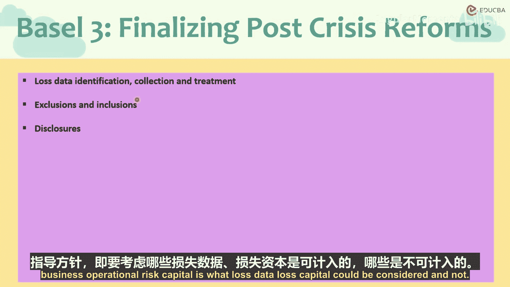
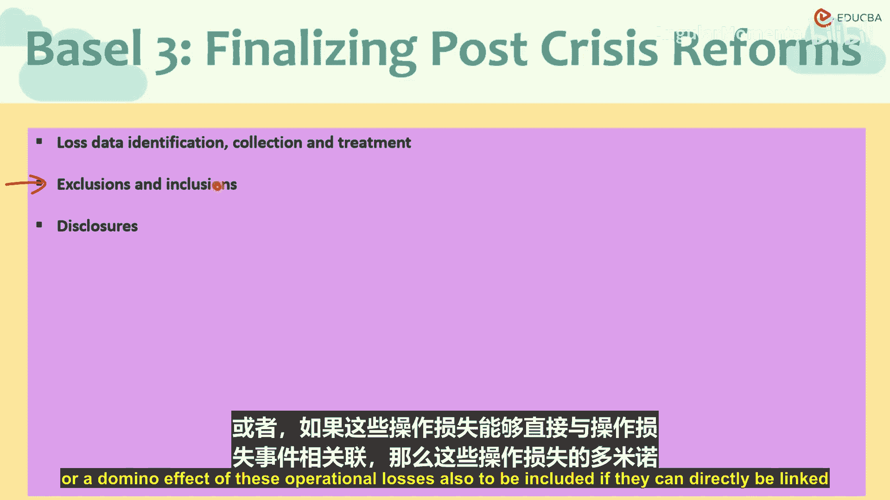
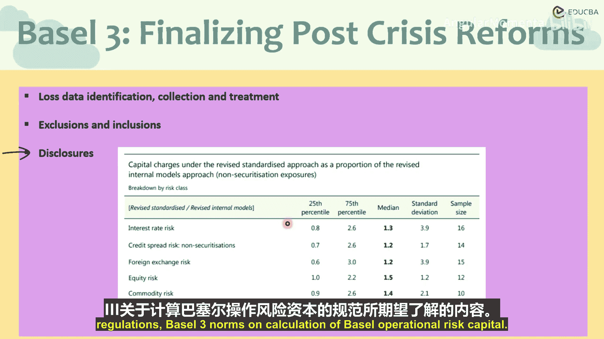

# 【EDUCBA】巴塞尔协议、压力测试与抗风险能力 ｜ Analyze Capital, Basel, Stress Testing, and Resilien p05 07_01_01_包含与排除 -BV1tLcTzJEeb_p5-

Now， some criteria or some guidelines while using this mathematical approach for estimating business operational risk capital。

Is what loss data loss capital could be considered and not。 So， for example。

 internally generated loss data calculations are to be used for at least 10 years of observations。

 So when we are moving from any other method to standardized method。

 we should have at least five years of data and then it would increase gradually over next five years to 10 years of data。

 Then this internal loss data is more relevant when clearly linked to business banks current business activities。

Technological presence and risk management procedures。

 So if bank has changed their nature of business or way of doing business。

 then it should be reflected in the multiplieries， the three components of business indicators。

Then there has to be a differentiation between gross loss net loss and recovery so gross loss is the loss before recoveries。

 if any net loss is the loss after recovery after taking into account the impact of expected recovery if we have the actual values of recovery。

 nothing like it if not we can take expected values of recovery recovery is independent of occurrences and obviously related to original loss events so we have to recoveries as an independent for different loss events if they are independent loss events。

 then the recovery percentage or in theverse of exposure of default will also be dependent independent of earlier loss events we should also include any charges。

 any fees， expenses， direct charges， impairment expenses， settlement expenseses。

 etc in the write downs in the net losses， cost。Incurred for like example， external expenses。

 which can be directly linked for these operational loss given like legal expenses。😊。

Or any fees paid to consultants， advisors， attorneys。

 those should also be included in the costs or the net losses cost for replacement。

 they should be also included in the net losses provisions and their impact on PNL also to be included any other loss。

 which is because of a follow over or a domino effect of these operational losses also to be included if they can directly be linked。

To the operational loss event that's why we have to as much as possible。

 keep the operational loss events separate from each other as much as possible。

 obviously in practice， it's not possible always because sometimes there will be cascading effect of one loss event one operational risk event into multiple events and then there have to be discloses as well for example。

 if the banks have business indicator greater than $1 billion then they have to be disclosures as to what would be the multipliers they are using what is the internal loss data。

 what is the calculation of operational risk capital which multipliers are used。

 which coefficients are used what are the charges used all needs to be mentioned and clearly disclosed under business indicator and standardized approach for example。

 if youre considering interest income then what are the sources of income or expenses broad level not they don't have to disclose the trade secrets and their appropriate information。

What level at least should be disclosed？😮，And there are disclosures as to what types of income are included in the three components of business indicator。

 the interest leads in dividend component， the service component and financial component and what consist of expenses。

 what consists of losses， what of profits， incomes and so on。

 There are also capital charges like the standardized multipliers or different types of assets。

 different types of risk， they also need to be disclosed or these disclosures have been summarized here for different banks at the industry level again。

 just an FYI we't need to remember them from exempt perspective， but。That is moreover。

 what we expect on operational risk capital and approach of basil 3 regulation Basal 3 norms on calculation of bases operational risk capital。

