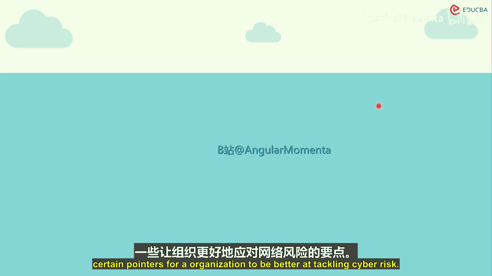
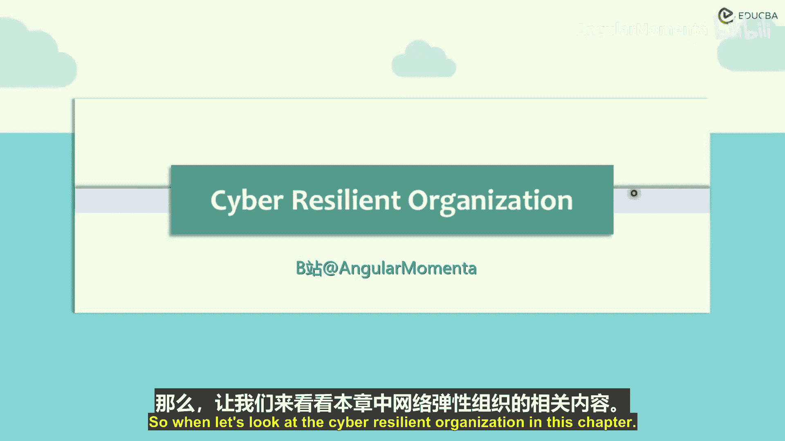
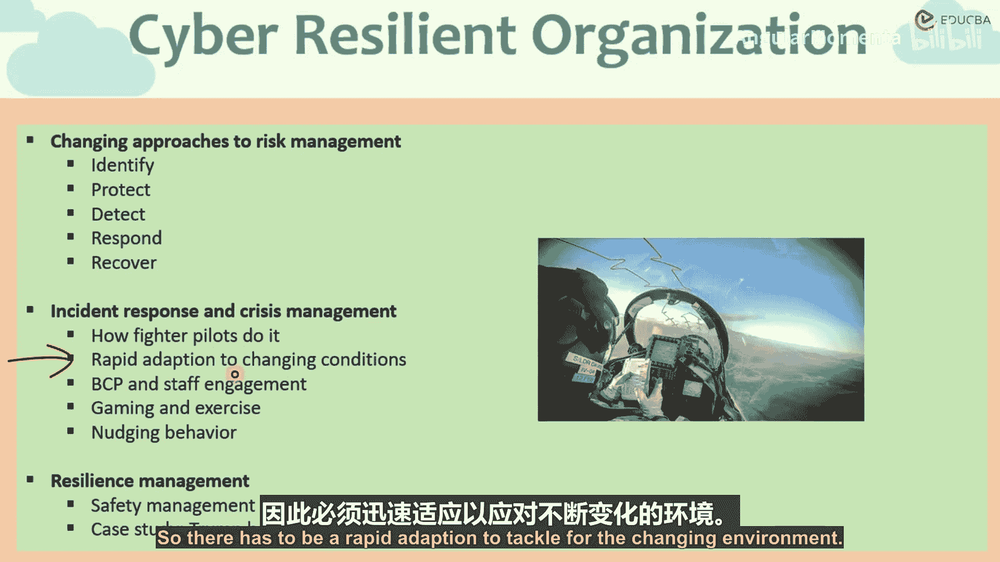

# 【EDUCBA】巴塞尔协议、压力测试与抗风险能力 ｜ Analyze Capital, Basel, Stress Testing, and Resilien p06 07_01_02_事件响应与管理 -BV1tLcTzJEeb_p6-

Now next two chapters we can look at a different aspect of operational risk which is cyber risk now we've seen what is included what is covered in cyber risk and how to tackle it what were going to look at is certain case studies traits of a cyberresilient organization and certain takeaway certain pointers for a organization to be better at tackling cyber risk so when let's look at the cyberresilient organization in this chapter so there are few approaches to risk management there is a approach proposed by national Institute of standards and technology and ID this their approach their suggestions consist of five functions within cyber risk management these are identify protect detect respond and recover identify obviously develop an organization understanding to manage cyberse risk to systems people assets data。

capabilities protect is to develop and implement appropriate safeguards detect is to develop and implement appropriate activities to identify the occurrence of cyber risk event respond is to take action against the detect incidences and recover is to maintain plan for resilience and restoration of capabilities that may have been impaired due to cybersecur incidents notice the chapter is focused on cyber resilient organizations so the focus is not only to identify and detect but also to recover the last part of this plan of this framework is very important very crucial is about how the organization can bounce back to its normalcy to its normal function after a cyber attack has happened It is going to happen no matter how we protect what kind of security measures to implement there is always a risk of evolving cyber attack its ever increasing ever evolving。

Phenomena， so there is there is always a nonze probability of cyber risk event happening the focus is on how the organization can come to the previous stage or how resilient an organization can be to the cyber risk event。

😊，The focus is not only on identify， protect and respond， but it also is on crisis management。

 There are ways for crisis management， the cybersecur system is a very complex and skillful process it requires a specific operations and skill set from the human resources as well there is a combination between man and machine a very crucial balance as to how hardware software and personal work together especially in the changing times where moving more towards a connected and digitized world where we are moving to internet of things where we have a connected equipment in every aspect of life so the cybersecur becomes very crucial because it can have wider and wider impact as we move ahead so one of the approaches to have a crisis management or incidences responses is to tackle it like fighter pilots。

RightSo fighter pilots， if you know if there is a crash。

 let's say if the plane crashes the pilot has the capability to eject there's an emergency eject from the plane's cockpit and they can land safely using a parachute or they can land with the reduced capabilities in emergency conditions the whole approach depends on first a very good coordination between man and machine interface and the staff being trained and prepared for both expected and unexpected incidences an issue can happen a crash situation can happen for any number of reasons in any situations when we are airborne so there have to be a understanding that no matter how well be prepared there is always going to be something which was unexpected unforeseen so there has to be a preparation to capability to have first to fall wide range of backups backup of backups full disaster。

Acovery plans， rapid action programs， but also to have unusual and unexpected situations approach and a general idea about having a incident response。

 which is an situations or an unusual situations， something which is not foresee Second thing we need to keep in mind is this is a very fast evolving and developing world Internet and cyber security as an aspect is touching different aspects of our life every day programs are evolving cyber securitycur evolving and so is the mal playersers malpes and the bad players also so it is a very quickly evolving function So we have as an organization we have to have rapid adoption to the changing conditions earlier when we had those pre smartphone phone era world the internet touched very few aspects of our life Now even our watches even our pace。

In our hearts， even in our digital hearing devices。

 they have internet that are connected through internet of things。

 so if there is an attack if there is a compromise on cybersecurity， it can be very very fatal。

 lives could be lost if let's say your hearing aid or your pacemaker could be compromised could be overridden by external agents。

😊，So there has to be a rapid adapt to tackle for the changing environment。😊。

