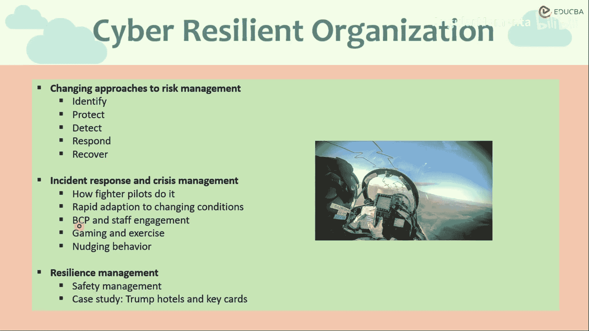
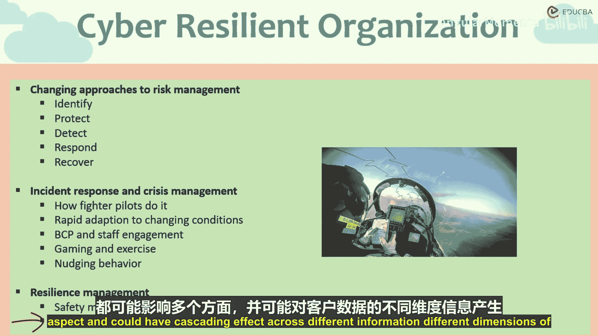

# 【EDUCBA】巴塞尔协议、压力测试与抗风险能力 ｜ Analyze Capital, Basel, Stress Testing, and Resilien p07 07_01_03_事件响应与管理（续） -BV1tLcTzJEeb_p7-

Next approach is to have a BP business continuity plan which will tackle which will foresee all the expected events right it can have a wide range of situations that can happen and how to tackle them。

 how to have backups backups of backups now the BP and the overall engagement continuity plan has can follow certain guidelines there Io 271 and IO 22301 guidelines for including the cyber security events these are standards for cyber resilience in the organization which could be part of our VP plan For example IO 27001 event or the standards are the international standards describing best practices for information security management system IO2230122301 is the international standards for business contiity plans by varying both these standards we can have。

A robust guideline as to how we can incorporate cybersecurity events into our business continuity plan these could have certain basic aspects as to how we can have backups if let's say staff has to work from home then we can have all the data on cloud which can be accessed through secure network and the business can continue we can have backups of servers。

 we can have backups of softwares backups of backups these could be geographically distributed so that if something happens to the site at one place or the server site server location at one place there could still be a continuity plan by switching to different servers in different locations。

 probably in different country altogether if the staff cannot work from office at a short notice they have to work from home or from anywhere else in the world then having data and softwares and accessibility options from servers and from cloud softwares through controlled software。

through protected lines and through secure lines could be very。

 very crucial for maintaining business continuity something that was tested and required very。

 very closely during the Covid-19 lockdown next approach is to have gaming and exercise Now gaming and exercise is in a way creating the cybersecur events and now have this gamification as to cybersecurity event so it could be in two forms first is having exercises in the form of games that can require staff to work in a certain way that can enhance and that can reinforce events that can reinforce the understanding to tackle cyberse risk。

 for example， instead of giving a dry lecture on how to tackle how to identify a phishing email there could be an interactive program interactive learning session or a game event to tackle a cyber security event or a cyber riskk event or a phishing email for example。

 that's called gamification there have been multiple。😊，Praining programs。

 multiple talent lab prizes for gamification apps right there could be a forward based apps there could be desktop based app that could incorporate cyber safety events cyber security cyber resiliency behaviors into the staffs behavior for example。

 and if you are teaching junk kids toddlers certain events like we've had apps develop for toddlers which specifically help them understand spatial coordination for enhancing their mathematical exposures and so on mathematical calculations word associations data associations and so on similar programs similar apps can be developed for increasing the cyber resiliency behavior as well So this is called gamification there are also exercises specific exercises just like fire drills are conducted similarly cybersecur drills could also be conducted one thing we have to keep in mind is this is all depend。

On staff engagement so we have to incorporate these cyberse events or cyber safe behavior into day to day action day to day focus day to day activities of staff this engagement has to happen at each level from top level to the bottom level this activities these cyber risky events should be something that is very visible and which part of day to day routine for example these could be highlighted in cafeterias or washrooms where it could be part of daily routine right something that could be viewed every day there could be testing done there could be a surprise checks there could be internal programs that could be trying to replicate a phishing email and check how many people how many employees can actually identify a phishing email just to give example versus how many。

Fall prey to that phishing email and actually act on it click on a particular link or install a program or download an attachment。

 so rather than waiting for external agents to send a phishing email and check and to be surprised by how many people actually fall prey to it the cyberse team can internally send such tricky emails and see what is the general program。

 general response。 if too many people fall prey to this， there could be a program。

 there could be a special training program， whatever people。

 what proportion of people fall prey to the phishing email they could be retrained or there could be a different approach taken to train these people if people are actually behaving in a certain way in a cyber cyber secureure way that could be encouraged So these responses are not to be seen as an isolation but rather as a tandem as a coordinated event So this is multipronged approach multidimensional approach for tackling cyber incidences cyber crisis management those will be implemented those。

Applicable in different situations so they cannot be seen to be working in sis but rather working together working in tandem for for tackling these situations together there is a focus on safety management safety management includes safekeeping of data sayke of personal identifiable information PII data personal and private identify information so data could be classified into public data。

 protected data personal data， private data personal identify data in different sensitivities from cyber risk and cybersecur perspective and there could be different ways different measures to protect data data based on the classification any data that is private data could be treated differently versus something which is public data versus something which has customer ident like customers financial transaction details or security information details。

 national insurance details。or anything which is related to customer identification those could be treated differently。

 there could be additional layers of protection for these particular types of data。

 There will be different safety measures for different types of data and this is true not only for software software data I mean not only for data but also for software but also for hardware and also for peripheral systems one case fee that we can check is we should be aware of between 2014 and 20147 hotels held by the former precede of us Donaldd Trump the Trump hotels had a data breach so the data breach ended up exposing 70000 credit card numbers and customer records of the customers of all the customers who were at one point of time part of or had been associated with the don Trump hotels this was only exposed when banks started spoting hundreds of fraudulent transactions。

And they could link something related to a common link。

 They all traced back the financial transactions from these cards and they all realized the last legitimate transaction。

 all these cards was in the Trump hotel。 So the data was breached and the credit card information was stolen It was misused。

 It was misused at a very big level。 there were very fraudulent charges。

 There was security identification takeover and that really exposed the lack of cybersecurity and the lackx approach towards cybersecur in Trump hotels in Trump management that you know it was basically traced back as to what happened in Trump hotels that exposed certain events So it was identified that。

Hackers broke into the central reservation system at the Trump hotels。

Now this reservation system obviously helped the online booking at Trump hotels， the program。

 which was dedicated program which was specifically customized for booking in Trump hotels that was overridden the software provider Sber networks that had a data breach so that data breach was access that was given to access was granted。

Was a whole was found by the mail agents， bad agents by that hole into software provider they entered into the Trump hotel's booking system and from there they could capture so much of financial information which was used for fraudulent transactions so you can see how a small reach at one level one chain of the whole cybersecurity or the whole cyber linked paradigm could affect multiple aspect and could have cascading effect across different information。

 different dimensions of customer data。😊。

