# 【EDUCBA】巴塞尔协议、压力测试与抗风险能力 ｜ Analyze Capital, Basel, Stress Testing, and Resilien p08 07_02_01_网络韧性目标 -BV1tLcTzJEeb_p8-

Now we can find some commonalities between organizations who have been good at being cyber resilient versus organizations which have been very poor。

In terms of their cyber resilience so we can calculate we can identify four attributes of a cyberresilient organization。

 These are anticipate withstand recover and evolve as you can guess from the names anticipate is to be aware of what all cyber risk cyber threats the organization faces from different aspects these risk could be common for multiple organizations or they could be some part of it could be unique to your organization so first of all is to anticipate what risk the organization has from cybersecurity perspective then withstand is to have measures to have firewalls to have security checks to have cyber protection programs that can help withstand cyber attacks from phishing emails it can have spam protection policy we have anti-virus programs and so on that's withstanding part next is recovery part recovering from the attacks attacks are going to happen no matter house of。

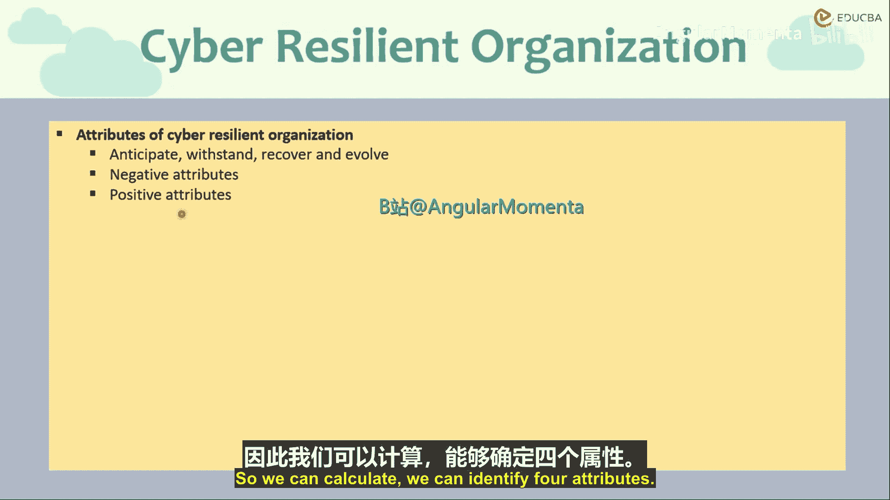

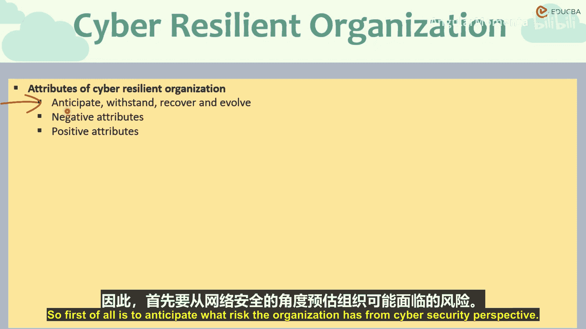

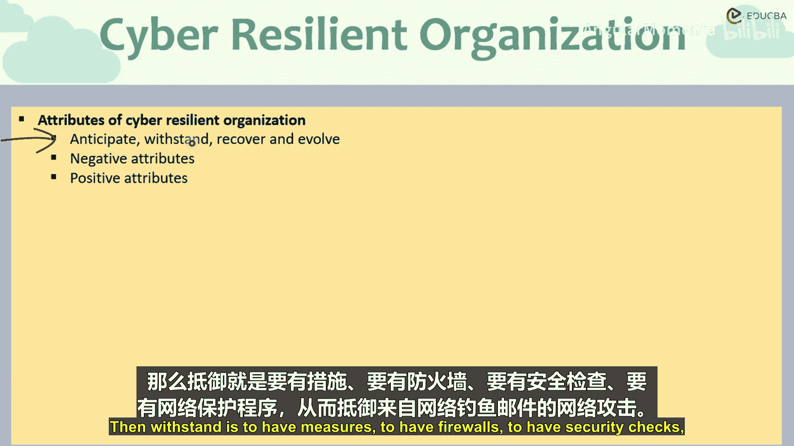

your system is so there should be plan to recover from these attacks let's say if one data center is attacked by a data breach。

 then there has to be a isolated data a silo data， which is not connected to systems the data is purely in silo so that if one set of data in one set of server gets corrupted we still have a backup data which is now back up every day so one data server goes corrupt we can just isolate that part of data move into our last backup source from a different server switch to that data source and resume from next day just business as usual that's the way we can recover and we'll see what happened I would impact in next section so this is recover and next part is evolve that is once your identified one breach one cyber security thread how do you overcome that how do you improve your systems to。

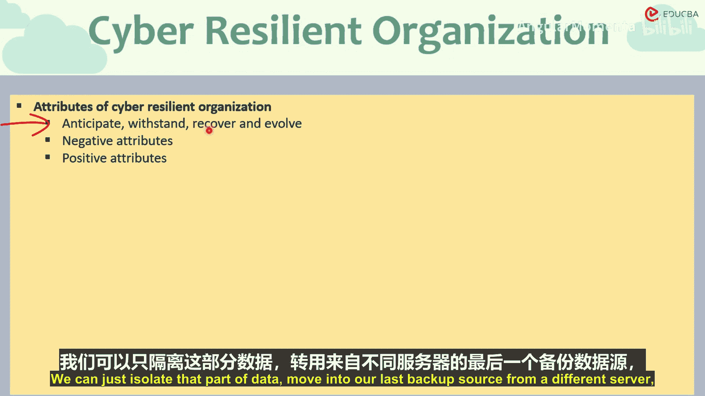

Overcome that did not fall prey to it。 You don't have to fall prey to it。

 You don't have to experience that threat yourself within your organization。

 It could be an external threat。 you can learn from example。

 you can benchmark from the outside cases so that evolving or evolution has to happen quite frequently and it it has to be a regular and frequent process shouldn't be a reactive process。

 but also a proactive process。 It is you should be able to identify the cyber securitycurity threats before they actually become a threat just to give an example what of negative attributes and how it relates to recovery phase。

In 2017， second of 2017， multiple millions of data points， multiple millions of credit card data。

 personally identifiable data points of of users from Efax right Equifax is a credit rating agency or credit bureau in US。

It has operations worldwide， but this particular breach happened in US data centers。

 So there was a breach of customer identifiable data postal identifiable data from Efaax data centers first of all。

 it was not identified。😊，For many weeks， at least six weeks。

 it was not identified so it was identified six weeks after the first incident happened at least that's the estimate and second of all。

 even after it happened it was not communicated to the relevant customers for as much as eight months after it was identified and so communication was not done to the appropriate parties to the customers to the residents who were impacted by this particular data breach the reason that the CEO of Equifax cave was that the hurricane that was in place Hurric Ima that was prevalent at that time took down certain data centers。

 two large data centers primarily soon after the breach announcement so they could not identify which set of customers were impacted by this data breach that is a classic example of failure in this stage first of all they were not able to withstand were not able to repel this attack and second of all。

 even if it at dead。😊。

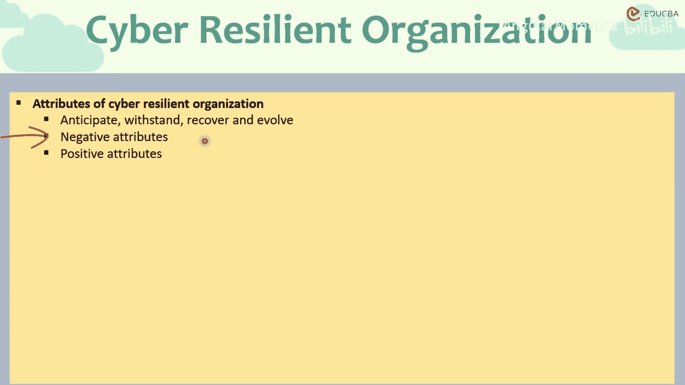

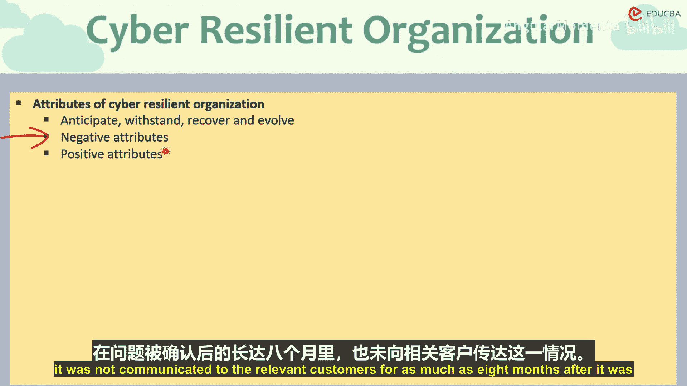

You are not able to recover from it。 Sos no plan。 absolutely。

 that was robust enough to recover from such events。

 So it's a classic failure class of not being able to recover from such events。

 not being able to resilient to repel those attacks。 So first of all。

 not having those four attributes is a negative attribute in itself。 And second of all。

 is not being open in communication， not communicating with the stakeholders openly and in a timely manner。

 that's also a very big negative attribute， a big no no big red flag in a cyber resilient or a failed cyber resilient organization。

 On the other hand， positive attributes could also be identified First of is top level commitment and top level。

😊。

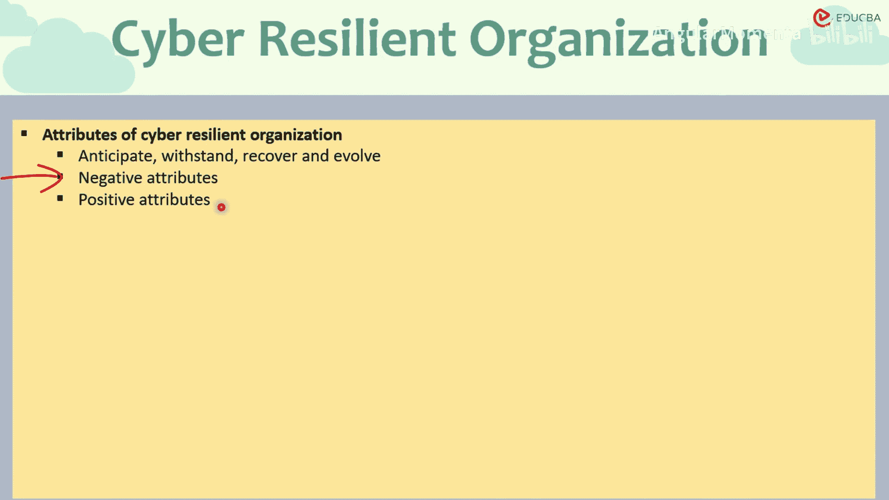

Engagement， rather engagement at all level in recognizing and valuing human performance as well as machine performance in cyber resilience。

 then having a culture to support the reporting of issues。

 general organization approach any attributes which are good attributes for operational risk identification or enterprise risk identification also apply in case of cyber risk identification。

 cyber resilient organization。😊。

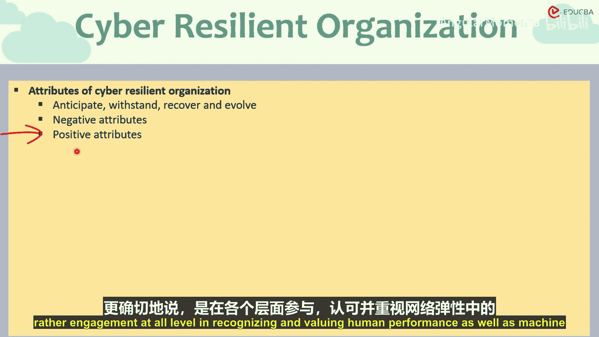

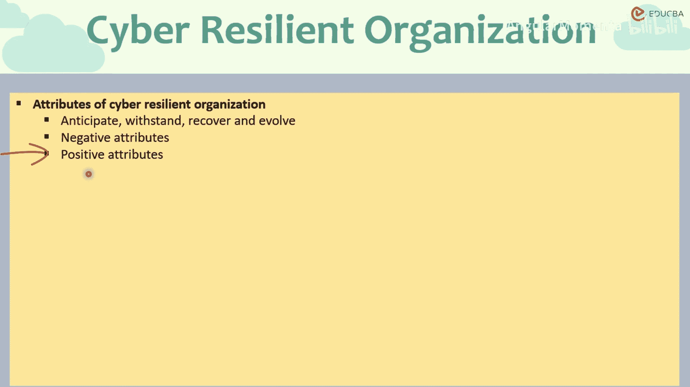

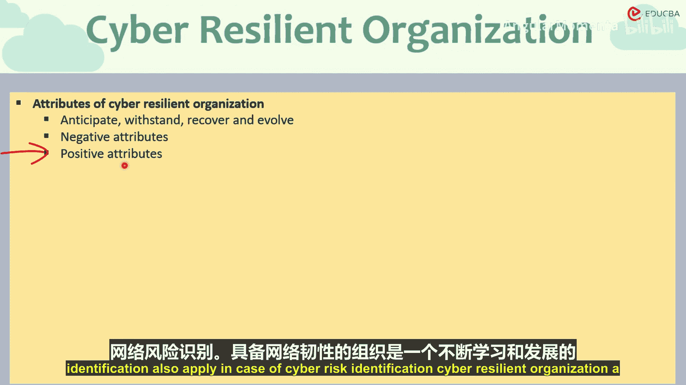

Learning and evolving organization is also a very positive attribute specifically in case of cyberreligions because the bad players are evolving every day so the good players the protectors also need to evolve at their pace if not at a faster pace there has to be awareness of the strengths as well as weaknesses for the organization and there should be a plan to identify those weaknesses and overcome those weaknesses last and most important positive attribute is flexibility to adapt that maximizes the ability to solve problems without loss of functionality so if one data center fields you can have we can switch to other data centers if hardware fail you can switch to cloudbased softwares if there's a lockdown you cannot access physical systems there is a backup on cloud based or digital systems if you cannot access physical systems or software systems have you can go back to your。

😊。

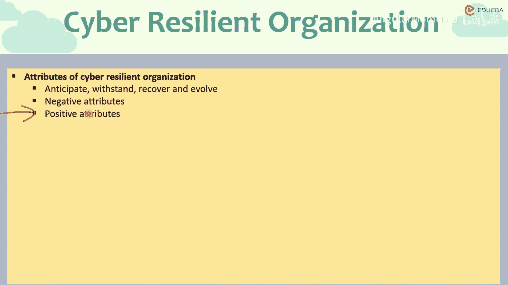

Pen paper or hardware program。 so there has to be backups backup and backups and flexibility to operate from any side the staff is crosstrained whereas one team in one location fails to perform there are backups to other their functions。

 So this is these are also common attributes for generally a resilient risk resilient organization not only for cyber resilient。

 but also overall operational resilient and good。😊。

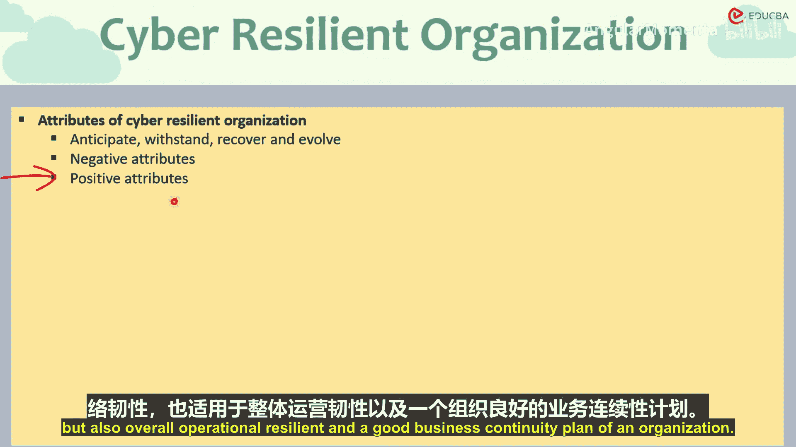

Business continuity plan of an organization， The objective of cyber resilience。

 as I mentioned earlier， is to recover and have least amount of disruption to a particular threat to a particular cyberresilience so that it not only being able to withstand the attack but also having a recovery mechanism in place。

 So it has to have an adaptive response and flexibility involving execution and monitoring in the action plan。

 So actions that best change the attack surface and maintain critical capabilities should be adapted to restore functional capabilities there has to be analytical monitoring involving gathering and analyzingizing data on ongoing basis and a coordination between different units。

 different systems communication between internal units。

 different lines of businesses and different modes of defenses so obviously there is going to be multileve。

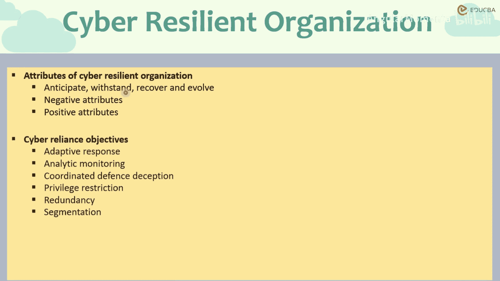

Fense system against cyber attacks there has to be a coordination between defenders and also business lines then deception this comes from the tactics to at a war level right sendu approach as to what should be warfare in general so cyber warfare also involves deception so it can deceive the attackers into attacking a particular area which is redundant or it can have a area which can deceive attackers into being complacent it is important to have redundancy system redundancy meaning backups and backups of backups if you have one data center it can have second data center which does the exact same job but from a different location it has daily backups it is isolated from other system so that if one data center is attacked the other data center is not attacked and it is not connected to the grid to the central。

Land systems right it is not impacted by cyber attacks right there could be a backup somewhere else which is isolated so this is having redundancy it is important to have redundancy so that we can have recover there has to be a fine balance between redundancy and having backups and being flexible because redundancy is costly and having backups is costly having multiple servers is costly so there has to be a backup between what is the cost of redundancy and what is the cost of falling prey to the cyber threats segmentation is segmenting different lines of businesses away from each other so that if one part fails we have other parts which is isolated and protected from the overall threat overall planning。

😊，Yes。There has to be plan related to incidences， what should be the incidences response just like a firefighting team right just like fire brigade which has an incidence response plan。

 what happens when they call these actions， their actions are like clockwork。

 trained theyve been trained so many times that their incidence response becomes more as a intuitive plan rather than something which is thought out and it becomes more as a reflex。

Obviously it' is not possible to have a reflex like incidence plan。

 incident response in case of cyber attackst because each attack is unique and it's in a evolving world。

 but there has to be general guidelinesline as to what actions need to be taken。

 what actions need to be prevented。😊，How we can have audit trail and other records to process the digital evidences。

 how to find a digital backup digital threat， how to find a digital loophole a weak point into cyber systems and how will be the accountability and responsibility allocated within the teams in case of a cyber cyber impact or cyber effect forensic investigation how it will be conducted who will be in charge so that all is part of forensic its all part of incident response planning。

The incidences were very different， but the response， the general skeleton。

 general approach to handling the incidences first line of approach， first initial approach。

 backup approach and comprehensive approach a coordination between different teams that could still be chalked out and exercised could be tested over and over again so that when the actual attack happens。

 the organization is prepared to respond to such incidences。😊。

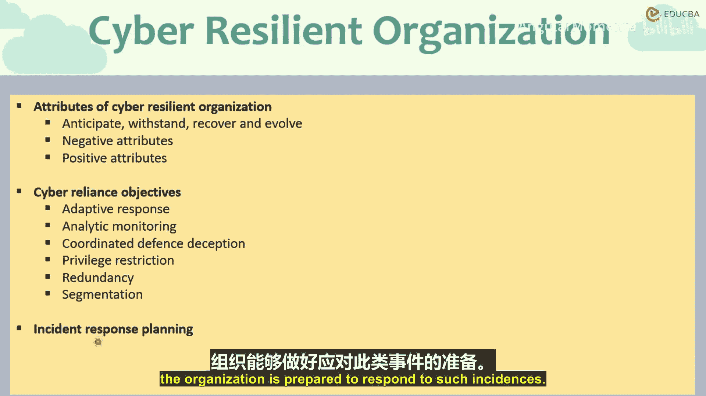