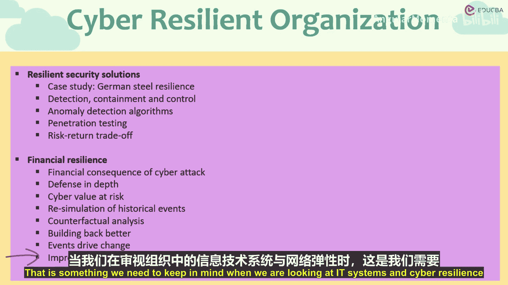
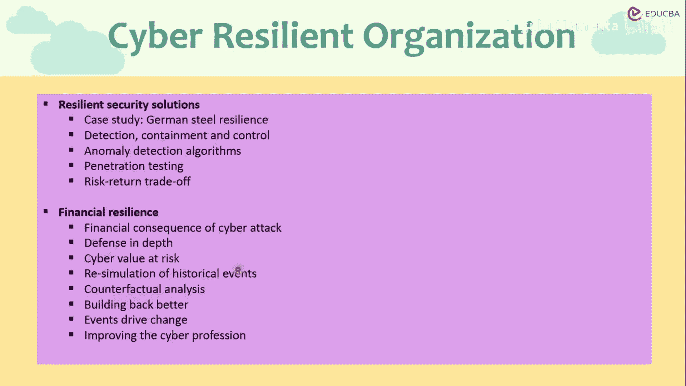

# 【EDUCBA】巴塞尔协议、压力测试与抗风险能力 ｜ Analyze Capital, Basel, Stress Testing, and Resilien p09 07_02_02_财务韧性 -BV1tLcTzJEeb_p9-

let's take a case study just like the Trump hotels there was another extreme so in 2016 there was an attack by Southeast Asian hackers obviously it was known afterwards that these are Southeast Asian the attack originated from Southeast Asia so these hackers exfiltrated the technological IP data intellectual property data of Tyson group which is a German steel or industry so which one of the largest steel makers in the world interesting part was it was detected very early by Tyson groups security systems。

 cybersecurity systems and countermeasures were applied in a very tangly manner so loss to this attack was very limited the organization was very resilient first of all it was able to detect and recovered from the attack very early and was also able to jump back to normalcy or to usual business so it showed a very。

high level of resilience in their cyber security goal noteworthy is that this attack came from state sponsored factors it was expected it was kind of guessed that it may have been a state sponsored like fully professional espionage attack it was quite unusual and unexpected for steel company maker to have cyber attacks。

 but if you consider the scale of internet scale of systems and automation in our systems。😊。

Most of our electricity generation is automated so if the male agents， bad agents， actors。

 sophisticated actors， it could be state sponsored agent。

 it could be a rogue nation if they attack let's say a country's energy production systems or a particular mechanism or the systems that control a particular dam dam opening operating systems the floodgates to operate dam and they could override those systems and just switch off the power generation or just open the floodgates in a dam and let the water pass through it the impact of this could be catastrophic there doesn't have to be any missile launch there has to be no casualty from the attack here but yet it could be huge loss to the nation which is being attacked so there's no sector there is no area of business which is safe from cyber attacks which could be which couldn't。

Targeated by rogue agents， especially professional and stateponed agents there is no safe sector at such what is important to have a plan for detection containment and control and you have seen this in multiple views multiple lenses earlier early detection and containment having firewalls and having plans to control it lying able to detain it contain it is just like a fire。

 a physical fire by having compartment so if you look at ships earlier ships they have compartments in their hull at their bottom so that if one of the compartment is damaged in the water enters in the compartments it does not spread into all the ship any damage compartment water damage compartment is restricted to that compartment only and it does not impact the overall integrity ship that's compartmentalization containment。

Same approach in different form could be used for cyber resilience as well that's containment and visual control is to control it in the shortest possible time there could be algorithms to detect anomaly Now it is usually said that any cyber attack leaves a trail money leaves trail cyber attackt leaves trail so there could be anomalies there in the behavior of certain programs which may not be evident at the surface at the user interface。

 but these could happen somewhere deep within the program so there could be algorithms which run those programs which keep scanning for these anomalies within the programs in lappers we call them antivirus programs which search for first of all common anomalies and also for unknown anomalies that could not be detected earlier so if there are common anomalies or known anomalies these are common viruses as we know them and they could。

Eliminate those virus there could be backup plans there could be attack programs that could eliminate those viruses but in case of uncommon anomalies unknown virus attacks these programs could be programmed or these algorithms could be trained to contain those stations and not isolate them from the other systems so that they don't transmit into other parts of the system there could be testing done from the internal systems as well so we can have ethical hacking system you would be aware the largest softwareer providers like Apple Amazon Microsoft they have bounty hunting or they employ ethical hackers they invite ethical hackers to find bugs find faults find anomalies loopholes backtos into their programs which can possibly expose their programs and systems to hackers or through bad agents these penetration this could be done on a regular basis by ethical hackers。

By internal programmers， internal testers so that we are one step ahead we are aware of our loopholes we are aware of our drawbacks before external agents。

 bad agents become aware of them that we can close those loopholes early on Of course this there is a tradeoff between being 100% protected versus being00% exposed security has a cost so there has to be tradeoff between risk and return we can have 10 different backups 10 different server backups of the data but that's obviously going to cost us 10 times so we have to come up between the possible cost of cyber attack versus possible cost of being resilient against that cyber attack so there has to be risk tradeoff cyber resilience also touches upon the financial resilience obviously there is a financial side to the cyber attacks there is a direct impact by。

Let's say if the cyber attack is impacting your personal financial data then the there is a direct impact there is also an indirect impact by loss of reputation。

 legal cost associated with it direct impact could be employing software programs to employing detection programs to overcome those cyber attacks indirect costs could include having backups or having resiliency programs。

 reporting requirements so those could be indirect impact but overall each attacks the overall financial resilience capacity as financial consequences also then you need to understand defense in depth。

So what could be cascading effect or linkages just like in financial system where failure of Lehman Brothers could could have triggered or failure of AI group AIG group could have triggered systemwide impact systemwide risk exposure to one particular organization could have cascading effect in different organizations in terms of cyber risk as well。

 so we have to a stress testing done we have to have linkages understanding of linkages and defense in depth there had to be multiple layers of defense if one just like in older times when there are different levels of defense in a for there are multiple gates。

 multiple channels to protect against enemy same principle applies in cyber security as well。

 just like market value at risk war measure that we have calculated for calculating market risk measure a single measure for estimating exposure to market values。

can have cyber value risk So are different approaches it's part of operational risk so we can have operational risk approaches。

 we can have a simulation of historical events just like in a financial simulation。

 we can run a simulation event of what happened in 2078 crisis how interest rate change how inflation change and how employment change and so on。

 we can rerun the simulations of past historical events in case of cyber resiliency attack as well there could be counterfactual analysis from the attacker side there could be event driven changes。

 which is learning from the mistakes learning from。

Past attacks which have actually happened with the organization had failed to detect or withstand them and has to be continuous focus on continuous improvement The focus of Obama's staff in 2008 was building back better there was the response the philosophy behind recovering from the financial crisis 2007 financial crisis by President Obama's office So what they said was you never let a serious crisis go waste and what you do is you take it as an opportunity to understand what you did not know before and to improve on it basal3 regulations which whereas a response to the GFCC global financial crisis was this example of building back better any attacks if your organization does fall pre to a cyber attack and which is just very likely no matter how good your secret systems are if your organization does fall pre to cyber attacks when you are recovering from。

You remember you learn from those incidences and build back better so that similar event or a replica of similar event linked event does not happen again that's continuous improvement there has to be continuous education and skill development program for people who are involved in cybersecur and IT skills of overall staff because the organization is only as strong as the weakest person or weakest section the chain is only as strong as the weakest link in the chain so organization is only as strong as the weakest member from the IT systems IT skills IT knowledge or cybersecurity cyber knowledge of other firm so continuous skill development and education becomes very very crucial in case of cyber resilience。

😊，Attackers cyber attackers will keep sending phishing emails in millions every day。

 All they need is one chance one gap， one person attacking one person clicking on a phishing link or downloading a bad software and they get they serve their purpose so it's like defenders have to do their job every single time。

 but attackers just need to be successful once it's like the pre has to outrun the the hunter every single time but but the hunter has to be successful only once cyber attackers have to be successful only once organizations and security So has to be successful every single time that is something we need to keep in mind when we are looking at I systems and cyber resilience in the organization。

