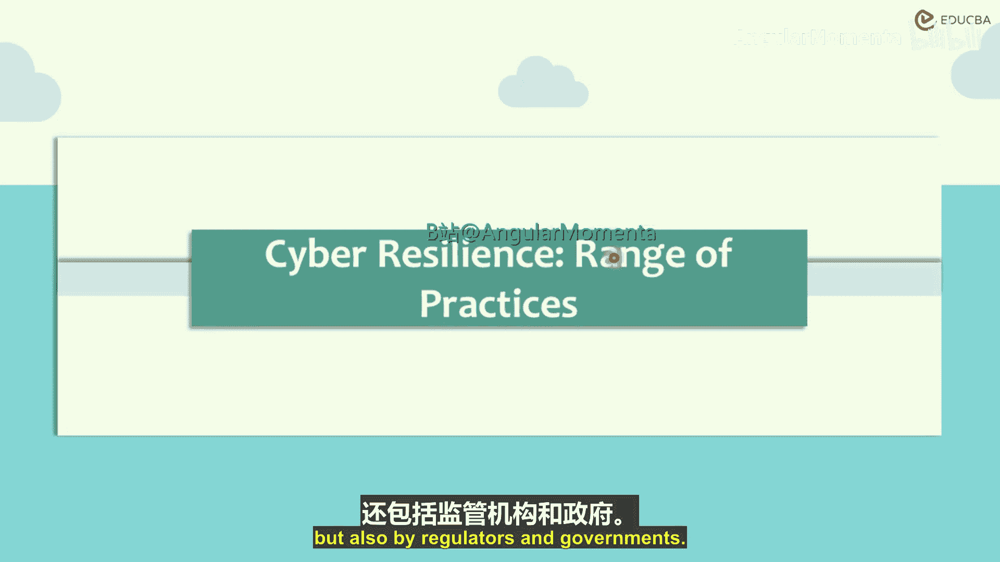
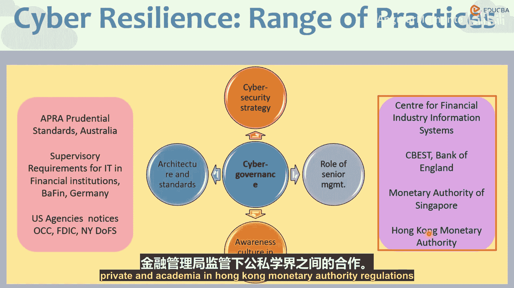

# 【EDUCBA】巴塞尔协议、压力测试与抗风险能力 ｜ Analyze Capital, Basel, Stress Testing, and Resilien p10 07_02_03_监管应用 -BV1tLcTzJEeb_p10-

Now in this chapter youre going to look at the actual applied side of cyber resilience。

 which is the range of practices of cyber resilience techniques not only by private entities but also by regulators and governments so to break it down cyberresilience has four aspects that you' have seen this strategy the role of senior management awareness culture and architecture and standards now this particular focus was developed by the G20 finance ministers G20 is。

 the global 20 influential countries， financial ministers central bank governors along with the cyber security experts so at an international level they issued a fundamental elements of cybersecur related to financial sector this was governed also by committee on payments and market infrastructure CPmiI。

Along with jointly international organization of securities Commissions IOSCO。

 it was also evolved because of the support from US and EUu regulators and experts and so the committee just like Basil committee has guidelines on banking supervision。

 this committee IOSCO has suggestions on cyber supervision， cyber resilience。

So this committee had broken down into this four aspects， strategy， senior management role。

 culture and standards， architecture and standards。

 There are a few global standards like we have discussed earlier I 27027001 which are solely focused on international standards for cyber resilience。

 Basal Committee on banking supervision also has their own guidelines on cyber resilience。

 So overall we all have there is a commonality between all those standards in this four aspects。

 So first of all they all mention that there has to be a strategy for tackling cybersecurity whether it will be in source outsource how much budget should be allocated and how it will be monitored it has to be closely monitored by senior management just like any role any risk objectives there has to be close involvement by senior management in this aspect at the same time it has。

part of organization culture， the staff has to be made aware of the cybersecur aspect。

 how to protect against it on an ongoing basis， and it has to be complemented by architecture and standards which are approved and recognized at global level the standards like IS 27000 standards it has to be part of the BCP plan and again。

 supported by ISO standards related to BCP plan 22301。

 So this brings standardization and uniformity in different aspects。

 different approaches in cyber resilience by different organizations。

 different governments also So let's look at how different organizations。

 different regulators have looked at it so we have first yesterday is by the A or Australia's prudentruial standards at Australian Prudential regulation authority A they have。

Published standards CP 234 on information security right these are prudential standards aimed to ensure that AP regulated entities。

 which is the equivalent of central bank。In case of cyber resilience so their regulated entities have resiliency against information security incidences。

 including cyber attacks by maintaining an information security capability appropriate and commensurate with the vulnerabilities and threats so they suggest that the AP regulated entities must clearly define information security relatederate role and responsibilities for boards senior management business leaders governing bodies and individual employees they should also maintain its security capabilities commensurate with the size and extent of threat of its information assets and also have continued operations continued monitoring they also need to implement controls to protect information assets appropriate with the criticality and sensitivity of the information assets and test it on。

s level and they should also notify ARP of the material information related to security information so they have these standards for entities which are regulated by their own standards within Australia German government German financial authority Bin have also come with the supervisory requirements for it in financial institutions These guidelines are also on the similar lines their focus is more on being prepared and being aware of the cybersecurity threats their focus they have developed the guidelines again their own version of ICt or the information and communication technology guidelines developed by European Bank authority Eba theyve modified it to suit their own requirement again which is on the similar lines there are U agencies which have developed their own guidelines and they have issued their。

gulatory oversight through different notices， these are OCC FDIC and New York Department of Fance financial Security。

 Buffin has come up with their policy or rather circular called as Bate which is banking supervisor requirement for IT so it includes it talks about IT strategy in IT governance。

 IT project management access management risk management outsourcing and other external procurement of services OCC has their own guidelines and notices on cybersecurity and IT security the FDIC a federal deposit insurance corporation also has their own notices for rulemaking the State Department's New York State Department of financial services has also read cybersecur regulations that require regulated institutions in New York within New York。

To have cyber security programs designed to protect consumers privacy data and have a written privacy policy。

 a written policy。Approved by board of directors and senior management the chiefs information security officer to help protect data and systems and to have plan in place to ensure these safety and soundness of financial services industry notice it's not only for the organization itself but the overall financial services industry this is within US similar efforts have been taken outside US as well so we have CBB which is implemented by Bank of England the Bank of England has also supplied their own guidelines on threat intelligence and penetration testing system for entities which will be monitored against their guidelines they have come up with different programs for example Crest certified threat intelligence manager program certification program for individuals to be aware of the cybersecurity programs then there are all。

So different models by different international agencies for example。

 we have Center for financial industry Information system which have come up with different guidelines they have suggested that there should be a chief information security officer just like a chief HR officer chief operational risk officer or chief risk officer there should be chief information security risk officer who should be monitoring these reviewing these cybersecur events and should be finally accountable for the cyberse of the organization there is also guidelines by monetary authority of Singapore MAS that requires financial institutions to have in place a comprehensive。

Technology risk and cybersecurity training program for board of directors。

 senior management and overall staff This will also include periodic D and retraining to these particular employees Hong Kong Monetary authority HKMA also have developed professional development programs they have guidelines on professional development programs PDps on one of the fortification initiatives by Hong Kong governments to increase the awareness and involvement of senior management and board of directors into cyberse programs Cy resilience programs So it is also part of their initiative to link government which is public area。

Industries which is private area and academics through Hong Kong Institute of Bankers through Hong Kong Applied Science and Technology Research Institutests and through some other institutes through which they are running these programs。

 So this is a partnership between public private and academia in Hong Kong monetary authority regulations。

