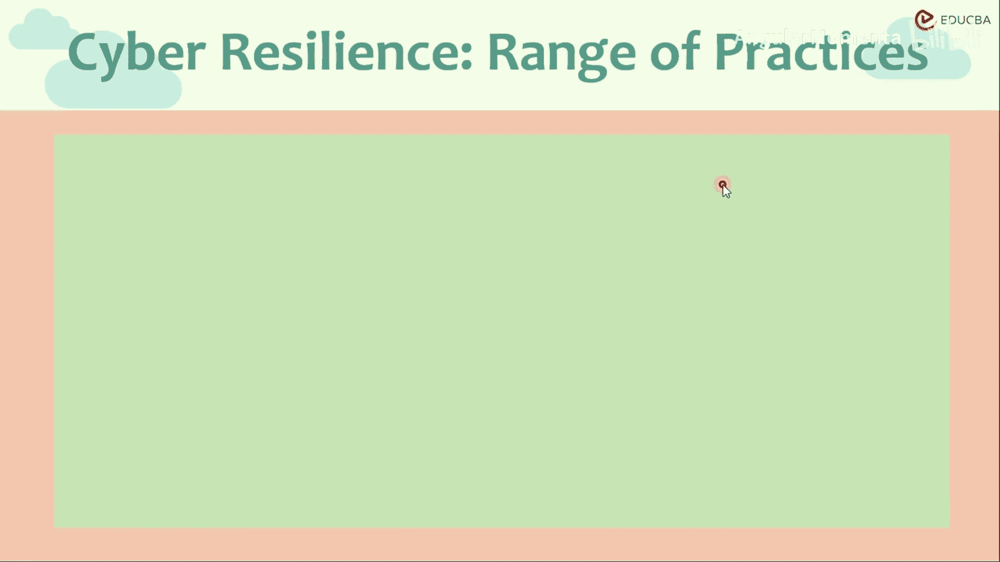
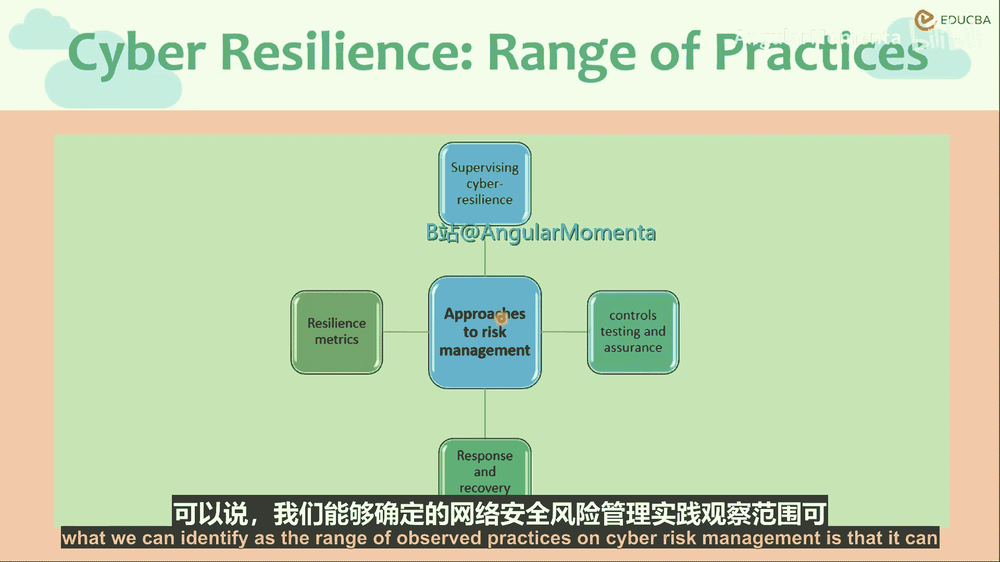
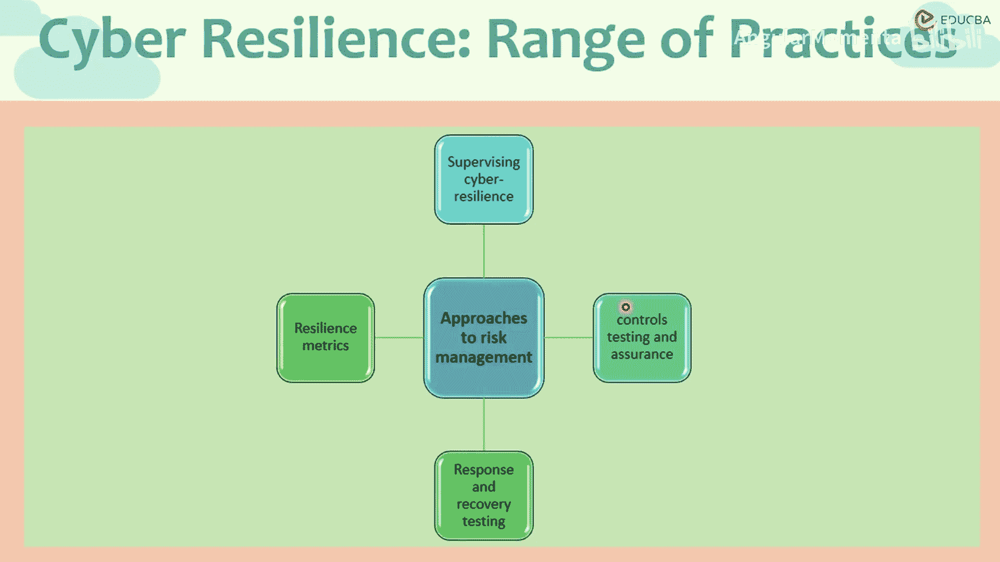
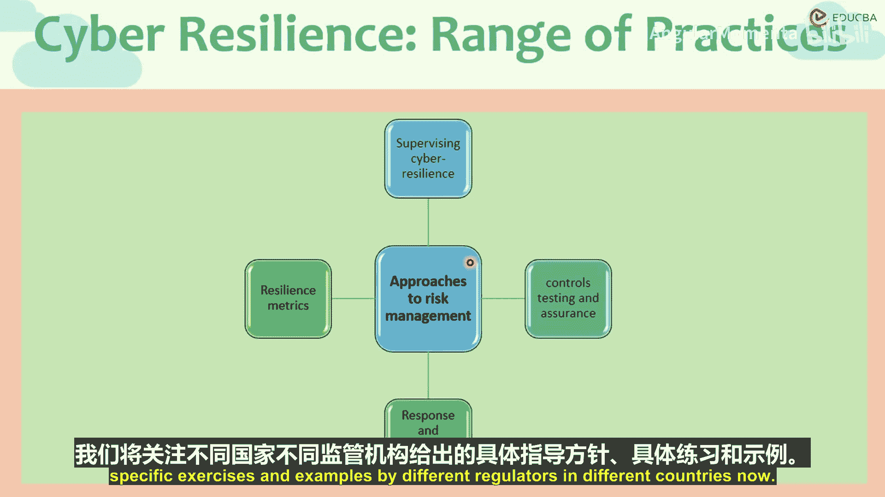

# 【EDUCBA】巴塞尔协议、压力测试与抗风险能力 ｜ Analyze Capital, Basel, Stress Testing, and Resilien p11 07_03_01_网络风险管理方法 -BV1tLcTzJEeb_p11-

So there have been multiple approaches， multiple commonalities for risk management。

 specifically cyber risk management， so what we can save if we can identify as the range of observed practices on cyber risk management is that it can be broken into four subsections。

First is supervisory cyber resilience。Then we have control testing and assurance。

We have response and recovery testing and we have resilience metrics Now these are different angles now we have seen supervisory side right how supervisors have been evolving their aspect of how the organizations will be reviewed and how the organizations which are being monitors by those supervisors will be reviewed。

 we have seen supervisory guidelines by different supervisors and we'll see also in the next section they have supervisors have been trained and need to have that lens that view understand the impact of cybersecurity on their participating organizations control testing as the name suggests it is testing and back testing of controls test stress testing documenting the response documenting the misses and near misses impacts of and results of internal testing so that is control testing and assurance response and recovery。

Testing so control testing is more about preventing the attacks like having firewalls and detection systems response and recovery systems is in the next stage wherein the assume that the cybert has happened and then what is the organization's approach to recovery at other backups and how the backup should be tested there are guidelines so it is not only testing and is response for stress testing of these events but also documentation of these events and learning from the gaps learning from the previous attacks for these particular cyber attacks and the recovery and resiliency from these systems one way to calibrate this across organizations across different units and across different time zones is to create a matrix and convert the qualitative data into quantitative data that can be broken down and to compared across different organizations and across the organization。

Differentent units and throughout different points of time so there has to be resilience matrix as to how many impacts happen。

 what was the organization's detection time， how quickly the breach was identified what was the impact financial impact versus non financialanci impact what was the accountability。

 what was the recovery plan it could all be converted into a scale system rating system and included in the resilience matrix wherein what was the effects of testing could also be included so it could include both the dive events。

 the live attacks as well as the testing attacks， the results of testing so that it has both simulated information as well as actual information and this could be included as a matrix as a reporting phenomena for reporting not only to board of directors。

 but also supervisors and regulators outside the organization So that is a general area general approach for。

Overall right having a risk resistant shield or exercise resistant shield in different organizations so this is also focused by different organizations。

 different regulators in different countries we look at these specific guidelines。

 specific exercises and examples by different regulators in different countries now。

