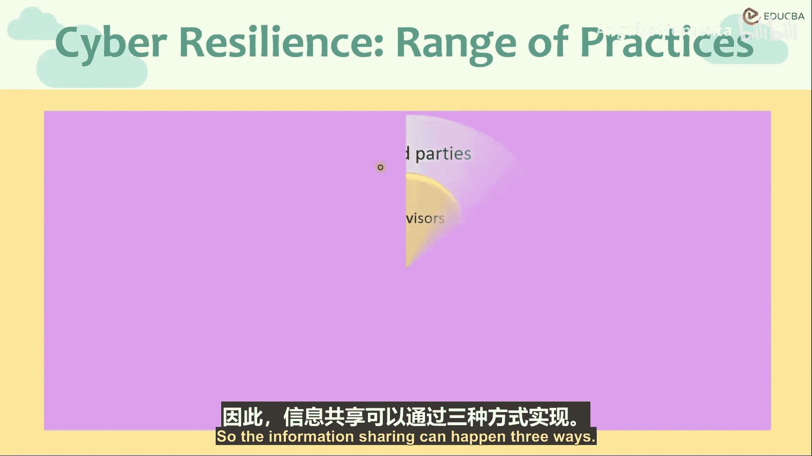
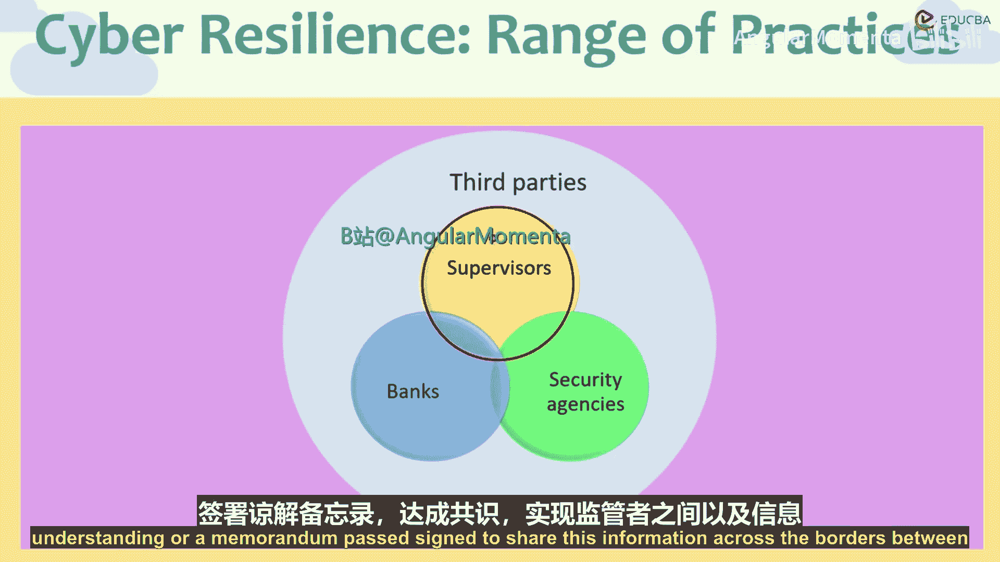
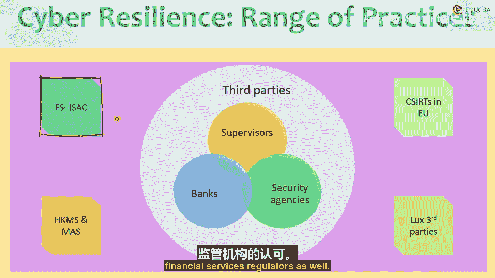

# 【EDUCBA】巴塞尔协议、压力测试与抗风险能力 ｜ Analyze Capital, Basel, Stress Testing, and Resilien p12 07_03_02_信息共享 -BV1tLcTzJEeb_p12-

One of the most important aspects of the whole financial industry towards being cyber resilient is information sharing。

 So the information sharing can happen three ways it will be bit to banks themselves。

It will be between regulators themselves， it will be between security agencies themselves and will be between all these three agencies interchangeably there will be also an overlap of all three agencies all three areas of financial system financial world sharing information with each other now it is very common for security agencies to share data between each other it has it's not new like our credit trading agencies are also in a way sharing data credit data amongst each other these security agencies also share data amongst each other and a lot of times their scope is international it is for their own good in a way going away from the competition within internally because a patch or a vulnerability in program identified by one organization it be shared by this organization among all the security providers security agencies so the overall system is stronger for example is bank may have。

😊，of the security system at its end， but if the third party employees third party contract workers。

 they are not working on a secured network then。The bank system is also at risk， similarly。

 the bank's security system made the best， but if the security systems themselves are not sharing information among each other。

 then each one will have to invent the wheel and identify the gaps and invent the approaches to bridge those gaps independently and that would be very。

 very cumbersome， very very detrimental overall improvement in the sector banks also have a pathway or a sharing platform。

 a lot of banks in common jurisdiction， for example all the banks in EUu jurisdiction in Japan in Brazil in Middle East have have been encouraged the public sector banks and private sector banks have been encouraged to share information among each other not without reviewing secured information or private information confidential information so this also helps other organizations to learn from the mistakes of one。

Or from the lessons of one bank of one organization。So this includes sharing of best practices。

 this includes sharing of threats。😮，Or vulnerabilities or anything that may be relevant There has to be sharing among supervisors also supervisors within the border。

 different supervisors， financial industry supervisors versus let's say banking supervisors。

 settlement security supervisors share market or capital market supervisors at the same time。

 supervisors from other sectors also within the borders of the country and also across the borders of the country that is international sharing of information Now there are a few cases where this has been very common or there are a few jurisdiction where there is a understanding or memorandum pass signed to share this information across the borders between supervisors and between information agencies as well。

 for example， F Iac financial services information sharing and analysis center this is a non。

entity established in 1999 to collect and provide financial services sectors。

 member organizations with information， and potential vulnerabilities as well as warning signals of risk cyber threats。

 cyber attacks on national financial and services infrastructure so these members。

 the members of Iac include banks， credit union， settlement and clearing depositories， deposities。

 clearing operation insurance companies， investment companies。

 financial sector regulators and law enforcement agencies it Iac host conferences。

 seminars as planning exercises and brings the cybersecurity experts from different organizations on the same platform to share ideas and to learn from the mistakes and best practices across the organizations。

This is cross borderor entities it invites international organizations to share their ideas and to have sharing between the organizations。

 they have the core elements for Iac include rapid response so first of all analyze and disperse the information on threats and intelligence systems on the recovery systems throughout its members on a real time basis are as close to realtime basis as possible so they have their own critical infrastructure notification system which is developed by F Iac they also have information sharing and analysis which is information dissipation gathered from external sources they have sources they have methods to collect information from external sources and to dissipate dis information after a verification obviously within its members so it collects information from different regulators and different entities outside its network it anonymizes data so that the。

ation privatete information sensitive information is not shared while sharing the information related to threats and recovery plans。

 it is driven by members and it is not for profit so it is specifically for the needs of financial industry and it is recognized by the US financial services regulators as well at the same time EU regulators as well。

😊。

