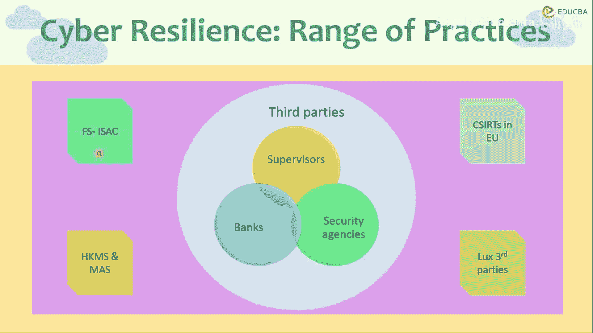
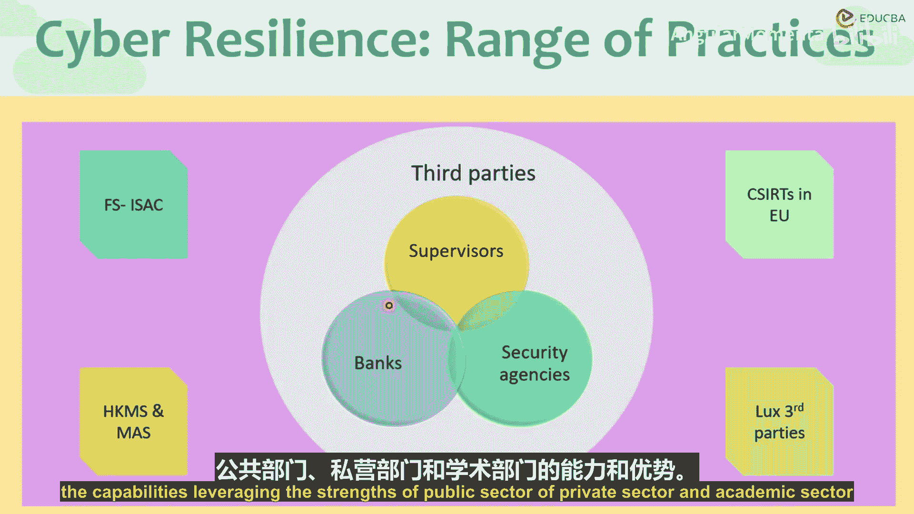

# 【EDUCBA】巴塞尔协议、压力测试与抗风险能力 ｜ Analyze Capital, Basel, Stress Testing, and Resilien p13 07_03_03_信息共享（续） -BV1tLcTzJEeb_p13-

There is also a bilateral cybersecurity information sharing agreement between Hong Kong monetaryetary authorityity。

 HKMA and monetaryetary authorityity of Singapore MAS so they have a framework through which they have agreed to share four guline information on four guiding principles between these two authorities so they share information related to voluntary basis it is totally voluntary it's not something that will be regulatory reinforced a second principle is being timely so the timely information sharing system because if there is a threat if a cyber attackt has happened on one of the systems then it is going to propagate among the systems across the border in a very quick manner it usually a cyber attack will be if if started with that intention that will be sharing across the globe that will be propagated across the globe。

with less than 24 to 408 hours second is being effective effective and efficient in sharing the information in running the framework and also running the cybersecur platforms within the organizations in these two regulations and having the information confidential which is key right when financial institutions sharing are sharing information confidentiality has to be very key aspect it has to be preserved at the most at the top priority because otherwise there will be loss of confidence between the organizations this is on Southeast Asia region we also have network and information security directive by EU we have CSEs or computer security incident response team at national level in EU zone for comprehensive incident management across the at the national level so each country in the EU。

Don have their own CSr teams or computer security information response team。

 They are like rapid action team to， first of all， tackle the information。

 They will monitor the information。Just like physical security team。

 they will keep monitoring the global development， have a plan to tackle the actions and also guide financial information on being resilient and tackling such information once that has been identified they will be connected through these national teams will be connected to the U wide network。

 they will be working with the respective Ministry of finance Ministry of Information and communication technologies and the European network and information security agencies NIS so they are working at different level and working with different agencies。

😊，To have a better response to cyber attacks。 So they will have information exchange and services exchange as well for operations and cooperation capabilities。

They will exchange and discuss information related to incidents and associated risk。

 which is on voluntary basis of course， but suggested right for betterment of the overall organization overall financial sectors they can also coordinate response across globe across cross border teams across cross supervisory regulations they also provide members support for tackling the responses。

 they also help member improving their own regulatory responses and cyber resilience programs and they also have general preparedness programs general improvement programs of all its members so that they can be better prepared for cyber incidences there is also a regulation that there is a regulated third parties in Luxembourg now Luxembourg as you know has a very strong presence in financial sector even though it's a very small country so it has specialized services。

Regulated companies that provide specialized services for financial cyber security to be more specific。

 So they have a commission do surveillance do sector fnancciier CSSF that applies for the financial institution themselves right so these regulations are for the service providers related to cyber resilience or cyber protection programs in the financial sector。

 So they have the guidelines and regulations for monitoring service providers or protecting the cyber police in that sense。

 third party private cyber police that sense。 So they work in tandem with the government agencies as well as private players。

 nonregulated government agencies and the Luxembourg government keeps circulating guidelines and notices or improvement in data collection between these three entities。

 So we' have seen how public private partnerships。Help improve the overall robustness of financial system financial sector as a response to cyber threats and improve the overall response time resiliency capabilities within the organization。

 this strengthens the financial organizations at the core the bad agents are working independently and relentlessly to find vulnerabilities in cyber agents cybersecur cyber systems and we cannot treat it as an isolated incidence if the systems in let's say。

 France in French banks are compromise they are going to have cascading impact in the global financial systems because of the system connectedness because of the rapid exchange of information and connectedness between different banks。

 different financial institutions， different regulations and innova is going to impact everybody so or improving the financial regulations。

 all the factors， all the parties involved in this sector。

And this true for financial as well as non financial sector。

 they have to work in tandem and in coordination with each other with kind of leveraging the capabilities。

 leveraging the strengths of public sector， of private sector and academic sector。😊。

