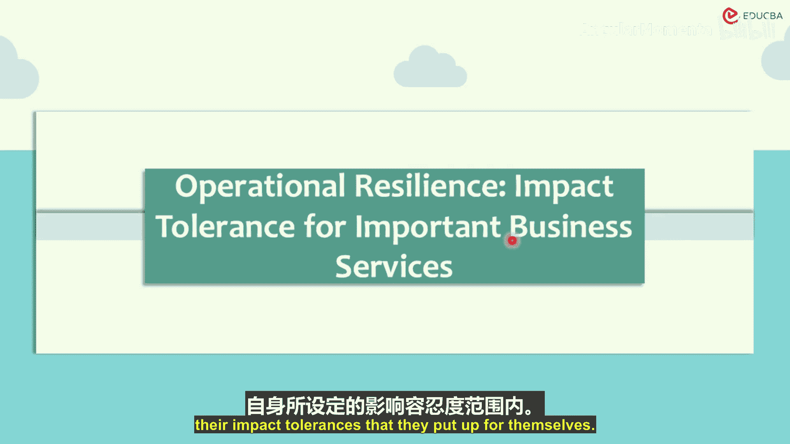
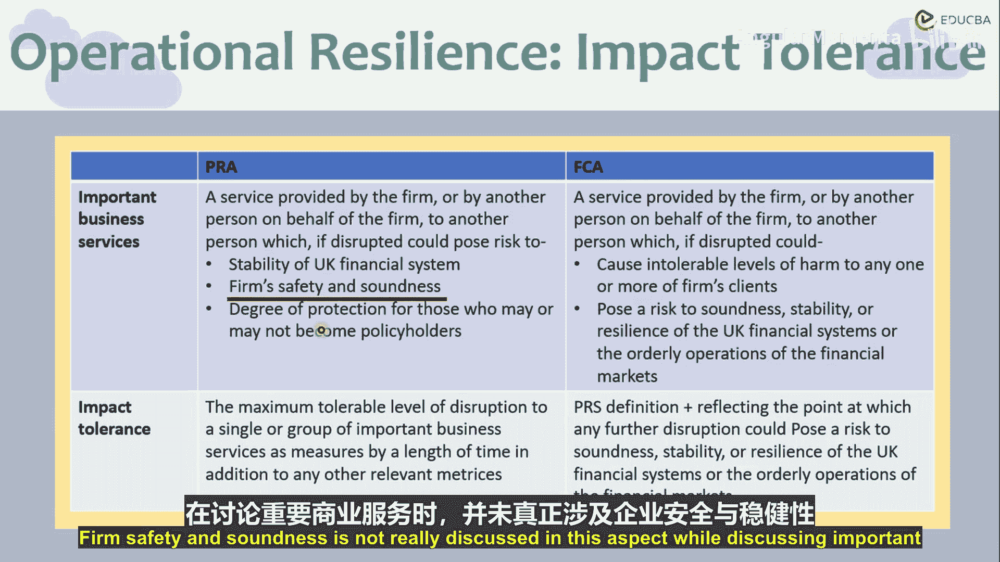

# 【EDUCBA】巴塞尔协议、压力测试与抗风险能力 ｜ Analyze Capital, Basel, Stress Testing, and Resilien p14 07_03_04_重要活动与影响容限 -BV1tLcTzJEeb_p14-

The next chapter or rather next couple of chapters that we're going to look at are more focused on operational resilience and their impact on business services。

 principles related to operational resilience and few related aspects right So this chapter is operational resilience impact tolerance for important business services。

 Now what is this chapter about So this is basically a research paper or a white paper published jointly by prudentru regulation authority PR and financial conduct authority F and Bank of England in its capacity of supervising financial market infrastructure firms。

 So these three organizations together called as the supervisory authorities。

 the key priority for supervisory authorities is to put in place is strong regulatory framework to promote operational resiliency of the firms and financial market infrastructure firms。

FMs so for this purpose， these three supervisory authorities published a joint discussion paper on operational resilience in 2018 and they've also used certain consultation documents to come up with followup version of that paper and this is that paper these are the key findings of that paper so to conclude like and to give a very gist of it the consultation proposed requirements and expectations for the firms and financial market intermediaries to identify their important business services by considering how disruption to the financial services that they provide can have impact beyond their own commercial interest Now this is a very different view if you notice it these firms are required to look at the impact beyond their financial and commercial interest they are required to set tolerance for disruptions for each important business service。

Which is called as impact tolerance and ensure that they can continue to deliver their important business services and are within their tolerances impact tolerances that put up for themselves for severe and plausible scenarios so that's basically it by looking at it there are certain differences in the way PR prudentruial regulatory authority and FC which is financial conductor authority which are the two authorities to supervisors within England within UK right UK financial markets so when they have given up de their final policies not very prescriptive。

 it's more descriptive just like base regulations it's more of a guideline and general principles rather than a step by step guide but there are few differences in the way they these two organizations。

 these two authorities view businesses for example if you look at internal services。

So now the regulators looked at the number of respondents and asked them for clarity as to whether internal services were included within the definition of important services now firms suggested that if disrupted internal services such as HR payroll may have significant impact on ultimate delivery of internal and external usage now if we look at the PR view of it and F view of it。

 what are the important business services PR suggests that a service provided by the firm or by another person on behalf of the firm to another person which if disrupted could pose risk to stability of UK financial system not only the individual bank but or institution but the whole financial system firm's individual safety and soundness and degree of protection for those who may or may not become。

Policholders or the customers of the firm that is called as important business service On the other hand。

 Fca defines business services service like this it say important business service is a service provided by the firm or by another person on behalf of the firm to another person which if disrupted could cause intolerable level of harm to any one or more of firms clients and poses a risk of soundness stability or resilience to UK financial systems or the orderly operations of the financial markets So notice PR puts stability of financial markets before the clients in fact the clients are at the bottom of the risk metrics but from FCA perspective the clients become the top priority and next is the financial systems overall firm safety and soundness is not really。

Discussed in this aspect while discussing important business service。

