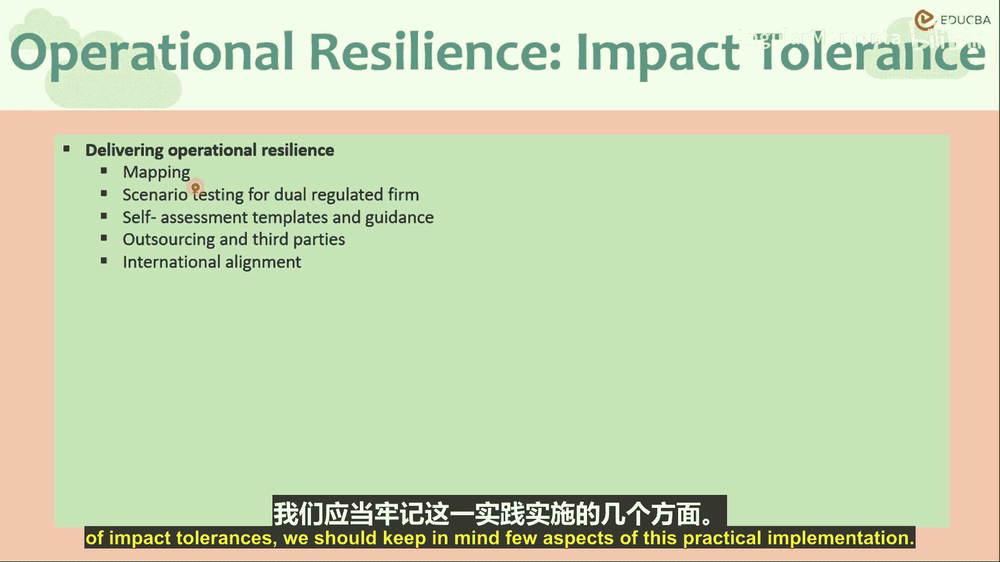
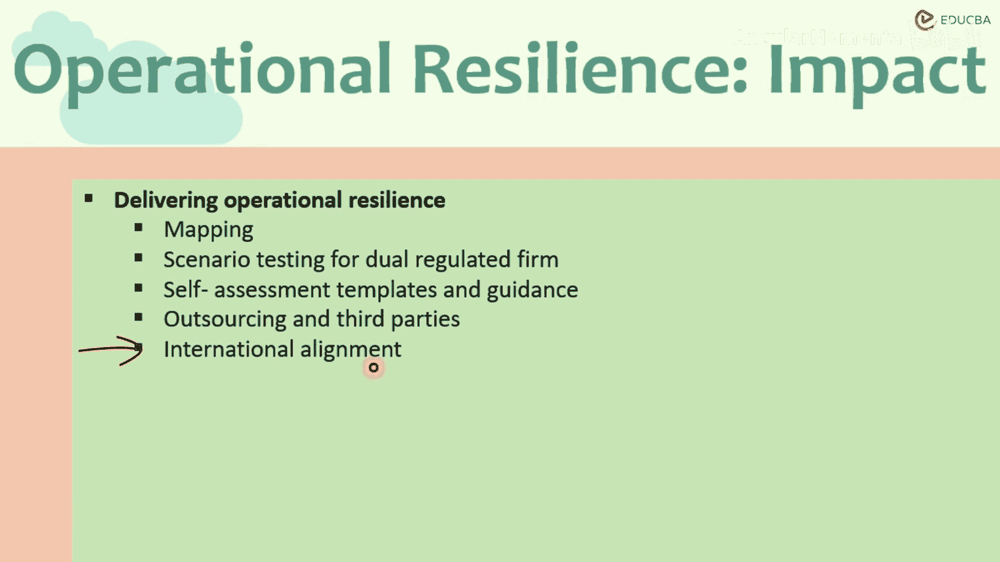

# 【EDUCBA】巴塞尔协议、压力测试与抗风险能力 ｜ Analyze Capital, Basel, Stress Testing, and Resilien p16 07_03_06_实现运营韧性 -BV1tLcTzJEeb_p16-

Now， when we are talking about actually implementing the operational resilience and implementation of impact tolerances。

 we should keep in mind few aspects of this practical implementation first of all the mapping aspect right so these firms as per this consultation paper the firms and financial intermediaries would be required to identify and document the necessary people processes。

 technology information systems or any resources that would be required to deliver each of the important business services right so it's part of the operational resilience and we can have people processes input output dependencies。

 linkages related to these important business services and specifically it was proposed that mapping should enable firms and and intermediaries to deliver to outcomes first is to identify vulnerabilities in delivery of。

And second is to test their ability to remain within the impact tolerances Now some of the firms have responded to the guidelines from the supervisors have question them as to what could be based is it output so is the impact tolerance or if the situation if the scenarios are to be dependent based on the output or input so these are two different aspects or to give you an example if we have a long short market neutral portfolio。

 then any severe inputs also any upswing or downwings in the market are ideally I repeat ideally not supposed to impact our portfolio imagine we are supposed to make profits either market goes up or goes down in a long short market neutral portfolio So we may have an input severe scenario but the output may not be as severe output may still be favorable especially if you are working with。

Options and implementing a strategy which has which would benefit from market volatility that would know benefit from input severity on the other hand。

 output severity is when your inputs may not be as severe but output is magnified for either because of leverage either because of weak points in the system or for any other unforeseen events so input severity is different than output severityity or outcome based severityity so there were obviously lot of discussions and what could be considered as severe scenario between the firms and the supervisors but overall when it comes to scenario testing the firms were expected to summarize the vulnerabilities that they had identified and the testing methodology the testing methodology included what were the learning how the gaps or。

Vulnerabilities were identified and second is what is the firm doing， What are the lessons learned。

 What is the action path， what is the firm doing to overcome those scenarios or the gaps that as identified in the scenario analysis that's a very important part lessons learned exercise to identify priorities and invest in the ability to respond and recover from disruptions as effectively as possible In other words。

 being resilient to the business scenarios as much as possible that was to be identified and implemented as a major part of this exercise is a major part of this scenario analysis to help these firms on this path the regulators had defined some guidelines avoid some guidelines on what could be severe or extreme scenarios So severe but plausible that is the requirement by this consultation paper on determining the stressful event they had given certain。

Guidelines that given certain examples as to what could be severe but possible event。 However。

 for each firm， their business being different and their business being only well understood by their own management they had full freedom to define what would be their stress scenario and what would be the scenarios under which they would like to measure it there were some templates provided。

 of course， for guiding the firms on identifying the scenario。

 identifying the vulnerabilities and to document the lessons learned from the severe scenarios Now these templates included certain guiding questions。

 certain thought provoking questions these included certain minimum requirements these included certain modes of communication as in stakeholder communication after the vulnerabilities had been identified and overall there are more focus on bringing uniformity thought process in bringing uniformity and understanding that these templates and。

Aances only act as a minimum required firms are free to choose free to go beyond in the fact encourage to go beyond the self the points discussing these self-assessment template so that would be helping only for the firms to identify gaps and vulnerabilities in the process the overall implementation of overcoming this vulnerabilities is obviously dependent on their own choosing they can outsource some part of their services and use thirdpart to conduct this so there are two aspects to outsourcing first is outsourcing the whole scenario analysis scenario testing exercise to consultants and take their views and second aspect is to identify vulnerabilities and then as a part of overcoming those vulnerabilities or as a part of improvement as part of lessons learned there could be a backup to outsource those processes to thirdpart or thirdparty service providers。

Now， whether to create backups for particular processes。

 business important business processes within the organization or to involve third parties is a very organization specific question a lot of organizations understandably wouldn't be comfortable outsourcing their important business processes。

 important business services to third party for multiple reasons and it is possible to have a middle thought based on the organization's approach based on the organization's preferences the only idea is if third party are being involved then information sharing and privacy of information should be well protected by documentation and by mutual understanding this consultation paper also touched upon the international alignment and by international alignment it is more focused on aligning the expectations and minimum requirements with the guidelines and。

iples by Basal Committee on Bank SupervisionBS so the supervisors do recognize that global and international connectedness connected nature of firms financial intermediaries and the importance of coordination between different supervisors and align and they trying to align on different regulations with different regulators so that there is at least a minimum standard minimum regulatory expectations supervisory expectations set for the firms no matter where they are operating from because。

At a very true sense at a very core of it， no matter where the headquarters of the firm may be situated。

 they are very likely impacted and very highly impacted by the global events and global interconnectedness。

 so this should not be a regulatory arbitrage wherein the firms are encouraged or have a motivation to choose a particular regulation against the other because it is convenient to them the idea is to be more prudential and be prepared for any events if any operational stressful events if they occur。

