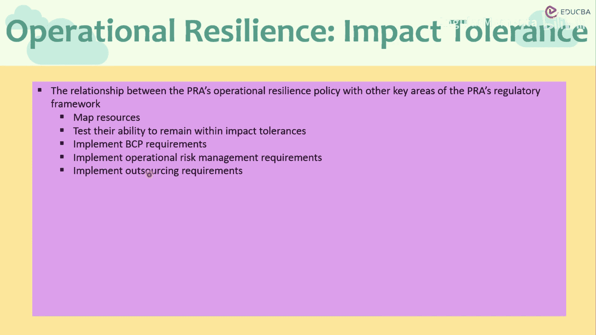
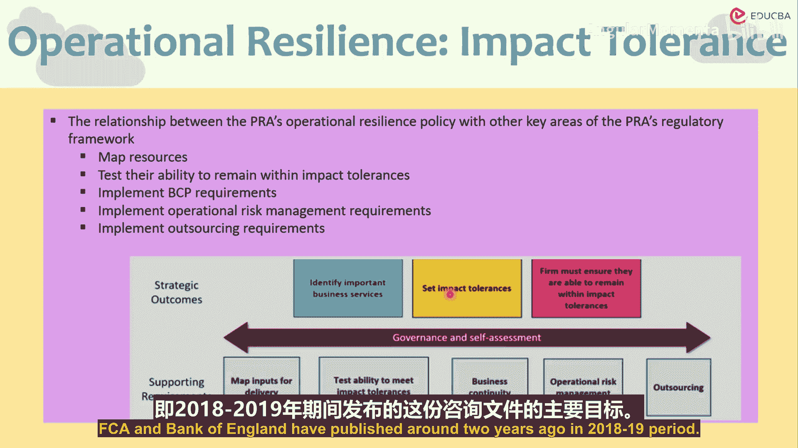

# 【EDUCBA】巴塞尔协议、压力测试与抗风险能力 ｜ Analyze Capital, Basel, Stress Testing, and Resilien p17 07_03_07_治理与自我评估 -BV1tLcTzJEeb_p17-

Now， we must understand that these are very open endeded and very firm specific areas。

 right the important business processes， the impact tolerances and guidelines are as the plans to overcome and stay within the impact tolerances as a very firm specific exercise the regulators have still issued a guidance principle or a supervisory statement which outlines the expectations for operational resilience of firms important business services for which they should be setting the impact toleranceances。

 how the firms should identify their important business services。

 The objective is to improve the overall resilience to operational disruptions for both firms and the wider financial sector So this policy the appendix to the consultation paper other addresses risks to operational resilience from interconnected。

Of financial systems and the dynamic and complex environment in which the firms operate。

 PR considers that there is a need for proportionate minimum standards for operational resilience that motivates or incentivizes the firms to prepare for disruptions and to invest where needed that's a very different view where it's a very good view。

 because we must understand that firms would like to be prepared。

 firms would like to have minimum disruptions to their business。

 but being prepared implies investing resources， not just monetary resources。

 but other human resources as well。 So in that sense。

 they are blocking some resources to be resilient for business disruption Now how much resilience is allowed that impact tolerance that tolerance to disruptions is a relative preference and it is very much dependent。

AndOn the risk return trade off for the firm， what the management seems to be appropriate。

 What PR and F， both the regulators together are trying to do is to set up with a minimum standard for operational regulation。

 so that。Firms are incentivized to prepare for disruptions and not to invest wherever is required because firms would ideally look at blocking any capital and investing any resources as a vestage or at least as an opportunity cost to the funds which could have been otherwise invested in business for them there is a very high likelihood that the firms or the management。

 senior management may look at it as additional burden the focus of the regulators is that the firms would not view it as a additional burden but rather something that would that they would be incentivized to have to maintain so that they overall help firms resilience operational resilience as well as for the whole financial sector's resilience so because the disruptions can have impact on firms safety capacity to deliver services and it can have a cascading。

ect on overall financial services as well because of the interconnectedness。

 depending upon the size and scale and nature of the firms business。

 it is relevant to all UK banks building societies。

 credit societies PR designated investment firms UK solvenc C2 firms society of Lloyds and its managing agents。

 insurers and so on So it gives some guidance on how to define a business resilience process and how to set up the impact tolerance Now of course these are more of a guidelines So we don't need to look at those guidelines these are very detailed guidelines but at the same time they are just guiding principles。

 they are not the step by step that you follow what step 12。

34 and you will arrive at the final answer which is your expected impact tolerance No it's not that excess it is very firm specific and because of the wide nature and the varied nature。

Nature of the businesses that are in the purview of these consultation paper under PR and Fca。

 it is not possible to give those close guidances for identifying important business processes as well as the impact tolerances。

 but there could be some standard practices， minimum requirements or identifying the business processes for identifying the business impact tolerances and also to come up with a lessons learned or a overcoming plan to improve the financial and operational resiliency how to build a matrix that we've seen there has to be timebased aspects of the time aspect has to be included in the financial metrics these principles the circumstances on which the metrics needs to be measured these are all given out as a guiding principles by this consulting paper they have the regulators have also introduced statement of policy or SOP。

Relevant to all banks and insurers within UK Now， PR considers that for firms to be operationally resilient。

 they should be able to prevent disruptions occurring to the extent practicable so has to be trade off between the and return and adopt systems and processes to continue to provide services in the event of incident and return to normal functioning as early as possible。

 So that is the business resiliency part， they should learn from the business events like actual incidences as well as near misses So documenting and learning from near miss incidences near miss eventst is also equally important as important as learning from the actual events and actual incidences they they have issued a kind of rule book or handbook for guiding the firms and helping them identify important business services impact all tolerances and so on it cover。

arereas like governance， operational risk measurement。

 BCP business continuity planning and management of outsourced relationship or third party relationship outsourced activities。

 third party service providers。

To put it more graphically， the guidelines are on the two fronts for the firms。 first is the。😮。

Strategic outcome， the focus is on determining strategic outcome at a broader level。

 you start with the strategic outcome that is desired。

 The strategic outcome is threefold first is to identify business。Important business services。

 second is to set the impact tolerances and third is to ensure plan and come up with a plan to make sure they are within the impact tolerances。

 How does that happen first is to identify what would determine as how would you decide whether the firm is within the impact tolerance or not that is coming up with a matrix。

Measurement metrics and converting it to qualitative quantitative data and second aspect is to come up with a scenario analysis stress testing so that the firms can come with a plan or learnings or guidelines as to what to do or what actions to take if the stressful event or the business services are impacted so that's part of the governance and self-assessment exercise。

 There are few tools supporting documents that are part of this exercise self-assessment which are you know is a steps。

 These are kind of intermediate steps to achieving these strategic outcome。

 These steps are to map inputs for delivery to identify what are the critical inputs in terms of people processes。

 hardware software resources， any other dependencies so that we can identify the crucial resources。

 then other document other requirement is to test ability to。impmpact tolerance， first of all。

 to identify what would be the impact to disrupt to these business processes for disruptions so to come up with events or to come up with scenarios that could disrupt these business services and to assess whether firm can stay within the impact tolerance that they are set up for themselves if those scenarios play out based on the event。

 the firm is required the firm's banks and insurers are required to come up with business continuity planP that would include backups accountability and responsibility of each team member each employee what would be the backup systems。

 what would be the contingency plan， if it has to be outsourced then that should also be included as a part of VP it could be outsourced for some time it could be outsourced as a policy outsourced agents could be used as a complementary services this outsourcing aspect third partyy service provider aspect has to。

Be included in the part of first business entity planning and second whether the firm has the ability to remain within impact tolerance in case of the disruption to business services to important business services。

 this whole exercise is going to be part of operational risk management guidelines。

 operational risk management module of the firm， which in turn is going to be part of the enterprise risk management aspect of the firm So the view is going to be at a top level。

 wherein the impact could be decided impact is to be studied at the organizational level at not at an individual business unit level。

 but organization level， In fact， regulators have taken this view to even one step further。

 they are trying to assess the important business service from the view that if disrupted that could have serious consequences to the overall effectiveness and health of financial sector So they are not only looking at business unit or the firm per se。

 but。overall financial sector in the UK and in the world。

 so it is going to have a very broad view you have to have a very wide and broad view and not a narrow perspective for the firm or for the business unit itself that is primarily the objective of this consultation paper that the three supervisors PR F and Bank of England have published around two years ago in 2018-19 period。

