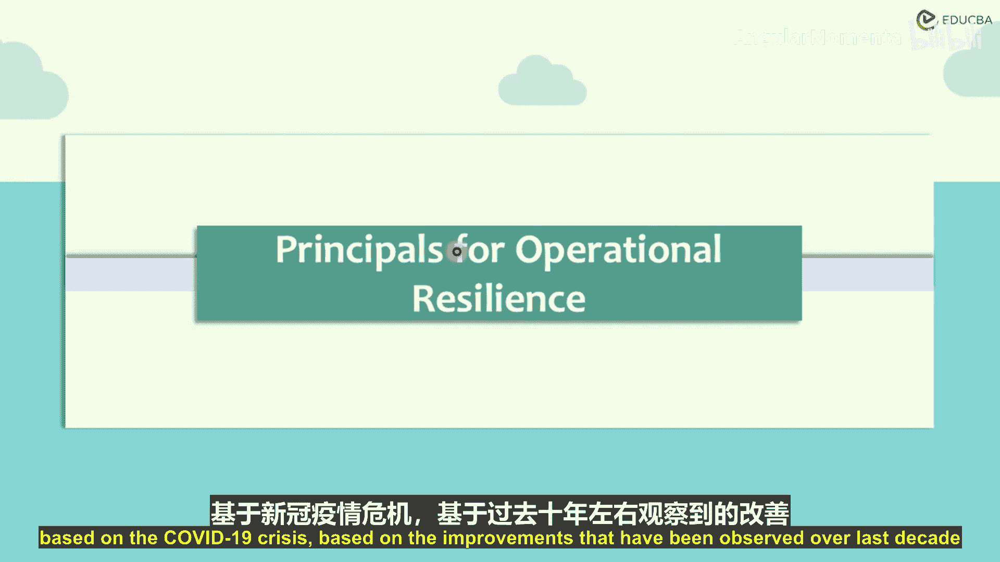
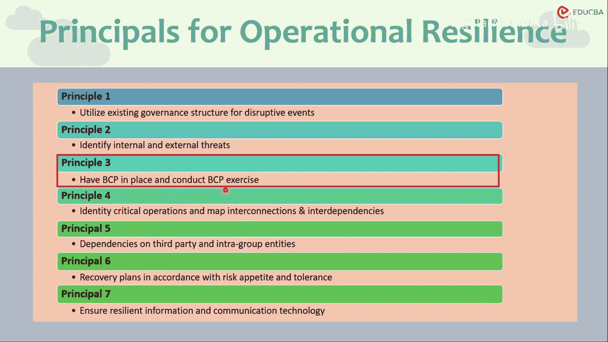

# 【EDUCBA】巴塞尔协议、压力测试与抗风险能力 ｜ Analyze Capital, Basel, Stress Testing, and Resilien p18 07_03_08_校长 -BV1tLcTzJEeb_p18-

Let's move on to the next chapter， which is principles of operational resilience。

 So what we are going to look at is the principles suggested by basal committee's reforms on prudential framework after the the great financial crisis GFC of 2007 to9 now the basal committee as a response to have come up with basal 3 reforms and one part of it was also focused as operational resilience not only strengthening banks and financial sector's financial resilience。

 but also operational resilience So the idea is to understand the background the basal committee believes that even though there has been continuous improvement on the continuous focus on the operational resilience of the banks of the financial institutions and the financial sector overall after the global financial crisis yet this needs to be improved further to include operational re related events in。

Certain scenarios like pandemics like Covid 19 pandemic， we can call that cyber incidences。

 technological failures， natural disasters which are low probability but high impact events and so the focus is on not high probability low impact events but low frequency low probability high impact events and prior to covid 19 pandemic or the lockdowns primarily。

The regulators had an impression that because of the continued focus of almost 10 years after the global financial crisis。

 the banking sector had considerably improved on their approach towards operational risk management。

 which was true partially I mean it was true to a lot of extent。

 but not 100 percent and was proven it was tested very brutally in last two years with the Covid-19 regulations with the Covid-19 pandemic。

 certain an areas of financial sectors had proved very vulnerable。

To such pandemic events to operational events， banks in general were a lot more resilient than the 20078 period and overall also bit more resilient than the other participants in the financial sector。

 depository services， non banking institutions， insurance agencies。

 banks were more resilient in terms of their operational aspect as well。

 operational risk management as well。So based on this understanding based on the global financial crisis。

 based on the CoVId 19 crisis， based on the improvements that have been observed over last decade or so。

 the Baal Committee has come up with certain principles for operational resilience。

 namely seven principles。

Of operational resilience before going to the principles one let's look at the definition of Basal Committee or operational resilience。

 the Basal Committee defines operational resilience as the ability of the bank to deliver critical operations through disruptions now what would be termed as a disruption and what would be called as a minimum level of delivery that is slightly open ended question but we can link it back to the guidelines from PR and F in the earlier question so if you are in a bank or an entity operating in UK we can take the more prudent guidelines or more descriptive guidelines from both and is understood that none of the guidelines of the regulatory views are against each other they will be complementing each other or will be neutral compared to each other but they will not be going against each other in the opposite view so implementing either of the guidelines。

From Basal committee or from your local regulatory body will help improve the operational regulatory aspect the ability the operational resilience or the ability enables the bank to identify and protect itself from threats and potential failures respond and adopt to disruptive events recover from disruptive events and moreover learn from these events in order to continuously minimize their impact on the delivery of critical services critical operations so when you are considering operational resilience in this aspect。

😊，We should keep in mind that the bank should assume that disruptions will occur and should take into account the overall risk appetite and tolerance for the disruption so you can link it how closely it resembles at the conceptual level the terms may be different impact tolerance versus risk appetite but at a very conceptual at a very core of it the basal guidelines are also very much in line with the Fca and PR and BOe consultation paper that we looked at that we studied just before this chapter in fact the basal committee guidelines first and these games came first and then UK guidelines came into picture UK guidelines are more recent so they have obviously taken some learnings from the basesal guidelines which came as a response to the overall financial sector's performance after the global financial crisis in case of basil the term critical。

Operations is based on the joint forum that was created in 2006 to talk out the highleve principle of business continuity so before 2006 earlier。

 the focus was on business continuity Now the focus is shifted to a much broader and much comprehensive aspect which is operational resiliency Now this defines that the criticality of operations depends on the banks's function and it is banks are choose to free to choose their own respective critical functions as long as they made the guidelines or meet the requirements as we had seen earlier So keeping this in mind let's start looking at the principles right first principle is to utilize existing governance structure for disruptive events What it suggest is banks should utilize their existing governance structure to establish oversea and implement an effective。

Operal resilience approach that enables them to respond and adapt to as well as recover and learn from disruptive events in order to minimize that impact on delivering critical operations through disruptions long sentence。

 but in essence， it is very similar to what we had seen earlier。

 basically disruptive events should be used scenario analysis and testing stress testing should be used to。

Check and test the operational resilience of the firm and come up with an improvement plan and guidelines based on those outcomes of this scenario analysis and stress testing that's the first principle second principle is that the banks should leverage their risk respective functions for management of operational risk to identify internal and external threat events and potential failure the weakest links threats and weakest links in people processes systems on an ongoing and regular basis they should promptly assess the vulnerabilities of critical operations and manage the risk resulting from these vulnerabilities to complement their operational resilience approach In other words the threats should be identified and they should be overcome they should be managed so that the overall risk appetite the term used by basesal committee or impact tolerance。

A term used by UK regulators， either of them in essence is the same concept so that the operational risk is contained within the risk tolerance as defined by the firms or impact tolerance as defined by the firms that's a second principle third principle is to have a business continuity plan in place and conduct regular exercises to test the effectiveness and currency of this particular VP plan they should be testing it for severe but plausible scenarios in order to test the delivery ability of the VcP plan and in order to test the ability of firm to adhere to the VP the business continuity plan this should cover for not only regular disruptions but also low severity but high probability or high impact events very much in line from general sense it is not very。

Different than what we would impact what we would assume for a banks to have a bank or any organization to have in place so nothing new here BCP is something similar to what we had looked at from cyber security aspect。

 cyber resiliency aspect， operation resiliency aspect， enterprise risk resiliency aspect as well。

