# 【EDUCBA】巴塞尔协议、压力测试与抗风险能力 ｜ Analyze Capital, Basel, Stress Testing, and Resilien p19 07_03_09_校长续任 -BV1tLcTzJEeb_p19-

Continuing to principle 4， which is related to mapping interconnections and interdependencies。

 So what it suggests is once the bank has identified its critical operations。

 the bank should map the resources， resources considering people processes。

 hardware software and systems requirement， technological requirement， information systems。

 facilities， anything that could be used as an input and dependent and required for final delivery of the output。

 Bank should identify those factors， at same time also map the internal and external interconnections and interdependencies that are necessary for delivery of the output from the critical operations。

 Why is it important so that once the interconnectedness and interdependencies are identified。

 we can know where the bottleneck could be， we can know where the system is could be the。

Fest or we can know what events will test what aspect of the system， For example。

 if we look at the Covid-19 lockdown kind of scenario。

 then the biggest area would be that would be stressed is the ability to work from home or work from out of office for an extended period of time if banks systems don't have ability to either provide harder for all the staff or have a secured network access for all the staff to enough access the bank network。

 then that is going to be the vulnerable area， the most vulnerable area the banks or any financial institutions should have the ability to identify the interconnectedness and interdependencies between different areas。

 different internal as well as external aspects and areas for the important business functions。

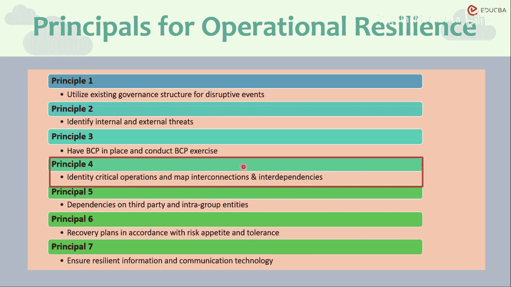

Next principle is related to third party dependency。

 so banks should be able to manage their dependencies on thirdparty services as well as related business entities。

 so it could be entities which has been outsourced which could be thirdparty service providers or it could be related entities the banks should be able to identify and manage their dependencies on these related parties thirdparty entities。

 thirdpart service providers as well as related parties within its operations the end purpose。

 of course， is the smooth delivery of the critical operations so banks should perform a risk assessment and due diligence before entering into arrangements with the thirdpart either outside thirdpart or intragroup entities consistent with the bank's operational risk management framework so the due diligence should be part of the operational risk framework。

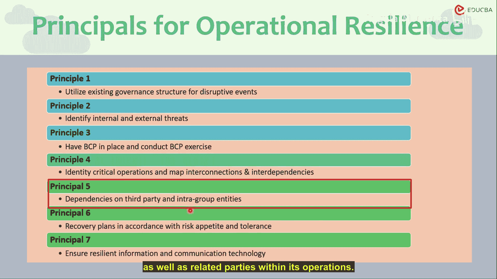

And should we clearly defined what would be tested。

 what would be expected from these third party services or intragroup entities as well。

 the risk management policy， the operational risk aspect， operational resilience aspect。

 this all should be tested for a the entity themselves。

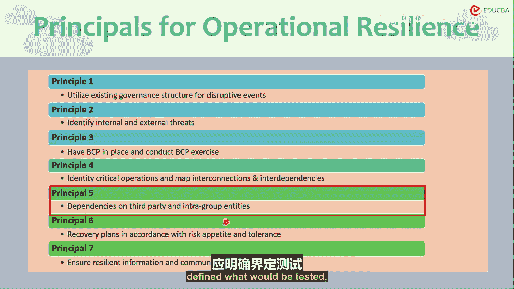

B the third party or external party with which they are doing business and C as a combined operational unit or as a combined interdependent delivery system of bank as well as the third party service provider。

 So if the third party service provider is trying is able to fill in the gaps in the operational resilience aspect of the bank then that would be the best possible outcome that would be the best possible complement why third partyy service provider for the bank's operation。

Next principle is the incident management， so banks should develop and implement response and recovery plans to manage incidences that could disrupt the delivery of critical operations in line with banks risk appetite or impact tolerance as we had seen in earlier chapter and tolerance for disruptions。

 basically risk up and tolerance or impact tolerance for disruption so banks should be continuously monitoring and improving their incidence response time incidence response plans。

 recovery plans for incorporation of lessons learned from previous incidences So it's expected to have a continuous feedback loop。

 These previous incidences could be actual incidences or near misses or learnings from the simulations learning from the scenario analysis testing analysis they all have to be treated at par because they all are。

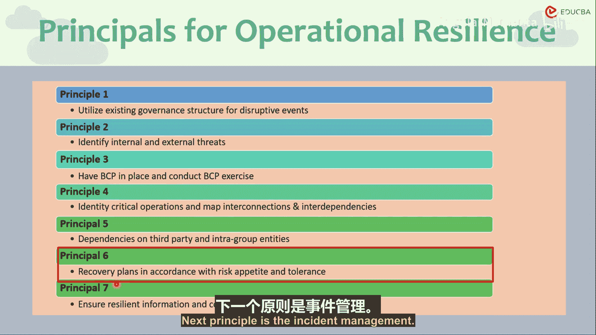

Expected to help banks be better and be more prepared for operational risk events The classification of incident severity is based on predefined criteria related to what is the outcome We have seen there are two approaches input severity approach。

 input severity classification as well as output severity classification So this severity in this case is supposed to be based on the output severity irrespective of the input severity。

 even a small variation in the input parameters could have a disproportionate impact on output parameters or output of the firm ability of the firm ability of the bank to deliver its critical business services So this severity of incident should be based on the impact to its critical business services。

 It could also define it could also be based on the expected time to return to business as usual not。

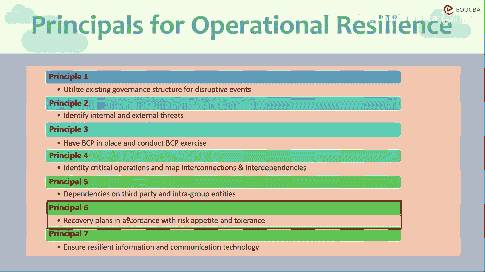

ity could be defined as a financial impact as the time to return to usual as per the connectedness and domino effect within the organization or within the financial sector overall or it could be also based on certain priorities as defined by the stakeholders internal and external stakeholders these could be regulators these could be shareholders there could be board of directors so there could be a predefined severityity but whichever way the banks are doing it it should be predefined and the recovery plan should be set according to the severityity of these incidences next principle is about information communication and cyber security so the banks should have resilient ICT information communication technology including cyberse that is subject to protection detection response。

Recovery programs， these programs should be tested regularly incorporated to situational analysis。

 situational awareness scenario analysis and should also convey relevant information for risk management on a timely basis for risk management as well as for decision making this would help them this would ideally support the processes for timely delivery in the risk tolerances and facilitate the bank's critical operations this will not only help deliver critical operations but also to help provide the senior management some comfort with the overall robustness and overall resiliency operational resiliency of the this should be documented in the ICT policy and information and communication technology policy it should be in the cybersecurity aspect cyber resilience aspect should also be part of the ICT policy we can include the governance and oversight requirements of。

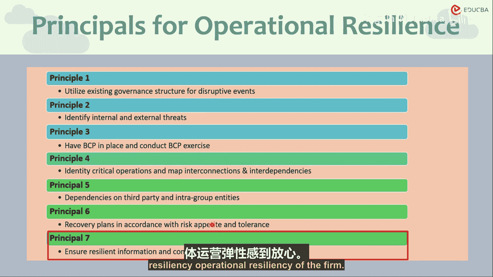

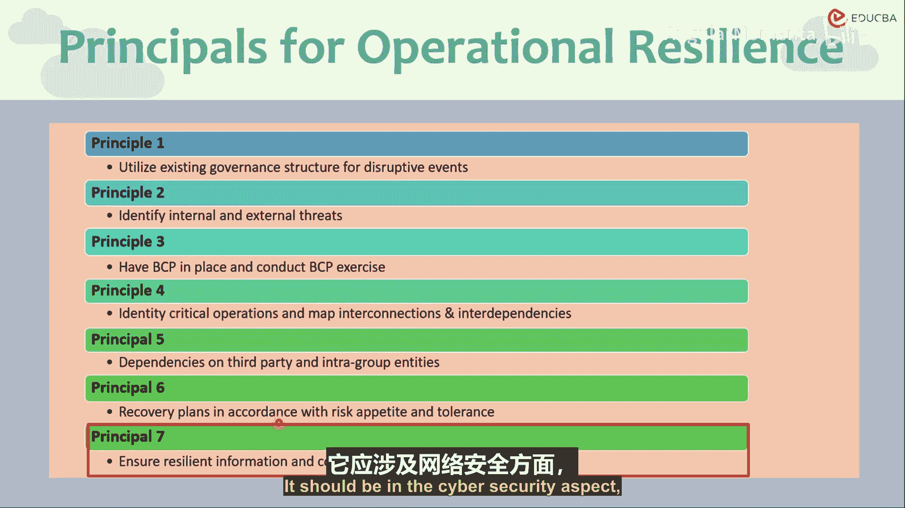

Cybersecur and ICT information technology， communication technology， the risk ownership。

 accountability， security measures， the risk matrix controls in place critical information of protection of critical information data privacy asset protection asset protection could be hardware assets or software assets。

 real assets or physical assets or digital assets identity management this should be also tested periodically for monitoring of cybersecurity controls seen in earlier chapters cybersecur and never evolving for asset right it has to be tested periodically and also improved based on the current development latest development in the world in the areas out there because this is a continuously evolving process the male agents or bad agents。

 bad actors are trying to impact trying to perpetrate into bank systems financial systems。

 financially。Intermediaary systems at all points of time， and they have to be right。

 they have to be lucky only onces， whereas there's defenders， the bankss。

 the financial intermediaries， the institutions lucky have to be correct every single time to protect themselves from the cyberresilience and cyber attack this could include multiple plans。

 backups， you'd seen some of the plans to keep a cold site the term here is hot site and cold site servers。

 hot servers are connected to systems， they will have backups but they will be connected to the internet will be connected to the grid。

 the network， whereas the cold sites will be backed up from physical measures， they will be replaced。

 but they will not be connected to the grid or the network local network or any network for that matter so that if the bad agents bad actors get access to the network。

 they hijack the networks itself。 the cold site are still able to function， but obviously。

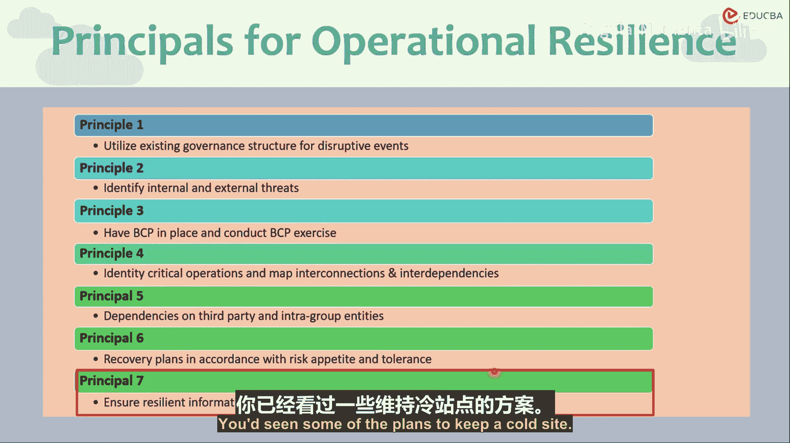

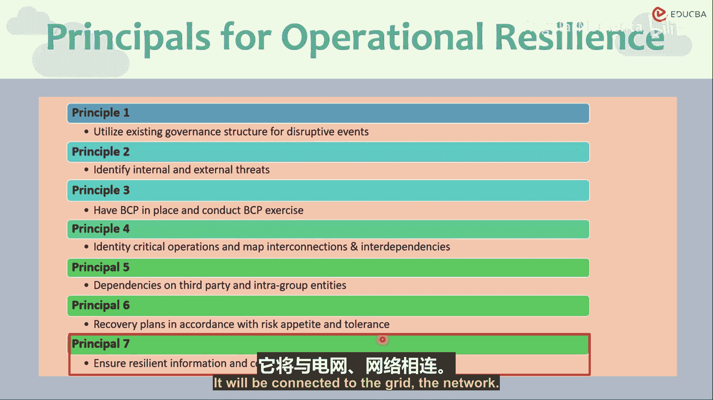

Maintaining cold sites is a bit costly in time consuming。

 recovering data from the coal site for business resiliency plan recovery plan is time consuming not to mention costly。

 so that's why we maintain hot sites now the hot sites and cold sites the tradeoff between maintaining more and more hot sites or cold sites and the cost associated with them is again a tradeoff but it should be in place now whether the bank goes ahead with one backup server or 10 of them depends on the risk appetite and business practices of the firm but overall the idea is there should be the regulators。

 what they suggest is there should be a plan in place the policy in place it should be revised it should be tested and it should be communicated with the stakeholders internal as well as external stakeholders as in when necessary So the idea is to have a plan in place what is the intensity and severity of the。

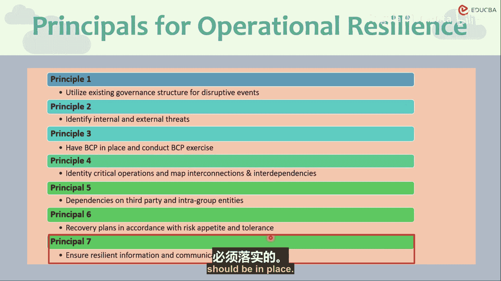

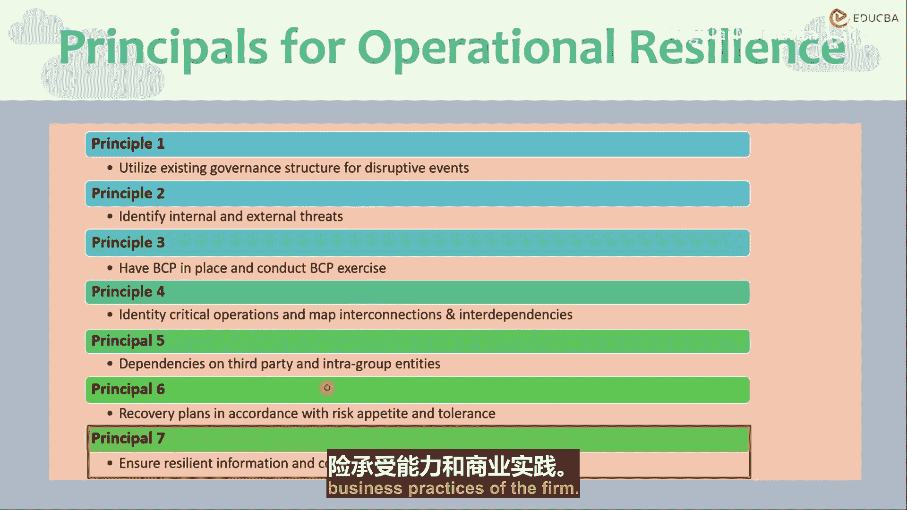

That is next question， but the first question is to have those policies in place and keep them updated so that if any event happens。

 then firms can maintain firms can keep functioning Now the important ground level reality is staff keeps joining employees keep changing their roles within and outside the organizations so if the plans are not the VB plans or resiliency plans the policies are not clearly defined and updated on a timely basis then it kind of creates a situation crisis creates a st where。

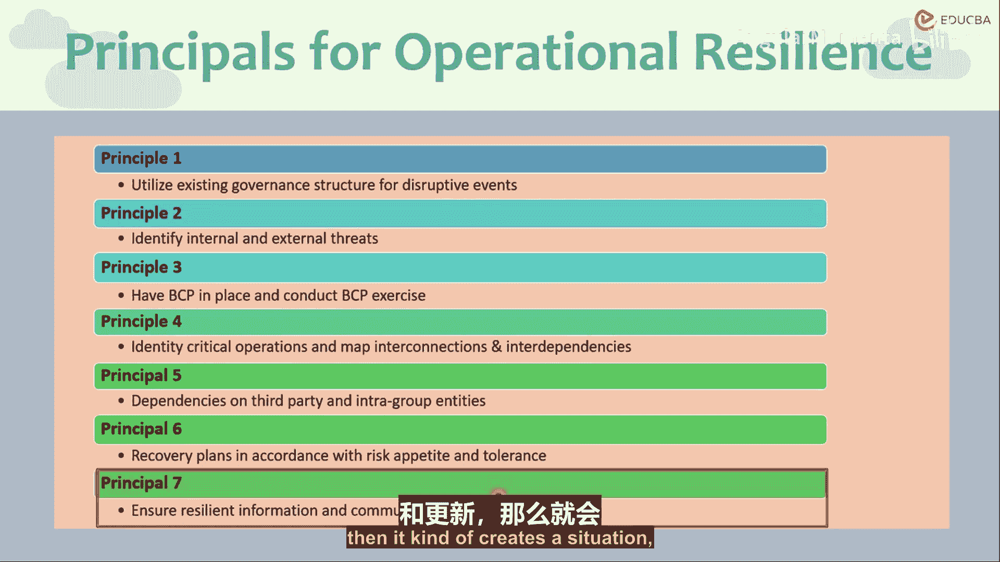

Critical important knowledge could be lost because the expert because the person who was aware of this particular area in and out had left the job so that could be avoided by having a proper documentation and policies in place that would help resilient operational risk as well as resilient information and communication technology this includes cyber resilience as well so these are the overall principles that are defined and suggested by baseal committee as you know baseal has to cater for and as to keep in mind the diverse nature of banking services across the globe right from us UK developed services developed countries to developing and underdeveloped countries in Asia and Africa so they provide more of guidelines comprehensive guidelines universal guidelines but actual adaptation of those guidelines depends。

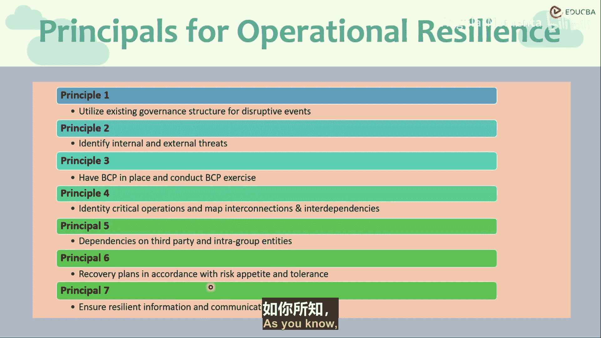

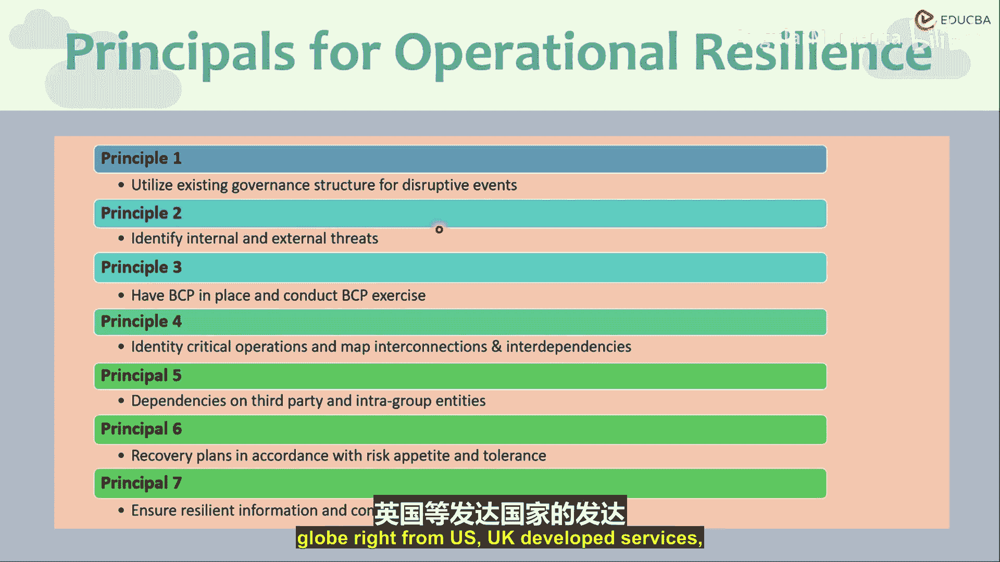

The central authority， the central bank and the regulator supervisors for that particular jurisdiction for that particular country。

 but the principles will remain the same， they could be modified and adopted to suit for the local requirement to suit for the individual requirements for each country。

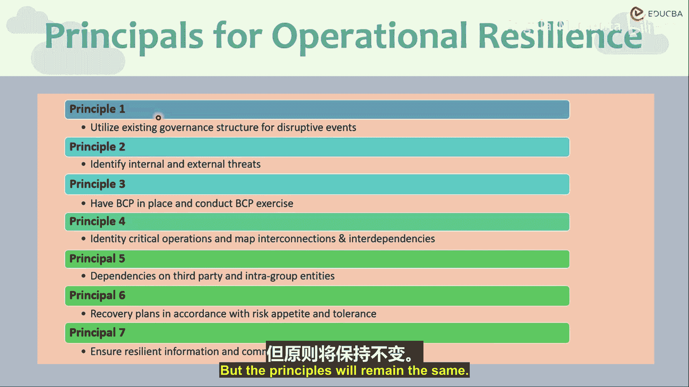

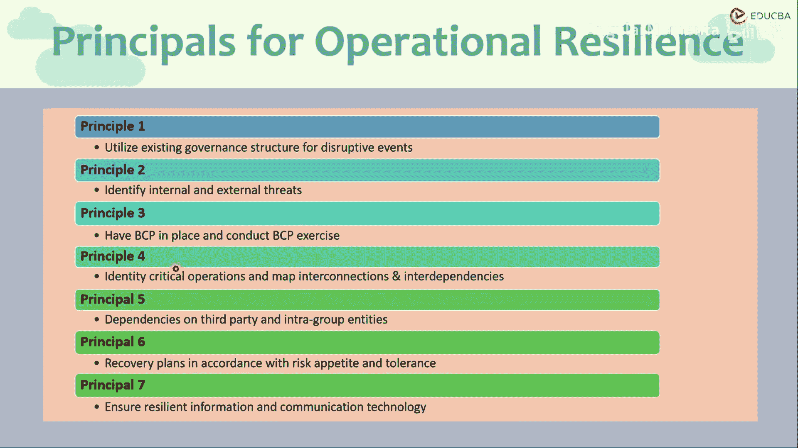