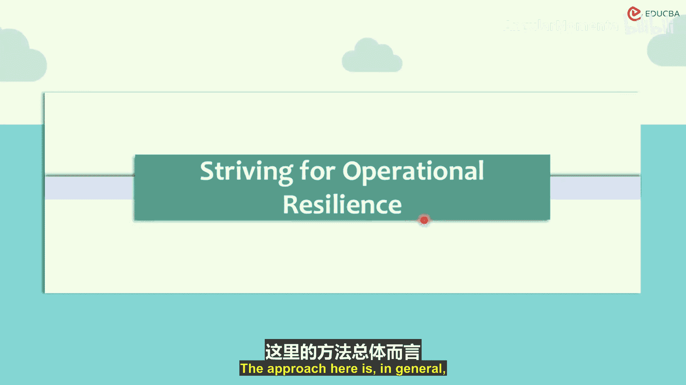
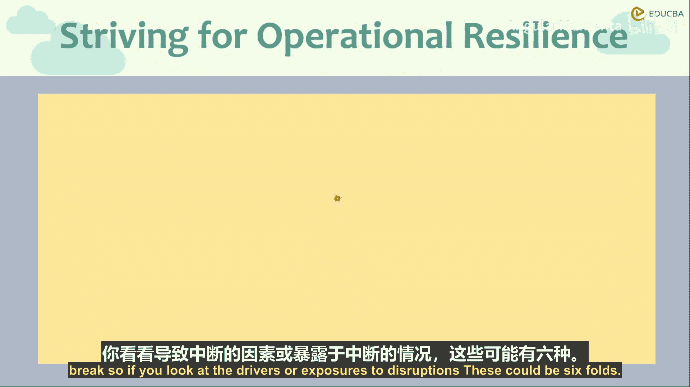
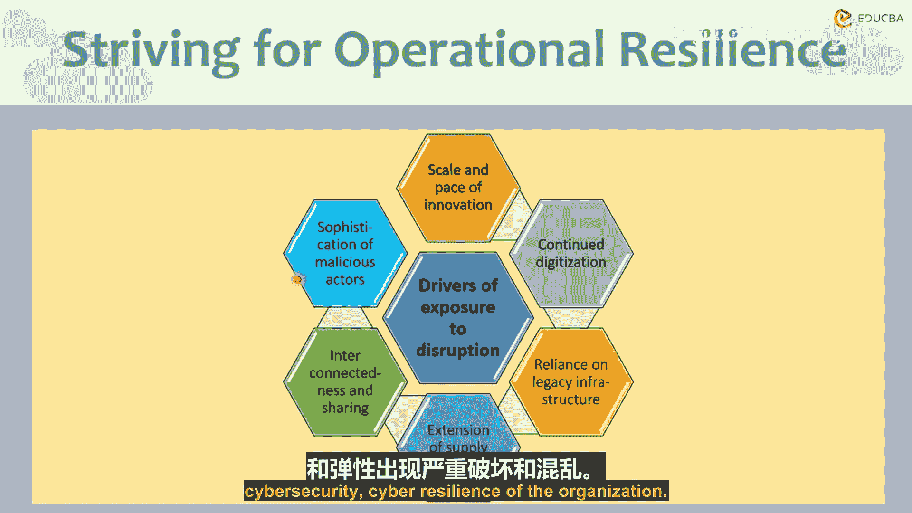

# 【EDUCBA】巴塞尔协议、压力测试与抗风险能力 ｜ Analyze Capital, Basel, Stress Testing, and Resilien p20 07_03_10_暴露驱动因素 -BV1tLcTzJEeb_p20-

Next chapter that we're gonna look at is striving for operational resilience It is primarily the questions that the board and senior management should ask themselves in understanding and creating their exercise whether they are capable or whether the organization is ready and to what extent they are ready in terms of operational resilience now to give a background though it has become a key agenda in lot of board meetings and senior management discussions it is inherently different from the traditional business continuity and disaster recovery approaches were exercises that the firms had in their place these processes these are disciplines business continuity and disaster recovery they are more focused on physical events they are designed for specific business units to be acted to be tested in silos but not at organizational。

Will not at cybersecurity events， for example， not for the financial sector together right the whole financial sector。

 the importance and the impact of important business activities on the form as well as the financial sector overall like we have seen in the last two chapters so they are more viewed as a compliance exercise rather than a risk management exercise the focus is different and most importantly they are working the business continuity and disaster recovery exercises are more working in silos only looking at physical events。

 physical loss events， physical stress events but in financial resilience。

 operational resilience we are looking at organization as a whole business or financial sector as a whole as well as events disruptions attacks arising from cybersecur from technology from third party physical events obviously facility。

op events， people or HR related events and everything The approach here is in general is to bend but not break。

 That's the operational resiliency approach So the overall ability of the organization to tackle to have operational resilience is to continue to provide business services。

 even in adverse operational events。 So how can that happen if the organization is prepared for these adverse events and as those plans to plans in place to operate in such events。

 they can have obviously if you are considering about cyber attacks if you are talking about physical disruptions。

 these can happen the organization are going to get impacted by these events by these stressful events。

 but the idea is they should be able to recover from them overcome them and still be able to deliver the operational services。

 the business services， that is the concept by bend but do not break。

So if we look at the drivers or exposures to disruptions。😮，These could be six words。

 There are six main drivers。 scale and pace of innovation。

 digitization reliance on legacy infrastructure， supply chain extension。

 interconnectedness and sharing of information and sophistication of bad actors。

 malicious actors bad place as well。 For example， if we look at scale and pace of innovations。 Now。

 the innovations areris from within the industry， as well as from outside the industry。 Now。

 obviously financial firms have been competing with each other for meeting customer demands。

 But now we are also getting a new sector， the technology sector。

 which is coming up with fintech products to get the same wallet of share of wallet and to cater to the same customer providing the same services So there is a huge competition which is driving the innovations in the sector and moreover。

 speedening up the innovation cycle。 What happens is if there is the。of all。

 that increases the complexity in the processes and infrastructure required for delivering the products and services that the same time it also increases the imbalance between time to market and security in the sense that if there is a disruption to the service that that's going to escalate and propagate in the whole market very quickly compared to the earlier times because all interconnected and there is not sufficient time to test for resiliency and not to sufficient time to incorporate new services。

 new innovations，😊，To make them part of the organization's resiliency plan。

 So that is a very big challenge， Obviously， that has to be done。 new technology， new products。

 as and when they are included in the business， they have to be incorporated in the organization's business con and operational resiliency plan。

 Second exposure。 Second driver is the digitization。 So we have Internet of things。

Technology is touching all aspects of customer life。

  customer expectations and desires are also increasing at the same time。

 so that is increasing the level of automation and adoption of new technology。

 faster adoption of new technology for delivering these services delivering the capabilities So the traditional or manual methods are not possible So earlier case。

 if Excelent work， there was still a possibility to make the financial transactions on with pen and paper on physical assets nowadays that is just not possible to process all these data manually we have to rely on systems and computers for processing these data so the important piece here is to identify the weakest link among the connected digital systems a chain is only as strong as the weakest link within the chain So the important idea here is to identify the weakest link within the system Third fact。

I reliance on legacy infrastructure now because the pace of innovation is so high。

 the infrastructure is becoming obsolete and legacy stage very quickly。

 organizations are not getting a chance to replace the legacy infrastructure that's continuously building up on this older infrastructure。

 either hardware or software， and hence if there are any bugs if there are any gaps between older infrastructure。

 legacy infrastructure and new infrastructure， then that is going to keep the system weak that's going to make the system weak and that's going to create problems in operational resilience in bouncing back。

 obviously as the infrastructure goes as a particular technology goes out of favorism， people。

 the capabilities to maintain them to decode them also become scarce and hence that could create a problem in building back better in building in having operational resiliency。

 of course， when a stressful even happen。When a disruptive event happens。

 we can definitely build back better and try to build with the latest technology。

 overcome the disruptive technology， the legacy infrastructure。

 but we don't have to the whole idea is we don't have to wait in a disruptive event forces us to overcome the legacy infrastructure we should be able to do it on ourselves as a proactive measure rather than reactive measure next principle next driver is the supply chain as as you are connecting and specializing in the businesses there is more and more dependency on thirdparty service providers on having outsourcing the business processes and business strategies so there is an increasing dependency on supply chain but as we bring in more dependencies from third parties within or outside the organization that is going to increase the risk and potential points of failure in the whole risk control。

Stucture interconnectedness and sharing is already covered in some aspect in different forms。

 but one thing that we should keep in mind is the sophistication of bad actors of mallaysious actors so the cyber attackers hackers they are also innovating very rapidly who identifying new means of attacking and exploiting the vulnerabilities in the form system in some cases they are very professional in their resourcing and funding in some cases they are also state sponsored whole sophistication to their practices and quick innovation rapid innovation is bringing in more challenges to preventing and overall approaching the cyber resiliency and cyber attacks for the organization moreover as youd said multiple times before the attackers have to be right or even lucky only once but the defenders the cyberseity agents have to be right have to be accurate。

And have to do their job every single time， because otherwise。

 even one vulnerability and one attack could lead to use shavocs and use disruptions in the overall cybersecurity。

 cyber resilience of the organization。

