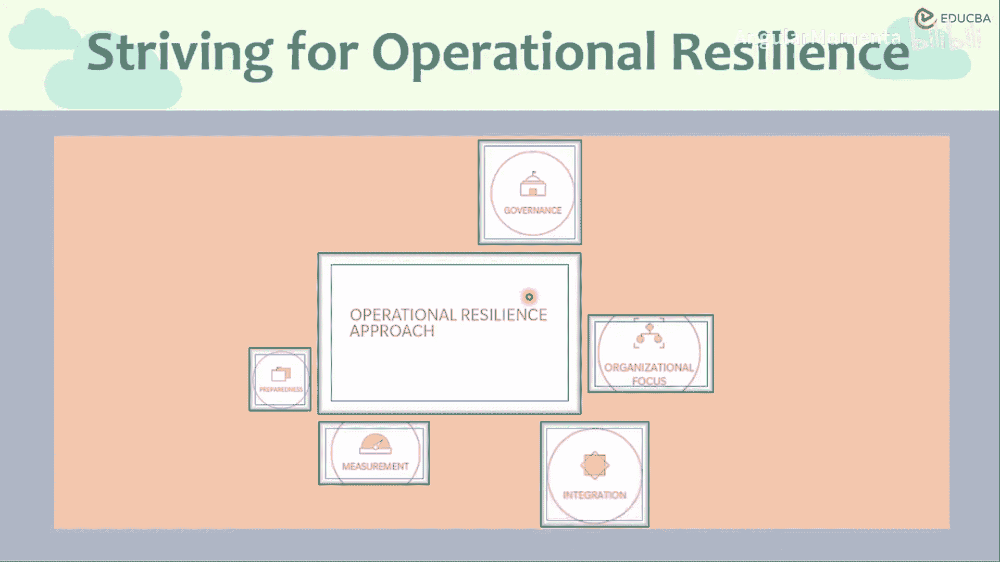
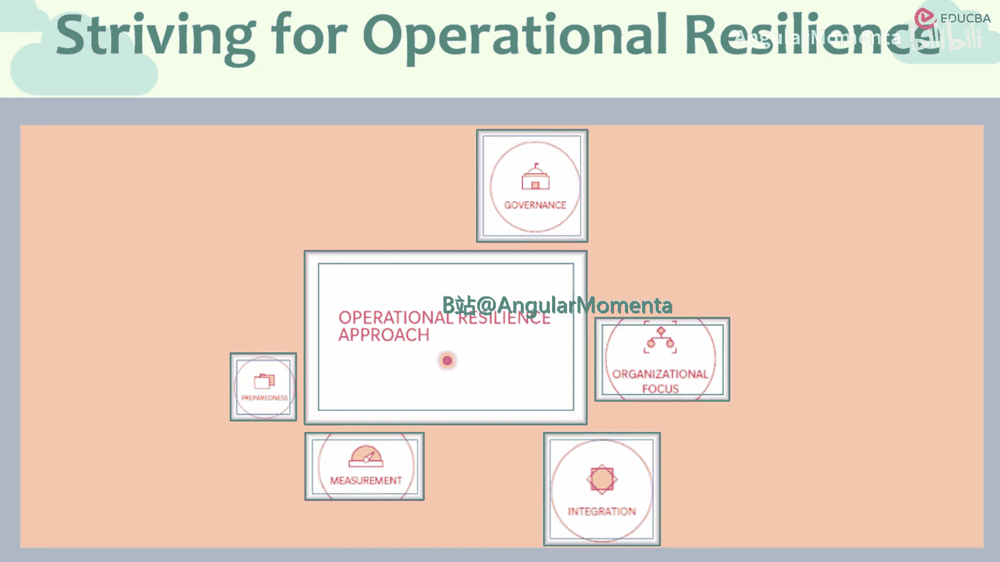
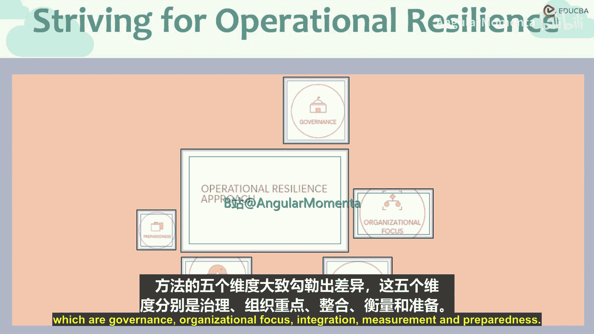
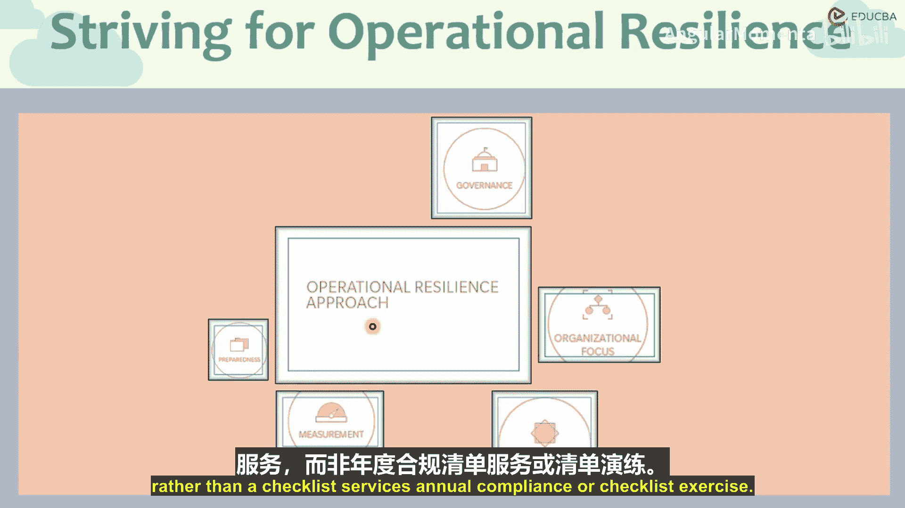
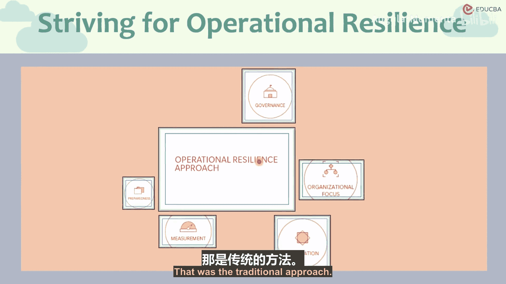

# 【EDUCBA】巴塞尔协议、压力测试与抗风险能力 ｜ Analyze Capital, Basel, Stress Testing, and Resilien p21 07_03_11_运营韧性方法 -BV1tLcTzJEeb_p21-

Now we should understand the operational resilience approach is fundamentally different from the traditional approach。

 traditional approach bringing the business continuity and disaster recovery approach in many ways right it we can broadly chalk out the differences in five dimensions of business resilience approach are governance organizational focus。

 integration， measurement and preparedness So to understand what are the differences。

 let's let's see what are the different ways how。

Traditional approach of BCcDR business continu and disaster recovery would look at these aspects versus how operational resilience approach looks at these aspects。

For example， from the governance side the operational resilience approach clearly defines the accountability of board and senior management。

 the board and senior management is expected to be fully engrossed and fully part of the operational resilience because operational resilience is part of enterprise level risk management and is not just a compliance view it is a comprehensive and actionable reporting to senior management to all the stakeholders to drive a continuous improvement。

😊，A continuous process， and it is closely monitored closely involved by the senior management。

 On the other hand， the traditional view or the BDR approach。

 the role of senior management and board of directors is very limited。

 It's more of an Fyi in case of post event response。

 It's more of a checklist checklist completion exercise in the sense that whether the firm is compliant or not。

 they just need to map this checklist。So that is a difference between traditional approach and operational approach Moreoverover。

 if you look at from organizational focus， traditional approach is very specific to business unit。😊。

Or particular technology asset at the most， it can extrapolate its reach to firm specific。

 but the organization focus of operational resilience is on the process critical business process。

 important business output from the service provided to the customers to the clients it is looking at end to end business process it not looking at Cys。

 for example， if you are looking at trade settlement as a process as overall process it touches upon different teams。

 different units within the organization for operational resilience approach。

 we would be looking at the overall contribution dependencies and involvement of each of these business unit as and where they touch the trade settlement or that particular business function。

 criticalities and vulnerabilities will be identified from all the business units。

 not in silos as it was done in the traditional approach。And at organizational level。

 the operational resilience is looking at not only organization。

 but rather the impact of disruptions to the overall financial sector to the overall economy at large right so its firm specific as well as it has a very broad view for overall development and overall resilience of this sector and not only the firm from the integration point of view。

 we must understand the overall operational resilience approach is because it is looking at overall process。

 the business output and not the business units， it is going to integrate multiple business units。

 multiple teams。😊，Multiple organizational assets， including systems， hardware， data， software。

 third parties， facilities， processes， people， knowledge and skills。

 they are all going to be part of the dependencies interdependencies and interconnectedness as approached by the operational resilience it will also test the resilience embedded in the upfront design of the business services design of product delivery and organizational asset and its part of the development its integrated in the development of the services and products。

But in BCdR， it's an outside part。 It's more of a compliance aspect。

 It's not necessarily ingrained into development of the services and asset。

 It's something that is done additionally as outside activity and moreover。

 it is the dependencies more focused on the business unit level or focused only on the specific technological asset not on all the assets。

 all the inputs and critical elements of the delivery of system。

 That's the whole approach That's the limitation of how the traditional approach looks at critical events from the measurement side。

 operational resilience approach looks at disruptive business scenarios or disruptive scenarios customized and tailored to each critical service which are very closely aligned to a business and are forward looking what could happen in future and the tolerances of。

Are also set very specific to the scenarios， and to the business。services。

 but in traditional approach there is a one scale one size fits all approach its a standard disruptive scenarios for all business unit whether it's a technological unit or whether it's a trade settlement measurement for example is flood or because the approach of traditional scenarios。

 BcDR approach is on physical disruptions or natural calamities right for example。

 if earthquake scenario we are looking at the impact of earthquake for example。

 in VcDR approach on I services on HR services on trade settlement services or asset management services and so on we are not looking at the services or the scenarios which are most critical for delivery of those businesses so that also requires standard tolerances and standard scenario measurement。

 standard scenario analysis which has its own benefits and merits。

But that doesn't give the best picture and the holistic picture of the overall business for from the operational resilience aspect。

 that also reflects on how the preparedness for those scenarios works， for example。

 because the scenarios expected under BCDR approach are infrequently occurring high incident high impact events。

😮，The capabilities are tested infrequently， mostly annually。😮。

And different incidences have different response regime so they may have different impact on the response time。

 There is no focus on crisis management per se， which is key emphasis on the operational resilience aspect right so there is a focus on crisis management。

 There is a focus on what would be the primary response just like an emergency services。

 what would the primary response， what would be the secondary response to a stressful event to a disastrous event。

There will be a response regime is a single incidence response regime for all incidence types there's a unified command center for approaching these incidences So the planning and capabilities are also monitored and tested continuously as opposed to a infrequent annual or semiann exercise so its more from a line of emergency services view right for linking it to something more relatable we can look at operational resilience approach as something that is emergency response services rather than a checklist services annual compliance or checklist exercise that was the traditional approach。

