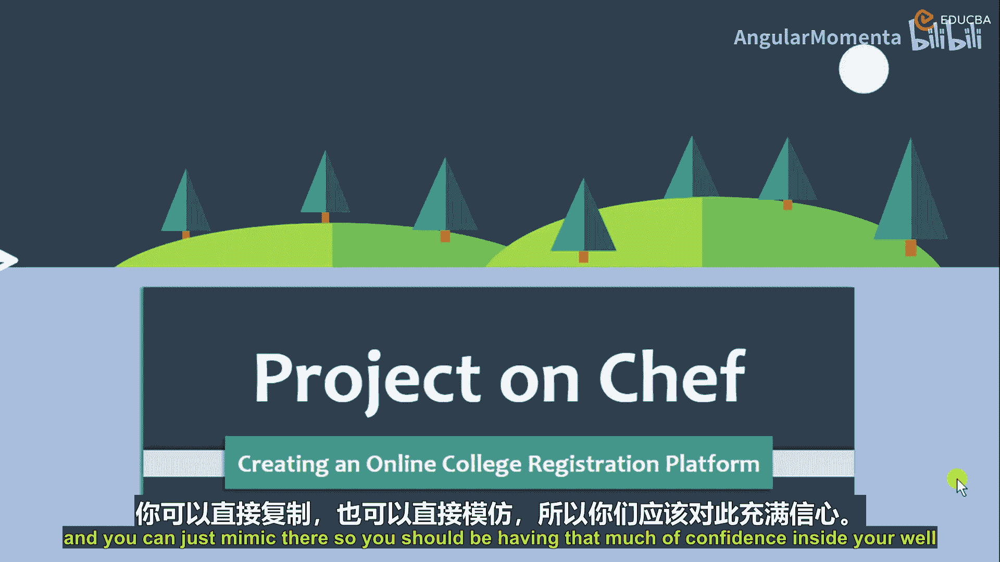
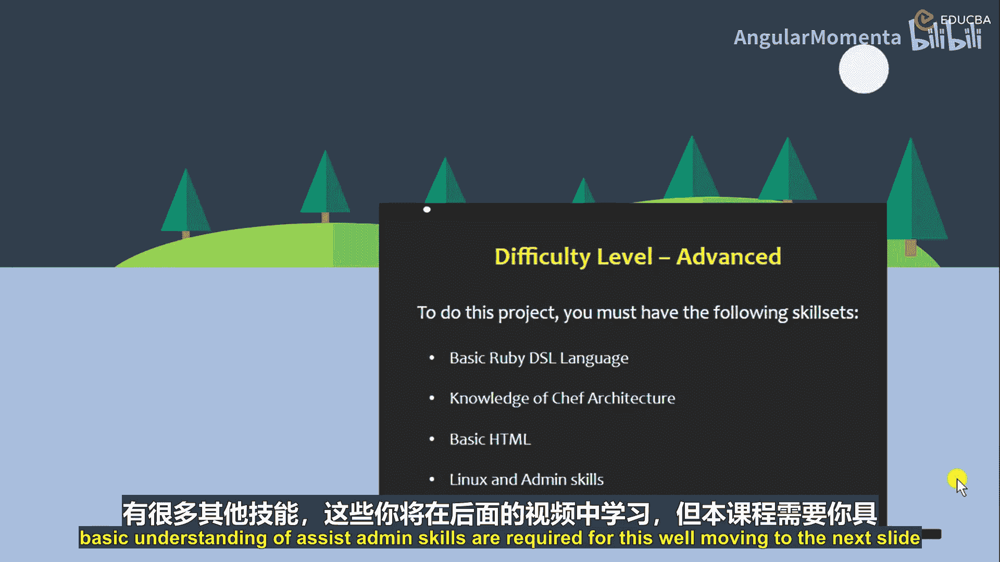
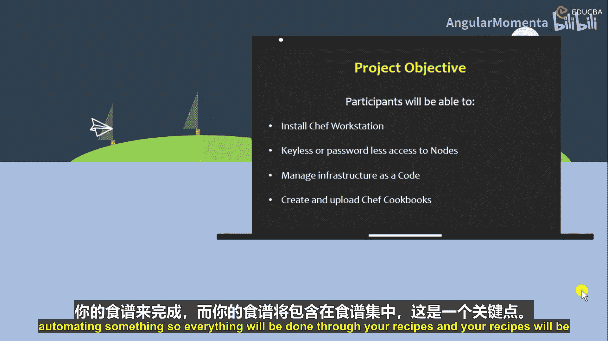
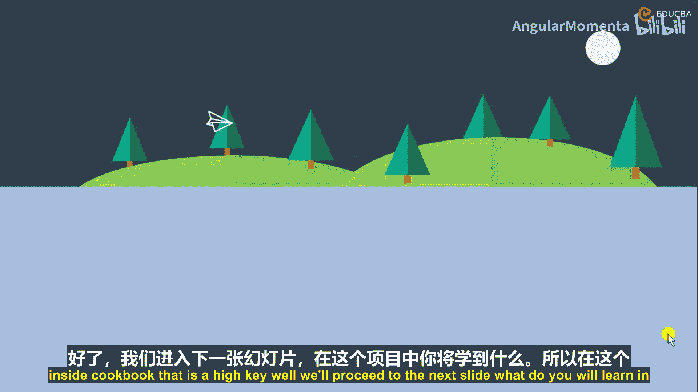
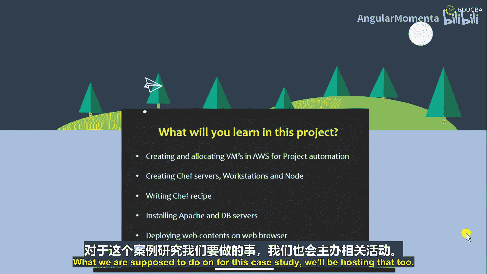
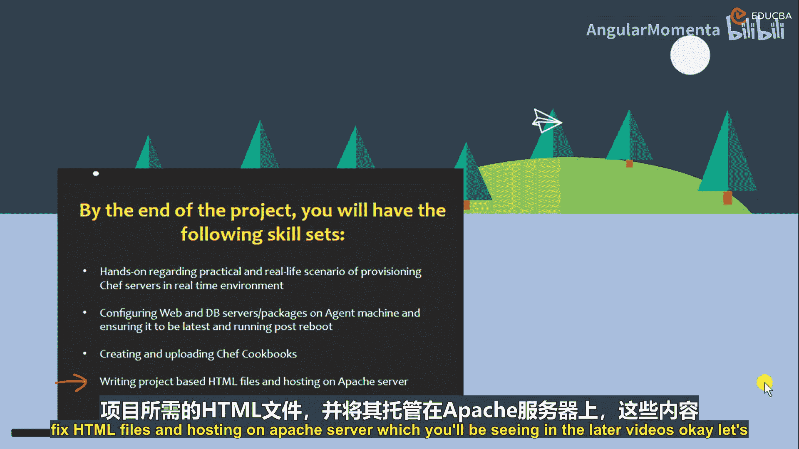
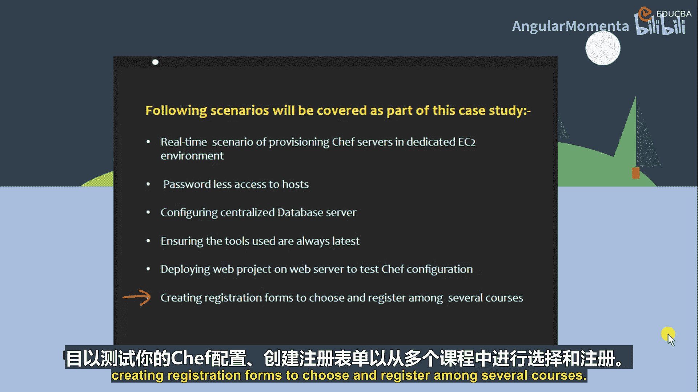

# 【EDUCBA】应用Chef实现云基础设施项目自动化 ｜ Apply Chef to Automate Cloud Infrastructure Project p01 01_01_01_项目导论 -BV134F1zaEdz_p1-

🎼Hey guys welcome to the topic that is creating an online college registration platform which is based on your Che course Well I want to thank you for deciding to take this course and I welcome you to the exciting journey over this case study so before starting let's have a brief introduction of about Che Well Che is very popular tool and it's a very important tool and it has many different flavors like you know depending on your needs it can be used as as your configurationation management tool or as a project automation tool or you can use as your orchestration or tool。

🎼But in much simpler way and in a layman language you can say it's a tool which makes your job easier Well this definition what I told you later like。

 it's a tool which makes your job easier it's a generic definition for all the Devops tool So from the time Devops came in the market。

🎼It made the jobs and all those deployments and congregation management much easier well the goal of this course is to give you the confidence to introduce CheF to your own infrastructure。

🎼You can use and mimic make all those features what I'm using here。🎼In your own infrastructure。

 in your own vation， if you're working for any MC you can just use all those things and all those infrastructure what I' am demonstrating here you can just copy and you can just limit it here so you should be having that much of confidence inside rail Well moving to the next slide that is difficulty level for this project of course this will be advanced level and let's take a moment to discuss the background for this course and what you should be familiarer with before you jump in Well a big part of learning Che is being able to discuss。

🎼Infrastructure as code in this course D。🎼Many times he'll be hearing this word infrastructure as a code。

 so we are actually creating infrastructure as a code in this great study。

🎼So don't worry about this you'll be seeing all those things in later videos well when you are able to describe infrastructure as good。

 part of which well be using Linux style command line tool so before you jump into the course make sure you are familiar with navigating changing directories or listing contents of the directory and you can be having skills like viewuing editing text files although you'll be able to use text editors of your choice。

🎼Mesasurly in this course， you may find。🎼Files needing to edit files directly on host machines。

 Therefore， if you never use a text editor before like。🎼You can say Wi or taxators like VI， nano。

 Emax， you might look into the just before you attempt to jump。

🎼It means you attempt to jumping the file remotely like well be doing a lot in this case study。

 well apart from that you should be also be aware of that you are using Inra as code and you are going to see a lot of code in this course。

🎼So let me be very clear you don't need to be a developer to get started learning Che but。

🎼Because of self reliance on Ruby programming language。🎼You will be having some understanding on。

🎼Variables， loops，arrows， and how to pass over variables， things like functions and array。

🎼This is a basic programming language， not only Ruby。

🎼If you are familiar with any of the programming language。

 you should be aware of all those things like how you're introducing loops。

 how you're introducing variables， how you're passing arguments in the script。

 So these things you should be having a bit of knowledge。 That's why we term this as advanced。

🎼Cre study， this is difficulty level is advance for this。 So in a nuts cell。

 just have a high level conception of ruby to jump in the core study。 Well moving to the next point。

 it's important。🎼To note， there is no in depth knowledge of chef to learn this case study。

 but you should be having。🎼sembly here with knowledge of chef architecture， the tree。

 the hierarchy what are near that your chef is following and apart from that what all you need is your control machine that should be preferred Linux because in this curory will be using Linux as your control machine and if you want to demonstrate and mimic the same thing what I'm demonstrating here please use Linux that is U to and open2 will be like flavors of your Linux so that you can just be using all those things what I'm depicting here you'll be needing virtual machine nodes which communicate through SSsH so SSH means secure transmissions between your nodes so once you install the nodes the nodes are communicating and they are like communicating because we have saved the public key private key and we made them enabled to talk to each other So nodes should be communicating to each other。

🎼Com to the knowledge of servers。🎼You can choose any physical server a cloud server for this case study you will be using AWS but can use Azure Google Cloud。

 Alibaba and there are a lot of cloud public cloud market so we can choose anything but I will suggest use AWS because we are using here so if you want to demonstrate the same thing then it will be easier for you okay well walk through each installation process and don't worry about nodes machine or Vms as we will talk about this in later videos What else is required is your basic HTML HTMLl is also a type of programming language and whatever changes you are doing in HTMLl they are they are hosted on the web server so it just website containing pages so I don't expect you to be a pro in HTML。

🎼But you should be having a conceptual understanding of HTMLl tags fields how you are defining a field。

 how we are inserting a tag and how we are cascaing it with CSs and other things you should be having knowledge so that when I write the code you should be able to get familiar like what things is getting happen and how we are calling all those things So a basic knowledge of HTMLl tags because HTMLl is everything this course is depending on HTML contents ultimately we will be posting all your website or web pages One is through HTMLl on web server Lastly your admin skills by some amin skills means middle wheel skills youll be having a lot of commands which。

🎼Like starting and stopping servers， checking the studio servers。

 or checking the version of your chef server what you have used。

 And there will many more skills in that you'll be learning in the later videoss。

 but a basicing understanding of。🎼As this admin skills are required for this we moving to the next slide。

🎼What is the project or objective？🎼So a participants。🎼They will be able to install Che's workstation。

🎼Keyless or passwordless access to nodes。🎼And these things will be done these things are set to be introduced in project objectives So if you describe all those things in this case study you will be installing Che workstation well be having a centralized workstation for this。

🎼That will be installing Che， and well be having。🎼Nots where we will be automating things on the nodes we'll be having a master server。

 a workstation where we edit all those files。And。🎼We need node why nodes because nodes are client machine。

 whatever short of automation we are doing on the master。

🎼The ultimate purpose of that is to be transmitted to nodes because it should be done。

 It should be there in the client machine and how the nodes will communicate。

 supposeupp in your organization， there are 50 nodes，50 client machine。

 where your changes are retro I mean there like we have whatever you' are doing on your workstation。

 it is mimicking there。 It is replicated there。 So how the nodes will be able to configured and how the nodes will be able to talk to each other。

 how the nodes will be able to communicate to your chef workstation。

 So for that will be ensuring that it is keyless or passwordless access。

 so that when your assess or sometimes if nodes want to communicate to the other nodes or the workstation。

 it doesn't require any human or intervention。 it should be passwordless because if it is not passwordless every time what you do all those things on hunt machines。

 you have to go there and type password。 It make sure it is keyless or passwordless access to the nodes。

 Third things is like managing infrastructure as code。 as I discuss you will hear a lot of。

🎼Things like infrastructure as a code， because C is nothing but infrastructure as a code。

 We are creating infrastructure on a code。 We are writing all the codes。

🎼Which is required to set up infrastructure。🎼Through a chef work that is cookbooks and the last thing is like creating and uploading Che cookbooks So in this school study case study。

🎼You'll be creating recipes and you'll be uploading recipes on a central server on nodes and that will be like it will be used as infrastructure record。

🎼So you are just。🎼You're just saying this word cookbooks。

🎼So chef is nothing but all things related to a kitchen。 Che as a person who prepares food。

 The recipes is like he's preparing recipes and cookbooks， what is actually cookbooks。

 So if someone asks you what is cookbook， we'll say a cookbook is a book where we have a recipes to make food similar in chef。

🎼A cookbook will be like having recipes so bundle of recipes are called cookbooks so in recipes we will have all those models what we try to install also may be like installing server or deleting server or creating content or deploying something or automating something so everything will be done through your recipes and your recipes will be inside cookbook that is a hierarchy well they'll proceed to the next slide。

🎼What do you will learn in this project so in this project you will be learning how to create and called allocate VM in A list for your project automation。

🎼So you' were creating。🎼Nots on AWS machine。🎼We'll be allocating VM's version machine dedicated for your node or for your centralized workstation this will be the first thing and this is like creating infrastructure and setting up After that we will be creating Che servers workstation and node before that we just created architecture we will be hosting it next I mean now we are just installing Che server the web server or Che server the version what we want to install we will install in a node we will be configuring the workstation。

🎼And we'll be setting up our nodes。🎼Later on， we'll be writing chef recipes what I explained you earlier。

🎼The recipes will contain your code， which will be used for the automation purpose。

 The next thing is like installing Apache and Db server。 This is the main thing。

🎼This is actually the soul of your Co study Be thought Apache you won't be having your web server you won't be having your website you won't be having the purpose for what we are doing Co this case study is like well be are doing a transaction which is like paperless it's like online transactions and which we like a college registration form so if there' is no web server because web servers are supposed to host web applications So what application will make HTML applications they will be hosting a web servers so we need Apache server or we use EngineX server that is your web server and we need D server。

🎼So why because D service serves the ultimate purpose。🎼Without T server。

 you just can't think of anything， suppose。🎼You're going into an online shop or you're just navigating to online shop like Amazon and try anything。

🎼From the time you log in all the details you like navigate to some products or you buy some products or you make it on your like a checkout all times and all So everything is stored in Db server for the time you log in database server So the first thing what we will be doing you will be installing database server because all the transactions should be going to database without database how you store things so college wants to store all those applicants who are actually are preferring to some subject or something so if you make the entry you have to save it somewhere right previously paper if people use to save their in files。

 big big files in physical location now we saving all those things in Db locations that is virtual the last thing is like deploying web contents on web server This is what we have discuss web server will be like Apache engine X or any server and deploying web contents like deploying your HTMLtMl contents or other contents what we are supposed to do on for this case study willll be hosting that too。

🎼The next slide is like are there any project requirements on prerequisites We have already discussed this let's get a brief on this So as I told earlier you the basic knowledge of the Ruby D cell language knowledge of chef architecture because when I will be demonstrating how the chef works and all I need you guys to have a picture of architecture the high it follows and of course D Tml tags that is required for for our case study and Linux language Linux by time Linux I'm not asking you to have self scripting knowledge。

 only the basic command language of Linux So who are the target students Well anyone who wants to learn chef as Devops tool。

🎼It can be anyone it can be you it can be from Hotel it can be from MNC Hoover wants to learn Chef as Devops tool because Devops makes you things easier So anyone who wants to learn Chef as Devops tool and who wants to integratecate the same in their architecture in their infrastructure they can actually get a lot of knowledge from this case study the next will be like participants working as Devops engineer so as chef is a part of Devops So Hoover is Devops engineer they are required to get the knowledge of cheff there are a lot of other Devops tool which actually does the same thing what Chef does like you have anible you have puppet So for Ansible worried people used to do they used to actually。

🎼They just write a playbook in Anible and they use to propagate on all the nodes and they used to have only one central server you don't need to have agents on the nodes。

 only Python is needed on all those nodes so when you're writing an nodes。

🎼Anivl nodes are actually getting pushed all those things and nodes are actually getting automated once you push all those codes there so EnCible is nothing but your push mechanism and here this thing Che is your pull mechanism your installing chef on your workstation that is main server on the train machine also so your chef machine will be continuously pooling your centralized server to get the fresh and latest copypy of the deployment you made so that your child or the node will be having the latest deployment so that's a basic difference。

🎼So the participants who are working as automation or developing engineers you'll be needing it because Che is a tool which helps in your deployment purposes you'll be just using chef as a deployment purpose so if you are developer and you want to deploy somewhere in the server you'll be doing this course if you're engineer you want automate every automationmate your code or you just don't want to go in10 servers and do the same stuff just automate codes in your chef directory and it it will be like it will be propagated to all your node so basically does your automation development work you can use an orchestration tool and the last but not the least students doing projects on automation project orchestration so if you're an a college wing students or finding engineer who want to actually have project on automation they can use Che as their automation tool because Che does exactly all those automation what is required for a DevOs tool so they can just go through this course and they will have plenty of knowledge and understanding how。

🎼I used as DevOs an automation tool or development tool and they can use for this project orchestra。

 Well， by the end of this project， you will be having following skill set like。

🎼Hands on regarding trackingctic and real life scenario provisioning self server real time environment environment。

 Of course， you'll be having like。🎼If you go through all those things。

 you can create all those chef servers in your real time environment in your real time office。

 if you're doing working in MNC obviously here working on some server little things。

 you can just mimicmake all those things in your architecture and you'd be confident enough to introduce chef。

🎼You'll be running web server and D servers on agent machines and ensuring it to be latest running post reboot so like I tell you in it's must to have configured web and D servers。

🎼On your agentging machine because agentging machine are nothing but your client machine where you w to do all those changes so if you did all those automation if you made all those web contents and。

🎼Suppose the web server worked on which you are targeting the contents and deployments。

 but the web server is not working。🎼Then the automation is gone。 you are having nothing。

 so it is required to have all those automation。🎼Things in a web server which is up and running should make sure like even if your virtual server mix goes down so once your virtual server comes up you don't need to go individually and start your web server or D server again will write a code which will make sure like whenever your D server is up your web server and like whenever your VM is up your web server and D server is up and running here you'll be creating an uploading Sha workbook。

🎼Youre riding project STl files and hosting on Apache server which you'll be seeing in the later videos Okay let's come to the main point that is the soul of this Co study that is the case study tells you a college wants to upgrade its admission trust year and aims to achieve registration process digitally well if you want to consider this situation to the real life situation now it's pandemic time corona issues like worldwide and it's a pandemic every business is down your college malls。

 everything is down。

So a typical college where students used to go and study offline， they're in huge loss。

 what they will do， they have to support their staff and they have to teach students。

🎼And they have to make business how they will do it so now they're planning to roll out forms which is like digital forms where whatever you used to do earlier like writing on everything on payment and paper lenss and for your registration like what's your name。

 what's your age， what's your gender address？🎼What course you want to do suppose it's an engineering college so what sort of things are equal for engineering college engineering college has civil engineering and mechanical engineering IT chemical。

 all those sorts of engineering they have so in order to take you those courses you need to register for that。

🎼Then only it will go and you will have all those contents presented on your videos or you will be able to do your live trainings or video conferencing everything on your OTT machines。

🎼In this case， we want to demonstrate that and we want to achieve that。🎼Additionally。

 it wants to have following features like these things。

Fully fl registration form and sign up form for its students。

🎼By the term fully pledgeged registration， it means a registration fund will have everything。

🎼Required for your registration like it will require your username， not username， maybe your name。

 your age， your email address， your course fors。🎼Opting for like if you're choosing computer science engineering you'll be opting for computer science engineering the address like the address for sending posts ands so these things are required on the registration form and once students fill that all the details they'll be able to sign up so once you are able to sign up all the details will go into your database server so once the college verifies the database server then it goes to payment page so once you are done with the payment you will be able to watch all those things and you will get all those study contents what you are required to get from the college so this is the basic aim for this case study for that we require a dedicated latest。

🎼Web server to hosted application because these forms will be hosting on the web server so if web server is not there it is not latest then it will be having difficulty right because you won't be able to mimic those things and you won't be able to make the changes。

🎼And the pile why we need this latest web server we need latest web server because in the earlier version of the web server they might be bugs they might be issues which the parent company must have fixed from the latest so if you have latest version why don't we go for the latest one so we'll be using latest web server only and in our code we will mention。

🎼Whenever theres some changes in the web server like a new version in web service there please automatically install the latest web server without taking the outage so we'll do that the next thing is like centralized Data So that restore store your all details and the third last thing is like detail you of course available for register whatever we have already discussed。

🎼And these scenarios will be covered as part of this case study what we have already discussed earlier。

 that is real time scenario for Proing Che serviceing dedicated to easy to environment。

 passwordless access to host， conring your centralized database server。

 ensuring the tools you are using your latest deploying web projects on web servers to test your Che configurationation creating registration forms to choose and register among several courses So why wait let's get started now。

