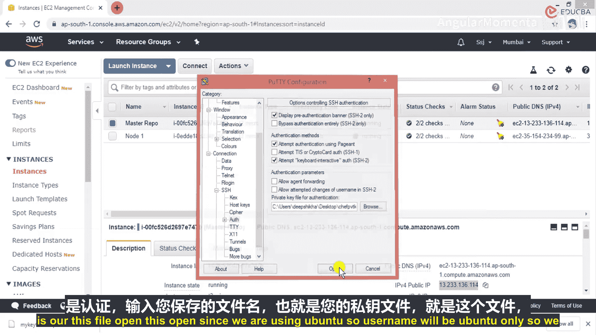
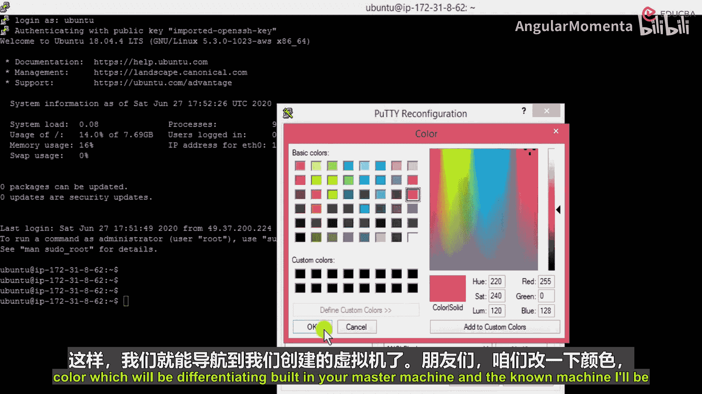
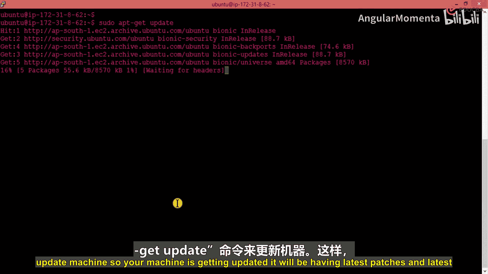

# 【EDUCBA】应用Chef实现云基础设施项目自动化 ｜ Apply Chef to Automate Cloud Infrastructure Project p02 01_01_02_AWS 节点与 Chef 连接配置 -BV134F1zaEdz_p2-

Now let's set up the environment。 So when you're ready， let's begin。 So for that。

 we need to go to your AWs console where I am exactly right now so if you。Go over to your services。

 You can see easy to instances under compute， I click services under compute。 It's easy to services。

So you have to be conscious of the what reason you are。 So I am in India。 So it's Asiaa Pacific。

 So that is your Mumbai reason， if you are from。Notor Virginia。

 Ohio or somewhere else you have to choose your reasons accordingly。

So you have to be very sure because your easy two instances are region specific。

 They are not global services。 So the servers， what you are creating here will be only for a reason。

 not for a global。If you have never used Ey two instances， it will be exactly looking like this。

You will have0 for everything。 See， This is 0。Only key pairs are two because I have used for my other case studies。

And other project purposes。So what you're going to do now。

 we'll go ahead and and hit launch instances。 It's exactly here。Its opening launch instances。So。

 we are here。We are using Ubantu as our operating system for Linux。 So let's go to this community。

 AM I。And select U2。Will be selecting the 64 bit machine open to。180，4 machine。

 So be specific with the releases on the machines。Select。Well be using free tire only。

 It will make sure we are using free tire。 easy， to instance， if we are digging this T 2 micro。

And throughout this course， we will be using opentu。 So now here we got instance formally。

 we use T 2 micro。Go to this next。Right now I am creating two instances。

 one will be for master and other will for your node。

 so just type 2 next and you can just make all those things as default。

 Don't try to change them because we don't need all those things。

 We just need a number of instances here。Add storage。We didn dont need to add any additional stories。

 So let this be as default。 go to tax。 Let it be like this。 go to security groups。

Have its like accessoriess， we should be having S and protocol should the TCP for it is already selected。

 Let's add one more rule here。Beallving all traffic here。

And this is a default port for all traffic in source I'll be changing this to anywhere。

So once you are choosing source to anywhere， it' is very prone for attack。

 like hacking and all because you are leaving your port open for anyone。But since this is your。

Just a demonstration for our case study。 So I am making this open。

But make sure in your production moment， you don't do this。 We go and review and launch。

So all those things are here。 What he ever choose。Then go to launch。 Now。

 we'll have to select a key here。 Well I already have some key ears with me。

 But for this project demonstration， I'll be having another key here。 So let's create one key here。

What I name is like。I will just write。My private。😔，mkey。😔，For chef， the subid name。

And what I will do， I will just download this key here。😔，This is getting downloaded and downloaded。

And everything is done。 Ill be launching the instance。So guys， your instance， is getting launched。

You can check here。Meanwhile， this instance is getting started。 Let's tag this instant。

 I will be writing this as master。Master repo。And your second stints will be coming up here within few seconds。

 I'll be pausing this video Once this is up， will resume the same。 So guys。

 wrote our known machines are up。 Let's stack this， as well。This video like note 1， I can make it。

So we have downloaded this key file here dot PMm file。 Now let's go and set up this。

File in your bodyy。So for that， go to your taskbar and select for putagegen。 I have putagegen here。

Click this and here you have to check for your key basically will be generating PK file。

 so we'll lower an existing private key file。 So for that。We'll go ahead load。

 and we have to go to the downloaded file。 What we have downloaded， It's here。

Notice we don't have file here because extension is taught P PK。 Let's make it to all files。

Navigate down。 So this is a file we have downloaded。 Click this open。So when slaughtered。

 it will show successfully imported。So we'll save this private key and let's save it。Say privateki。

Just put this name。 Anything like Dot P PK is already selected。 So just put us。sif。Private key。

This will be sufficient。We'll save this fighting。So， that file is saved。Now， what we'll do。

 we'll go to Patti and we'll check our machine。 So for that， copy the IP address。Good do putty。

Pasteted here。You have to go to SSH file， then authentication。

 you have to put the file in what you have saved that is pre private filing。😔。

This is how this file open this。😔。

Open since we are using U2， so username will be open to only。

So we are able to navigate to the Vm we have created， guys。Let's change the color。

Let's change some color， which will be different gupinra。Master machine and the node machine。

 I' will be using this column。

And。Actually， the font Shi is small， too。 Let's make it bigger， little bigger。Let's make it 14。

So we are good。 Now what we will do， We have just installed our one to machine。

 Let's first get this machine updated。 So let's try to update this machine。 So for that。

 you'll do Suro。get。Update machine， So you are doing。

So your machine is getting updated， it will be having latest patches and latest modules further open to machine。

 so this is a very required task what you have to do for every machine Soier machine is installed。

And updated。 so just put top here。