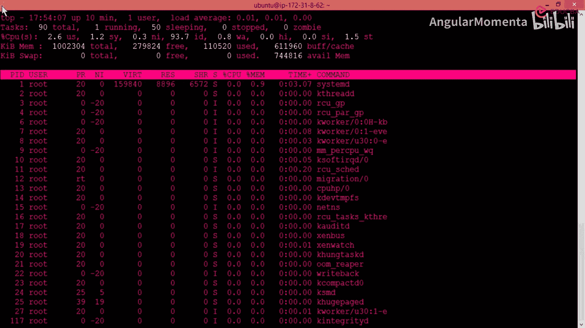
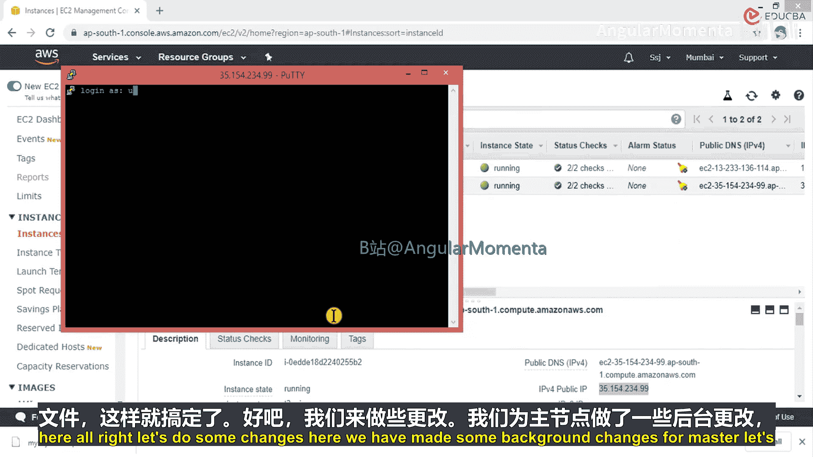
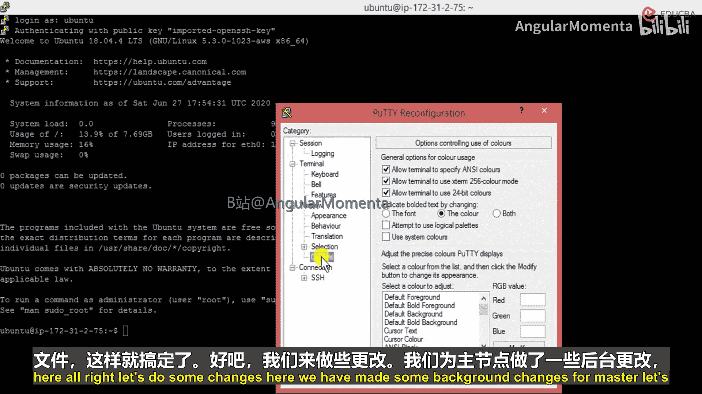
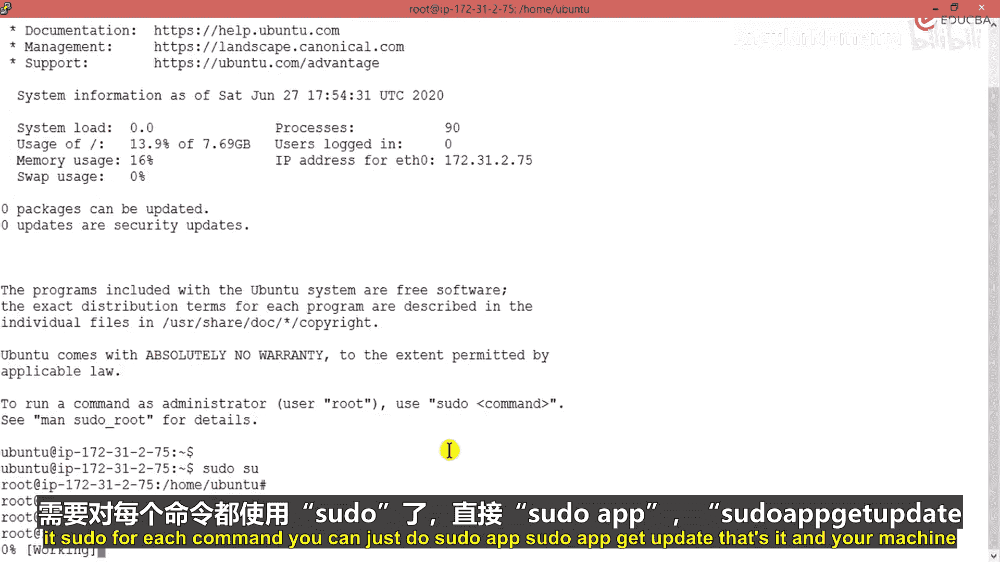
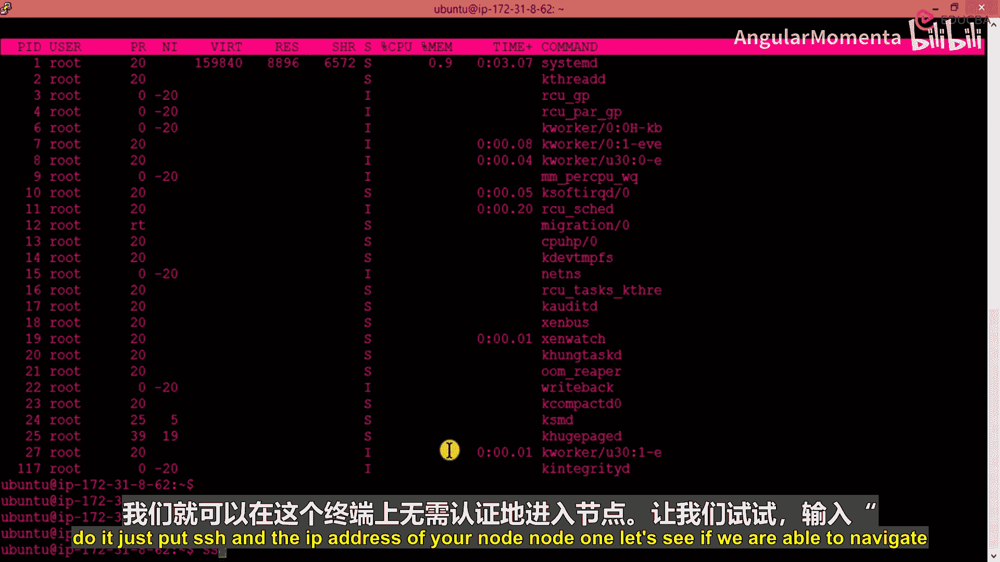
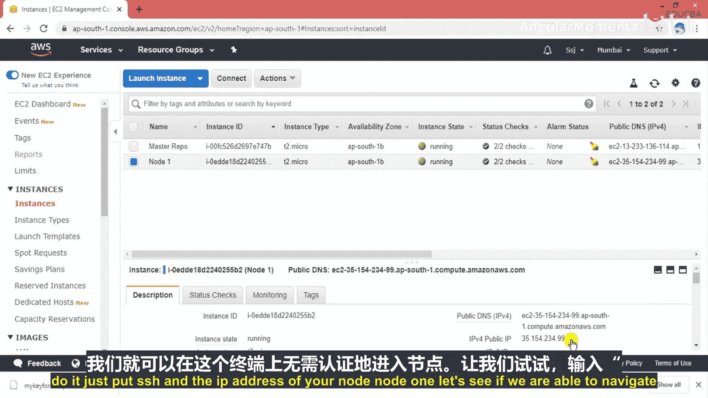
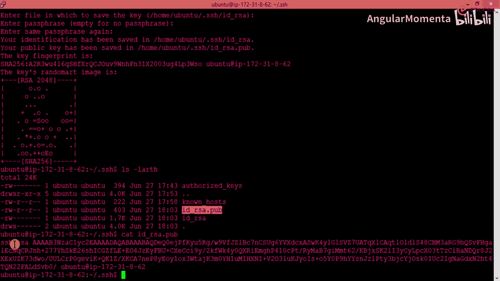

# 【EDUCBA】应用Chef实现云基础设施项目自动化 ｜ Apply Chef to Automate Cloud Infrastructure Project p03 01_02_01_AWS节点连接用于Chef继续 -BV134F1zaEdz_p3-

Now， let's create one more server， one more node what you have created here。

We'll go to node 1 and do the same for node 1。Go here。😔，Go with switch authentication。

 select your file， and we will be good here。😔。

Alright， let's do some changes here。 we have made some background changes for master。

 let's make the system color for this thing that will be easier for us to distinguish between them。

Happy ending will make it more bigger so that you guys don't have any issues while this。

Appearance system。 let's update this machine to C。We are writing Suu as because super user。

 you can just use pseudou as Su。Now your road user。

And you can you don't need to write pseudo for each command。 You can just do a pseudo app。Sloabki。

Update， that's it。 And your machine will be updated here。So in this way。

 we have configured our two machines。Which are based on your U2 and they are updated。

 Now guys we have created two machine the next step is to provision this S access to your she host。

 So it means if you go to master and type SS and the IP address we can enter the node without authentication here on this terminal。

 So let's try to do it， just put SS and the IP address of your node node1。

Let's see if we are able to navigate without any issue。

Are you sure you want to continue connecting， I said， yes。

And we are getting issue like permission denied。E this warning permanently added this thing to your list of known hosts。

Now， what happens in the step is like our SS is not configured between the nodes。

 So once our master is trying to navigate to this machine。

 it is not happening because the master key is not present in the node key So those keys are present once we install this machine so they are different So they are just like fingerprint if you have fingerprintable from one machine if you have a similar fingerprint for another machine。

 then you will be able to do it。Well， now we have to solve this issue to achieve SsH because this is the basic step。

 we have to enable the node to be able to access connection from the master machine so that it doesn't require any key of PK file or any password and this is very necessary step when you try to install Che。

Now let's see how we can fix this issue。 So just two Ls minus L at T arch。In this。

 we have dot SS file， so navigate to do SS file。To LSMS is LTR。

 and we have two things like authorized keys and known hosts。

These are the keys required forationss and known host is like this are folder in each machine。

 which will be having list of host which this machine knows。 If you go here。

 it shows this has been added。This I P has been added to the known host because the machine is knowing this machine。

 That's why it is going to enter that machine。 If we just car this known host。

You will see the IP address here for the machine， but this is not the IP address we must be telling。

Well， what happened when you click this and when you click S and this was added to the known host。

 So your I address actually got converted and it got encrypted。

So this is nothing but your encrypted IP address。Your machine was able to save。 Well。

 the other fold of what we are seeing is the author keyith。

 So it's a file wherein you will be entering all the machines。

Which you can connect to this particular system。 So well just do cat or race keys。Do you say this。

 This scheme my key for this thing。 If you delete all those things like all these。Features。

 if you delete it now。 and once we come back to the terminal again。

 you won't be able to come to the stner because this is a fingerprint for this machine。

If you delete this on only then no one can actually navigate to this machine。

 So this is very important for this machine。 So what happened when I connected to the system I use this particular file。

This file will to fix the issue will add one more key to the authorized key file。

On your known machine。Now which key we have to add， I should tell you now。

 in order for you to generate a key for your system， all you have to do is to type SS S key chain。

 so just type S hyppheng。기in。So it will generate a key for your machine。I will just enter。

It will be save in a different location。 So once you get this RSA thing， it means your key has been。

And it has been you got a key which you can use on the other machine。 if you put there。

 you will be able to navigate。Now， if you do LS minus L at TH， you will see the new folders。

Do you see this fullest I draw R A dot pub and this thing。

So what you have to do is you have to do just do CA this profile。You got this file here。

