# 【EDUCBA】应用Chef实现云基础设施项目自动化 ｜ Apply Chef to Automate Cloud Infrastructure Project p04 01_02_02_Visual Studio Code 厨师专用版 -BV134F1zaEdz_p4-

So we'll cat the content of this filey。And we place the same in the author ski。For the another note。

 so we'll this copy this。 We'll go to the note here。

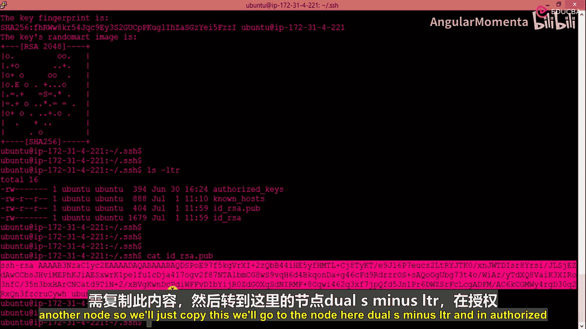

Do well is menelier。 and in author he， we just need to paste this。May I hear just place this line。

Say this file。 So we have added the key for the master node in the aging node。

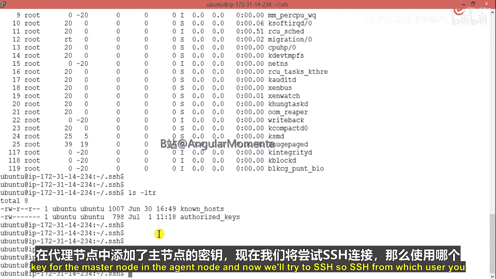

And now well try to assess。 So S from which user you will be using open to user because you using open to machine at the rate。

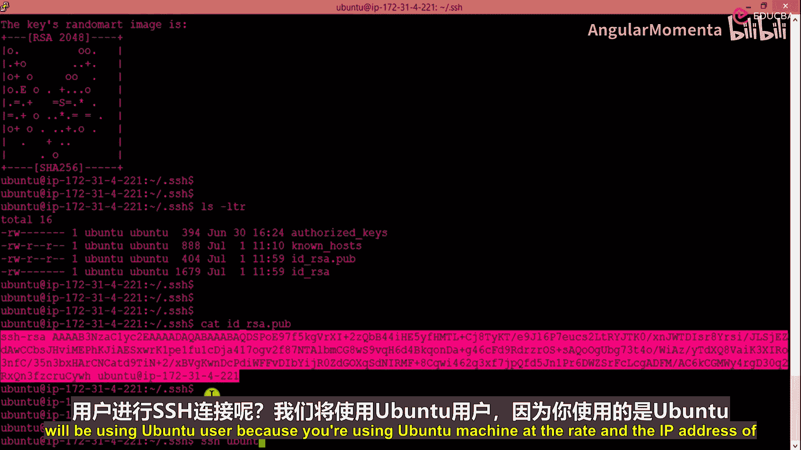

And the IP P address of this machine。

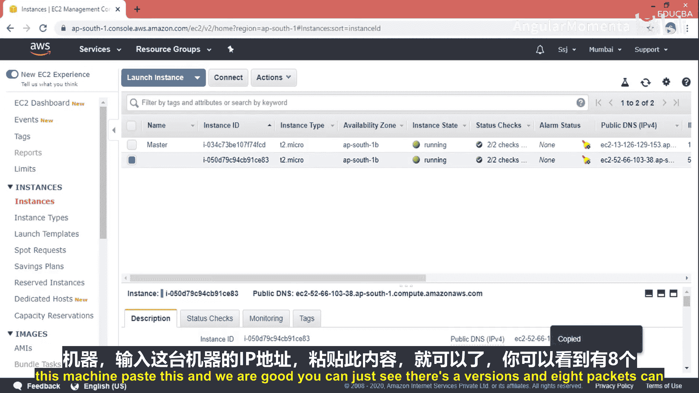

Pass。And we are good。 You can deceive these as and8 packets can be updated。

 and this is all what we have entered into the agent node。 If you just check the horse name。

It should show as the agent hosting that is 172，3，3，14，2，3。

4 if you check their hosting for this machine。

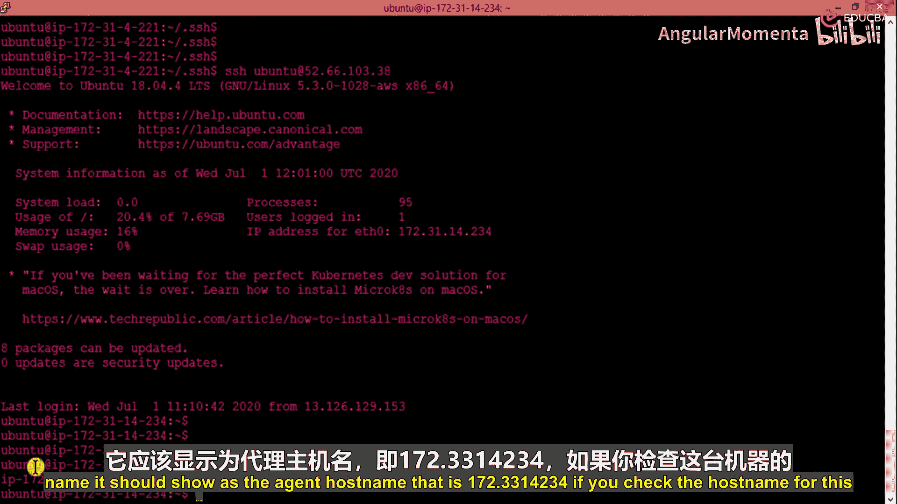

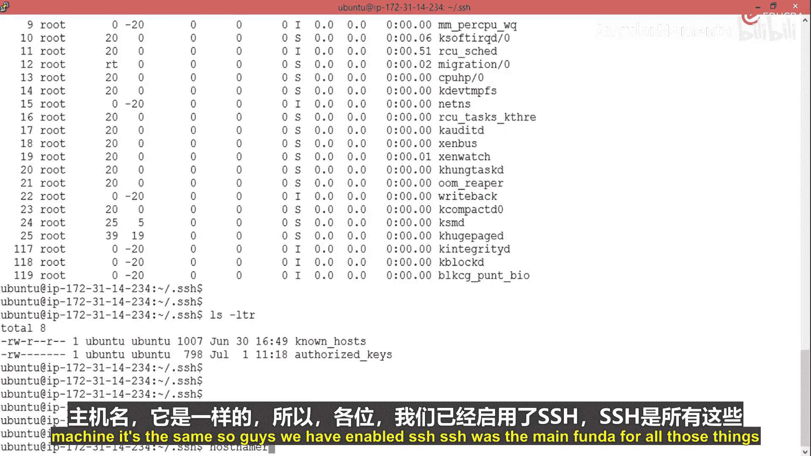

It's the same。 So guys， we have enabled Ss。 SH was the main fund for all those things。

 When we use automation tool， we have to do S because we have to manage a lot of nodes a lot of machines。

 So every time we don't need to go to another machine and type the user and password。

 a machine can communicate to other machine without asking for password。 This is what we call。

A password less or keyless architecture or infrastructure。

 So we have achieved our one of a milestone， which was to achieve a password less or key less infrastructure so that。

 I mean， it means like we are connecting your load and we are not asking for a password。

 So this is what we have achieved。 now just exit and we will come to the position load。

So this setup we have done， we are ready the setup now let's。Get ready with a cord。Well。

 for the purpose of creating code， I w to show you my preferred setup。

 I will be setting up AWs shift workstation， and for that I am using Visual Studio code。

 which is a great editor， and you can install and config。

 so Im going to interact with my AWs E to surf workstation through this visualual studio code。

Let's open this。 This is here。 If you don't have a download from Google。

 you will get the visual studio code from there。 well to set up a core infrastructure。

 I'll first open my new workspace。 So under start you will find add new workspace folder I will be going on desktoptop and I will create one folder。

 so I will create one folder like。

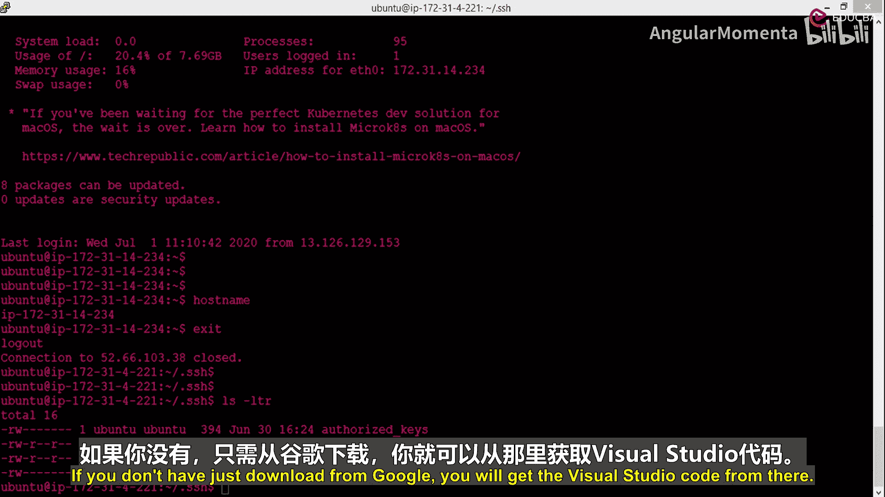

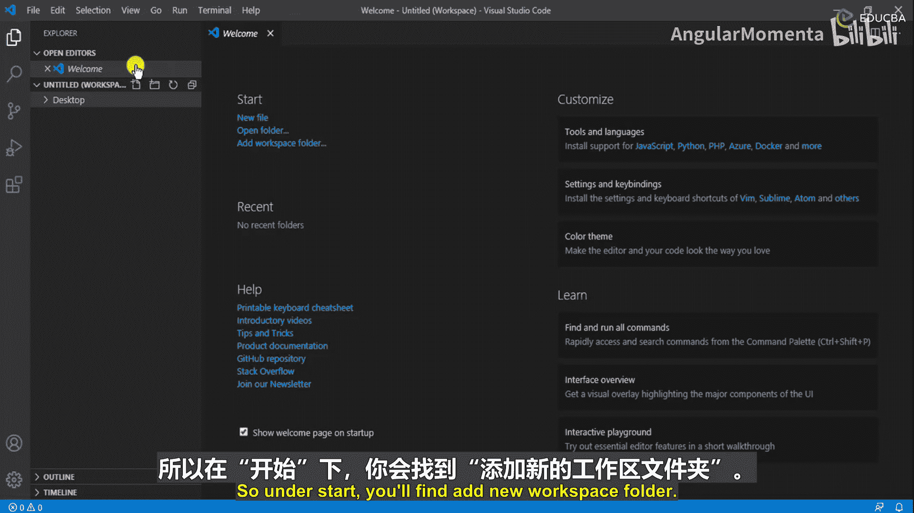

Chef workstation。So a folder is created。Call this El Otation 1。And。

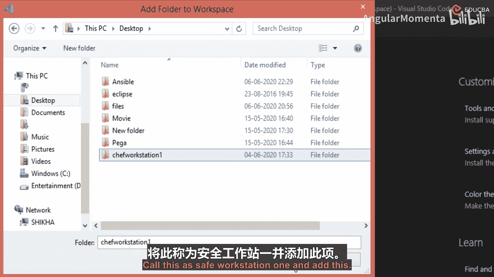

Har this。Now， workstation 1 is already configured。 Now I will begin my custom。

 So what I would like to do is to edit code and file and folders from my U2 workstation posteded on this here will set up。

 So I shall use visualual Studio code extension to accompany this。 So click on views。Yeah。

And then click on extension。Then we have to search for extension in Markque please this we would like to add to our editor。

 So whatever you want to add to your this editor， you can search on this market please。

You can see right search extension in this marketplace So this is just an what why we use visual Studios like this is a great editor and you can actually virtually bring all your stuff from your VM into this editor you can edit files you can run and you can actually replicate your open to workstation in this a visual studio code for this purpose we willll be just edit files and managing files in virtual Studio code and well be using open to workstation so that youll have a cleared a distinction so that you don't confuse。

Now we are going to search for a extension called STP， SFTP。And this SFTV is there the first option。

 just click this。Now you have to install this install。 This is getting installed。

So our SFtP is install， so this extension will be used to set up our AWS E to instance to connect within Vi Studio code。

 So once this is installed we can go to view and just put。Come on， Pe。 Let's check here。

 Let's go to view first。And。Go to command。Pellet。And search for S5B。

you will see a lot of options related to SFTP and what you are interested in SFTB config。

 so click on SFTB config。And you have to then select the workstation this one。And we are here。

 So this is SFTP J file。 So in this file， we are writing the connection details for our。

Vtual machine that is open to virtual machines。So in the name of a server， you can just put。

You can just put U2。host name will be the IP address of your machine where you are install your workstation。

 So instead of local host， just go here and copy the master address。

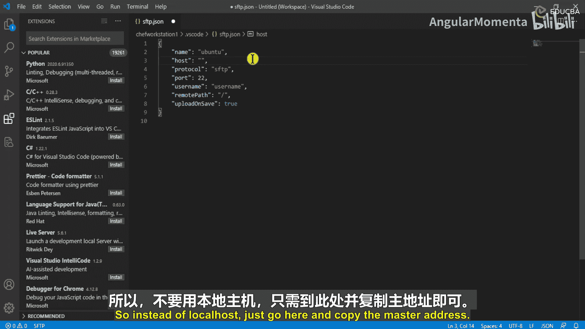

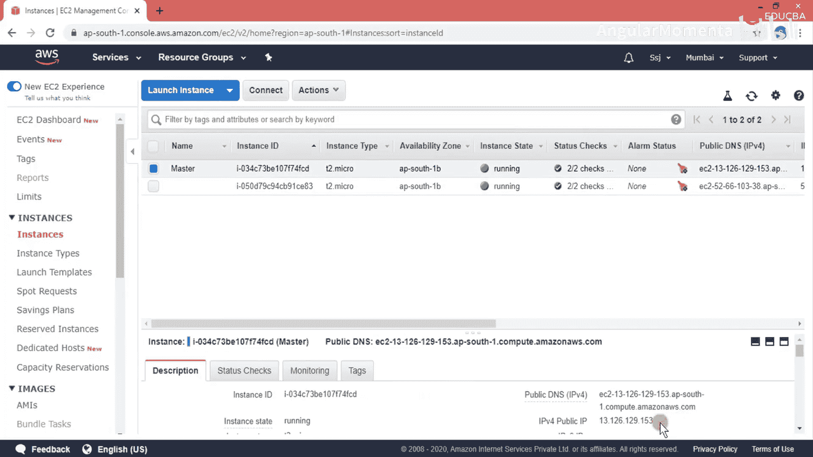

Have every copy is here。Pasted here。This is connection details file。

 so you have to just mention all those connection things。

 so protocol is the50p port is 22 and username you have to put the username what you we are connecting and open to so just the username。

And we'll put U2 in remote party have to give the location in your U2 machine so that is your location is home U2。

 so just put home and U to this is the remote location for our U to host。So once after that。

 you can just go to upload on the say， but I would like to add one more line here。

Which will be like adding private key here in the connection details， so。

Just mentioned private key path。 So you have to just take care of the notation here。

 just write private。Keep at here。 select this thing。And with within your double quotes。

 mention the location of your Pam file， my Pam file location， I'll be pasting it here。

 so it's somewhere on desktoptop。

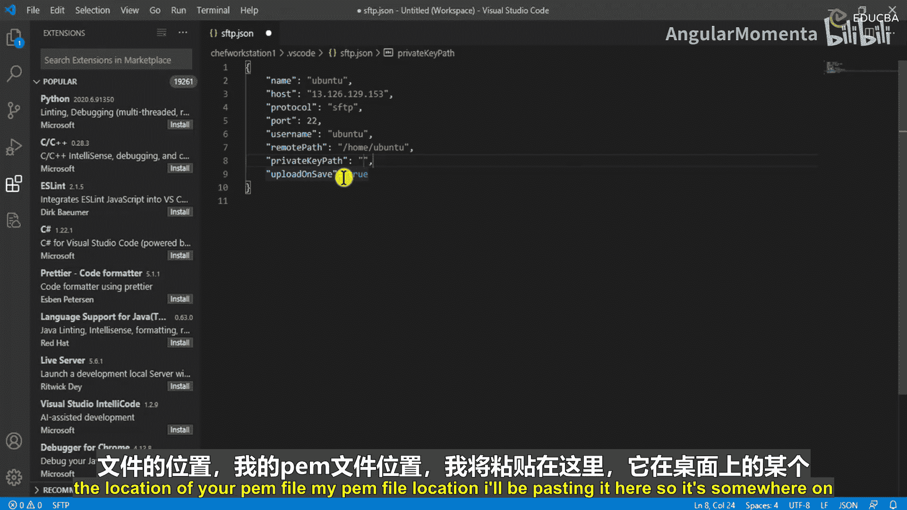

This is my penm file。And I'll be copying its location。Well。

 you have to mention dot P PEm file here and just close it in double codes。

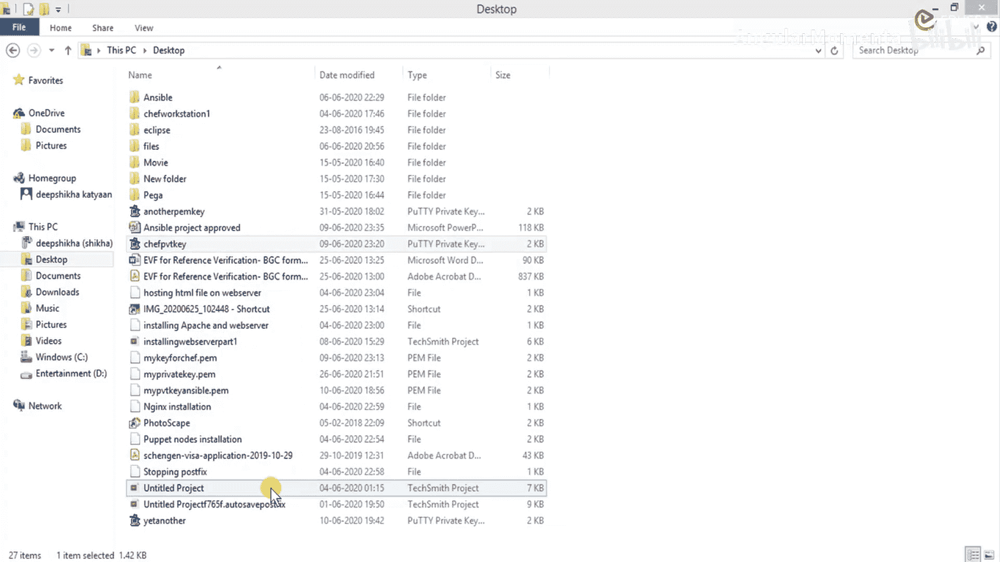

So this is the location we have given。See inside sea folder users and the username。

 desktoptop and my key for Sha dot Pam file。But this location is in Windows machine。 Actually。

 the folder structure is fine， but location is in middleow machine。 So in Windows machine， we don't。

So notify this why one slash will be writing double slash。

 So everywhere we will be putting like this。Dist thing。

Soir double slash black slash will be this one。This one。And。This one。The next line。

 what we have here is upload on save。And the property value is yes。

 This is because what's going to happen will connect to Utu instance。

 and we will download any file we would like to edit to our local machine。

 So Vigil Studio code will edit this locally。 And once you save it。

 it will be uploaded back to the server。 It means as soon as you save the file。

 it will be uploaded back to your Uto instance。 This allows me to easily edit files locally。

 and then persist those files in the remote machine。And will save this file， controller us。

So we have actually created one set of for as a freey where we have mentioned the host name。

 machine name and the connection details。 the the remote path for open2。

 and we have specified the Trat key full Ra well。 So we are good with the virtual Vi studio code method。

 So after we have saved it， we have to come to this command prompt again and type S FT P。

 When I see other options here like open necessary terminal remote saying cancel all these options are here。

 Suppose saving this file， you'll file in the left hand your workstation。 that is safe workstation 1。

😊，And inside us you will find dot cachei dot s dot v dot co。

 So these files are not local files there these files are actually there on Euro open to machine if you go here and just to。

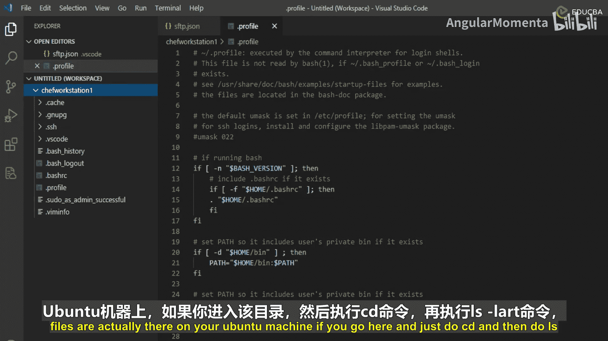

Sri， and then duelis menus Helaarage。You'll exactly find these files。 cacheier， this file， Ba tree。

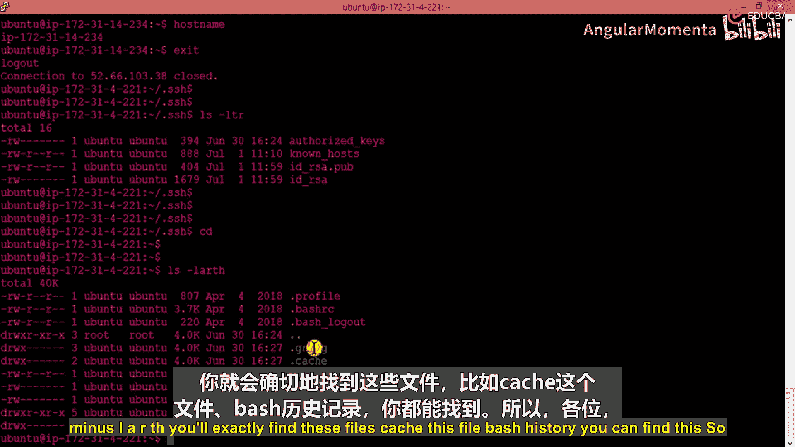

You'd find us。So guys， we have successfully created the image of your bunch to server on virtualual Studio code。

 so if you want to edit some file if you want to go to SS where we have done enabling your SS。

Just go to R a known host。 youll find this file。 You can add anything。

 You can just check this file where we have copied it So like this we can change， we can edit。

 And so whenever we edit here we edit this file as locally So once you make all the changes here and save the file it will directly go to the open to machine So it's so easy right you are working on your Windows machine you are just configure everything。

 and now your Windows machine is connecting to your open to machine。

 So whatever changes you are doing locally is going into your virtual machine。

So for all the project demonstration， mostly we will be using Viil Studio code to edit the files。

We have options to open the version machine instance on this visual studio code as well。

 but just to make some clarity and don't mix up the things， I'll be using them differently。

So we'll see now how to create resources recipes and how we can proceed further for our case study。

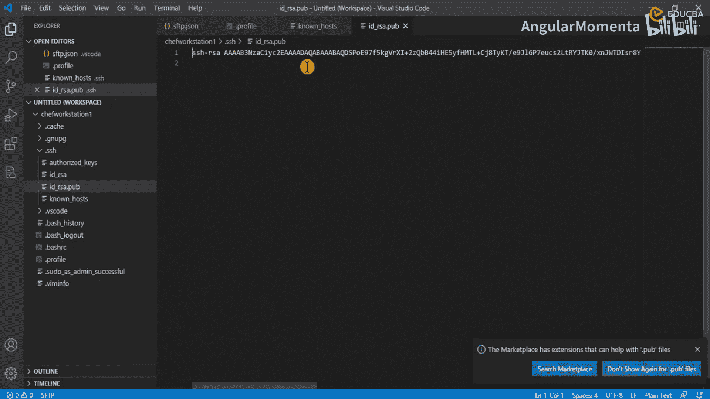