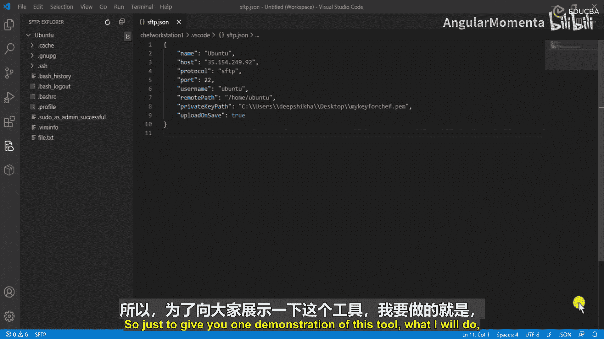
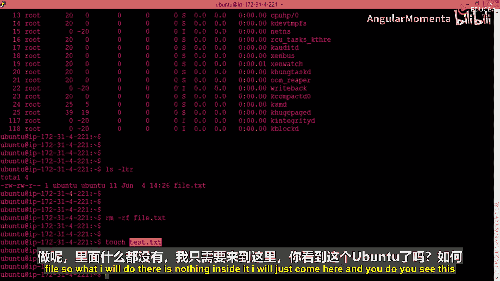
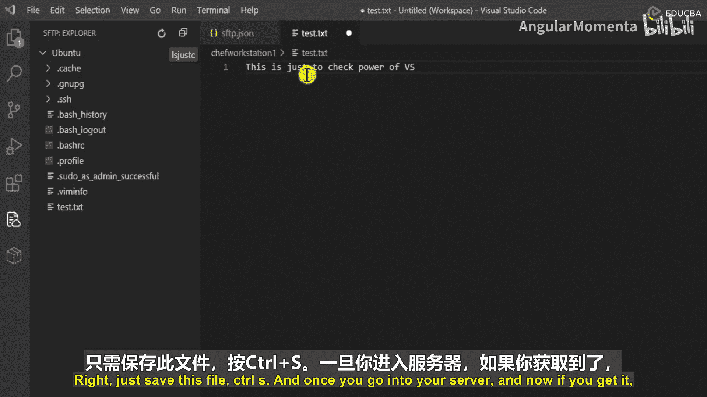
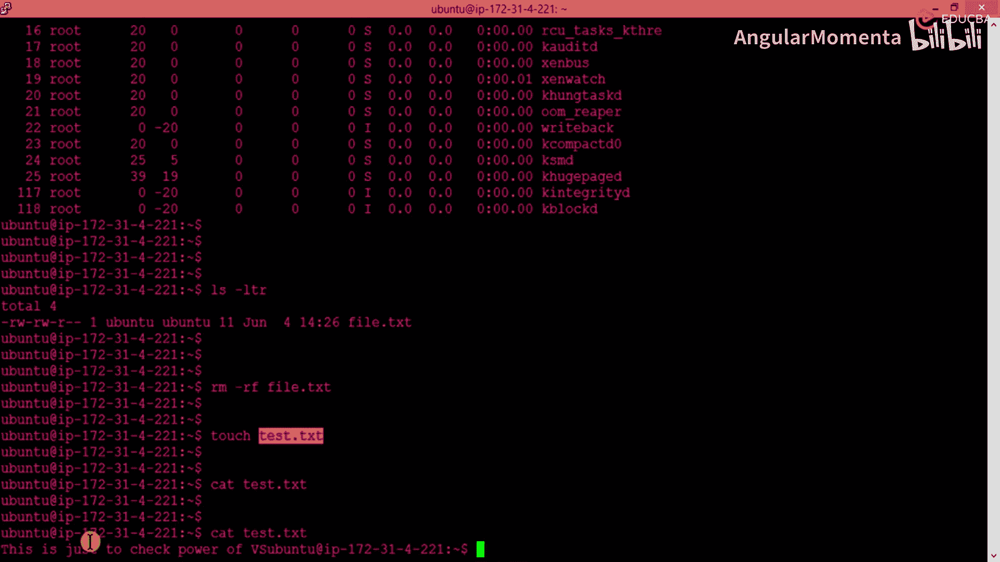
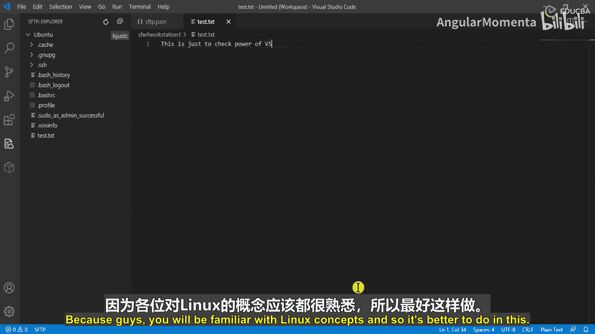
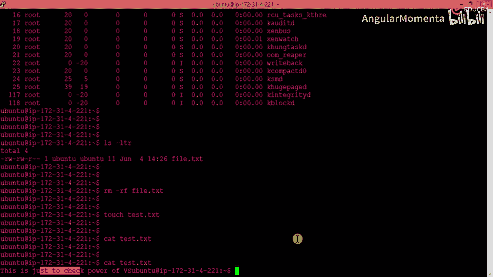
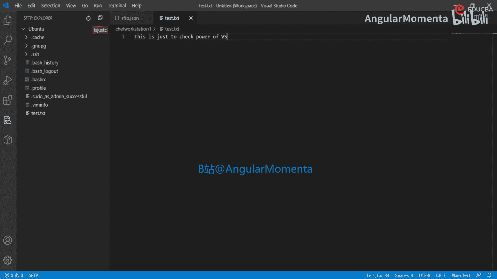
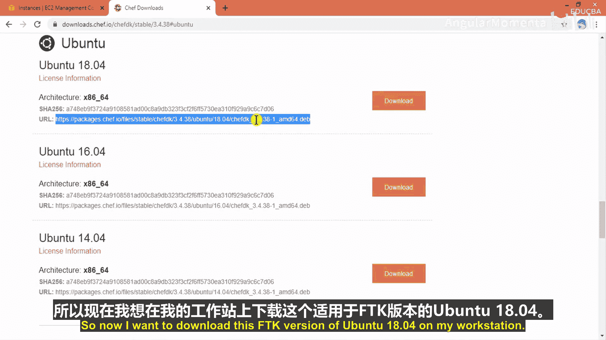
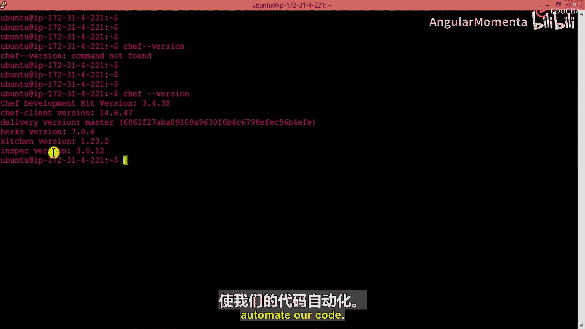

# 【EDUCBA】应用Chef实现云基础设施项目自动化 ｜ Apply Chef to Automate Cloud Infrastructure Project p05 01_03_01_在厨师工作站上设置Chef开发工具包 -BV134F1zaEdz_p5-

Well， guys， that's very powerful， too so。Just to give you one demonstration of this tool。

 what I will do， I will go to open to machine and I will create file here。

How this remove this。And we can just create a new file empty file and let's make a Du dot TxT file。

So I have created this on my open2 machine。That is on my virtual machine， and。

The content of this file is empty。 There is nothing actually inside it。

 I had just created an empty file。So what I will do there is nothing inside， I will just come here。

And you do you see this U too。So how got a open to once you click on view and once you open as open view。

Tll me Then you will get this。And the you to type SFTP。

So that we have already seen its Sun workstation via score and this J file is there。

 we have mentioned all those keys。So let's so we have created in this open2 machine that file name is。

Tt not the ext。So let's refresh this button and see if it appears here。Here it's appears here。

 Can you see this。Not what I will do， I will just edit this file locally。

If you try to double click it， it will throw an error that you cannot copy。

 could not edit in read on the editor， so what you have to do is just right click and edit in local。

And you can just mention anything， whatever you want， this is。Just a check。Power off。reious。

Readread and just see this file control is。

And once you go into your server。And now if you get it， you will find something different here。

Can answer this？

So this tool is very popular and it very powerful so and through this tool actually we can replicate this VM in this terminal。

So side by side we can write code and we can check the output and all。

 but just for the making the things more easier and simpler。

 what I will do I won't use the tool much only for rating purpose I will be using it because guys will usually be familiar with Linux concepts and so its better to do in this。

Like creation everything will be done， but sometimes if I want to edit some file on virtual studio will will be doing this here Now lets go to the next step。

And the last step， what will be used to prepare our chef environment。Is to download your Itk。

That is Che development kit。 So what we will do we just download the chef development kit on our。

Worktation and then we will proceed Well your Che development kit contains number of tools used for building。

 testing and deploying our Che code so we can find this Se development at download。che。

 iio and here you can open the link to Che development kit let's open it。

So it says to D。Downloads。Dot chef。找他有。Okay， well， this is the main page for Che Now。

 if you add another line， another word that is C。Dy。You'll get the version。We are here。

 So well from the releases I am choosing this 3。4。38 as as Che decay version。

 So you want to replicate the same。Functionality what I am using in this course。

 you can choose this version that is 3。4 do 3 hK， but their are latest version also you can try them out because of some system constraints and my system specifications I am just choosing their lower version that is compatible with my system。

Al' so。Go to the section， so for our tester moment I want to make sure to check U2 here there are list of operating system for Che De since we are using U2 so we will be using U2 version of Che De just click this。

So now shall be taking to the download links of Ubu2。Well， I am using 18。

4 U2 shall make sure to copy this URL。 I just copied。

 So now I want to download the5k version of U to 18。t04 on my workstations。 So I have copied it。

 I will just go here。

Clear it。And just to download the version， download the package， just write W get for Roman2 machine。

And paste the contents here。It will make sure that your package is getting downloaded。

Your package has been installed。I mean， that your package has been downloaded to your local machine。

 Now it's time for us to install the package before that， let's check。

Whether it has been installed successfully or not。Yes， we had the file here。Now， to install。

He just need to put。D，P， K， G， hyphen I。And this， de file。It will ensure。Ura。😔，In short。

 to install your shifty conversion。So， let's do it。

So it is telling a requested operation requires super user privilege。

 so either you have to be pseudo user or route user。

 so I am escalating my permission to pseudo I am a pseudo user and then even can just。Put the air。

Yeah。So our chef decay 3。4 door。38 is getting installed in our workstation。

It is downloading all those libraries and bind files which we require for our practice for test and moment if we see the installation process it is reading database and unpackaging your Sa DK what we have installed in our local then setting up this then this nurse thank you for installing Sa development kit so guys we have successfully with install the Sa DK Now to check the version of your Se DK you just need to put shift。

Hhen， hyphen version。😔，If you put this。If you put this， you will get to the version of7k。

 so this is a wrong syntax， I will just correct this。Just watch chef。Space and version。

 it will show you all the components of your f DK with their versions if you click this。

Your Che De version as 3。4 apart from this your are giving this delivery version master。

 your box version， kitchen version， inspect versions。

 so these all versions have been installed as part of your Che De 3。4。Dot 38。

 Now it's time for us to do automation and write code and let C decay automate our code。

