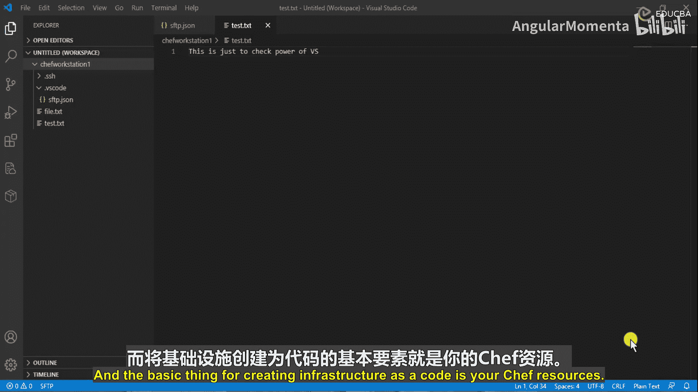
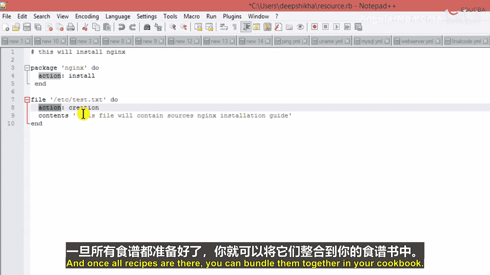

# 【EDUCBA】应用Chef实现云基础设施项目自动化 ｜ Apply Chef to Automate Cloud Infrastructure Project p06 01_03_02_资源与Ruby编程原则 -BV134F1zaEdz_p6-

Well now we are in process of creating our infrastructure and the basic thing for creating infrastructure as a code is your Che resources。

 So first we have to know what are Che resources， So if you define safe resources。

You can say it's a basic building block of Che， which defines the necessary steps to bring the con item into desired state。

So when we define resources， so resources are nothing but a piece of code。

 that piece of code which is required in the coding part to bring your like automation into place so we have used one term desired state right so you will be saying what is desired state。

So you can see it's a term which is thrown around。For shift。

 and it defines how you want to define a particular component to configure。

 suppose if you are taking component called resources called web server， So however。

 bring the web server into desired state。So。In order to get this server into desired state we be having resources in that we define resource and we define web server。

 so what are actions that resource will be doing it so in order to get the web server into desired state will be installing that。

And we' will make sure that is up and running。 This is one thing What else we can do is like we can create one file inside we dot in Hml format。

 and we can host this。 Now， you must have heard the term like infrastructure as code。

 even I told we are doing we are creating infrastructure as code。 So， I mean。

 chef is often called infrastructure as code。 And it is done so because we declare how a system component to be configured in the abstraction of a rubby programming language。

 So chef is nothing but。We are doing Rubi programming language inside cyberSa code。

So it is just abstraction of your ruby programming language。

 So this abstraction is called domain specific language or DSL。

 we have talked in the PPT right where we having a knowledge of ruby DSL that is domain specific language。

 so thats abstract。Is called domain specific language。 So chef is domain's specific language。

 which lives on top of Ruy。So let's take one example and see how we can define resources like this is how we will be writing exactly the same code so lets we will be just creating one show resource code so。

let's make this as this will install。Engines。And I writing one code。

 let's save this file into Ruby extraction。 So save as。Let see this。We can just make this as。

Re sauces。t so this compiler will know it's a ruby file。So it's a ruby fight。

 Now we'll define package here， a package， and this is a resource， and the package name is ingenx。

 Now we have to put comms here， here and here。And now we have to open one do block。

And mention what are we going to do with this package。

 so just take care of agitation actually it's not required， but for a better programming。

 language ability and how to write a good and readable programming。

 we have to take care of this just mention action here。

Although defining why we are mentioning action and other things。And installed。

And here we are closing this resource。 So here I have created one simple example。

 which will be illustrating the example of She as architecture as code。

 So safe resources are written in abstraction of rubby。 So here first， you will be defining hash。

 So this will。Install。Eines。So this hash declares a comment inside our ruby file。

 so we should always we should always comment in the code to describe what's going on。

 The reason behind is that when the next version letter on which maintains your code understand what you are trying to do because every time you won within the system So we have to go out and some other person will be taking care of them So whatever ruby programming you have written here So if you mention the comment what you are doing then the next version will be clear what is your intention and what you are trying to do and it can move that further Now resource pictured here is package resource and it's followed by a name So what what you define is what package we are defining So this resource type is what package So we are defining a package resource So first we are mentioning package and the name of the package what you want to install So this is enginex after the name of the package will open ruby block to So this is a ruby block to which will close。

By the end so this block is completely closed by end here and within this ruby block。

 this do and end， we could declare how Che should configure this particular package you understand this so this is package and this is its type of the package and this is the name of the package and these are actionss now in this quoting block through this resources we are just one should be sure like we want to ensure chef to install package。

And the package is installed So this is getting into the desired state well this is one of the resource type which is package Now if you define one more package here and lets call the package as will define a file package So package not package a resource type will be file。

So if I define like， it should be under。ATC folder and it should be a a file called X lets status test dot。

Txt。And now， after declaring what type of resource we are using and the name the resource。

 we are opening a do block do。So next thing， what we are going to do is we have to mention the action or actions we are going to take on this resource type。

So I'll put mention action as creation。Creation of this text file， because this file is not existing。

 So I want the Ruby block to create a file after that。Once this file is created。

 this is an empty file。 What else we can do automation for this file resource so we can just mention as contents。

And inside your content， it should be like。So we will just mention content。

 so content won't be having any action loop or this this hyphen symbol we be just defining this。So。

This file will contain。嗯。So， thus far。Ingenics。Int guide。

So we mention it here now you can mention like another inside file resource what else you can do you can just mention the permission for the file that Wu can access this file and all so these all things you can bring changes in the file resource so this is done actually let me close this and I am closing the same block here。

And if I if we summarize what we did here， so this is just a file resource and after decing the type of resource which is file we asked for the name of the resource。

 So we just mentioned the absolute path So in this case it's a part of the resource and thats to be configured so we usually we put absolute path here after that we a do block here。

Yeah。Which contains an action called C。So this is very important。

 If we are not mentioned these actions， it won be created。 Well notice we have。

The actions has column in front of them。 You see this column。They share this column。

We call this as Ruy symbol， so each action will have color in front of their name and actions are specific to resource ss。

We can only take action of create。File resource， not on package resource。 we add additional content。

 not only the file to be created， it should also have some content inside this。So when Che runs。

 it makes sure file exists at the location we have mentioned here。And have the specific contents。

 So when you are running the chef on the nodes like hundred nodes you have or you don't have any nodes only the master node you have。

 So when you are running this code on your rubby block on your node。 So what a chef will do。

 it will first check whether this file is there or not if the file is not there。

From the action module， it will just create the file， so once the file is created。

It will append the contents of the file if it is not there。

If it is there it will just app it so this way we understood how we can mention the resource type in coding so in our codings well be just mentioning all the resource types like these times we give an example of your package and file similar there are a lot of other resources which will be with when we are doing a real hands on how we are mentioning our code for our infrastructure so we'll get to see all those examples in the letter and what these are the resource type and once we bundle all those resource type in a file we call them as recipes so we have to be very clear a recipe contains a lot of resource files so when you bundle up all the resources in on a code file then we call them as recipes and if we have a lot of recipes inside then that folder inside there is a lot of recipes we call them as cookbook so cookbook contains recipes recipes contain your resource。

So resource as a building block of your coding so if you know all those resources then you can just grab like things like how you want configure your recipes and once all recipes are there you can bundle them together in your cookbook。

