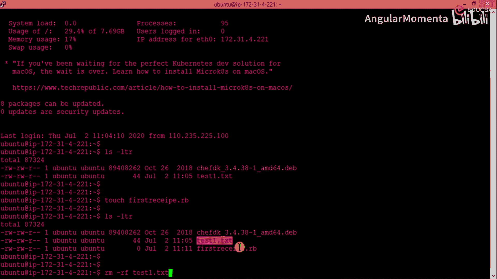
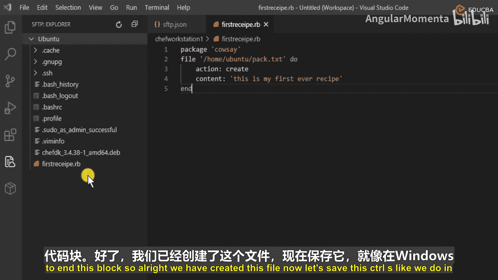
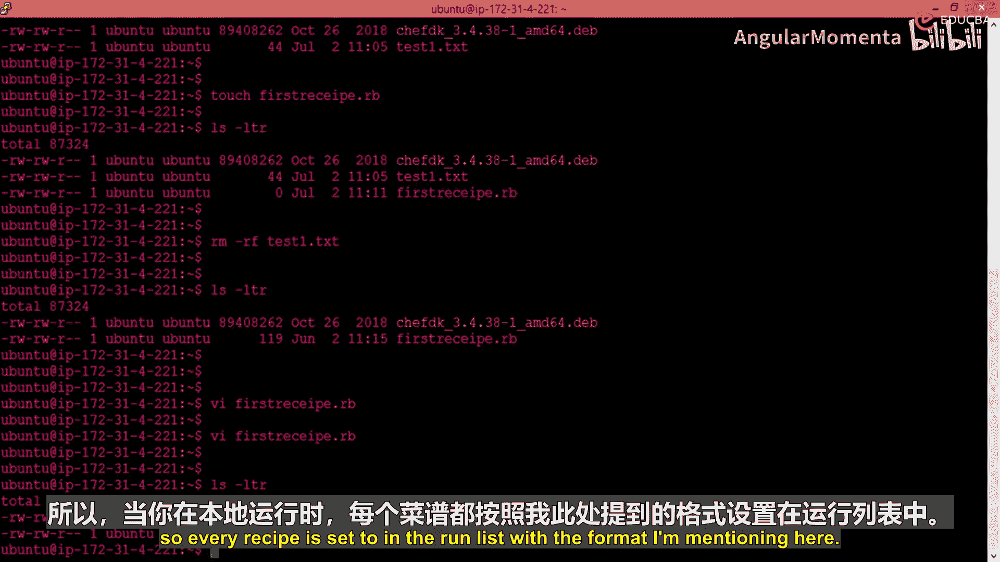
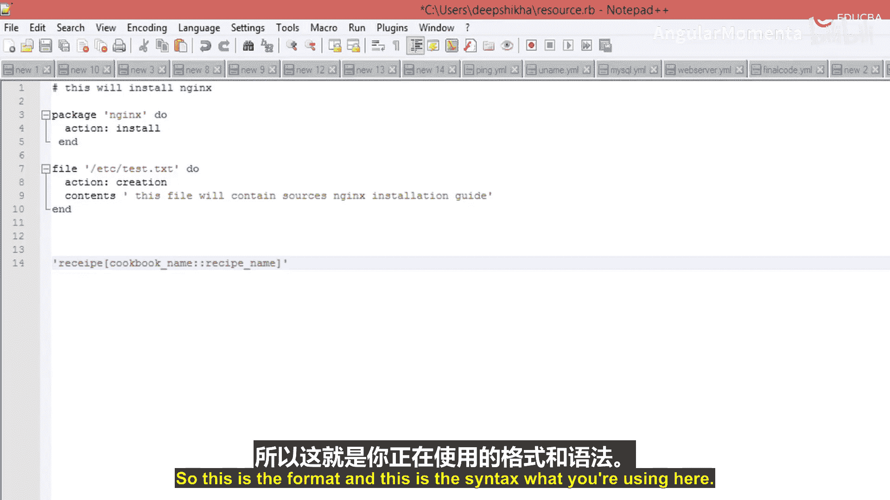
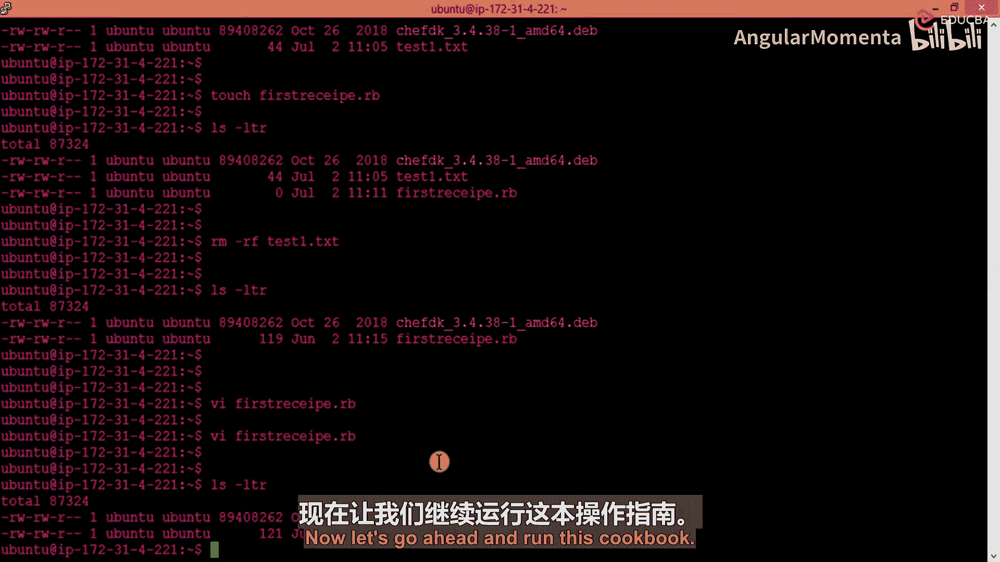

# 【EDUCBA】应用Chef实现云基础设施项目自动化 ｜ Apply Chef to Automate Cloud Infrastructure Project p07 01_03_03_在本地模式下部署配方 -BV134F1zaEdz_p7-

Well， now we are in process of creating our first recipe。 So in our self recipes。

 it declares our configuration policy。 that is resources and resource type。

 which are everything necessary to configure part of our system。

 So basically it recipes are dot RB file。 Let me create one empty file with extension of RB。

 So let's call this as a。First。The recipe。t RB file I am just creating one empty file here so by extension do RB it means it's a ruby file now we will use this ruby file to configure our system like I will be just testing our testing our system and so well why ruby so ruby is a dynamic language which is general per programming language and actually this is very easy and to use and read so lets we have created this let's check this。

First， let's remove the TXT file what we have created here。Now I will go to Vigil Studio code。

 Here is our Vigil Studio code。

Now， let's refresh this content。 This is our machine， and this is all the host。

 Let's refresh the content and check whether the A file has been created or not。Oh， yes。

 Here is our first recipe file。 right click and the de local。

Now we'll be writing the piece of code here and see if we can automate the things。

Let me first declare the resource type。 I will be installing one package and let's say the package is Ki。

And。And apart from creating the。Package I'll be creating when more use them in resource。

 I'll be using file resource。And I will force this file resource at home。Open to。

And let's name it this as。Pac dot Txt。So we are just testinging our first recipe file and so we have declared the resource typeer file now we' will start the ruby block that is with started do and they will be the first action what we have to do So in actions it is like it has to。

Create the file。And in content section。It should have。H， this is。咪。First。A recipeci。And now。

 we have to。End this block。So alright， we have created this file now。

 let's save this control S like we do in Windows system and now we'll go here and check the contents here。

So our first content is， so whatever we have edited there。😔，It's present here。

So our visual studio code is working absolutely fine。

 Now we are running on this workstation and the tool what will be used to run this recipe file as your chef client So you must be I mean worried about what is Che client So I hope you will be having a clear knowledge。

 but let me re or let me just give another picture of what is Che client agents。

 So whenever you run this RV file right dot extension file R we in Che it。The chef client agent。

 which takes care of all of your automation what you are doing in is do R file。 So in nutsll。

 you can just say Che client agent is where all magic of chef happens。

 So Che client is an agent that runs on each machine locally which is managed by chef。

 So when chef client runs， it check the state of your resources like resources we have defined in this file right。

 So it'll check the state of resources and if needed， it would bring those items into desired state。

So what it is L module if you check here。This is a desired state。

 it is first thing it should download this thing upload this package and mean install this package and when you are creating this file resource it should create it and this is the desired state。

So how to run this chef client agent， So it's literally command line executable agent that is given a list of recipes to examine when it just to run So when you are running this command we are just providing them the list of recipes and the list of runs which it has to run and when we enter this chef client it will chef client will step through each resource and bring our machine into what were proposed way we have mentioned well when you set to run this chef client notice that we are just creating on this master mode and we are running the client now so basically we are running on local mode we are not automating here and on the other notes which is like hosted by your chef sh we are just testing our information on the local mode So local mode is a very important definition of chef it likes if you say what is how do you define and how do you automate through local mode you can just mention like the chef。

line whenever it is local mode or if it' is a default mode so in default mode what is there I mean it is in default mode everything will be automated through your chef server you are uploading your recipes to your chef server and it is chef server which is taking care of all your things Well we can see the chef client doesnt care where its recipes are。

And from where it came， however， its default mode receives default mode reaches out to a chef server for policy to be applied。

 We are not using our default mode were just using a local mode So if your recipes are found locally like we have recipes here in our local system This is our recipes then we must overwride this behavior because when you run the chef client it will in default mode if we are not mentioning any parameter。

 it will default go to server So in order to overwride this。

 we have to exclusively mention that we are running on local machine like locally right now we are running this chef client locally Later on one other videos will be running chef client on the default mode Well applying to the recipe in the local mode will execute the code using chef0 So the local mode flag is that hyphen iPhone local hyphen mode flag we should be writing now and which will allow for chef client to look locally for the recipe so we have。

Of pass that parameter， what I will be pass。 So when you are running this locally。

 So every recipe is set to in the run list with the format I am mentioning here。 So inform it。

 you can just mention。

Deefine recipe here。 and here it comes for brackets。 and then you mention cookbook。

 Don't worry what cookbook will be checking this soon。And the name of the cookbook。

 And then it comes your。recipeci and the name， recipe recipe name。

If you don't define inside cookbook that's okay， we can just run it for now and we'll close this。

 So this is the format and this is the syntax what you are using here。

 Now let's go ahead and run this cookbook I mean run this recipes。

