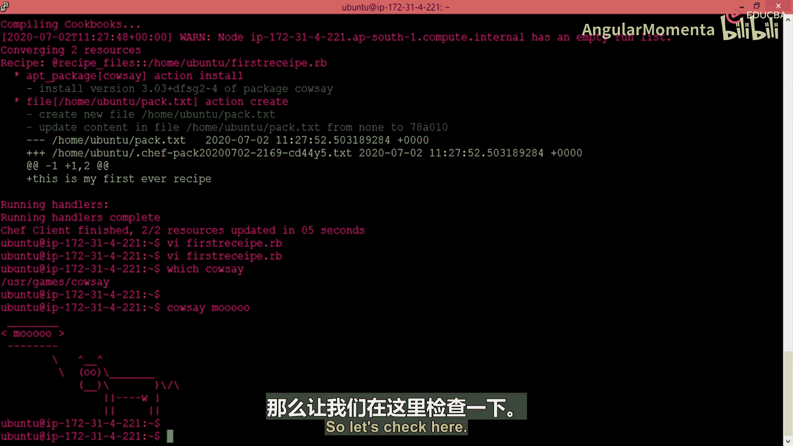
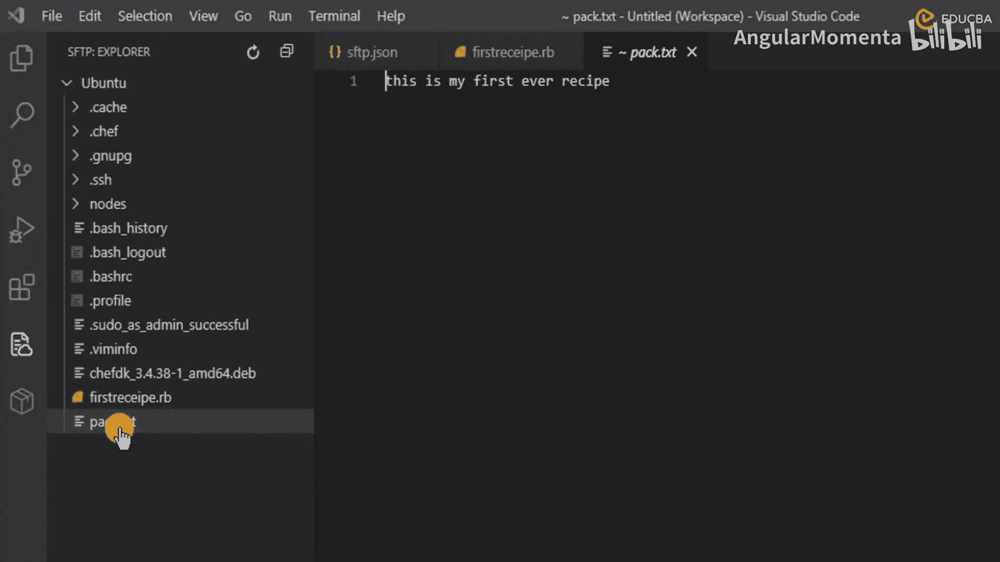
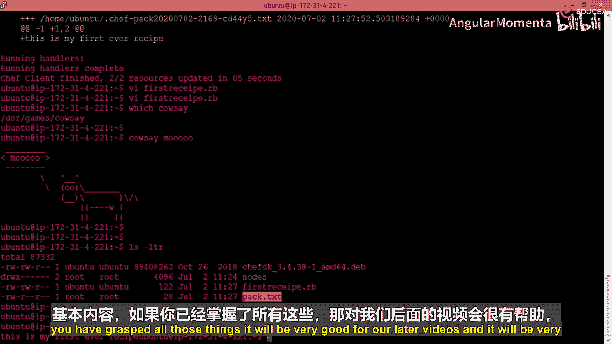

# 【EDUCBA】应用Chef实现云基础设施项目自动化 ｜ Apply Chef to Automate Cloud Infrastructure Project p08 02_01_01_在本地模式下部署配方继续 -BV134F1zaEdz_p8-

Now， let's execute this。Since we are into12 machine to directly run you need to be super user and you can be used the root userr but to demonstrate it using order12 you can just mention shdo so put shdo here and then it comes your chef client you have deify chef client here and it follows by we are actually if you are not mentioning this thing it will be as difficult now we are since we are over this sinch。

 we have to make it as look now we are good to run this recipe executing this recipe now so your recipes is getting executed here。

Well， it shows some syntax alert。Fix syntax error here。Well。

 if you notice here in the content section I have just mentioned column。

 which is only specified for actions， so by mistake I have just mentioned column， just remove this。

And I think we should be good now here。And let's run this command again。

And let's see if it is starting。 I think that has not been compiled because it was not saved properly。

 Let me save it again。 Well， I have saved their file actually correctly。

 because that time it was not saved because I was in。

Now via editor I have not saved that properly and I have saved it。

 and if you see here this recipe file was executed well to check what all things has been done。

You you going to see this。Chef Klein finished two out of two results updated in 0。5 seconds。

So our self client has finished a building。Two out of two resources， we have defined two resources。

 Remember one package and one file resources。And we see several warnings， here。This is a warning。

And these is the warnings。And you can safely ignore these warnings for now。

 because when you will look at this warning， it shows no cookbook directory format that because we have not created any cook directory。

 even if you don't create cookbook directory。You are good to run your recipe file because even if you don't know right。

 if you don't have any book， you just don't need it mean doesn't mean that you cannot read。

So the listist， I mean， the book of recipes is like cookbook。

 so we can easily run these things after that your。Shef clientt has started executing。

 She even checked the version here of the chef client。 What is it's running on again， Its。

 it gives a cutelyric warning hair that。Our run list isn't。 Yes。

 our run list is we have not specified anything。 Well。

 then Che clientss goes in process of compiling our recipes。

 It examines each chef for resources it finds after that it converges So what is convergence here。

 converging two resources。 So convergence is a process of executing all the compile resources。

 So whatever resources it has compile。 suppose we were getting errors before this convergence resources right because it was compiling。

 So while compiling it has compilation issues So it has thrown error。

 So once you are reaching at this place， it means you are compilation is good now it is executing your compilation that is convergence So that process of executing all your executing all your compile resources and now we will see summary of the printed after the recipes which we run。

 So these are the things well do you notice we have two statics here。

1 for your a package and one for your file， Our package resource compile from a generic package to an a package for Ubutu。

 See what happens when we wrote this command right。 I will show you here。We just mentioned a package。

 We didn't mention like whether it should be a young package or it should be a package。

 So this is the beauty of chef。If you are reading the writing the same code in Papeto or anciible。

 you have to explicitly mention what package you you wna you wna use for this。

 If you are using open to machine， then you have to mention you are using app if you are using other OS operating system you will be mentioning using Y model。

 So this is the beauty of chef client， which will be like identifying your resource type and your Os and all。

 So you don't need to mention it explicitly it will be if you mention generic it will be fine our package resource what you mentioned resource compiled from a generic package to an a package for open to So it means your chef understands that we are writing code on open to machine。

 So where app pack is a package manager， we are also taking the action of installing the package。

 Do you see this action install versions No in the code we have written like install。

 Do you see we have not written action here action to install why。

 because if you are omiing this action right。So by default for a package。

 chef will understand that we have to install the package。

You got that next so we have installed a particular version and this is a version or it it may be the latest version available for the package so we can check our work by typing which cowi so we have installed our package whatever you want installed that was cowi so we can just check whether cowi has been installed or not if we put cowi here you will get to know this is cowi。

This file has been installed and it is that this location Now。

 if you want not say you wantna test our CA application， then you can just mention like this。

You can just see cowey， followed by。Do you see when followed by if you are writing arguments。

 you will see a cute little cow here， So your cow has been successfully installed。

 And when your passing argument， you can see all the changes Apart from that what it has done。

Can see plus sign here。That it has appended the contents of the file。And additionally。

 we should make sure that our file has been created， and it contains。

The file it contains the contents what we have updated。

 so let's verify that too for our mean plus to be be sure。

 So if you see the file has been created here action is created if you see green thing then this has been done successfully and content is also done。

 so let's check here we can check from visual studio code as well。

If you go ahead and refresh。You will find a lot of things here。Do you say this？

Inside this first recipe B we have our back dot Txt and this shows this is my first ever recipe what we have created if you see here。

 you can do the same here。

Back to Tx is there， you can just add the contents。And。You are good。

 So what happened We have just created our first recipe。Now this was the major thing。

 whatever we will be doing now will be like well be inserting the recipe in our cookbook and after executinging them locally like when you are sure but we are good with local we be uploading on the server and through server your recipes will be uploaded to your host machines so this is a basic thing if you have grasped to all those things it will be very built for our later videos and it will be very handy and。

